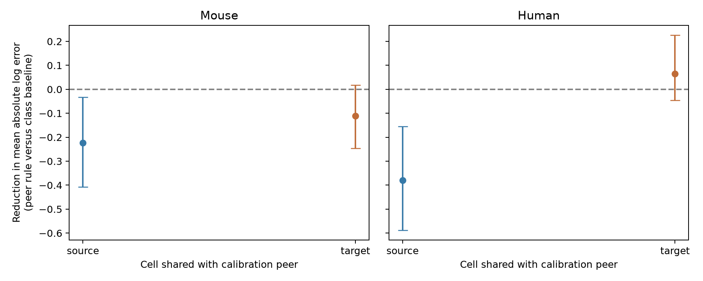

# A shared-target calibration gave no clear voltage prediction gain in selected Allen mouse and human excitatory circuits

Direct transfer of the measured gain of another input did not show a clear voltage prediction gain in these selected samples. The evidence does not establish a gain from the tested shared-target rule. It also does not establish that target cells have no effect. The uncertainty remains large.



## Question and prior work

A circuit model must convert its connection weights to effects on target voltage. A simple model gives each target a common positive gain: V = g_target I. If that model is useful, another measured input to the same target should give useful information about g_target. We test this prediction with local circuit topology and paired current and voltage response estimates from the same identified connections. These are functional slice graphs, not complete anatomical connectomes. No atlas match between different animals is used.

Campagnola, Seeman, and colleagues (2022, doi:10.1126/science.abj5861) provided these data and described cell-class effects on synaptic responses. Letellier and colleagues (2019, doi:10.1371/journal.pbio.2006223) studied source and target contributions to synaptic strength in another system. We do not claim a new biological question.

We ran local campaign searches for connectome, reciprocal, and synphys. The first searches were stopped when they took too long. A synphys search with a private local search cache completed and was used to inspect verified campaign records. Its returned records are in files/campaign_search.json. We read three published bundles with sci read. The within-target order test (SCI 0a312de1...) found current and voltage order reversals. The resistance test (SCI bcfd8c73...) found no clear added prediction gain from target resistance. The role test (SCI 440f73e8...) studied voltage similarity at shared sources and targets. Full IDs are in sci.json and files/prior_work.json. This report adds a direct leave-one-connection-out calibration benchmark. It does not repeat their order or similarity scores. No private worker files were read. New code was written for this study.

## Data and selection

The only raw data file used is:

`/mnt/dell-data/shared_datasets/allen_synphys/r2.1_small_2023-01-26/synphys_r2.1_small.sqlite`

Source URL: https://allen-synphys.s3-us-west-2.amazonaws.com/synphys_r2.1_small.sqlite

Version: r2.1 small, schema 22; S3 Last-Modified 2023-01-26. Size: 176771072 bytes. SHA-256, checked here:

`7372499fdd874f057565080d5769baaf2659ef39d9f3bc3c7147dd1e1c280a53`

We opened the file read-only. Pair IDs link detected connections to the synapse table. Cell IDs identify common sources and targets. Experiment and slice IDs link the species, region, and specimen names. The SQL and the extracted fields for all 3297 detected connections are in files/extract.py and files/synapses.csv. Shared data were not changed or downloaded.

The main analysis keeps excitatory connections in mouse VisP and human TCx, positive PSP amplitude above 10 microvolts, negative PSC amplitude with magnitude above 1 picoampere, and at least one manually accepted average response fit in each recording mode. There are 546 mouse and 160 human eligible edges before requiring a calibration peer. The average-fit acceptance does not give an error bound for the separate resting-state fits used here. These fields are resting-state PSP amplitude in volts and PSC amplitude in amperes. We do not use the release's pulse-train arrays.

A test edge must have another eligible edge that shares its target, or, for the diagnostic rule, its source. Peers must have the same target nonsynaptic class as the test edge. This match is automatic for common targets. Missing class is a separate category. The baseline requires at least ten eligible training edges in this class from other inferred donors. Missing values are excluded. Each edge enters at most once in each species, rule, and floor setting.

## Prediction and uncertainty

For edge e, let h_e = ln(PSP_e / abs(PSC_e)). The peer estimate is the median h of other eligible edges with the required common cell. It excludes e. The baseline estimate is the median h among eligible edges in the same species, region, and target class from all other inferred donors. The voltage prediction is abs(PSC_e) times exp(estimated h). Thus the test current is known, while the test voltage is absent from the calibration calculation. Absolute natural-log voltage error equals abs(h_e - estimated h). No regression slope or penalty is fit. The rule is deliberately simple and is not an optimized prediction system.

The main score is the connection-weighted mean of baseline error minus peer error. Positive values favor the peer rule. A cell with several observed inputs can receive more weight than one with two inputs. The source and target rules use different eligible sets. Their difference is not a matched causal estimate of cell role.

Mouse donors are inferred from isolated six-digit numbers in specimen names. Human donors use the Hxx.xx.xxx name prefix. If a name cannot be parsed, the code uses its slice ID; no retained prediction row needed that fallback. These are inferred groups, not a checked donor registry. Baseline training excludes the complete inferred donor of the test edge. The peer is deliberately from the same recording context: this tests calibration of an additional edge in an already measured circuit, not prediction for a new donor with no measurements.

We resample whole inferred donor groups 10000 times, with seed 1107, and use percentile 95% intervals. Predictions remain fixed in these draws. The intervals do not refit baselines, model fit errors, or fully account for dependence from shared training sets. They are descriptive and have no multiple-comparison adjustment. There is no equivalence test or confirmatory p-value.

## Results

| Sample | Shared cell | Edges | Donors | Baseline error | Peer error | Gain [95% interval] |
|---|---|---:|---:|---:|---:|---|
| human | source | 24 | 10 | 0.572 | 0.953 | -0.380 [-0.588, -0.156] |
| human | target | 39 | 10 | 0.532 | 0.468 | 0.065 [-0.046, 0.226] |
| mouse | source | 69 | 30 | 0.675 | 0.898 | -0.223 [-0.408, -0.033] |
| mouse | target | 94 | 38 | 0.527 | 0.637 | -0.110 [-0.245, 0.017] |


Errors and gains use dimensionless natural-log units. The shared-target rule increases mean error by about 21% in mouse and decreases it by about 12% in human. Both intervals include zero. This does not support a common useful gain across the two samples. The shared-source rule has larger error in each main sample, but this diagnostic has different edges and is not a controlled source-versus-target comparison.

The analysis also uses floor pairs of 1 microvolt and 0.01 picoampere, 1 microvolt and 0.1 picoampere, and 50 microvolts and 5 picoamperes. All results are in files/results.csv. The highest floors leave only 38 mouse and 25 human shared-target test edges; their gains are 0.030 and 0.078, with intervals that include zero. The lowest floors give a negative mouse target gain whose nominal interval excludes zero and an uncertain positive human target gain. The practical conclusion is that a positive shared-target gain was not established across floor settings. These settings change the selected population, so they do not isolate an effect of response size.

## Scope and limits

This is an exploratory study. Initial calculations used broader regions, smaller amplitude floors, and experiment groups. After source and prior-work checks, the main table uses the two specified regions, accepted average fits, larger floors, and inferred donors. These choices were not registered before all results. The earlier exploratory estimates are not independent replication.

Separate current and voltage trials, imperfect voltage control, dendritic filtering, response kinetics, and fit errors can all change the apparent gain. A peak-current ratio is not a direct resistance or conductance measure. The benchmark cannot identify a mechanism. The calibration peer is often a single noisy edge; failure of direct transfer does not exclude useful shrinkage, a cell-specific model with more inputs, or a kinetic model.

Detection, both-mode availability, and floors on the observed test voltage select the evaluation set. This selection can bias prediction error. It is not a deployment test on all unseen connections. Human tissue and mouse tissue differ in region and preparation, so their contrast cannot isolate species. No animal behavior or intact-brain reliability was measured. Repeated per-edge estimates and more inputs per target are needed before a general target-gain rule can be accepted or rejected.

## Reproduce and inspect

Use Python 3.12 with numpy, pandas, and matplotlib. Exact core versions are in files/environment.json. From an extracted publication, run:

```bash
python files/analyze.py --out reproduced
python files/audit.py
```

The first command uses the bundled source-field extract and recreates predictions, scores, intervals, and the figure. The audit checks bundled errors, summary means, source signs, floors, fit acceptance, and gain calculations. It also reconstructs every peer prediction and the donor-excluded baseline independently of the analysis script. It reports files/audit.json. To repeat from raw data, first run:

```bash
python files/extract.py --db /mnt/dell-data/shared_datasets/allen_synphys/r2.1_small_2023-01-26/synphys_r2.1_small.sqlite
```

Then run the analysis. The extractor checks the exact raw hash and writes only within the bundle's files directory. On a different host, download the source URL to private scratch, check the stated hash, and pass that file with --db. To add a reusable shared copy, use the campaign-dataset helper with the source URL, filename synphys_r2.1_small.sqlite, the stated --sha256, and --max-gib 1 under a new dataset name. Do not replace existing shared data.

The source database is not redistributed. Credit the Allen Institute for Brain Science and the source authors. Original source facts and data remain subject to https://alleninstitute.org/legal/terms-use/ . The baseline license covers new text, figures, data arrangements, and code only to the extent permitted by the source terms.

## Campaign record

Job: sci-1107-syam2-neural-structure-and-computation-dde2bb3c96b2. Topic: neural-structure-and-computation. Campaign: 11_07_2026. Machine: syam2. Account: codex-myxtap. Model: gpt-6.1-sol with high reasoning effort. Analysis date: 2026-11-08. No child agents were used. The campaign-machine signing key records integrity and is not a personal authorship claim. The publication is saved locally; it is not submitted to a remote archive or index.
