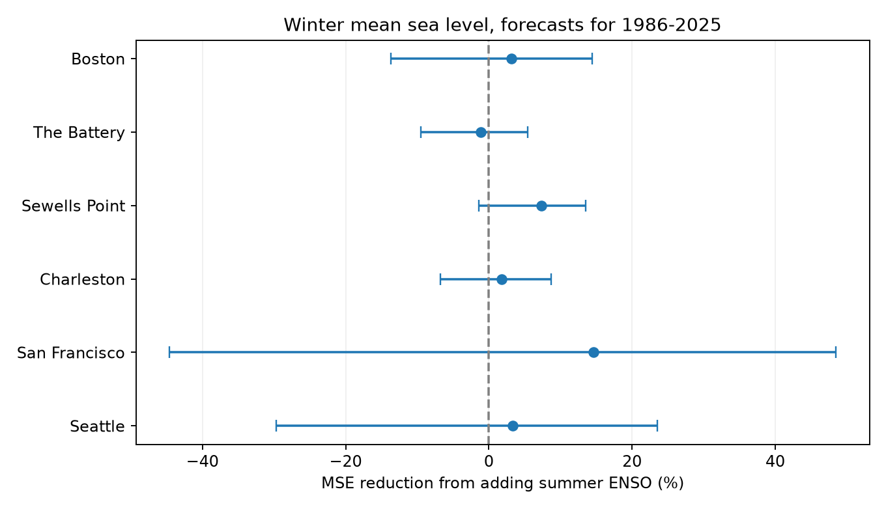
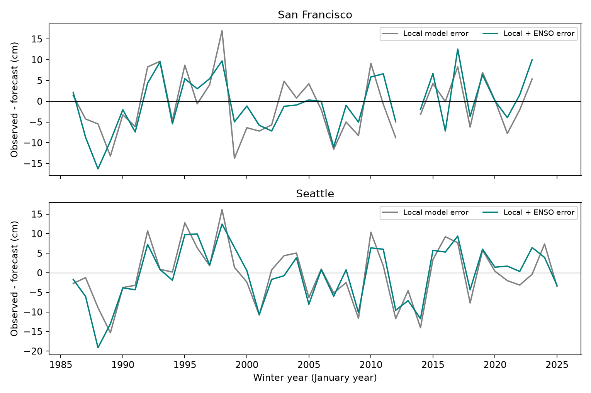

# Summer ENSO gave uncertain winter sea-level forecast gains beyond local summer level at two Pacific gauges in 1986-2025

We tested whether July-September Nino 3.4 improves forecasts of December-February mean sea level when the model already has local July-September sea level and a time trend. The equal mean of the two Pacific site skill estimates was 8.98%. The conditional 95% five-year block interval was -32.87% to 32.99%. Positive skill means lower mean squared error. The interval leaves both loss and gain possible. This is not evidence that ENSO has no effect.

When we removed the 1998 and 2016 winters from evaluation, skill fell to 1.51%, with an interval of -38.94% to 26.78%. This check kept the original training histories. It shows sensitivity to these test winters; it does not measure their influence on later fitted models. All six individual site intervals included zero.

## Question and prior work

Mean water level sets the height from which tides and storms act. A useful seasonal mean forecast could thus help coastal planning. This test measures seasonal mean levels, not flood counts, storm surge, damage, or recovery.

[Hamlington et al. (2015)](https://doi.org/10.1002/2014JC010602) used sea-level reconstructions and tide gauges to estimate the ENSO contribution to US coastal sea level. [Khouakhi et al. (2019)](https://doi.org/10.1016/j.advwatres.2019.07.007) studied seasonal prediction of high sea-level frequency with ENSO patterns. We could inspect the latter study's search abstract, but its repository and publisher full text could not be retrieved. We do not claim to reproduce its methods or compare forecast scores with it.

The campaign [precipitation forecast study](sci:sha256:613b0ddfe29853a816c1880f84c061841d758ecaa5365c184a32464943d46fda) used the same fixed ENSO source. The campaign [monthly peak study](sci:sha256:78285c2f5e450f277e3b512035e713b12fc6379d05825aa601bfbbcc92683210) described the shared six-gauge sources and their quality limits. We read both publications and wrote new analysis code. We reuse their shared raw sources, not their derived results. Our added contribution is a fixed-data chronological forecast benchmark that tests the extra information in ENSO after local summer level is known. The campaign search is preserved in `files/campaign_search.json`. The search does not prove novelty.

## Data and support

We used six NOAA CO-OPS monthly mean snapshots for 1960-2025, retrieved on 2026-11-08, and the NOAA CPC ERSSTv5 monthly Nino 3.4 anomalies relative to 1991-2020, retrieved on 2026-11-07. The exact paths, source URLs, source metadata, byte counts, and SHA-256 hashes are in [provenance.json](files/input/provenance.json). There is no separate NOAA release identifier for these API responses. Snapshot hashes define the version. We read the seven source files in place and verified each recorded hash. We did not modify shared data or download new data.

Each source monthly MSL is in meters relative to a fixed local MSL datum. It is an observed monthly level, not zero by definition. The series includes local land motion. Cross-site datum differences do not enter the forecast skill comparison. The API requests specify metric units. NOAA does not apply the requested time zone to monthly products.

The bundle preserves all 4,738 monthly source rows in the requested range, with the fields used here. Six extra January 2026 rows returned by the source API were excluded. The fixed ENSO extract includes 1960-2025 only. No 2026 observation enters any fit or target. The Nino 3.4 anomaly is column 10 in the original source, not its absolute temperature or another Nino region.

A winter year denotes its January: winter 1986 is December 1985 through February 1986. Its predictors are July-September 1985. The summer and winter averages give each month equal weight. All three months in both seasons must have finite MSL and monthly inferred flag zero. We do not fill gaps. The result has 360 complete station-seasons from 1961-2025. `quality.csv` lists exclusions. Test counts are 36-40 per station. Missing seasons can bias the result if loss depends on water level.

The [plan](files/plan.md) was written before outcome fits. An initial implementation tried to use the six-site intersection for all training data and stopped at a coverage assertion before fitting. The [support correction](files/coverage_note.md) records the switch to the planned separate-station fits. Models within a station always have identical support. Site supports differ. At The Battery, winter 1986 also lacks the minimum 20 earlier complete training seasons. We preserve this missing forecast.

## Method

Each station has four ordinary least squares models:

- Trend: intercept and (winter year - 1980)/10.
- Local: trend terms and local summer mean level.
- ENSO: trend terms and summer Nino 3.4 anomaly.
- Both: trend terms, local summer level, and summer Nino 3.4 anomaly.

For each test winter from 1986 through 2025, we fit only earlier complete winters, with at least 20 training seasons. The primary model uses an expanding history. We make no forecast when a predictor or target is missing. Thus the evaluation is conditional on complete inputs and outcomes. No model uses a target winter, a future target, or a full-period fitted anomaly to prepare its predictors. The fixed retrospective ENSO baseline and source revisions still use information unavailable in historic real time. This is a chronological hindcast, not an operational forecast test. Data release delays were not modeled.

For each site, skill = 100 * (1 - MSE_both / MSE_local). The primary estimate is the equal mean of these skill ratios for San Francisco and Seattle. It is not a ratio of pooled MSEs, and the sites are not a random coast sample. The four Atlantic site scores are secondary comparisons. Their intervals are pointwise and have no multiple-test adjustment. We make no positive site significance claim.

We use 9,999 circular moving-block bootstrap samples of the 40 test calendar years, with five-year blocks and the same sampled calendar positions at every station. Missing seasons stay missing. Within each draw, site MSEs use available matched forecasts. Any draw with no valid forecast at any site is rejected and redrawn. The seed is 11072026 plus block length. Primary index arrays and scores are saved in `draws.npz`. Intervals are the 2.5th and 97.5th percentiles. Training models are held fixed. These conditional intervals describe variation among observed error blocks. They do not include training estimation uncertainty, source error, or future changes. Forty years provide limited information on extremes and long dependence.

## Results

| Station | Test winters | Local RMSE (cm) | Both RMSE (cm) | Added ENSO skill (%) | Pointwise 95% interval (%) |
|---|---:|---:|---:|---:|---:|
| Boston | 37 | 4.90 | 4.82 | 3.16 | -13.68 to 14.47 |
| The Battery | 36 | 5.91 | 5.95 | -1.10 | -9.47 to 5.39 |
| Sewells Point | 40 | 6.97 | 6.71 | 7.34 | -1.42 to 13.52 |
| Charleston | 38 | 7.11 | 7.04 | 1.78 | -6.73 to 8.69 |
| San Francisco | 37 | 7.10 | 6.56 | 14.60 | -44.63 to 48.49 |
| Seattle | 40 | 7.25 | 7.13 | 3.36 | -29.65 to 23.55 |

ENSO-only skill against the trend-only model was 23.00% at San Francisco and 20.07% at Seattle. Local summer level alone had skill of 9.21% and 14.24% against that same trend baseline. These are point estimates with different baseline denominators; they must not be subtracted as an additive information split. The smaller added ENSO scores against the local model are consistent with some shared information between local level and the ENSO index. They do not establish a physical pathway or redundancy. Local wind, pressure, circulation, and other climate modes can affect both predictors and outcomes.

## Checks and limits

| Pacific check | Skill (%) | Conditional 95% interval (%) |
|---|---:|---:|
| Primary | 8.98 | -32.87 to 32.99 |
| First 20 test years | 6.59 | -64.02 to 39.29 |
| Last 20 test years | 9.15 | -28.56 to 31.80 |
| Exclude test winters 1998 and 2016 | 1.51 | -38.94 to 26.78 |
| Use prior 25 calendar years for training | 9.61 | -27.08 to 30.66 |
| Add quadratic time to both models | 9.25 | -20.19 to 27.50 |
| One-year uncertainty blocks | 8.98 | -35.81 to 34.59 |
| Ten-year uncertainty blocks | 8.98 | -35.41 to 33.35 |

The paired-Pacific check, added after the main analysis, keeps the same 37 evaluation winters at both sites. It gives 8.79% skill without refitting. This is close to the primary score. It is a support check, not an additional hypothesis test. `influence.csv` gives every one-test-winter deletion. The full forecast and coefficient tables let readers inspect model stability. The prior-25-year check also requires 20 complete training seasons, so its evaluation support can differ from the primary support. Sensitivity scores do not validate a preferred alternative model.

The null result is limited to the predictor, model, sites, seasons, and support tested. Other ENSO indices, nonlinear responses, additional ocean data, longer records, or dynamical models can give different skill. Six harbor gauges do not represent all coasts. A mean-level forecast does not give tidal phase, surge, wave runup, flood frequency, or a safety threshold. We did not estimate a climate cause, a trend acceleration, or a change in ENSO physics. Retrospective source processing, gaps, few large events, uncertain dependence, and changing coastal conditions limit inference.

## Reproduce and inspect

The package includes exact used-field inputs, source provenance, code, annual values, quality flags, all 228 valid site forecasts, model coefficients, uncertainty indices, sensitivity results, and two figures. Full raw JSON is not duplicated. The source hashes identify every raw file actually used. `input_hashes.json` identifies the derived input files.

1. Run `sci verify BUNDLE.zip --json`, then extract the verified ZIP.
2. Install `files/requirements.txt` in an environment outside the bundle. The run used the versions in `files/results/run.json`.
3. From any directory, run `PYTHON=/path/to/python sh files/reproduce.sh /absolute/output/path`. On campaign hosts the script uses `campaign-compute`. Elsewhere it runs Python with library threads set to one. The small analysis used less than one minute on this host; allow 1 GiB RAM.
4. Compare the new CSV, NPZ, and JSON files to `files/results/`. The signed repeat record gives a same-host byte comparison. Image metadata may differ between library versions.
5. To rebuild input extracts, run `python3 files/export.py --store /mnt/dell-data/shared_datasets --out /absolute/new/input`. It verifies raw hashes before reading. Optional `python3 files/retrieve.py` uses the locked campaign helper for the seven exact source URLs and required hashes. Later source revisions can prevent byte-identical retrieval. Do not replace a shared dataset to bypass a hash failure. All numerical work can run offline from the bundled inputs.

The separate audit uses decimal averages and a second regression implementation based on normal equations. It checks annual means, predictor alignment, training restrictions, all valid forecasts, site scores, and every primary bootstrap draw. Its maximum forecast difference was below 2e-15 m. All checks passed. This is a same-worker numerical audit, not external peer review.

## Campaign and rights

Job: `sci-1107-syam2-earth-and-ocean-sciences-d8e178bdb6ca`. Topic: `earth-and-ocean-sciences`. Campaign: `11_07_2026`. Machine: `syam2`. Account: `codex-myxtap`. Model: `gpt-6.1-sol`, high reasoning effort, through the Codex harness in T3 Code. One worker did the work; no agents were launched. Context is also in `files/context.json`. The campaign-machine signing key is not a personal authorship claim. Keys are outside the publication. The signed bundle is saved locally only.

The SCI baseline license covers text, derived evidence, figures, and code. NOAA source data are US government data. Source attribution and query conditions remain in the provenance record. Cited papers are not included or relicensed.
