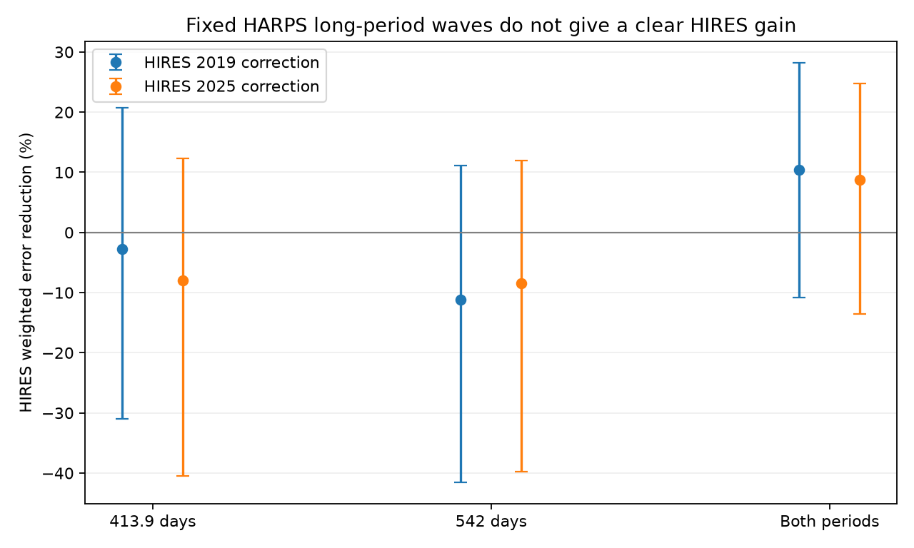

# Fixed 413.9-day and 542-day HARPS waves give no clear HIRES error reduction for GJ 273

The fixed two-wave model gives a small HIRES error reduction, but the uncertainty includes zero. This study finds no new planet or new signal. It supplies a test of whether known disputed signals transfer between instruments. It does not exclude the proposed outer planets.



## Question and prior work

Does a circular signal at 413.9 days or 542 days, fitted only to HARPS, reduce error in the public HIRES velocities of GJ 273? A circular planet gives the same velocity period, amplitude and phase in both instruments, apart from their velocity offsets. Stellar activity, sampling, instrument drift and noise can limit this agreement.

Astudillo-Defru et al. (2017) found the known 18.65-day and 4.72-day planets. Tuomi et al. (2019, arXiv:1906.04644) proposed two longer periods from combined data. Pozuelos et al. (2020, doi:10.1051/0004-6361/202038047) review the outer candidates and the competing activity interpretation. These are known signals. We do not claim priority for their identification. Our result is the fixed-wave transfer score and its stated controls, not a new fit of the published full planet model.

Before the precise test, we searched the campaign for astronomy, GJ 273, GJ273, Luyten and 273. Searches for 273 were checked for unrelated number matches. No returned title or abstract described this target test. The search is bounded and is not proof of novelty. We also read the published KOI-3105.01 model check, SCI 1611bbc167858d6887a7988ea13de5d7d294c913f2bad4e038357d156198c28f. It shows why an anomaly needs separate model checks. It supplies no numerical input here.

## Data and provenance

We reuse three completed shared datasets. No shared data were changed or downloaded. Exact source URLs, retrieval times, byte counts and SHA-256 values are in `files/provenance.json`. The immutable response snapshots and original provenance records are also in `files/raw/`. Shared paths use the supported compatibility mount; that mount points to the current SSD store.


- `/mnt/dell-data/shared_datasets/gj273-harps-2017-a88-f0992a2e/gj273_harps.tsv`
  SHA-256: `564fefc68768b5c5947d95ca50c186752fab55e3753be81f15457de2155297da`.

- `/mnt/dell-data/shared_datasets/gj273-hires-talor2019-f0992a2e/gj273_hires_corrected.tsv`
  SHA-256: `a9bcafd27097104fefbcf3ee2f6659c7af0151ce79f60a0cb8c6ede1f8723fe1`.

- `/mnt/dell-data/shared_datasets/gj273-hires-teklu2025-f0992a2e/gj273_hires_2025.tsv`
  SHA-256: `06bad0f3c65d73f0aa7ba0cd52644106e88c9ea0b91f02f4c1f34d84c5d469c6`.


HARPS has 280 rows from BJD 2452986.769625 to 2457661.897769. The 2019 HIRES table has 75 rows from BJD 2450807.01458 to 2456675.99001. The updated table has 81 rows through BJD 2459546.09451. It shares all 75 old observing epochs to 0.001 day. It adds only six epochs. Thus, the two releases test calibration and a small extension; they do not give two independent confirmations. `extra_hires25_rows.csv` lists the extra epochs. HARPS and HIRES use distinct instruments and exposures, but their dates overlap.

Use all supplied velocity rows with their formal errors. No velocity clipping enters the primary result. We convert HARPS dates by adding 2400000 and velocities and errors from km/s to m/s. We subtract its median velocity as a numerical convenience. HIRES uses corrected RVcor and e_RVcor in m/s. We do not apply a new quality selection to activity-spectrum flags, which do not by themselves define a velocity rejection rule. The full source records remain available for inspection.

## Model and score

Fix P = 18.6498, 4.7234, 413.9 and 542.0 days. These are chosen literature-scale test values, not periods estimated on a new scan. For each period use cos[2 pi (t - 2455000)/P] and sin[2 pi (t - 2455000)/P]. Fit by weighted linear least squares. The error scale is sqrt(formal_error squared + j squared). The primary j is 2 m/s. We also test 1 and 3 m/s. This j is a weight floor, not an estimated physical noise process.

HARPS has a constant, a linear time term, the two known short-period waves, and either one or both long waves. Transfer only the fitted long-wave coefficients to HIRES. In HIRES, fit its own constant, linear term, a step at BJD 2453230 for the 2004 upgrade, and both short-period waves. The step permits a remaining offset after catalog correction. It does not measure the hardware change. Separate slopes absorb slow drift, including any linear secular acceleration. No disputed-wave coefficient is fitted to HIRES in the primary score.

Let A be the HIRES nuisance design, L the long-wave design, c the HARPS long-wave coefficients, and R the weighted residual operator for A. Let r = R(y) and v = R(L c). Then the baseline residual is r and the transferred residual is r-v. Define gain = 1 - sum[((r-v)/e)^2] / sum[(r/e)^2]. Positive gain means less weighted error. This projection makes the short-period fit identical in its role under both alternatives. It avoids attributing a changed short-planet coefficient to a long wave.

The first exploratory score, in `transfer_scores.csv`, instead transfers all fitted planet coefficients. It mixes changes in the short and long waves. The primary score is `isolated_scores.csv`. The distinction was made after the first score was inspected. This is an exploratory study, not a registered blind test. In addition, the literature period selection used HIRES. The present instrument transfer is conditional on those selected periods.

## Results

| Wave | HIRES release | Error reduction, percent | Resampling range, percent |
| --- | --- | ---: | ---: |
| 414 | hires19 | -2.7 | -31.0 to 20.8 |
| 414 | hires25 | -8.0 | -40.5 to 12.3 |
| 542 | hires19 | -11.2 | -41.5 to 11.1 |
| 542 | hires25 | -8.5 | -39.8 to 11.9 |
| both | hires19 | 10.4 | -10.9 to 28.3 |
| both | hires25 | 8.8 | -13.5 to 24.7 |


The table uses a linear baseline and j = 2 m/s. Ranges are the 2.5 and 97.5 percent points of 3000 combined resampling trials. For HARPS, multiply fitted residuals by independent random signs for each occupied 365.25-day block, add them to fitted values, and refit the coefficients. For HIRES, resample occupied 365.25-day blocks of paired score contributions. The time origin for each instrument is its first observation. We keep the test nuisance projection and denominator contributions fixed before block sampling. These are conditional sensitivity ranges, not exact coverage guarantees. They do not include period selection, model error, or all long-range noise. A second table gives 4000 HIRES-only block trials for each of 36 combinations of period model, release, baseline degree and weight floor.

The pair has a positive point score in all primary weight-floor and linear/quadratic baseline tests. Each individual wave has a negative point score in these tests. A pair can fit the same source variation better than either component because each coefficient changes in the joint HARPS fit. This pattern does not establish two planets. In the primary HARPS fit, the pair amplitudes are 1.55 and 1.68 m/s. The single-wave fits give 1.90 and 1.87 m/s. Amplitude alone is not a planet test.

## Instrument, activity and numerical checks

Removing the HIRES step changes the paired gain to 10.9 and 9.4 percent. Restricting to post-upgrade observations reduces it to 3.4 and 1.9 percent. Adding the HIRES S index as a linear nuisance term gives 10.3 and 8.9 percent. `robustness.csv` gives these checks and the fitted template scale diagnostic. That scale is exploratory and has no significance test.

HARPS activity fits use its S index, H-alpha index and line width, separately and together. Missing activity indices remove one row in the affected fits. The pair amplitudes remain near 1.5 to 2.3 m/s. A linear activity term therefore does not give a unique activity explanation. It also does not remove more general activity signals. The input line width and activity indices need not trace the same physical process or have the same noise as RV.

`training_sensitivity.csv` tests a HARPS step at BJD 2457170, a single four-MAD residual cut, and fixed long periods moved together by minus or plus five percent. These are conditional checks, not an orbit search, significance correction or confidence region. Each variant refits HARPS and transfers its long terms. The pair gain rises to 15.2 and 13.6 percent with a HARPS step. The four-MAD cut retains 277 rows and gives 8.2 and 7.6 percent. Moving both long periods down by five percent gives -7.6 and -4.2 percent; moving them up gives -16.9 and -17.5 percent. Thus, the sign is sensitive to fixed period choice. These checks have no separate resampling ranges. Their scores must not be interpreted as independent trials.

Known-signal controls transfer one short-period component from the HARPS four-wave fit and fit the other short period as a HIRES nuisance. The 18.6498-day wave reduces error by 3.3 percent in the older table and 1.0 percent in the update. The 4.7234-day wave increases error by 2.8 and 3.2 percent. A test that gives weak performance even on known planets has limited exclusion power. The controls do not call those planets into question.

The code verifies an injected exact template plus nuisance trend to residual error below 1e-9 m/s. It checks weighted residual orthogonality and compares fitted coefficients with an independent normal-equation solution. `numerical_checks.json` records errors. These checks validate arithmetic. They do not validate the physical model or measure recovery probability in real correlated noise.

## Physical meaning and limits

A circular planet model predicts a fixed sine wave. The pair passes only a weak point-score check in these HIRES data, and its ranges cross zero. A real eccentric planet can depart from this waveform. Period error can change the extrapolated phase over years. A stellar cycle can also have a wave-like part, and seasonal sampling can couple the long waves to trends. A correlated or changing stellar signal can transfer differently at different wavelengths. The present activity regressions and catalog calibration checks cannot distinguish these causes.

We do not fit eccentric orbits, a joint noise process, a full period posterior, or additional spectrographs used in the prior candidate study. We do not search all residual frequencies or estimate a false-alarm probability. The six added HIRES epochs alone are too few for the proposed multi-wave test. Better confirmation would require dense new velocities with simultaneous activity measures, followed by prediction from a model fixed before those measurements. No such confirmation is supplied here.

## Reproduce and inspect

Use a writable copy of this bundle. Python 3.12, NumPy, pandas and matplotlib are needed. Exact installed versions are in `files/environment.json`. No new dependency was installed. Run:

```sh
python files/analyze.py
```

The default input is the included `files/raw/` snapshots. It checks every raw response hash against its original provenance before fitting. To reuse shared data instead, from this job workspace run `python work/result/files/analyze.py ./datasets`. The code writes tables, checks and the static PNG beside itself. It runs on one process, with no network request. The random seed is 900. An offline rerun from the included snapshots completed and reproduced the reported central scores and all numerical assertions. The score tables and numerical results, apart from last-digit linear algebra differences, should reproduce. Provenance input paths change when the bundle location changes.

For a fresh public retrieval, use the exact HTTPS URLs in provenance.json and save each response under its dataset folder and original filename. The VizieR response header includes a request time; a later response can have a different byte hash even if its scientific rows agree. Use the included snapshots for exact reproduction. Do not replace shared datasets. Do not modify a signed bundle; a change needs a new signature.

Job: sci-1107-dell-astronomy-900ade11c48b. Campaign: 11_07_2026. Topic: astronomy. Machine: dell. Account: codex-andrii. Model: gpt-6.1-sol, high reasoning effort, through the Codex harness in T3 Code. The campaign-machine signature proves bundle integrity. It is not a personal authorship claim. The publication stays local to the campaign. Private keys are not included.
