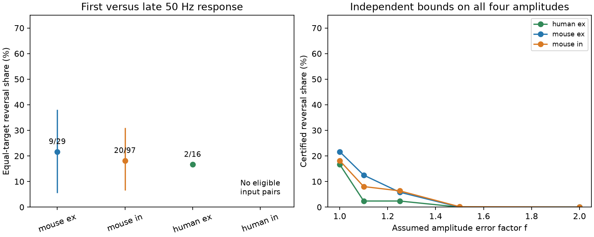

# A factor 1.10 amplitude bound preserves 14 of 31 first-to-late response order reversals in selected Allen slice inputs

## Result

A fixed strength order did not describe both the first and late fitted voltage responses for all selected inputs. There were 31 order reversals among 142 input comparisons in mouse visual cortex and human temporal cortex slices. These comparisons used 206 distinct detected connections and 93 target-sign groups. Fourteen reversals remain under independent amplitude error bounds of factor 1.10. Nine remain at factor 1.25, one at factor 1.50, and none at factor 2. These are exact statements about the released summaries and assumed bounds. They are not estimates of error-free physiology.



| Group | Comparisons | Edges | Targets | Inferred donors | Reversals | Equal-target share | Nominal 98.75% interval |
|---|---:|---:|---:|---:|---:|---:|---|
| Mouse excitation | 29 | 44 | 20 | 14 | 9 | 21.7% | 5.6 to 38.1% |
| Mouse inhibition | 97 | 144 | 66 | 45 | 20 | 18.2% | 6.5 to 31.0% |
| Human excitation | 16 | 18 | 7 | 7 | 2 | 16.7% | 0 to 57.1% |
| Human inhibition | 0 | 0 | 0 | 0 | 0 | Not estimated | Not estimated |

The human excitation interval is descriptive and very weak. Human inhibition has eight eligible single edges but no target with two retained inputs. A zero count there does not show a zero reversal rate.

## Question and prior work

Can one fixed set of incoming weights, multiplied by one positive target gain for each train state, describe these responses? This restricted model preserves the order of any two inputs to the same target. A strict reversal is a counterexample for the fitted summaries. A reversal does not reject all static recurrent models: network effects, input-specific filters and nonlinear target responses can also change measured response order. We measure single-connection response peaks, not simultaneous input integration or behavior.

Campagnola, Seeman and colleagues (Science 2022, doi:10.1126/science.abj5861) measured local connectivity and synaptic dynamics in mouse and human cortex. Their study already established diverse short-term plasticity. Our contribution is a within-target order test with an explicit amplitude-error certificate. This is a focused reanalysis, not independent biological replication or a claim that short-term plasticity is new.

Before choosing the question, we searched the campaign for connectome structure, developmental bilateral circuits, synphys, synaptic frequency crossover, train rank and 50 Hz work. We read verified publications SCI 0a312de1 (current versus voltage strength order) and SCI 00601321 (rise-time order and error bounds). We use their order design and bound method, now for two train states. We wrote new code. We did not read private worker folders. Searches are bounded and do not prove that no related analysis exists. The plan was saved before order computation in files/plan.txt. This study is exploratory; the intervals do not cover campaign-wide question selection.

## Source and linked circuit measurements

Credit the Allen Institute for Brain Science and the source authors. The source is Allen Synaptic Physiology r2.1 small, source date 2023-01-26. Exact shared path used:

`/mnt/dell-data/shared_datasets/allen-synphys-r2.1-small-20230126/synphys_r2.1_small.sqlite`

The resolved immutable object path is in files/provenance.json. Source URL:
https://allen-synphys.s3-us-west-2.amazonaws.com/synphys_r2.1_small.sqlite

Size: 176771072 bytes. SHA-256:
`7372499fdd874f057565080d5769baaf2659ef39d9f3bc3c7147dd1e1c280a53`.

We checked this hash and opened the database read-only. Pair IDs link the measured circuit and its responses in the same slice. No atlas match between different animals is needed. This is a functional slice circuit, not an electron microscopy reconstruction. The SQL query links pair, synapse, dynamics, experiment, slice and source cell tables. There are 3287 detected connections with dynamics rows. Of these, 2021 meet the region, distance and dynamics quality rules before response-count and amplitude rules.

## Selection and response definitions

We require detected chemical connections in mouse VisP or human TCx, cell-body distance from zero to 500 micrometres, and dynamics.qc_pass equal to true. We require at least 20 measurements for each amplitude field. Both magnitudes must be at least 20 microvolts and have the expected sign: positive for excitation, negative for inhibition. These floors are analysis choices, not measured noise thresholds. The complete edge counts before a second input is required are 240 mouse excitatory, 530 mouse inhibitory, 101 human excitatory and eight human inhibitory edges. files/coverage.csv gives all variant counts.

The first field is pulse_amp_first_50hz. The late field is pulse_amp_stp_induction_50hz. The pinned Allen analysis code defines the first as a median over available first-pulse fitted responses in 50 Hz trains. The late field is the median over per-train medians of pulses 6, 7 and 8, when pulses 1, 6, 7 and 8 are available. These are deconvolved and reconvolved voltage-response fits in current clamp. The two fields can use different trial sets. Recovery-delay groups are pooled. We do not assume that the difference is a paired-trial causal effect. We use the published scalar fields, not stp_all_stimuli arrays. No empirical uncertainty for their medians is inferred from trial standard deviations.

We form all unordered pairs of retained inputs to the same target, in the same experiment, with the same synapse sign. Ties in either state are excluded. Targets with one retained input cannot enter. Edges and comparisons can share cells; they are not independent replicates.

## Order test, proof and uncertainty

Let a and b be positive response magnitudes for two inputs at the first pulse, and c and d their late magnitudes. A strict reversal has (a-b)(c-d) < 0. A common positive target gain cannot cause this reversal. With every magnitude allowed independently in [value/f, value*f], a reversal must remain exactly when both larger-to-smaller ratios exceed f squared. Equivalently, f must be less than the square root of the smaller ratio. At equality a tie is possible, so we do not certify a strict reversal.

Proof: the worst allowed change decreases the larger value by factor f and increases the smaller by factor f. The original ratio is thus divided by f squared. Its order stays strict for all allowed changes exactly when the original ratio exceeds f squared. Both opposed orders must stay strict. This is a sharp certificate for each comparison. It is not a joint fit of all inputs and does not prove that all uncertified reversals can be removed at once. Loss of a certificate is not proof of a common gain model.

We average comparison indicators within each target and sign, then give every target equal weight within a species and sign. The factor 1.10 certified counts are five mouse excitatory, eight mouse inhibitory and one human excitatory comparison. Their equal-target shares are 12.5%, 8.0% and 2.4%. At factor 1.50, the one surviving reversal is mouse inhibitory and contributes 0.15% under target weighting.

Mouse donor IDs are inferred from isolated six-digit specimen tokens. Human donor IDs use Hyy.nn.nnn tokens. All extracted specimen names parsed. These are inferred IDs, not a checked donor registry. For each reported group and factor, we resample whole donor groups 10000 times with replacement (seed 988631), keeping all their target means. We use percentile endpoints 0.625 and 99.375 to give nominal 98.75% intervals. This is a four-group convention, not a correction for all exploratory variants or factors. It does not include fit error, missing data or donor-label error. Intervals are not tests against a zero physiological reversal probability. Degenerate intervals do not establish zero population rates.

## Sensitivity and limits

With a 10-measurement minimum, fitted equal-target reversal shares are 20.5% for mouse excitation, 17.2% for mouse inhibition and 22.6% for human excitation. With a 40-measurement minimum, only six, seven and one targets remain. Those samples are too small for strong inference. At a 50 microvolt floor, shares are 30.8%, 22.0% and 19.0%; a different floor selects different connections. Matching source nonsynaptic class, Cre label and layer gives 20.0%, 18.7% and 3.3%. When the first response magnitudes differ at least twofold, there are only two, five and zero reversals. Thus small initial strength gaps contribute much of the primary result. Full counts, target numbers and intervals are in files/results.csv. These checks are descriptive.

Responses and complete inputs are missing nonrandomly. The analysis does not estimate reversals among all tested connections, all targets, or undetected edges. Slice cutting, fit error, holding conditions, trial selection, source-cell composition and target filtering can change the result. We have no repeated-estimate validation of an amplitude bound. A biological source of the reversals cannot be separated from measurement error with these summaries. The human sample does not establish cross-species generality. There is no in vivo or behavioral validation. A useful next test is repeated first and late response estimation on identical train sets, with errors measured before testing input order.

## Reproduce and inspect

Use Python 3.12 with numpy, pandas and matplotlib. Exact run versions and provenance are in files/provenance.json. Keep the signed bundle unchanged. From an unpacked bundle, use a private output directory outside it:

```
python files/analyze.py --db /path/to/synphys_r2.1_small.sqlite --out /path/to/private-analysis
python files/audit.py --out /path/to/private-analysis
```

If the source is absent, run `python files/retrieve.py /path/to/private-data/synphys_r2.1_small.sqlite`. This writes a new scratch file and checks the stated hash. Review Allen external terms before use. The script never downloads into the signed draft or changes a shared dataset. Regeneration makes aggregate results and the figure plus external_edges.csv and external_comparisons.csv. Keep these record-level files external. They permit inspection of every comparison without republishing the source records under incompatible terms.

The audit checks shared targets, experiments and signs against the regenerated source extraction. It checks every comparison at all 16 corners of each four-amplitude error box for five factors. It then checks all aggregate shares and monotonicity in the error factor. This run passed 3920 interval checks for 784 comparison rows across variants and 105 aggregate rows. These are implementation checks, not validation of biological assumptions. files/audit.json records the result. The raw database, downloaded definition code and record-level extracts are outside the bundle. Only original code, text, figure and aggregate analysis results are bundled. External terms are identified separately in files/EXTERNAL_DATA_NOTICE.txt.

## Campaign record

Job: sci-1107-dell-neural-structure-and-computation-988a631cc686. Topic: neural-structure-and-computation. Campaign: 11_07_2026. Machine: dell. Account: codex-andrii. Model: gpt-6.1-sol, high reasoning effort. Date: 2026-11-09. The campaign-machine signing key confirms bundle integrity; it is not a personal authorship claim. No additional agents were used. This result is saved locally only.
