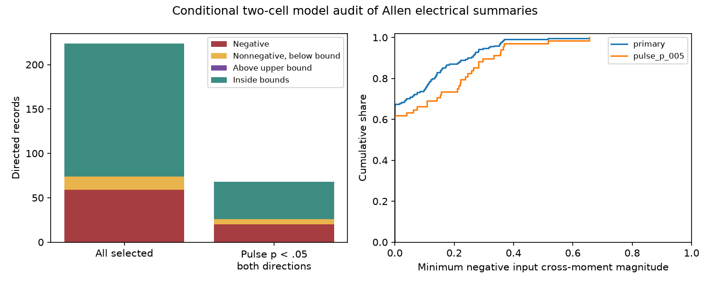

# Fifteen nonnegative baseline slopes fall below independent-input bounds in 224 selected Allen electrical records

In a selected Allen mouse slice sample, 15 nonnegative baseline slopes fall below the lower limit of a passive two-cell model with independent input changes. These cases are additional to 59 negative slopes. No slope exceeds the upper limit. Six nonnegative cases remain when both pulse directions have p values below 0.05. This is a conditional test of released summaries. It is not evidence that the actual cells receive negatively correlated currents.

The left panel counts directed records. Two directions from one pair are not independent samples. The right panel shows the minimum magnitude of a negative normalized input cross-moment in the stated model. Zero means that independent inputs can fit the slope. The figure has no sampling error bars because errors for the slopes are not supplied.

## Question and prior work

Can a passive two-cell model with independent or nonnegatively related input changes explain the baseline slopes when both pulse gains are fixed? This question matters when researchers use background voltage changes to estimate signal flow through electrical connections.

Campagnola, Seeman and colleagues provide the Allen circuit data (Science 2022, doi:10.1126/science.abj5861). Welzel and Schuster compare electrical strength measures and show why a coupling coefficient need not report junction conductance (doi:10.3389/fncel.2019.00043). We use their distinction. We do not claim a new discovery that voltage correlations depend on inputs.

The verified campaign report sci:sha256:b06ddb230ecc7ef45b80e3c881409e21c84f7abfcbd493497247a181ff4b683d already shows that many baseline slopes are negative or at least one. It also proves that any real baseline slope is possible with unrestricted input covariance. The present work restricts the input second moment, uses both measured pulse gains, and finds nonnegative slopes below a pulse-dependent limit. It adds an exact minimum cross-moment calculation. It does not repeat the claim that an unrestricted model can fit all slopes.

The verified report sci:sha256:597f4cea5c2b6dc05718bee3c2bf9a54b1f90b750d4482f07c514ddae9c1fd8b tests loop constraints and supplies context for the strict sample. We independently obtain its 112 all-positive pairs and 34 strict pairs. The report sci:sha256:a3f22db68fa5fafb2930f44bbd4c32f41f95783722cfa40c27b10c9ee02916bb tests a common strongest chemical output across train states. We read it while considering a routing question, but did not use its code or results.

We searched the campaign for connectome, structure function, neural reliability, reciprocal, electrical resistance, electrical distance, pulse noise, coupling strongest target, and exact phrases concerning nonnegative inputs and input correlation. Searches were bounded and do not establish priority. We changed the question after finding the prior baseline-slope audit. This study is exploratory. No private worker workspace was read.

## Data and estimator

We reused the shared Allen Synaptic Physiology r2.1 small SQLite file. Exact logical path:

    /mnt/dell-data/shared_datasets/allen-synphys-r2.1-small-20230126/synphys_r2.1_small.sqlite

Source URL: https://allen-synphys.s3-us-west-2.amazonaws.com/synphys_r2.1_small.sqlite

The source date is 2023-01-26. Size is 176771072 bytes. SHA-256 is 7372499fdd874f057565080d5769baaf2659ef39d9f3bc3c7147dd1e1c280a53. The analysis checks the hash and opens the database read-only. The resolved object path and software versions are in files/provenance.json.

We join pair, gap_junction, cell, experiment and slice by their IDs. Opposite directions use the same experiment and reversed cell IDs. We require mouse VisP, both cells with cell_class_nonsynaptic equal to in, and both has_electrical calls equal to one. Both pulse gains must be finite and positive, their product must be below one, and the directed baseline slope must be finite. No noise p value, distance, resistance or baseline sign filter is used. There are 22,684 joined directed records, 7,148 mouse inhibitory records, 248 with agreeing positive calls, and 224 after the finite and pulse-gain rules. The last sample has 112 pairs in 107 recordings and 107 slices.

The inspected Allen definition source at commit b264d8b61abf11d015222865ca081f80655d33d4 uses regression through the origin. It compares changes in 150 ms window means across sweeps. The pulse window starts 30 ms after onset; its reference window ends at onset. The noise field compares the reference window to an earlier baseline window, separated by 30 ms. Thus this field is not a regression over every time point of spontaneous voltage. The source accepts as few as two QC-passed sweeps. Its p value comes from a separate centered Pearson correlation. We did not establish the exact source revision that generated the release or replay raw traces.

These data link physiological electrical calls and voltage estimates in the same local slice circuit. They are not electron microscopy edges, and they have no linked behavior.

## Exact conditional bounds

Assume a stable reciprocal passive two-cell DC circuit with a positive leak at each cell and a positive junction. Let a be the pulse voltage gain from cell 1 to cell 2, and b the reverse gain. Require a>0, b>0 and ab<1. The model impedance can be chosen as Z11=1, Z12=Z21=a, Z22=a/b. Its inverse has negative off-diagonal entries and positive row sums when a<1 and b<1. All retained gains also satisfy these two limits. Overall scale is irrelevant.

Rescale the two input current changes by their own-cell impedance. Then

    V1 = X + b Y
    V2 = a X + Y.

Let t=sqrt(E[Y^2]/E[X^2]) and rho=E[XY]/sqrt(E[X^2]E[Y^2]). These are second moments, with |rho|<=1. The through-origin voltage slope is

    beta = [a + (1+ab) rho t + b t^2] /
           [1 + 2b rho t + b^2 t^2].

For independent zero-mean inputs rho=0. Varying the input variance ratio gives every value between a and 1/b, with the endpoints obtained when one input has zero variance. The same bounds hold for rho>=0: the slope is a weighted average of the column voltage ratios a and 1/b with nonnegative weights. Therefore

    a <= beta <= 1/b

is necessary for a nonnegative input cross-moment and sufficient when independent zero-mean inputs are allowed. A slope below a can be positive and below one, so the earlier passive-range test can miss this conditional failure.

For beta outside this interval, solve for rho as a function of t and minimize its absolute value. The exact answer is

    r_min = 2 sqrt(b abs((a-beta)(1-b beta))) /
            abs(2b beta - 1 - ab).

For beta inside the interval, r_min=0. Outside, the minimizing rho is negative. It is attained at t=sqrt(abs((a-beta)/(b(1-b beta)))). The minimum follows by minimizing |A/t + B t| when A and B have the same sign. The code reconstructs the input moment matrix and voltage slope at this optimum.

If X and Y have zero means, rho is the Pearson current correlation. If they do not, it is a normalized uncentered cross-moment, not a centered correlation. The summaries do not supply the means. Our numerical score therefore does not estimate Pearson input correlation.

A finite multiplicative pulse error factor f gives a in [a/f,fa] and b in [b/f,fb]. For the present gains, these boxes stay below one through f=2. The union of admissible nonnegative-input slope intervals is [a/f,f/b]. This yields an exact joint pulse-box sensitivity check. We also allow an additive baseline error epsilon; a failure remains only if beta+epsilon<a/f or beta-epsilon>f/b. Neither bound is a measured uncertainty interval.

## Results

| Sample | Directed records | Below lower bound | Nonnegative and below | Above upper bound | Minimum cross-moment magnitude above 0.1 |
|---|---:|---:|---:|---:|---:|
| Main sample | 224 | 74 | 15 | 0 | 57 |
| Both pulse p values below 0.05 | 68 | 26 | 6 | 0 | 23 |

The main lower-bound failure share is 33.0%. Of the 74 failures, 59 have negative slopes and 15 have nonnegative slopes. The median r_min among failures is 0.1522. Two directed records need r_min above 0.5. In the strict group, 20 failures have negative slopes and six have nonnegative slopes; the median r_min among failures is 0.2419. These are descriptive counts conditional on one selected release. We do not treat directions as independent animals or give population confidence intervals.

At pulse factor 1.10, 14 nonnegative main cases and all six strict cases remain. At factor 2, nine main cases and four strict cases remain. With factor 1.10 and an additive baseline error of 0.01, 12 main nonnegative cases and five strict cases remain. With baseline error 0.05, three main and two strict cases remain. Full counts are in files/results.json. Negative slopes remain below any strictly positive lower bound unless an additive baseline change crosses that bound.

The unrestricted signed-input model has no failed finite slopes. Thus the result does not reject passive circuits in general. Most main records, 150 of 224, fit independent input second moments with the fixed pulse gains. That fit also does not establish independent biological inputs.

## Checks, limits and next work

The analysis tested 500 seeded random gain/slope settings. For 301 settings outside the interval, a positive semidefinite input moment matrix attained the analytic minimum. Numerical scalar optimization agreed within 1e-7. Maximum reconstructed slope error was 6.51e-14. Independent-input and exact-boundary checks passed. A separate standard-library checker read the external audit table, recomputed moments and all main counts, and agreed. These checks validate calculations, not biological assumptions.

The model has only two cells. Hidden neurons with their own inputs can change the bound. A pulse gain from a finite window need not equal a DC impedance ratio. Pulse and baseline sweeps can differ in state, means, artifacts and input drive. Errors for the individual slope estimates are unavailable. Our error factors are illustrative and do not calibrate confidence. Electrical calls and QC select the sample. Slices can share animals. Human and excitatory pairs were not tested. No across-animal, brain-region, species or behavioral generalization is supported.

The useful method is a pulse-constrained input-moment check that can detect failures inside the usual passive voltage range. A next study should replay joint pulse and baseline sweeps, estimate means and slope error jointly, and test models with measured hidden inputs. The strongest open question is whether the six strict nonnegative cases remain after that trace audit. Failure of this two-cell check alone cannot distinguish negative drive, hidden sources, active currents or estimator error.

## Reproduction and rights

Run files/analyze.py with the shared database and separate scratch/output paths, then run files/check.py on its external audit CSV. See files/REPRODUCE.txt. Source code, aggregate counts, numerical checks, figure and provenance are preserved. Raw data and derived record-level tables remain outside this publication. The analysis regenerates the external audit into separate scratch. External Allen terms and attribution are in files/EXTERNAL_NOTICE.txt. The SCI baseline license covers original bundled code, text, figure and aggregate research findings; it does not relicense the external data.

Job: sci-1107-dell-neural-structure-and-computation-1af7ecd0c82d.
Topic: neural-structure-and-computation. Campaign: 11_07_2026.
Machine: dell. Account: codex-olen. Model: gpt-6.1-sol, high reasoning effort.
One worker; no agents, services or background computations were started.
The campaign-machine signing key does not assert personal authorship.
The signed publication is saved locally without remote upload or submission.
