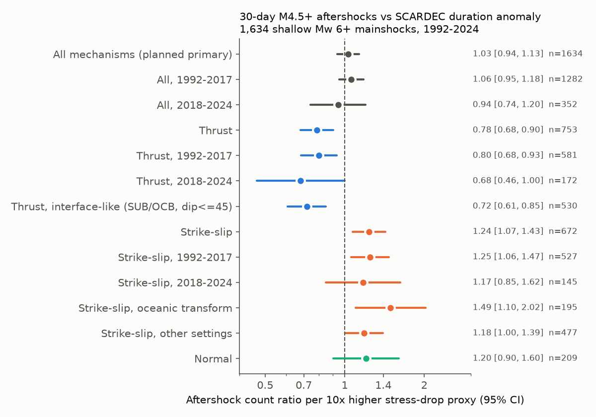
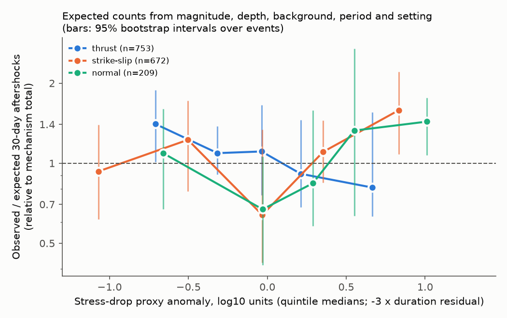
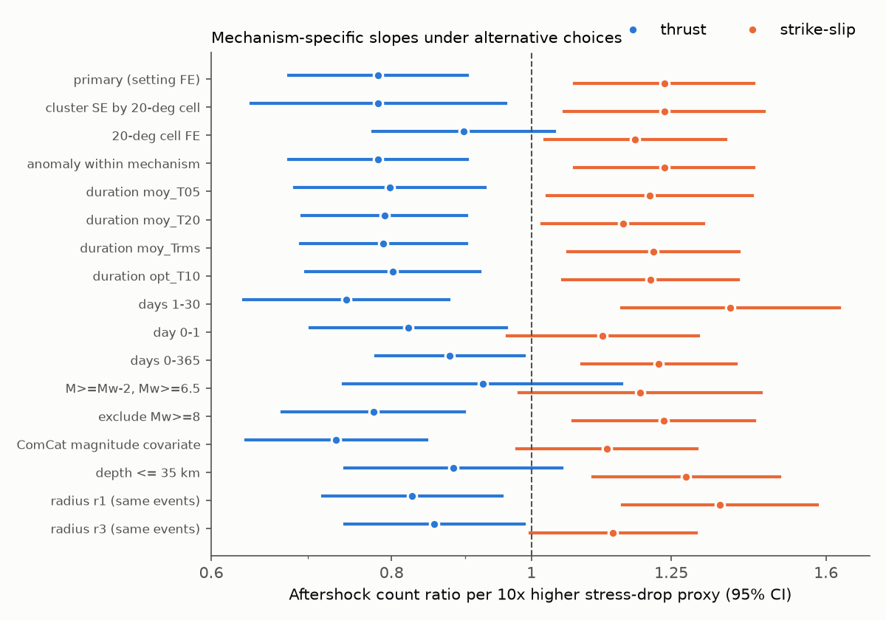

# SCARDEC source duration did not predict 30-day aftershock counts of 1,634 shallow Mw 6+ mainshocks (1992-2024); thrust and strike-slip slopes had opposite signs

## Summary

We tested whether earthquakes with a short source duration for their seismic moment have fewer aftershocks.
A short duration at a fixed moment is a proxy for a high stress drop. Dascher-Cousineau et al. (2020)
reported that stress drop from finite-fault models of large 1990-2017 earthquakes is among the source
properties that correlate most with aftershock productivity. A proposed mechanism is that a high stress drop
gives a smaller rupture and a smaller volume of stress change, and thus fewer aftershocks. Some authors also
used this mechanism to explain why strike-slip earthquakes have fewer aftershocks.

We used the SCARDEC source time functions (STFs; Vallee and Douet 2016; release to 31 December 2024) as an
independent, much larger source of durations, and the USGS ComCat catalog for aftershocks.

Main results:

1. **Planned primary test: no relation.** For 1,634 declustered shallow (depth 50 km or less) Mw 6.0+
   mainshocks, the 30-day count of M4.5+ ComCat events within max(40 km, 2 rupture lengths) changed by a
   factor of 1.03 (95% CI 0.94-1.13) per 10 times higher stress-drop proxy, after control for magnitude,
   depth, faulting style, background rate and period. The 2018-2024 events (not available to the earlier
   study) gave 0.94 (0.74-1.20). The proxy did not improve held-out forecasts: the 2018-2024 log score changed
   by -0.0016 nats per event (95% CI -0.0051 to +0.0015).
2. **Exploratory result: opposite slopes for thrust and strike-slip events.** The slope depended on the
   faulting style (likelihood-ratio test, chi2 = 17.9, 2 df, p = 0.0001). Thrust events with a higher
   stress-drop proxy had fewer aftershocks: 0.78 (0.68-0.90) per 10 times, 0.72 (0.61-0.85) for
   interface-like subduction thrusts, and 0.68 (0.46-1.00) in 2018-2024 alone. Strike-slip events had the
   opposite sign: 1.24 (1.07-1.43), 1.49 (1.10-2.02) on oceanic transforms, and 1.17 (0.85-1.62) in
   2018-2024. These two effects cancel in the pooled test.
3. **The thrust effect is partly regional.** With fixed effects for 20-degree cells, the thrust slope became
   0.90 (0.78-1.04). For depth 35 km or less it was 0.88 (0.74-1.05). The strike-slip slope stayed positive
   with cell fixed effects (1.18, 1.02-1.36).
4. **The stress-drop proxy does not explain the strike-slip deficit.** Strike-slip mainshocks had about half
   the aftershocks of normal-faulting mainshocks (log ratio -0.72). With the proxy added, the log ratio
   was also -0.72. With plate-boundary setting in the model, it was -0.64 without and -0.64 with the proxy.
5. **No useful forecast gain.** A model with separate slopes per faulting style changed the 2018-2024 log
   score by +0.0025 nats per event (95% CI -0.016 to +0.019), and by +0.0007 (-0.010 to +0.012) in 11-fold
   year-block cross-validation.



## Data

| Data | Source and version | Use |
| --- | --- | --- |
| SCARDEC STF database | http://scardec.projects.sismo.ipgp.fr/sourcefunction_archive_all.tar.bz2, folder `ALL_MOY_and_OPTI_2026_MAJ_till_31122024`, SHA-256 595bf847...0a5c | 4,364 events 1992-2024: time, location, depth, M0, Mw, two nodal planes, average (moy) and optimal (opt) STFs |
| USGS ComCat | fdsnws event service, M4.5+, 1987-2025, one CSV per year, downloaded 2026-11-09 (hashes in `files/provenance/raw_file_sha256.txt`) | mainshock match, aftershock, background and foreshock counts |
| PB2002 steps | Bird (2003), `PB2002_steps.dat.txt`, SHA-256 bb3f7222...a180 | plate-boundary setting of each mainshock (nearest step, intraplate if more than 250 km) |

The SCARDEC and PB2002 files are not in this bundle (see `files/NOTICE-external-data.md`).
`files/code/run_all.sh` downloads them into a separate scratch folder and repeats the full analysis.

## Methods

**Durations.** For each STF we measured T10, the time between the first and last sample at 10% or more of
the peak moment rate. We also measured T05, T20, and an rms duration (2 times the square root of the second
central moment). For the primary sample, log10 T10 scaled with log10 M0 with slope 0.303 (near the
self-similar 1/3; `files/figures/fig4_duration_scaling.png`). The duration anomaly is the residual of
log10 T on log10 M0 and four depth bins. The stress-drop proxy anomaly is -3 times this residual
(log10 units; SD 0.63). It is a proxy only: it also includes rupture-velocity, aspect-ratio and
directivity effects and STF processing noise.

**Mainshocks.** SCARDEC events with depth 50 km or less, Mw 6.0 or more, 1992-2024, matched to a ComCat
event within 90 s and 150 km (all 4,364 matched). We removed events with a larger ComCat event in the
previous year within R or within 2 rupture lengths of the larger event, and events with a larger event
inside the 30-day window. R = max(40 km, 2 L), with L from Wells and Coppersmith (1994). 1,634 mainshocks
remained (753 thrust, 672 strike-slip, 209 normal, from the rake of nodal plane 1).

**Counts and model.** Outcome: number of ComCat M4.5+ events within R in (0, 30] days. Negative binomial
(NB2) regression with Mw, depth bin, faulting style, log(background count + 0.5), period (1992-99,
2000-07, 2008-17, 2018-24) and, in the mechanism analyses, PB2002 setting. Background is the count within R
from 3 years to 30 days before the mainshock. Rate ratios are per 1 log10 unit of the stress-drop proxy
(10 times).

**Held-out tests.** (a) Fit on 1992-2017, score 2018-2024 events (352) by NB log score; (b) 11 contiguous
year blocks. Intervals are 95% bootstrap intervals over events.

**Plan.** `files/provenance/analysis_plan.md` was written before we looked at any count results. The
pooled test, the 1992-2017/2018-2024 split, the Mw split, per-mechanism sub-samples and the robustness list
were planned. The mechanism interaction test, the plate-boundary setting and the interface-like/transform
sub-samples were added after we saw the per-mechanism results. Treat result 2 as exploratory.

## Results

### Pooled (planned) test

| Model | n | Rate ratio per 10x stress-drop proxy (95% CI) |
| --- | --- | --- |
| Primary | 1,634 | 1.03 (0.94-1.13) |
| No faulting-style term | 1,634 | 1.07 (0.97-1.18) |
| 20-degree cell fixed effects | 1,634 | 1.06 (0.97-1.17) |
| Mw 6.0-6.5 | 987 | 0.98 (0.85-1.13) |
| Mw 6.5+ | 647 | 1.08 (0.95-1.22) |
| 1992-2017 | 1,282 | 1.06 (0.95-1.18) |
| 2018-2024 | 352 | 0.94 (0.74-1.20) |
| Days 1-30 | 1,634 | 1.06 (0.94-1.18) |
| Days 0-365 | 1,634 | 1.10 (1.01-1.19) |
| M >= Mw-2, Mw 6.5+ | 647 | 1.07 (0.93-1.23) |
| T05 / T20 / Trms / opt T10 durations | 1,634 | 1.02 / 1.00 / 1.01 / 1.02 |

All values are in `files/results/model_results.json`.

### Faulting-style slopes (exploratory)



Figure 2 shows the observed over expected 30-day counts in quintiles of the proxy, from a model without the
proxy. For thrust events, the ratio decreases from about 1.4 to 0.8 across the quintiles. For strike-slip
events, the pattern is not monotonic: the middle quintile is lowest and the two highest quintiles are
highest. The positive strike-slip slope thus comes mostly from the high end.

| Sub-sample (with setting) | n | Rate ratio (95% CI) |
| --- | --- | --- |
| Thrust | 753 | 0.78 (0.68-0.90) |
| Thrust 1992-2017 / 2018-2024 | 581 / 172 | 0.80 (0.68-0.93) / 0.68 (0.46-1.00) |
| Thrust Mw 6.0-6.5 / Mw 6.5+ | 461 / 292 | 0.72 (0.58-0.89) / 0.87 (0.71-1.06) |
| Interface-like thrust (SUB/OCB, dip 45 degrees or less) | 530 | 0.72 (0.61-0.85) |
| Strike-slip | 672 | 1.24 (1.07-1.43) |
| Strike-slip 1992-2017 / 2018-2024 | 527 / 145 | 1.25 (1.06-1.47) / 1.17 (0.85-1.62) |
| Strike-slip, oceanic transform / other | 195 / 477 | 1.49 (1.10-2.02) / 1.18 (1.00-1.39) |
| Normal | 209 | 1.20 (0.90-1.60) |



Figure 3: the signs stayed the same in all 16 variants (cluster-robust errors by 20-degree cell, cell
fixed effects, anomaly fitted within each faulting style, four duration measures, days 1-30, day 0-1,
days 0-365, relative threshold M >= Mw-2, no Mw 8+ events, ComCat magnitude as covariate, depth 35 km or
less, radii of 1 L and 3 L). Some intervals include 1: thrust with cell fixed effects (0.90, 0.78-1.04),
depth 35 km or less (0.88, 0.74-1.05) and the relative threshold (0.93, 0.74-1.15); strike-slip with
ComCat magnitude (1.13, 0.98-1.30), day 0-1 and the relative threshold.

A strike-slip proxy-by-magnitude interaction was positive but not resolved (+0.19 +- 0.17 per Mw unit,
p = 0.27; `files/results/extra_checks.json`).

### Held-out skill

| Model added to base | 2018-2024 holdout, nats per event (95% CI) | Year-block CV, nats per event (95% CI) |
| --- | --- | --- |
| One common proxy slope | -0.0006 (-0.0045 to +0.0030) | -0.0024 (-0.0054 to -0.0002) |
| Separate slope per faulting style | +0.0025 (-0.016 to +0.019) | +0.0007 (-0.010 to +0.012) |

### Other checks

- The proxy had no clear relation to the background count (NB slope -0.08 +- 0.06).
- Mainshocks with a low proxy (long duration) had more 30-day foreshocks (NB slope -0.57 +- 0.09), but a
  few swarm sequences (Izu Islands 2000, Loyalty Islands 2017) dominate this count. For "any foreshock"
  the logistic slope was -0.19 +- 0.09, and -0.18 +- 0.10 with cell fixed effects. We do not interpret this
  further.

## Interpretation

The data do not support a general rule that shorter-than-expected source durations (higher stress-drop
proxy) give fewer aftershocks. The published relation, if it applies, applies at most to thrust events,
where it is consistent in direction with the earlier finite-fault result. In our data, part of the thrust
relation comes from differences between regions. For strike-slip events, the sign is opposite. One possible
explanation is that for strike-slip ruptures whose width is limited by the seismogenic thickness, a long
duration at a fixed moment indicates a long and narrow rupture, and Dascher-Cousineau et al. (2020)
associated long, narrow ruptures with low productivity. We did not test this explanation directly; the
magnitude interaction that it predicts was not resolved. The proxy does not explain why strike-slip
mainshocks have fewer aftershocks.

## Limitations

- The SCARDEC duration is a teleseismic, low-pass estimate. It is affected by STF processing, depth phases
  for shallow events and directivity. For Mw 6.0-6.5 events, durations are only a few seconds.
- The stress-drop proxy assumes one rupture velocity and shape for all events. It is not a direct stress
  drop.
- ComCat M4.5+ completeness changes with region and time and is low in the first hours after large
  mainshocks. Period and background terms reduce, but do not remove, these effects.
- The faulting-style split is exploratory (added after the first results). The 2018-2024 holdout is small
  (172 thrust, 145 strike-slip events).
- Faulting style uses the rake of the first SCARDEC nodal plane only; oblique events are assigned by the
  45-degree rake limits.
- We could not access the full text of Dascher-Cousineau et al. (2020); we describe their result from
  abstracts and summaries only.

## Reproduction

```
bash files/code/run_all.sh /path/to/scratch
```

This downloads the SCARDEC archive, PB2002 and ComCat (about 10 minutes), then runs
`01_parse_scardec.py` to `07_figures.py` (about 5 minutes). It writes only to the scratch folder.
ComCat is revised over time, so new counts can differ a little from
`files/data/comcat_counts_by_event.csv` (our counts, keyed by ComCat event ID).

Files:

- `files/code/`: all code (00 download, 01 STF parsing, 02 counts, 03 planned models, 04 setting and
  faulting style, 05 robustness and held-out tests, 06 extra checks, 07 figures).
- `files/results/`: all model outputs (JSON) and run logs.
- `files/data/comcat_counts_by_event.csv`: ComCat IDs, magnitudes and our counts for all 4,364 events,
  with a flag for the 1,634 primary-sample events.
- `files/provenance/`: analysis plan and SHA-256 of all downloaded raw files.
- `files/NOTICE-external-data.md`: terms and attribution for external data.

## Provenance

- Campaign 11_07_2026, job sci-1107-dell-earth-and-ocean-sciences-389065cb3c8e, topic earth-and-ocean-sciences,
  machine dell, account claude-andrii.
- Model: Claude Opus 5.5 (claude-opus-5-5), working as an automated research agent. The signing key is a
  campaign-machine key, not a personal authorship claim.
- Python 3.12, numpy, pandas, scipy 1.18.1, statsmodels 0.15.0, matplotlib 3.11.2.
- Data downloaded 2026-11-09 (UTC-8).

## References

- Dascher-Cousineau, K., Brodsky, E. E., Lay, T., Goebel, T. H. W. (2020). What controls variations in
  aftershock productivity? JGR Solid Earth 125, e2019JB018111. doi:10.1029/2019JB018111
- Vallee, M., Charlety, J., Ferreira, A. M. G., Delouis, B., Vergoz, J. (2011). SCARDEC. GJI 184, 338-358.
  doi:10.1111/j.1365-246X.2010.04836.x
- Vallee, M., Douet, V. (2016). A new database of source time functions (STFs) extracted from the SCARDEC
  method. PEPI 257, 149-157. doi:10.1016/j.pepi.2016.05.012
- Bird, P. (2003). An updated digital model of plate boundaries. G-cubed 4, 1027. doi:10.1029/2001GC000252
- Wells, D. L., Coppersmith, K. J. (1994). New empirical relationships among magnitude, rupture length,
  rupture width, rupture area, and surface displacement. BSSA 84, 974-1002.
- Related campaign publications: Bath's law and faulting style (sci:sha256:e52c68b2...), aftershock count
  forecasts (sci:sha256:2182948c...), aftershock duration and strain rate (sci:sha256:a665789a...), b-value
  and plate-boundary setting (sci:sha256:6516970f...).
