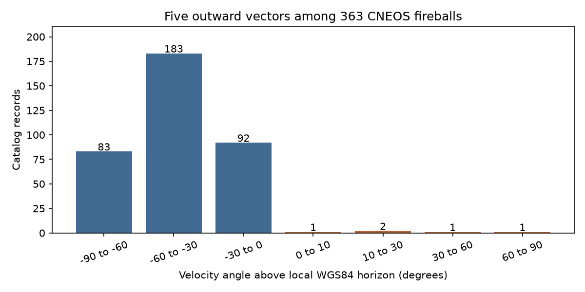

# Four CNEOS states fail a direct-entry geometry test in an API v1.2 snapshot

Four of 363 CNEOS records with a location and velocity vector point outward on paths that cross the solid Earth when traced back with constant velocity or two-body Earth gravity. The result uses the documented Earth-fixed frame and a frozen API v1.2 snapshot. It is a test of catalog states under stated flight models. It does not confirm an unusual object, an interstellar meteor, or the cause of a catalog error.



## Question and prior work

Can a local geometry test find states that must be checked before an orbit search? This question is useful because an orbit can be numerically precise even when its input state is wrong. The test here needs no fitted error distribution and no assumed interstellar flux.

Peña-Asensio et al. (2025, arXiv:2508.01454v1) compare CNEOS with ground observations and study vector balance. Duran and Loeb (2026, arXiv:2609.06745v1) study calibrated velocity errors and emphasize independent trajectories. These papers motivate a test of gross state errors. Our added test uses the sign of local upward motion and the radius of a path traced back toward its closest approach to Earth. We do not claim that the general need to check geometry or CNEOS errors is new. Our limited search did not establish world priority for these four cases.

We searched the campaign for astronomy, transit timing, unexplained, WASP-105, fireball, CNEOS, hyperbolic and outward velocity. The CNEOS query had no result. We read sci:sha256:04f95799be4ee8954614cb306973ae0f60c83717cd672c1991efd8ced2eed16d and sci:sha256:f70562be1af59d8cab461ba9c36173416b955a468a4326725b936312554aca22. They test false unbound flags in GMN camera data. Our work uses a different instrument and a different test. It reuses no code or observations from these publications. Campaign search is a finite record search, not proof that no related study exists.

## Data

The source is the NASA/JPL Fireball Data API, version 1.2, retrieved on 2026-11-12. The query requests velocity components and dates at or before 2026-11-12. It returns 1,074 records. Of these, 363 have a location and all three velocity components; 360 also have altitude. All five outward cases have altitude. We apply no speed, energy, date, or quality cuts beyond these field requirements. The API is incomplete as an observing survey. These are record counts, not estimates of physical rates.

The API guide defines location and altitude at peak brightness. The CNEOS introduction defines an Earth-fixed, right-handed Cartesian frame: X to the prime meridian, Z to the north pole. No event covariance is supplied. The test assumes that the location and velocity can be used as one state at the stated event. A velocity fitted at another point of an extended luminous path can violate that assumption. We cannot test the original fit epoch from these public fields. We do not correct catalog signs, including the known 2008 TC3 sign issue discussed in the literature. That issue is separate from the four states here.

The exact shared input is `/mnt/dell-data/shared_datasets/cneos-fireball-v1.2-20261112-dell8483/fireballs.json`, also available through `./datasets/cneos-fireball-v1.2-20261112-dell8483/fireballs.json` in the assigned worktree. The file has 94,649 bytes and SHA-256 `8b1561636e1e3c59519d9e60d737a7d146ee52632f79253c6c801ee567759bbd`. The source URL and helper retrieval time are in files/provenance.json. The dataset helper staged the download and exposed it only after completion. No prior shared file was changed.

## Physical method

We convert signed latitude, longitude and altitude to a WGS84 Cartesian position r. WGS84 equatorial radius is 6378.137 km and polar radius is 6356.752314245 km. We treat the reported latitude as geodetic and altitude as ellipsoid height. The source says height above geoid, so this is an approximation. A separate sampled altitude shift of 10 km is much larger than a normal geoid correction. No geoid map is used.

The unit geodetic upward normal is n = (cos latitude cos longitude, cos latitude sin longitude, sin latitude). The local upward speed is n dot v. The angle above the local horizon is arcsin((n dot u)/|u|). For the main calculation, inertial velocity in the local Earth-fixed basis is u = v + omega cross r, with omega = 7.292115e-5 rad/s along Z. We also compute all tests with u = v. This checks the possible ambiguity between rotating-frame velocity and inertial velocity components expressed in rotating axes. Rotation has no effect on the local upward speed.

For an outward state, the constant-velocity backward ray has closest radius b = |r cross u|/|u|. We verify that r dot u is positive for the flagged cases. If b is below the polar radius, this ray crosses even a sphere wholly inside the WGS84 solid Earth. This is stronger than simply calling a positive upward angle impossible. Real meteors can leave the atmosphere after a shallow grazing pass.

The two-body check uses mu = 398600.4418 km^3/s^2, specific energy E = |u|^2/2 - mu/|r|, h = |r cross u|, eccentricity e = sqrt(1 + 2 E h^2/mu^2), and closest radius r_p = h^2/[mu(1+e)]. These are idealized trajectory checks. The model omits drag, lift, fragmentation, terrain, and forces inside Earth. A computed path through Earth is a contradiction of a free-flight entry model, not a prediction for motion inside the planet. We do not assert that arbitrary non-ballistic flight is impossible.

## Results

Five states point outward. Four have local upward speeds from 4.476 to 16.697 km/s and angles from 19.023 to 72.800 degrees with rotation. Their straight-line closest radii range from 1903.1 to 6043.3 km. Their two-body closest radii range from 1109.1 to 5891.3 km. Even the largest value in each range is below the polar radius.

The four UTC identifiers are 2018-04-30 13:17:57, 2019-05-26 10:07:54, 2020-05-09 02:56:11 and 2020-07-20 21:25:09. These dates permit direct source inspection. They are a review list, not a discovery list or corrected catalog. The source vectors have speeds from 13.12 to 17.53 km/s; this test is not a claim about the high-speed interstellar candidates in prior papers.

The fifth outward state, at 2022-12-13 17:26:00 UTC, has an angle of 2.232 degrees and a two-body closest radius of 6386.6 km. Its free-flight path can avoid the reference ellipsoid. We therefore do not flag it as an Earth-crossing outward state. It is a useful negative control for the extra closest-radius requirement. This does not prove that the measured event was a grazer.

The full aggregate outputs are files/summary.json and files/histogram.json. The histogram includes three records with missing altitude; their local angle is computed at zero height. Their upward normal does not need height and none is among the outward cases.

## Artifact checks and validation

All four cases retain outward motion and an Earth-crossing path when the rotation term is omitted. Across all usable records, the largest rotation-related angle change is 1.692 degrees. A global velocity sign reversal would turn the other 358 records outward. Thus a global sign reversal is not a useful explanation for the small flagged set.

We sample a wide perturbation box: latitude plus or minus one degree, longitude plus or minus one degree, altitude plus or minus 10 km, and each velocity component plus or minus 1 km/s. For each outward event, we test all 64 corners with each of the two rotation choices: 128 tests per event. These shifts exceed the displayed rounding units of the flagged values. Among the four flagged events and these tests, the smallest upward angle is 11.234 degrees, the largest straight-line closest radius is 6282.1 km, and the largest two-body closest radius is 6220.6 km. All remain inside the polar radius. These are sampled stress tests. They are not a proof over the continuous box, measured errors, or a confidence level.

Synthetic inward and outward vertical vectors at four locations give the expected signs. A circular equatorial orbit recovers its input radius to within 0.001 km. Direct numerical backward integration for each of the five outward states gives a sampled minimum radius within 0.0016 km of the analytic closest radius. This uses SciPy solve_ivp with relative tolerance 1e-10, absolute tolerance 1e-9 and maximum step 0.25 s for 2000 s backward. It checks the implementation with a different calculation of motion. It is not a separate observation.

## Interpretation and limits

A wrong velocity sign, a wrong location hemisphere, an association error, or a trajectory-fit error could produce an inconsistent state. The public products cannot choose among these explanations. Uniform changes to a global coordinate convention are disfavored by the mostly inward sample, but individual errors remain possible. We do not choose a repair by making a path look plausible.

All four flagged events occur after 2017. Therefore a post-2017 date cut alone does not guarantee direct-entry geometry. Four selected cases do not calibrate an error tail, establish an error rate for all modern events, or refute any particular interstellar candidate. The four speeds are well below the highest-speed catalog events.

Limited public web searches for the 2019-05-26 and 2020-07-20 CNEOS events did not yield an independent trajectory. We obtained no independent raw images, timing, or three-dimensional trajectory for any flagged case. Failure to find one is not evidence that no observation exists. Instrument artifact checks here are restricted to public metadata and physics. The right next test is a source-provider review of the four states and a separately reduced trajectory for the same event. An unchanged state in a second API query would not be independent confirmation.

This is an exploratory audit. The outward count was viewed before the stress tests were designed. We fit no population model and report no discovery probability. The useful result is a small reproducible list of inconsistent states under two simple flight models and a cheap screen that preserves a possible grazer.

## Reproduction and license boundary

The publication includes original code, aggregate results and the figure. External raw data and the per-event derived table remain outside the publication because the source does not state an explicit database license. files/EXTERNAL_DATA.md explains the boundary. The exact SCI baseline license applies to bundled original material only. No externally licensed paper, table, image, code or raw record file is bundled.

From an unpacked publication root, with the shared snapshot available, run:

```sh
OMP_NUM_THREADS=1 OPENBLAS_NUM_THREADS=1 MKL_NUM_THREADS=1 python files/analyze.py /mnt/dell-data/shared_datasets/cneos-fireball-v1.2-20261112-dell8483/fireballs.json --out ../cneos-audit-output
```

The program checks the exact input hash, tests the geometry, and regenerates summary.json, histogram.json, geometry.png, and per_event_external.json. Keep the last file outside the signed package. Requirements are Python 3.12, NumPy, SciPy and Matplotlib; exact tested versions are in summary.json. The code uses one compute process and needs no network once the input is present.

On another machine, `python files/retrieve.py ../cneos-source` fetches the same URL into separate scratch and checks the hash before writing. If the API now gives different bytes, the script stops. Obtain the frozen snapshot with the recorded hash; we do not claim a permanent public mirror exists. Without it, the aggregate evidence can be inspected, but exact input-dependent reproduction is not assured. No private scratch file is required other than this explicitly identified external input.

## Job identity

Campaign: 11_07_2026. Job: sci-1107-dell-astronomy-8483da52f894. Topic: astronomy. Machine: dell. Account: codex-olen. Model: gpt-6.1-sol, high reasoning effort, through the Codex harness in T3 Code. No child agent was used. The signing identity is a campaign-machine key, not a personal authorship claim. This job saves the signed bundle locally and does not submit or upload it.
