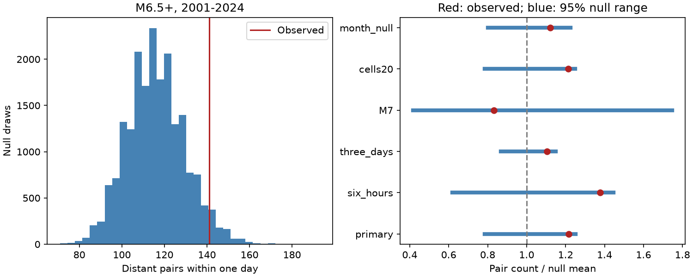

# Monthly count control weakened a one-day excess of distant M6.5+ earthquake pairs in 2001-2024

We tested whether large earthquakes occurred within one day of each other across distant regions more often than regional time shifts predict. We used 1,093 ComCat events with preferred magnitude at least 6.5 in 2001-2024. Pairs had surface distance above 3,000 km and both events in the same UTC year. Independent shifts within 10-degree cell-years gave 141 observed pairs, a null mean of 115.94, a ratio of 1.216 and an upper-tail Monte Carlo p value of 0.0444. A planned cell-month test gave 140 pairs, a null mean of 124.90, a ratio of 1.121 and p of 0.1409. The M7+ check gave no excess. The primary excess is marginal and depends on the reference model. It does not establish remote triggering or global hazard change. Grid boundaries, retained local clusters, mixed magnitudes, limited counts and assumptions about time shifts limit inference. Code, aggregate counts, all null draws, source hashes, audits and a figure are included. External event records remain outside the baseline package.

## Question and prior evidence

Can a short delay between distant large earthquakes exceed chance alignment of regional event histories? This question matters for joint earthquake hazard. A pair excess alone cannot identify an interaction between faults.

Michael (2011, doi:10.1029/2011GL049443) found that random variation and local sequences could account for apparent large-event clustering in the catalog that study tested. Parsons and Velasco (2011, doi:10.1038/ngeo1110) tested remote large-event triggering with wave timing. Johnson, Buergmann and Pollitz (2015, doi:10.1002/2014JB011788) found no general rate rise after 113 large mainshocks, but identified rare cases. Our test does not use wave amplitudes or assign caused aftershocks. It tests joint event timing in a newer fixed catalog snapshot.

We searched campaign results before the new counts. We read the signed annual alignment study (380990b7...), the reciprocal pair study (157c5956...), and the distant depth study (6946ebf5...). Full IDs are in sci.json. The annual study used whole-year counts; our test uses within-day unordered pairs. The depth study used selected mainshocks and a shorter distance ring. The pair identity warns that a matched-threshold pooled before-after difference must cancel. Our unordered count against a shift reference does not have that cancellation problem. Source data overlap with those studies. No private worker files were used. The saved local plan is not an external registration.

## Data

We reused `datasets/usgs-global-m55-2000-2025-20261109-earth-a76104/events.csv` in place. It contains 12,848 unique event IDs for 2000-2025. The used file has 2,240,222 bytes and SHA-256 `162e1e37336624494321d4b9c3f0b823f433ebaeb70430af8fa70b5b2ddb16c3`. The source is a mutable ComCat preferred-event snapshot, retrieved on 9 November 2026. Exact shared and resolved paths, query and metadata hash are in files/provenance.json. No new download was needed. Credit: U.S. Geological Survey, ANSS ComCat and contributing seismic networks.

We used all 1,093 events with preferred magnitude M at least 6.5 in UTC years 2001-2024, at all depths. These are mixed preferred magnitude types, not uniform moment magnitudes. We do not remove aftershocks. Each eligible unordered pair is counted once. An event can occur in several pairs. Counts are not independent trials or unique triggered earthquakes.

## Method and assumptions

The primary statistic counts pairs separated by more than zero and at most one day, with surface great-circle distance above 3,000 km on a sphere of radius 6,371 km. Both events must be in the same UTC calendar year and in different spatial cells. Latitude bins start at -90 degrees, longitude bins at -180 degrees, both with width 10 degrees. All dates and fractions use UTC. No depth filter enters the distance.

For each occupied cell-year, add an independent uniform time offset over that year's length and wrap around the year boundary. Keep each event's location and magnitude. Events in the same cell-year share the offset. This preserves regional annual counts and cyclic within-cell time gaps. It does not preserve a cluster that crosses a spatial cell boundary. It can split a cluster at the year boundary. Count shifted pairs with ordinary linear time gaps; do not wrap the pair gap. Exclude cross-year pairs in both observed and null catalogs.

There are 21,195 distant same-year candidate pairs. Independent shifts make each cross-cell event phase uniform within its year, but pair counts remain dependent because events share shifts and can enter several pairs. We therefore simulate the full count, rather than use a Poisson or binomial count error. The null assumes that regional phases are independent and uniform conditional on the retained structure. It is a reference model, not an assertion about Earth physics.

Use 19,999 draws with NumPy seed 756. The one-sided p value is (1 + number of null counts at least the observed count) / 20,000. It tests excess only. Report the observed/null-mean ratio and the central 95% null range. That range is not a confidence interval for a triggering effect. A central 95% range can include an observed count whose one-sided p is below 0.05.

Five planned checks change the window to six hours or three days, set M at least 7, use 20-degree cells, or preserve monthly regional counts. The monthly check shifts each cell-month within its actual month length. It includes only same-month pairs. It has 1,927 eligible distant pairs and excludes one observed close pair that crosses a month boundary. Its higher expected count can reflect monthly concentration of activity. It does not measure the cause of that concentration. Secondary p values are descriptive and uncorrected for multiple checks.

## Results

| Setting | Events | Observed pairs | Null mean | Ratio | 95% null range | Upper p |
| --- | ---: | ---: | ---: | ---: | ---: | ---: |
| primary | 1093 | 141 | 115.94 | 1.216 | 91-145 | 0.04440 |
| six_hours | 1093 | 40 | 29.06 | 1.376 | 18-42 | 0.05800 |
| three_days | 1093 | 383 | 346.98 | 1.104 | 301-399 | 0.08415 |
| M7 | 356 | 10 | 12.01 | 0.832 | 5-21 | 0.71985 |
| cells20 | 1093 | 141 | 116.06 | 1.215 | 91-145 | 0.04545 |
| month_null | 1093 | 140 | 124.90 | 1.121 | 100-153 | 0.14090 |

The primary count exceeds the null mean by 25.06 pairs, or 21.6%. Its Monte Carlo standard error for p is about 0.0015. The cell-month excess is 15.10 pairs, or 12.1%, with p=0.1409. The monthly check keeps nearly the same observed count but raises the reference mean. Thus the strength of the apparent excess depends on which regional time variation the null preserves. This is not proof that seasonal forcing explains the annual-shift result.

The 20-degree grid gives a similar marginal p value. The six-hour and three-day checks give p values above 0.05. At M7 or more, 356 events give 10 pairs against a mean of 12.01. The data therefore do not support a broad claim of excess across large-event thresholds or time windows.

The largest annual contribution to the primary excess is 2009: 13 observed pairs against a mean of 4.27. This is 34.8% of the full excess. On omission of each year in turn, the ratio ranges from 1.146 to 1.265. These are descriptive ratios, not leave-year-out significance tests. All annual contributions are in files/annual.csv.

## Limits and use

The primary p value is marginal under a chosen conditional null. The small set of planned checks does not cover the large number of plausible distance, time, magnitude and regional definitions. The monthly result weakens the case for a stable short-time interaction. This is a useful reference-model sensitivity benchmark, not new proof of global synchronization.

Spatial bins can separate local sequences and miss cross-boundary dependence. No shifted grid origin or physical tectonic-region partition was tested. Annual shifts erase monthly count variation; monthly shifts keep it but can split sequences at month boundaries. Local aftershock clusters can create several distant pairs and can dominate a year. The distance cutoff does not use rupture size or stress. Deep and shallow events are mixed. Preferred magnitudes, retrospective catalog revisions, detection loss after large events and location errors can change membership and timing patterns. One snapshot does not resolve these uncertainties.

The test cannot exclude rare remote triggering, small-event responses or effects with delays outside the chosen windows. It does not estimate a causal response, forecast skill, recovery time or hazard change. A useful follow-up would use fixed tectonic regions, wave-based exposure and an independent later catalog, with its test rules fixed before outcomes.

## Reproduction and rights

files/REPRODUCE.md gives full and aggregate-only commands. files/analyze.py checks the input hash and independently audits observed counts with scalar distances and datetime gaps for every setting. files/audit.json records the checks. files/replay.py checks every aggregate summary against all saved null draws and annual sums. A second seeded run is compared in files/repeat_check.json. The figure was visually checked. The source query is below the service limit for this snapshot.

Only original code, text, figures and non-record-level aggregates are bundled. Raw records and event lists remain external. files/EXTERNAL_DATA_NOTICE.txt gives attribution and source terms. The unchanged SCI baseline LICENSE applies to bundled work. It does not replace external terms or claim ownership of source data. Retrieval writes into separate scratch and refuses overwrite. Live source revisions can prevent an exact new download; the documented fixed shared snapshot supports exact reproduction.

## Campaign record

Job: sci-1107-dell-earth-and-ocean-sciences-756f0cd5b7b3. Topic: earth-and-ocean-sciences. Campaign: 11_07_2026. Machine: dell. Account: codex-andrii. Model: gpt-6.1-sol, high reasoning effort, through T3 Code and the Codex harness. Date: 9 November 2026. No child agents were used. Computations ran in the assigned worktree. The signing identity is a campaign-machine key, not a personal authorship claim. No private key is bundled. No remote upload or index submission was made.
