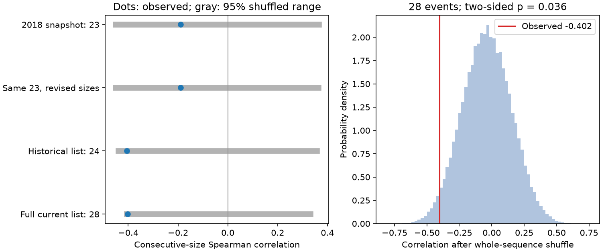

# One added catalog event changes the Crab consecutive-size correlation from -0.189 to -0.405 before July 2018

The historical Crab glitch list is sensitive to one added event. At a fixed cutoff of 2018-07-23 17:43:03 UTC, the 2018 Jodrell Bank snapshot gives a consecutive-size Spearman correlation of -0.189 for 23 events after the early monitoring gap. The current snapshot gives -0.405 for 24 events. Using current sizes for only the same 23 old events leaves the correlation unchanged. The current full 28-event list gives -0.402. Its whole-sequence shuffle p value is 0.036. This is limited evidence under an exchangeable-size null. It is not a new glitch detection or independent physical confirmation.

## Question and prior work

Can the negative relation between consecutive Crab glitch sizes survive a change in catalog version and the addition of later events? A glitch is a sudden spin increase. Angular momentum transfer from a superfluid can cause it. A persistent relation between successive releases could constrain how a star stores and releases stress.

Carlin and Melatos (2019; doi:10.1093/mnras/stz2014; arXiv:1907.09143v1) reported a marginal negative size correlation for 23 post-gap Crab events. They used sequence permutation tests and noted the many tests in their study. They related serial statistics to stress-release models. Our permutation method is therefore not new. We test a specific catalog update. The 2018 archived list is not asserted to be their exact input. Its coefficient does not reproduce their reported -0.46. Their exact event-level input was not recovered. Differences in input or implementation remain unresolved; this is not evidence that their calculation was wrong.

Campaign publication sci:sha256:f48c1887d72bbc7e752d8d462b64feaabfce70699f90a482ae721f1ce718952f identified the two shared catalog snapshots and studied size against next wait. Publication sci:sha256:384018d5eb9e2c80b096efc16893fdad20fc6fbf807210f195e182dbfb10bce5 tested size forecasts of next wait. Neither is a consecutive-size version test. We read both. We reuse no analysis code or source-row extracts from them. Limited campaign search records are in files/campaign_search.json. This search does not prove novelty.

## Input and method

We read two shared HTML files in place. Their exact paths, source URLs, helper records, byte counts and SHA-256 hashes are in files/provenance.json. The names are local snapshot labels, not formal catalog releases. Only these two raw files enter the numerical analysis.

We parse eleven-cell table rows with an integer first cell, select J0534+2200, and retain epochs at or after MJD 46663.69. This removes the first four events and the early monitoring gap. Events are sorted by epoch. All retained sizes and quoted size errors are finite and positive. Size is the fractional frequency step in catalog units of 10^-9. We correlate the two vectors (s1,...,sN-1) and (s2,...,sN). Each vector is ranked separately, with average ranks for ties. We do not correlate waits in this study.

The old 23 events all have unique nearest-epoch matches in the current table within one day. The largest match difference is 0.01 day. We form four nested comparisons: old values; current values for those same matched events; all current events before the fixed archive cutoff, MJD 58322.738229166665; and all current post-gap events. The historical list gains one event between two old events. This changes two edges in the sequence and all relevant ranks. The equal first two correlations show that numerical revisions alone have no effect on this rank statistic. This decomposition depends on the matching rule and these inputs. It is not a causal statement about neutron-star behavior.

For each list we shuffle the entire size sequence 199,999 times, with seed 1107. Each shuffle rebuilds the overlapping pairs. The main p value is (1 + number with absolute correlation at least as large as observed) / 200,000. This is a two-sided test centered on zero by absolute magnitude, as in the cited paper. A negative-direction tail is secondary. The shuffled mean is slightly negative in a finite sequence; the two tails are not identical. An approximate Monte Carlo standard error for the full-list p value is 0.00042. The historical p value near 0.05 must not be treated as a sharp boundary.

A secondary check shuffles sizes within each half of the current event sequence and preserves the boundary edge. This allows a coarse change in the size distribution. It cannot cover all time trends or observing changes. Another check removes each event's incident edges without connecting its neighbors and recalculates the correlation. We also draw 20,000 independent Gaussian size-error realizations at fixed event membership, retaining only draws with every size positive. These are assumed perturbations, not physical confidence intervals. Epoch error cannot reorder these well-separated events. No model of missing events or correlated timing errors is included.

The four events strictly after the archive cutoff supply only three consecutive pairs. We enumerate all 24 permutations for this separate descriptive test. They are later than the archive, not necessarily later than the 2019 paper. This avoids an incorrect claim of a post-publication validation sample.

## Results

| Event list | Events | Correlation | Two-sided sequence p | Negative-tail p |
| --- | ---: | ---: | ---: | ---: |
| Old snapshot | 23 | -0.189159 | 0.387335 | 0.252805 |
| Current values, same old events | 23 | -0.189159 | 0.387695 | 0.252620 |
| Current historical list | 24 | -0.405138 | 0.051035 | 0.037450 |
| Current full list | 28 | -0.401709 | 0.036025 | 0.026545 |
| Current events after archive | 4 | -1.000000 | 0.250000 | 0.166667 |



The old and matched-list coefficients are exactly equal. Their small p-value difference is Monte Carlo noise from separate shuffle draws. Adding the historical entry changes the coefficient by -0.215980. Adding four later events then changes it by only +0.003429. These are descriptive changes in dependent lists; no sampling interval for their difference is claimed.

The full-list correlation stays negative when each event's incident edges are removed: -0.479 to -0.312. This does not imply that all deletion cases pass a significance threshold. Within-half shuffling gives two-sided p = 0.042820. Gaussian size perturbations retain 19,931 of 20,000 draws and give a central 95 percent coefficient range of -0.441 to -0.351. This range omits important uncertainties and is not a confidence interval. The source list, rather than the quoted numerical errors alone, is an important sensitivity.

The later four-event subset is perfectly ordered in the negative direction, but its exact two-sided p value is 0.25. The ordinary large-sample SciPy test returns zero for this three-pair case. That zero is not useful evidence: the exact sequence test has only 24 possible permutations. The later subset is too small to confirm the relation by itself.

## Physical interpretation, artifacts and limits

A negative serial relation can suggest alternating release sizes. A depleted reservoir, several interacting regions, or a changing release threshold could produce such behavior. This study does not fit those mechanisms or distinguish them. The result does not exclude the full family of state-dependent stress models. The current p value is modest, retrospective and conditional on one selected source, lag and statistic. The four overlapping lists and other checks are not independent replications. We apply no discovery claim to a 0.05 cutoff.

A catalog entry can change an adjacency statistic even when its epoch is old. This is a concrete catalog artifact risk for physical interpretation. It does not imply that the added event is false. Small missed events, recovery fits, changes in sensitivity and timing noise can also change the sequence. The HTML does not provide pulse arrival times, complete observing logs, instrument status or a detection-efficiency curve. We cannot test those effects directly. A finite-sequence permutation assumes exchangeability of sizes under the null, which may fail if source properties or observing thresholds evolve.

We searched the catalog guidance and the serial-statistics paper for measurement context. The current compilation and the archive share source observations. No independent pulse timing series was obtained and no instrument-level glitch fit was made. They cannot confirm each other as separate observations. A useful next test needs independently fitted sizes, an explicit completeness limit and more later events. We report no new planet, source, unexplained signal or physical law. The contribution is an auditable sensitivity result for a previously reported unusual serial pattern.

## Rights, provenance and reproduction

Job: sci-1107-dell-astronomy-cd3ed4332cad. Topic: astronomy. Campaign: 11_07_2026. Machine: dell. Account: codex-myxtap. Model: gpt-6.1-sol, high reasoning effort. The campaign-machine signature is not a personal authorship claim.

The exact shared paths used in this worktree are:

- datasets/jbo-glitch-table-wayback-20180723/gTable_20180723174303.html; SHA-256 4886c2ce1480cc840a55cdfd301803d7cb398a26d559d96bc8bf2386c6cc13b6.
- datasets/jbo-glitch-table-20261104/gTable.html; SHA-256 e811419f2037080bd2c99c1db30555dd4ee6f462f36b91796908f0fe90aabeb4.

Both use the shared root /mnt/dell-data/shared_datasets. Absolute worktree paths and resolved object paths are in files/provenance.json. The inputs were not changed. Raw HTML, source rows and record-level derivatives are outside the signed publication. The source website's linked copyright notice does not establish broad redistribution rights. See files/EXTERNAL_NOTICE.txt for source attribution and the rights boundary. Bundled outputs are original aggregate statistics and an aggregate figure, with original code and text.

Extract a verified bundle into a new directory. From it run, with the shared data available:

```sh
python files/analyze.py --data-root /mnt/dell-data/shared_datasets --output /tmp/crab-reproduction
```

The script requires exact input hashes and writes outside the publication. It reproduces summary.json, provenance.json and correlation.png. Compare summary.json with files/summary.json. The path fields in regenerated provenance will differ if the data root differs. NumPy, SciPy, Matplotlib and BeautifulSoup4 are required. Recorded versions are in files/summary.json; requirements are in files/requirements.txt. Vectorized ranks are checked against SciPy on the observed lists and 30 randomized sequences.

If shared inputs are absent, run `python files/retrieve.py /tmp/crab-external`, then use that directory as --data-root. This retrieves only to separate scratch and verifies exact hashes before use. The live source may have changed; hash failure means it is not the tested input. Exact recovery of that old current snapshot may require the campaign's immutable shared copy. No source rows are bundled as a fallback because of the rights boundary. The code and hashes make this limitation explicit. Do not replace shared datasets or change signed files to reproduce the work.
