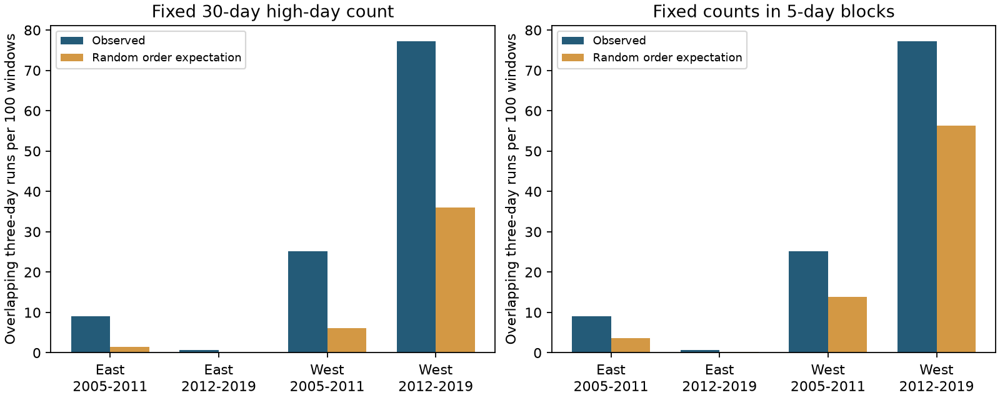

# High-ozone days gave more three-day runs than fixed-count random order near selected US bird surveys in 2005-2019

We tested the order of high-ozone days in 1,120 complete exposure windows before selected bird surveys in four US states in 2005-2019. We compared observed overlapping three-day runs above 70 ppb with exact expectations from random date order at fixed high-day counts. Observed counts were 2.14-15.54 times the 30-day expectations in two regions and two periods. They were 1.37-3.19 times expectations when counts were fixed within five-day blocks. The excess stayed positive with second sites, complete paired sites, equal site weights, and one window per site-year. No single site or year deletion removed the excess. The later eastern sample had only three runs. At 80 ppb, both eastern main samples had no runs. Selected windows covered 20-39% of filtered surveys and had warmer survey starts. These are finite-sample exposure results. Repeated dates, selected monitors, rare events, and assumed random-order references limit inference. We do not estimate weather causes or bird effects. The package gives daily data, exact calculations, source hashes, all checks, and code.



## Question and prior work

Do monthly high-day counts describe the order of ozone exposure near bird surveys? We test whether three consecutive high days occur more often than expected when the same high-day count is placed at random on the observed dates. This is an exposure method study within the climate, pollution and biodiversity objective. A future study of joint weather and pollution effects can use the method to check how much information a monthly count removes. We do not show that runs affect birds more than separate high days.

Sun, Hess and Liu (2017, doi:10.1002/2016GL071731) studied weather persistence and ozone. Their CASTNET analysis linked ozone to successive stagnation days; it did not support the same buildup from successive hot days. That work motivates the question but also shows why ozone persistence alone cannot identify a temperature cause. Liang and colleagues (2020, doi:10.1073/pnas.2013568117) studied bird abundance and air pollution regulation with a different design. Our result neither repeats nor refutes their biological inference.

We searched the published campaign before choosing this test. SCI 87a455ff... gave paired-site daily evidence and incomplete high-day agreement. SCI db4b00d3... tested the calendar overlap of episodes at nearby sites. Both use the same source data as this study. Our new result is an exact comparison of observed run counts with random-order expectations conditional on high-day totals. We make no claim to first discovery of persistent ozone. The local plan was saved before the new calculations in files/analysis_plan.txt. It is not an external registration. Site and year deletion checks were added after the main calculations as a stress check.

## Data and selection

We verified the source SCI ZIP before extraction. Files/parent_verify.json gives the result. Files/reuse.json gives hashes and sizes of the derived inputs. No new raw data were downloaded. No shared data were changed. No private worker workspace was read. Inherited private paths in source records are historical provenance only.

The biological source is the USGS Breeding Bird Survey 1966-2024 release, doi:10.5066/P14SNUV4. East means New York and Pennsylvania. West means California and Oregon. The two periods are 2005-2011 and 2012-2019. The inherited 3,607 surveys have route coordinates and accepted standard protocol. Parent filters require valid weather, assistant status, date and survey duration. Exact raw filters are in files/build_base.py and files/parent_analyze.py. We use route dates and locations to define windows; no bird response is fit.

The parent selected the nearest two ozone sites with valid April-July data for each year. We retain windows with both sites within 50 km of the route start and at least 24 common valid dates in the prior 30 days. Our main test uses the nearest site and requires valid data on all 30 dates. The survey date is excluded. The two-site condition is inherited to keep a fixed comparison set. It restricts the result to areas with dense monitor support. It is not needed by the mathematical method.

The EPA daily summaries cover 2005-2019. The inherited builder keeps Ozone 8-hour 2015, 8-HR RUN AVG BEGIN HOUR, ppm units, at least 75% observation coverage, values 0-0.3 ppm, and event types None or Included. It removes duplicate site-instrument-date-value rows, averages retained instrument values within site-date, and converts to ppb. These are daily maximum eight-hour site summaries. Changes in instruments and site locations were not audited.

| Region | Period | Filtered surveys | Complete main windows | Sites | Selected start C | Excluded start C |
|---|---|---:|---:|---:|---:|---:|
| East | 2005-2011 | 620 | 232 | 49 | 15.55 | 14.16 |
| East | 2012-2019 | 1157 | 449 | 63 | 14.44 | 13.25 |
| West | 2005-2011 | 565 | 127 | 47 | 11.93 | 9.65 |
| West | 2012-2019 | 1265 | 312 | 81 | 12.71 | 10.42 |

The complete main windows are 20-39% of filtered surveys. Selected surveys have warmer starts in all four samples. Missing days, monitor placement and roadside survey placement can select the weather and habitat in this result. We do not impute missing exposure or weight the sample to represent excluded surveys.

## Exact reference calculations

A high day is strictly above 70 ppb, with a 1e-9 ppb numerical tolerance. The threshold is descriptive. It is not a bird damage threshold or a regulatory compliance test. A run is three consecutive high dates. Runs overlap: four consecutive high days give two runs. Thus, counts are not counts of distinct episodes.

Let n=30 and k be the high-day count. Under uniform placement of k high labels on these dates, each adjacent triple is high with probability k(k-1)(k-2)/[n(n-1)(n-2)]. There are n-2 possible starts. The expected run count is k(k-1)(k-2)/[n(n-1)]. This expectation is exact and needs no simulation. We sum the expectation over the same windows as the observed run counts.

A second reference fixes each high-day count within six consecutive five-day blocks anchored at the start of the window. For each triple, partition its dates by block. If r dates fall in a block of m dates and k high days, the probability contribution is C(k,r)/C(m,r). Multiply contributions across blocks, then sum over triples. This reference retains local variation in the frequency of high days and only changes their order inside each block. It is not a weather-adjusted causal model. The arbitrary block boundaries can affect the answer.

We report finite-sample observed counts, exact expectations and their ratios. These are model-reference contrasts, not randomization p values. Real dates were not assigned at random. We give no independent-window confidence intervals: windows can share dates and sites, and pollution episodes can cover many sites. The four samples have distinct region-period records, but sites repeat across periods and regional events can be shared. They are not four independent statistical replications. Exact expectations remove Monte Carlo error; they do not remove sampling or model uncertainty.

## Results

| Region | Period | Observed runs | 30-day expectation | Ratio | Five-day-block expectation | Ratio |
|---|---|---:|---:|---:|---:|---:|
| East | 2005-2011 | 21 | 3.428 | 6.13 | 8.34 | 2.52 |
| East | 2012-2019 | 3 | 0.193 | 15.54 | 0.94 | 3.19 |
| West | 2005-2011 | 32 | 7.786 | 4.11 | 17.52 | 1.83 |
| West | 2012-2019 | 241 | 112.552 | 2.14 | 175.48 | 1.37 |

All four observed counts exceed both references at 70 ppb. High-day totals alone did not give the observed order of exposure. Fixing five-day counts reduced the excess in all samples. This is consistent with some concentration of high days on scales longer than a few days, but does not isolate a physical cause. The remaining excess shows that coarse variation in local frequency alone is not sufficient under this reference.

The large ratio in the later eastern sample has a very small denominator. Only three windows had any run there. The absolute excess over the five-day reference was 0.46 runs per 100 windows, compared with 5.46 in the early East, 11.40 in the early West and 21.00 in the later West. Ratios alone would give a poor account of this difference. We do not infer a trend or a regional effect from these comparisons.

## Bias and sensitivity checks

At 70 ppb, all four contrasts remained positive with the second-nearest complete site, with both sites fully observed, with equal total weight per site, and with only the earliest complete window per site-year. The last rule kept 158, 272, 110 and 264 windows, respectively. Its five-day-reference ratios were 2.35, 3.26, 1.83 and 1.37. Thus, repeated windows at one site-year cannot alone explain the excess. The second-site samples differ when data are missing and do not compare identical windows.

Removing each site in turn left the five-day-reference excess positive in each sample. Removing each year did so too. The minimum excess across year deletions was 2.33, 0.33, 8.79 and 15.89 runs per 100 windows in table order. These deletion ranges are sensitivity results, not confidence intervals. Removing one monitor or year does not remove dependence from region-wide events.

At 60 ppb, all four main samples again had more runs than either expectation. At 80 ppb, both eastern main samples had zero runs; the early eastern 30-day expectation was 0.0069 and the later expectation was zero. Both western samples still had an excess. We therefore do not generalize the four-sample result to every high-ozone cutoff. All 60 threshold, region, period and rule summaries are in files/summary.csv, including zeros and undefined ratios. An undefined ratio is stored as an empty CSV value.

## Limits and use

This is a method result for selected biological exposure windows. It does not estimate a climate-change effect, a weather mechanism, a bird effect, species loss, distributions or ecological timing. We add no daily temperature, stagnation, wind or habitat model. Serial weather, emissions, transport, site conditions and reporting can all contribute to the observed order. Neither ozone site is a direct measure of bird dose. A coordinate describes the route start, not every stop or territory.

The calculation shows why a study that holds monthly high-day totals fixed can still have different exposure timing. A biological effect model could use both a high-day count and a run measure, but sparse episodes and shared exposure histories can limit that model. The present evidence does not show that such a model will improve biological prediction. It provides an exact audit that future climate and pollution analyses can apply before they interpret a monthly count.

## Provenance and reproduction

This job is sci-1107-dell-climate-pollution-biodiversity-73bf0d08ad16, topic climate-pollution-biodiversity, campaign 11_07_2026, machine dell, account codex-andrii. Model: gpt-6.1-sol, high reasoning effort. No agents were launched. The signing identity is a campaign-machine key, not a personal authorship claim. Files/job.json records these details.

The current input is the verified local campaign bundle 87a455ff1a82f79a12d74a6328ba8e808be5a22ab7110156d2ff58e0c3a16874.zip. We used no current raw shared dataset files. Files/upstream_provenance.json and files/upstream_bbs_provenance.json preserve the exact original shared paths, source URLs, versions, byte counts and hashes. EPA snapshot aliases are /mnt/dell-data/shared_datasets/epa-aqs-ozone-daily-YEAR-20261108/daily_44201_YEAR.zip. The original BBS aliases are /mnt/dell-data/shared_datasets/usgs-bbs-2025-routes/Routes.csv and /mnt/dell-data/shared_datasets/usgs-bbs-2025-weather/Weather.csv. Some original snapshots were lost before this job. We did not try to access the failed disk. Source URLs are mutable; the saved hashes identify the required versions.

The package includes all derived daily evidence needed for an offline repeat. Use an extracted copy and a separate output directory to preserve signed files. Exact package versions are in files/environment.json. From the publication root:

```sh
python3 files/analyze.py files /tmp/ozone-runs-repeat
python3 files/validate.py files /tmp/ozone-runs-validation.json
python3 files/deletion.py /tmp/ozone-runs-repeat
python3 files/retrieve.py
```

Analysis needs Python with numpy, pandas and matplotlib. Validation uses only the standard library. It independently checks every binary sequence, both expectation formulas and all 60 summary totals. It also compares exact expectations with exhaustive enumeration of short binary sequences under fixed block counts. Files/validation.json records 228 exhaustive checks and 6,747 window-threshold checks. A second analysis run gave byte-identical windows.csv, summary.csv and selection.csv; files/repeat_checks.json records the checks.

The retrieval script prints helper commands with source URLs and exact expected hashes; it downloads nothing. Use the campaign dataset helper only when an exact snapshot is absent. Do not replace existing data. If a URL returns a different hash, obtain the archived snapshot instead of accepting a new version. The inherited raw-build scripts are supplied with attribution to the source SCI publication. Only provenance input names were changed in build.py and retrieve.py. With the exact raw snapshots available in a separate dataset root, run build_base.py on Weather.csv, compare base_runs.csv, and run build.py DATASET_ROOT OUTPUT. This raw rebuild was not repeated here because those snapshots are absent. The offline derived-data analysis is the tested reproduction path. The SCI baseline license covers our additions; original data terms continue to apply.
