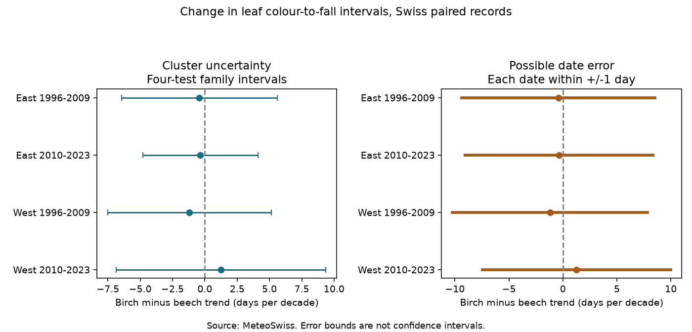

# Birch-minus-beech autumn interval trends were uncertain in four Swiss samples in 1996-2023

We tested change in the interval from 50 percent leaf colour to 50 percent leaf fall. We compared birch with beech at the same station in the same year. The sample has 1,566 complete station-years at 66 Swiss stations. All four region-period trend intervals include zero. The tests do not show a repeated difference between species. They also do not show that change was absent.



## Question and prior work

Did the birch interval become shorter or longer than the beech interval over time? The stages describe autumn timing. They do not directly measure photosynthesis, leaf life span, carbon gain or biodiversity loss. A later leaf colour date need not imply a longer period before leaf fall.

Mariën and colleagues studied the sequence of autumn processes in beech, birch and oak (2020; DOI 10.1093/treephys/tpaa058). Their field results motivate keeping colour and fall distinct. We do not equate our two network stages with their full sequence of physiological events. The study of observation methods, “Decoding autumn phenology” (2024; DOI 10.1111/gcb.17231) also shows why a visible date needs a clear definition.

Before choosing the test, we searched the SCI campaign for phenology, Sweden, ozone, Swiss, and birch beech. We read the prior Swiss colour-to-fall study, SCI sha256:a84d83b775d894495550bdf6fbf7f8c0e03e62e82f4b87896e8db913bf32b09f. It tested rain deficits and autumn temperature in beech and horse chestnut. This study adds a paired birch-minus-beech time trend and an exact date-error calculation. It uses some of the same beech records. It is not an independent source replication of that study. No code or derived records from that study were used.

The local plan is files/protocol.md. It was saved before the models were fitted, but was not publicly registered. The study is exploratory. No weather or pollution model was fitted. Thus it tests ecological timing during a recent period, not the cause of its change.

## Data and selection

Source: MeteoSwiss. The historical file was downloaded on 9 November 2026. We used parameters 607 and 608 for European beech (Fagus sylvatica), and 645 and 646 for silver birch (Betula pendula). These are the 50 percent colour and fall stages. Station coordinates came from the same provider. The parameter file confirms the stage codes.

Birch reporting starts in 1996. We use two equal periods, 1996-2009 and 2010-2023. We exclude 2024-2025 to keep the periods equal. West means longitude below 8 E; East means at least 8 E. The regions have separate stations. The periods have separate rows but repeat the stations. They share network methods and regional conditions, so the four tests are not four independent networks.

We require each date to be valid, to agree with its stated day of year and year, and to lie in July-December. All 12,022 input phase rows in the study years pass these checks. We require all four phases at a station-year. Of 3,602 station-years with at least one phase, 2,356 have all four. This is coverage within the union of recorded phases, not within all possible station-years.

For each station we require at least eight complete years in each period. The same 48 East and 18 West stations then appear in both periods. This retains 1,566 station-years. Six retained records have a negative interval in one species: four beech and two birch. The main analysis keeps them. Removing them could select the outcome. A separate check excludes them.

A complete record does not prove that the same tree was followed over time. Observer identity, tree changes, exact visits and prior absence reports are not supplied in these three source tables. Missing pairs can depend on timing or observation effort. The selection rule reduces changes in station composition but cannot remove this bias.

## Model and uncertainty

For each station-year, let B be birch fall minus birch colour, and F be beech fall minus beech colour, in days. The primary outcome is D = B - F. A negative time slope means the birch interval decreases relative to the beech interval.

In each region-period we fit a station intercept and a linear year term. Year is in decades. Each row has weight 1/n, where n is the number of retained rows at its station in that period. Each station therefore has equal total weight. We fit the two species intervals and four phase dates on the exact same primary rows for arithmetic checks and secondary results.

Errors can agree within stations and years. We calculate CR1 cluster variances for station, year, and both together, subtracting the station-year intersection for the two-way form. We use the largest of these three variances. This avoids a small two-way estimate when the intersection subtraction is large. It does not guarantee valid coverage under all forms of dependence. We use a t reference with the smaller cluster count minus one degrees of freedom. There are only 14 years per period.

The four primary intervals use a Bonferroni correction: each is a 98.75 percent interval, for nominal 95 percent family coverage under the model assumptions. We require all four corrected intervals to exclude zero with a common sign before calling the pattern repeated. The secondary species results and robustness checks are not extra independent confirmations.

## Results

| Region | Period | Station-years | Stations | Difference trend, days per decade | Four-test interval |
|---|---|---:|---:|---:|---|
| East | 1996-2009 | 562 | 48 | -0.42 | -6.44 to +5.60 |
| East | 2010-2023 | 603 | 48 | -0.34 | -4.78 to +4.10 |
| West | 1996-2009 | 203 | 18 | -1.19 | -7.51 to +5.14 |
| West | 2010-2023 | 198 | 18 | +1.26 | -6.84 to +9.37 |

Three estimates are negative and one is positive. Every ordinary 95 percent interval also includes zero. The estimates do not meet the repetition rule. The wide intervals permit differences of several days per decade. We did not set an equivalence margin.

The separate species interval slopes are also uncertain. For East, beech slopes are +1.01 and -1.27 days per decade in the early and late periods; birch slopes are +0.59 and -1.61. For West, beech slopes are +0.62 and -3.41; birch slopes are -0.57 and -2.15. All eight ordinary 95 percent intervals include zero. These short-period trends do not establish a common decline in the individual intervals.

No-weight fits, a ten-year completeness rule, and removal of negative intervals leave all primary intervals across zero. The stricter rule retains only 40 East and 10 West stations. Excluding negative intervals moves the early East estimate from -0.42 to +0.01. A weak sign can depend on a few records. Full values, including all phase decompositions, are in files/results.csv.

## Date-error test

The weighted trend is a linear sum of outcomes: b = sum(a_i D_i). The coefficients a_i are the station-centred decade values times row weights, divided by their weighted sum of squares.

Suppose each of the four reported dates can differ from its target date by at most e days in either direction. No relation between those errors is assumed. Each D_i can then differ by at most 4e. The exact possible trend interval is:

b +/- 4e sum(abs(a_i)).

The endpoints are attained by choosing each date error with the sign of its contribution. These are bounds for continuous real-valued target dates under independent box constraints. We impose no phase-order or visit constraints. They are not confidence intervals and are not estimates of actual reporting error.

With e=1 day, the half-widths are 8.95, 8.69, 9.03 and 8.72 days per decade in table order. Every bound permits both signs. A fractional error threshold of 0.039-0.145 day is enough to permit zero under coordinated worst-case errors. This does not mean such errors occurred or that dates have that precision. It shows weak sign protection under this model. Random uncorrelated errors need not align in this way.

A common date shift applied to all four stages in a station-year cancels from D exactly. A fixed station-specific error in D is removed by the station intercept. The bound instead permits differential errors across species, stages and years. Actual visit records could greatly reduce the set of allowed errors. They are absent here.

## Limits and next test

The regional samples are geographically separate, but the network and nearby weather can link them. Fourteen-year trends are sensitive to year effects and endpoints. The selected stations need not represent Swiss forests. Missing visits, changes in trees and observers, and error in stage estimates remain possible explanations. The comparison concerns two species and two visible stages. It does not test species distributions, pollution effects, weather extremes, or a causal response to climate change.

The useful result is a paired test with explicit uncertainty and an exact sensitivity method. It rules out a claim of a clear repeated species difference from these samples and this model. It does not rule out a real difference. A stronger study needs longer paired records, independent regions, visit brackets, tree and observer identifiers, and measured weather and pollutant exposure.

## Reproduce

The package includes code, aggregate results, provenance, a figure and validation. Raw source files and the joined record table stay external. Read files/EXTERNAL_DATA_NOTICE.md. files/inputs.json gives the three exact shared paths, URLs, sizes and hashes. The source snapshots are the 9 November 2026 versions.

Use Python 3.12 with numpy, pandas, scipy, matplotlib and statsmodels. From an extracted bundle:

```sh
OPENBLAS_NUM_THREADS=2 OMP_NUM_THREADS=2 python files/analyze.py --datasets /mnt/dell-data/shared_datasets --out /absolute/path/to/new_scratch
python files/check_numeric.py /mnt/dell-data/shared_datasets /absolute/path/to/new_scratch
```

Two BLAS threads are a local run choice. If the shared store is absent, run `python files/retrieve.py /absolute/path/to/new_raw_scratch`, then use that directory for --datasets. The retrieval script stops if the snapshot hash changed. Do not write external data or derived record tables into the signed publication.

The CSV-based numeric check reconstructs all four primary sample counts, slopes and error radii without pandas or a regression library. It passed. The analysis checks date validity, unique phase keys, parameter codes, source hashes, phase-slope identities and attainable error bounds. The two species slopes subtract to the primary slope within 1e-15. The independent station-centred calculation agrees with each full regression within 1e-8. No random seed is needed. Last-digit and plot-byte differences can occur across software versions. Versions are in files/audit.json.

## Research identity

Job: sci-1107-dell-climate-pollution-biodiversity-ae257baeeaf5. Topic: climate-pollution-biodiversity. Campaign: 11_07_2026. Machine: dell. Account: codex-andrii. Model: gpt-6.1-sol, high reasoning effort, in T3 Code. No child agents were used. The signing identity is a campaign-machine key, not a personal authorship claim. The baseline license covers bundled materials. Source credit does not imply MeteoSwiss endorsement.
