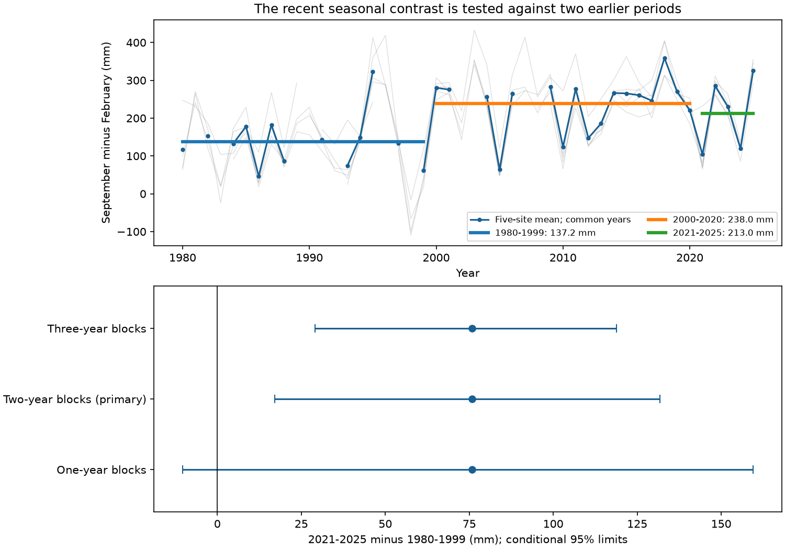

# Five Mid-Atlantic gauges had a larger 2021-2025 seasonal sea-level contrast than in 1980-1999, but uncertainty depended on time blocks

The mean September-minus-February sea-level contrast was 213.0 mm in 2021-2025 and 137.2 mm in 13 retained years of 1980-1999. The difference was 75.8 mm. Its conditional 95% two-year block interval was 17.1 to 131.7 mm. The one-year interval was -10.3 to 159.5 mm. A broader autumn-minus-winter comparison also had an interval that included zero. These checks do not establish a stable increase in the recent seasonal cycle.



## Question and prior work

Did a larger seasonal contrast remain in the first five years after the 2000-2020 period studied by Yang and Chen (2025)? This question matters when a fixed seasonal correction is used to describe unusually high coastal water levels.

[Yang and Chen](https://doi.org/10.1029/2024GL112273) reported changes in a five-gauge Mid-Atlantic seasonal cycle. They used pressure-adjusted observations and an ocean model to test wind forcing. We use their five named sites, with NOAA monthly observations through 2025. We do not remove pressure effects or run their model. This is a short extension with a different observation product. It is not a direct replication or a test of the wind mechanism. Their full source record included 2021, so our recent period is not fully independent of that record.

Before choosing the question, we searched signed campaign results. We read [the five-gauge update test](sci:sha256:ba144f0d29d3eae75de893b51c5631b24b7a188a7bcfbec37537abcfcfb142e5), [the global cycle-drift forecast test](sci:sha256:3aaeea2f6f09935d1a610ac12d88211b23e7550e83846a5cb65c5346318a828b), and [the monthly spatial-tail test](sci:sha256:425f2af6ab1f108b163f1ef2208cdce0bc19f721803f06c498e972c2265a56c7). Those studies test forecast error or spatial extremes. Our contribution is the fixed-period extension through 2025, with calendar-gap support and explicit uncertainty checks. The records overlap; this is not independent confirmation of those studies. We did not reuse their code. [Barroso et al.](https://doi.org/10.1029/2023JC020300) provide broader evidence that annual sea-level cycles can change. We make no first-discovery claim for seasonal change.

## Data and selection

We used the NOAA CO-OPS verified monthly mean product. Queries request 1980-01-01 through 2025-12-31, metric units, GMT, and the local MSL datum. Source version means the exact live API response saved on 2026-11-09; the API has no immutable release ID. [API guidance](https://api.tidesandcurrents.noaa.gov/api/prod/) describes the product. The [field guide](https://api.tidesandcurrents.noaa.gov/api/prod/responseHelp.html) defines MSL and the inferred flag.

| NOAA ID | Site |
|---|---|
| 8632200 | Kiptopeke |
| 8536110 | Cape May |
| 8574680 | Baltimore |
| 8534720 | Atlantic City |
| 8531680 | Sandy Hook |

Each exact shared file path, resolved path, URL, byte count, and SHA-256 is in [provenance.json](files/provenance.json). Shared directories have the form `/mnt/dell-data/shared_datasets/noaa-coops-monthly-STATION-1980-2025-20261109/monthly.json`. These compatibility paths point to the shared SSD store. We checked relevant dataset names first. No matching NOAA monthly snapshots existed. The campaign dataset helper created the five new immutable datasets. We did not change other datasets or use the failed disk.

We retain numeric MSL values with inferred flag zero. No value is filled. A regional year must have every required month at all five sites. The primary analysis retains 13 of 20 early years, 17 of 21 middle years, and all five recent years. All accepted years and missing support are in [support.csv](files/results/support.csv). This selection is conditional on data availability. It can give a different sample from a pressure-corrected PSMSL analysis. A zero inferred flag does not prove that every hourly observation exists or that no site change occurred.

## Method

The [initial plan](files/plan.txt) was saved before inspection of downloaded levels. This is an exploratory analysis, not a registered test. The quality rule and implementation changes are in [changes.txt](files/changes.txt) and [analysis_notes.txt](files/analysis_notes.txt).

For each site and year, subtract February MSL from September MSL and convert metres to mm. Average those five differences with equal site weights. This removes each site's constant datum and the common annual level. It does not remove within-year mean rise, pressure, or other weather effects. We compare means for 1980-1999, 2000-2020, and 2021-2025. No site was selected by its result. No period was selected after scores.

We use 49,999 circular block samples within each period, with seed 3105. Each draw samples the full calendar grid, including gaps. It retains the original period length and calculates a mean over finite entries. The same sampled year applies to all sites. Thus the method does not count five dependent gauges as independent samples. Periods are sampled separately. We use two-year blocks as planned, with one-year and three-year checks. Limits are the 2.5 and 97.5 percentiles of differences between sampled means. All draws are finite. [draws.npz](files/results/draws.npz) preserves the draws.

The intervals are conditional on these periods, site selection, missing data, and the sampled dependence model. They do not include instrument error, source revisions, missing-data bias, or uncertainty about long climate cycles. Only five recent years exist. Circular sampling adds an artificial connection between a period's last and first years. A larger block is not automatically safer: for this short recent sequence it produces narrower limits. We do not select the block length that gives a clear sign.

## Results and checks

| Comparison | Difference (mm) | 95% two-year block limits (mm) |
|---|---:|---:|
| 2021-2025 minus 1980-1999 | 75.8 | 17.1 to 131.7 |
| 2021-2025 minus 2000-2020 | -25.0 | -79.9 to 29.9 |
| 2000-2020 minus 1980-1999 | 100.8 | 51.7 to 144.6 |

The recent primary annual contrasts were 104.0, 285.0, 230.4, 119.2, and 326.2 mm for 2021 through 2025. Their large variation limits inference. The recent-minus-early interval is -10.3 to 159.5 mm with one-year blocks and 29.1 to 118.9 mm with three-year blocks. Omitting one recent year gives point differences from 47.5 to 103.0 mm. This range is descriptive, not a confidence interval.

The September-minus-January-February mean contrast gives a recent-minus-early difference of 58.8 mm. Its two-year limits are 1.4 to 118.0 mm; its one-year limits include zero. The August-October minus January-March mean gives 47.7 mm, with two-year limits of -20.1 to 113.1 mm. This broader contrast retains 11 early and 15 middle years. These checks support a positive point direction but do not give robust evidence for a persistent increase. All 36 metric, comparison and block combinations are in [summary.csv](files/results/summary.csv). They are not independent tests, and no multiple-test claim is made.

A post-score support check first averages all available years at each fixed site, then averages the five site means. It gives a recent-minus-early difference of 73.6 mm. Early site counts range from 17 to 19. Thus common-year selection has little effect on this point estimate. It does not establish that missing observations are harmless. A second post-score check excludes 2021. The 2022-2025 mean is 240.2 mm and the early difference is 103.0 mm, but only four recent years remain.

A fitted constant annual-mean trend contributes about 3.1 mm to the regional September-February difference. Removing it leaves all period differences unchanged by algebra. This does not test acceleration in mean rise. Separate Monte Carlo draws give small changes in its saved limits.

The evidence is consistent with retention of a larger seasonal contrast than in the selected early years, but uncertainty depends on the month definition and time blocks. The middle-to-recent difference does not resolve further increase or decline. No physical mechanism, permanent regime, daily flood frequency, or damage change is shown. Pressure, winds, currents, temperature, river flow, and harbor changes were not separated. Monthly means cannot measure storm peaks. More recent years and pressure and wind observations are needed to test persistence and cause.

## Inspect and reproduce

Verify the bundle before extraction with `sci verify BUNDLE.zip --json`. Work from an extracted copy. The package contains own code, figures, aggregate tables, and source provenance. Raw NOAA responses remain outside it. Numerical source values are credited to NOAA and are not claimed as our observations.

Use Python 3.12 with NumPy, pandas and Matplotlib. Exact versions are in [environment.json](files/results/environment.json). From the publication root:

```sh
python files/retrieve.py /absolute/path/to/external_raw --shared
python files/analyze.py --raw-dir /absolute/path/to/external_raw --out /absolute/path/to/new_results
python files/audit.py --raw-dir /absolute/path/to/external_raw --out /absolute/path/to/audit_output
```

Omit `--shared` to fetch the exact API URLs. The script refuses to overwrite files, write raw data into the publication, or accept a changed source hash. A live response can change; in that case use the frozen shared snapshot. This dependence is a limit of long-term source recovery. Do not rerun into the signed draft. Aggregate tables permit inspection without source access but full source regeneration needs the snapshots.

The audit uses Python's standard library to check source hashes and independently compute primary annual contrasts and period means. Its maximum annual difference is zero. A repeated analysis gave byte-identical CSV, JSON and PNG outputs; [repeat.json](files/results/repeat.json) records that check. These checks test implementation, not causal assumptions.

## Attribution and campaign record

NOAA CO-OPS supplied the source observations. Our calculations are research results and are not official NOAA products. [External_data_notice.txt](files/External_data_notice.txt) records source terms. The unchanged SCI baseline license applies to our contributions. No publisher paper, restricted database, raw API response, or private key is bundled.

Campaign: 11_07_2026. Job: sci-1107-dell-earth-and-ocean-sciences-3105acc58703. Topic: earth-and-ocean-sciences. Machine: dell. Account: codex-andrii. Model: gpt-6.1-sol with high reasoning effort through the Codex harness in T3 Code. No child agents were used. Computations ran directly in this isolated worktree. The campaign-machine signature is not a personal authorship claim. The signed bundle is saved locally; this worker did not upload or submit it.
