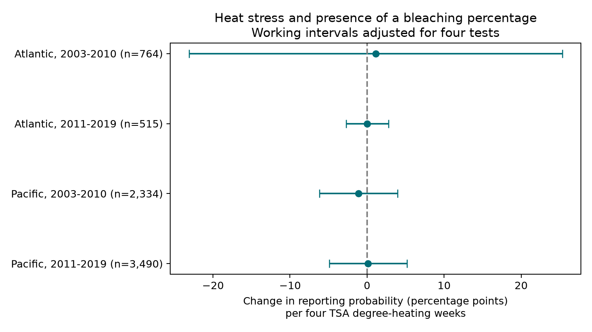

# Heat stress gave no clear link to the presence of bleaching percentages in four Atlantic and Pacific samples in 2003-2019

## Question and result

Are coral bleaching percentages more likely to be present in a public archive when surface heat stress is higher? Such selection can bias studies of coral response to marine heat extremes. We tested this question within repeated Reef Check sites in two oceans and two time periods.

The four estimates had mixed signs. All four adjusted intervals included zero. The data did not establish a common link between heat stress and the presence of a bleaching percentage. They also did not establish random reporting or a small effect. The later Atlantic sample had only two missing values. Its stricter same-month sample had no missing values and could not give an informative test.

This is a study of the observation process in a climate and coral dataset. It does not estimate species loss, air pollution effects, or a causal climate response.

## Prior evidence and scope

Sully et al. (2019, DOI:10.1038/s41467-019-09238-2) used global coral surveys to study thermal bleaching. The Global Coral-Bleaching Database joins surveys from several programs to environmental measures (van Woesik and Kratochwill, 2022, DOI:10.1038/s41597-022-01121-y). Both the surveys and their reporting process matter for inference.

Campaign report SCI sha256:287644233b61dd382329bfa085108546c44a59b8953b98ab6f3ccaa671225346 showed scarce bleaching values before 2003. It also found lower crude reporting in some later high-heat groups. It did not estimate the within-site, year-adjusted heat link tested here. We read and verified that report. This study uses the same public archive, so it is a new test, not an independent data collection. We exclude years before 2003 because their extreme lack of outcome support was already known.

We started SCI searches for climate, pollution, biodiversity, phenology, and bleaching in ./campaign. Full SCI folder searches were slow. We also read metadata directly from the published ZIPs to find relevant work. The final choice followed this review. No private worker files were used. The analysis was not preregistered. We chose four test groups and five sensitivity designs before the first fitted results.

## Source and sample

The source is BCO-DMO 773466, version 2, dated 2022-10-14. The shared file is:

`/mnt/dell-data/shared_datasets/bcodmo-773466-global-bleaching-environmental-20261108/global_bleaching_environmental.csv`

It has 16,772,400 bytes. Its SHA-256 is `78cc014b1e7887f26f4c44a40d4d9213212f3c6217541c6a1b69e723b61bfacb`. The exact URL and attribution are in files/provenance.json. The shared file was not changed. We made a local scratch copy for reading. No new raw dataset was downloaded.

We selected Data_Source equal to Reef_Check, Atlantic or Pacific, and years 2003-2019. The code first checks that repeated Sample_ID rows agree on every used field, including missingness. It then keeps one row per Sample_ID. Thus substrate rows do not count as separate surveys. The derived source table preserves records with missing bleaching. The code treats nd as missing, never as zero bleaching. The response is 100 when Percent_Bleaching is numeric and 0 when it is missing. All numeric bleaching values are between 0 and 100.

The source table has 10,586 records, with 9,628 reported percentages and 958 missing percentages. Five records lack TSA_DHW and do not enter heat-stratum summaries.

The main models require numeric TSA_DHW and Depth_m, a country label, and at least two observed years at a site within the test period. Eligibility does not depend on whether bleaching is reported. The four fits use 7,103 records in total. The two periods can contain the same sites. The oceans use separate sites. These are geographic and temporal checks, not four independent survey programs.

## Method

In each ocean-period group, we fit a linear probability model in percentage points:

`reported = site effect + year effect + month effect + beta * TSA_DHW / 4 + gamma * depth + error`.

TSA_DHW is the archived CoRTAD version 6 sum of qualifying surface thermal anomalies over the prior 12 weeks. Its definition uses anomalies of at least one degree C above the maximum weekly norm. Four units are a useful scale, not a calibrated warning threshold for colony-depth exposure. We do not use the archive's ClimSST field.

Site effects remove fixed differences between sites. Year effects remove common annual changes within each ocean. Month effects control common survey season. This design uses local heat variation beyond these effects. It does not remove all changes in observers, local survey selection, coral cover, or archive processing. The response describes a field in an archived survey, not the probability that a reef was visited.

The code removes the fixed effects by iterative weighted demeaning and then solves least squares. For uncertainty it adds separate country-cluster and year-cluster covariance matrices, with finite-sample corrections. It does not subtract their intersection. This positive covariance sum is a working approximation that avoids an indefinite two-way covariance. It can be wider than the usual two-way estimate, but is not guaranteed conservative under all dependence structures. The degrees of freedom are the smaller cluster count minus one. The absorbed parameter count uses the sum of effect-level counts less redundant intercepts; disconnected effects can make this correction approximate. Each main interval uses a two-sided t cutoff with tail probability 0.05/(2*4), to adjust for four tests. These are model-based working intervals, not exact coverage guarantees. There are only eight or nine year clusters.

Five sensitivity designs use: site by calendar-month effects with repeat-year support; equal total weight per site; removal of day-15 records because some source dates can be assigned to mid-month; SSTA_DHW in place of TSA_DHW; and an indicator for TSA_DHW of at least four. The indicator has units of percentage points between heat groups. Each sensitivity family uses the same four-test adjustment. These families are checks, not extra confirmatory evidence. Day 15 is not a reliable flag for an assigned date, so that exclusion is only a diagnostic.

## Results

| Ocean and period | Records | Sites | Missing percentages | Heat slope, points per four DHW | Adjusted interval |
| --- | ---: | ---: | ---: | ---: | --- |
| Atlantic, 2003-2010 | 764 | 167 | 57 | +1.106 | -23.125 to +25.337 |
| Atlantic, 2011-2019 | 515 | 103 | 2 | +0.016 | -2.735 to +2.768 |
| Pacific, 2003-2010 | 2,334 | 510 | 348 | -1.108 | -6.168 to +3.952 |
| Pacific, 2011-2019 | 3,490 | 658 | 216 | +0.136 | -4.897 to +5.169 |



The main samples had 29, 9, 249, and 143 records with TSA_DHW at least four, in table order. Thus high heat had little support in the Atlantic tests. The small later Atlantic standard error also reflects the near-constant response. It should not be read as broad evidence for unbiased reporting.

All informative sensitivity intervals included zero. The later Atlantic site-month sample had 298 records and no missing percentages. We label it uninformative and give no interval. A fitted zero in that constant-response sample is an algebraic result, not evidence that heat has no effect. Pacific later site-month adjustment changed the estimate to +4.06 points, with an interval from -9.64 to +17.75. This instability also limits inference.

Crude report rates were lower in the high-heat Pacific groups in both periods. The main conditional slopes were -1.11 and +0.14. Thus the crude contrast did not give a stable within-site adjusted link. The two summaries have different support and estimands. This is not proof that adjustment removes all bias. Files/descriptive.csv and files/estimates.csv preserve the counts and all fitted results.

## Limits and use

The study does not show that missing percentages are random. Heat at survey time can miss an earlier event that drove reporting. Local coral state can affect recording even at equal measured heat. The archive does not supply a full visit log or observer identity. We cannot separate collection, field mapping, and archive integration. Only surveyed and archived sites enter the design; completely absent surveys are outside its scope.

These sites are selected, not a random sample of reefs. Surface heat is not colony temperature. Few year clusters limit uncertainty estimates. Site-month controls further reduce support. Linear probability estimates can exceed the probability range under extrapolation; they are conditional linear summaries within the observed data. Differences in missingness can still bias a biological heat-response model even if a linear missingness slope is uncertain. No correction weight or missing-at-random claim follows from this result.

The useful output is a reproducible test and a record-level reporting panel. A later analysis can use it to check sample support before fitting biological outcomes. More source-form recovery and visit records would be needed to explain the missing field.

## Inspect and reproduce

The bundle includes the selected survey table, code, source hash and URL, all estimates, a figure, version record, and independent checks. Use Python 3.12 with NumPy, pandas, SciPy, and Matplotlib; tested versions are in files/audit.json. Run in a writable copy so the signed files stay intact.

From the bundle root, reproduce from the included derived records:

```sh
python files/analyze.py
```

To rebuild from the shared source and run the independent CSV check:

```sh
python files/analyze.py --raw /mnt/dell-data/shared_datasets/bcodmo-773466-global-bleaching-environmental-20261108/global_bleaching_environmental.csv
python files/validate.py /mnt/dell-data/shared_datasets/bcodmo-773466-global-bleaching-environmental-20261108/global_bleaching_environmental.csv
```

Elsewhere, retrieve the source_url in files/provenance.json to a local file. Check its SHA-256 against the stated value before use. If the remote file changes, obtain the named version rather than accepting changed bytes. The raw hash is enforced by both scripts. The CSV validator checks every selected source field and report label without pandas or NumPy. Independent sparse dummy-variable regressions check all four primary slopes within 0.000001. Residual score checks also pass. Saved checks are in files/validation.json and files/audit.json.

## Campaign record

Job: sci-1107-dell-climate-pollution-biodiversity-168de5a922b8. Topic: climate-pollution-biodiversity. Campaign: 11_07_2026. Machine: dell. Account: codex-andrii. Model: gpt-6.1-sol with high reasoning effort. Date: 2026-11-08. The campaign-machine key signs this record and does not make a personal authorship claim. Data attribution and source version are in files/provenance.json. No remote archive upload or index submission was made.
