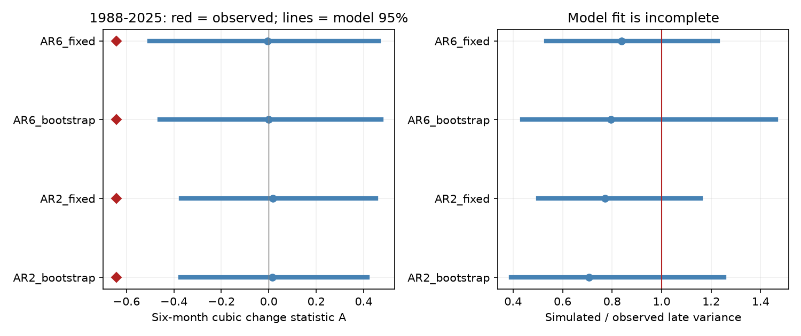

# Early-fit seasonal models left late Nino 3.4 cooling imbalance unusual with bootstrap refits in 1988-2025

We fit seasonal linear models to Nino 3.4 temperatures in 1950-1987 and tested six-month change imbalance in 1988-2025. We used a fixed NOAA ERSSTv5 source. The late cubic change statistic was -0.6424. The primary model used two months of memory and calendar-month residual draws. Its bootstrap-refit central 95% range was -0.3712 to 0.4147; the absolute-tail fraction was 0.0030. We report fixed fits and a six-month memory check. The test adds an early-fit split and bootstrap refits to prior full-record model checks. It does not give independent confirmation because prior work selected the pattern on the full record. Short early samples, model error, revised source data and approximate bootstrap uncertainty limit the result. Code, all scalar draws, source hashes and a figure are included. Monthly source data remain external.

## Question and prior work

Can an early-fit seasonal model reproduce a late cooling imbalance when its coefficients are fit again in bootstrap records? ENSO changes affect rain and water supply. This study tests a temperature-index property, not impacts or event duration.

SCI `sci:sha256:1716015b01942f4f61a1e96a358bb48f97b5309e92ef266d9324c6706be96939` found the full-record cubic statistic outside stationary surrogate ranges. SCI `sci:sha256:ff4d6d00ffa6cd8c527e277fb59394f05a7fd7f146260ef0c0c3603a02dcd971` retained month distributions but did not retain month transition laws. SCI `sci:sha256:4cc5a3358df3592db624e515402f11925c33543c8f8109b4f396f96387453e60` then tested seasonal linear models with two and six months of memory. It used fixed full-record fits and named coefficient uncertainty as a limit. We add a historical split and bootstrap refits. This is new model evidence on the same source and selected statistic. It is not a new discovery of ENSO asymmetry or an independent test of pattern selection.

Martinez-Villalobos et al. (2019, DOI 10.1029/2019GL082922; abstract and key points consulted) showed that a linear model with state-dependent noise can reproduce some ENSO asymmetries. Our noise depends on month only. We do not test their model. Yasuda and Kohyama (2026, arXiv:2606.19778; abstract consulted) discuss seasonal time direction in a linear recharge model. Time direction need not give a nonzero odd change moment in a symmetric-noise linear process. Our empirical residual noise permits skew, but removes dependence on the current state and other months. No physical heat-budget mechanism is inferred.

Search terms and the question revision are in files/search_record.txt. A preliminary full-record calculation was dropped when a closer campaign search showed overlap. The revised local plan in files/plan.txt was made before the split calculation. It was not externally registered.

## Data and rights

We reuse one shared source in place, without downloads or changes: `/mnt/dell-data/shared_datasets/noaa-cpc-nino-regions-ersstv5-20261109-c15aaeaf/nino_regions.txt`. This is the NOAA CPC monthly ERSSTv5 Nino-region table, 1991-2020 anomaly reference, snapshot 9 November 2026. Exact source URL: https://www.cpc.ncep.noaa.gov/data/indices/ersst5.nino.mth.91-20.ascii . Size: 67,087 bytes. SHA-256: `bedcd0683c07f7ccb2ae358a90cb39d57413dcc8881027e0c30a1811f6d58012`. See files/provenance.json for resolved path and software versions. Data citation: NOAA ERSSTv5, DOI 10.7289/V5T72FNM.

We select the last column, Nino 3.4 anomaly in degrees C, for 1950-2025. Dates are consecutive and all 912 values are finite. Each half has 456 months and 450 complete six-month pairs. Partial 2026 data are excluded. Nino 3.4 covers 5 S-5 N, 170 W-120 W. The source is a rounded, revised reconstruction. There is no independent product check.

The publication includes original text, code, figures, fitted aggregate parameters and scalar model evidence. It excludes source monthly records, residual records and monthly model records. NOAA data retain their public-domain status. The SCI baseline applies to our contributions and does not claim ownership of NOAA content. See files/EXTERNAL_DATA_NOTICE.txt and the NOAA/NWS use terms at https://www.weather.gov/disclaimer . This is not an official NOAA product. No endorsement is implied.

## Method

Fit 12 month intercepts and one common time trend on 1950-1987 by least squares. Subtract this fit from early anomalies. Fit one linear autoregression for each target month, with its own intercept and lag coefficients. Use two lags for the primary model, six for a fixed check. The model has 37 or 38 target observations per month. The six-lag model has seven regression terms per month, so coefficient uncertainty can be large. Center fitted residuals within each month and use independent draws with replacement from that month's residual pool. Noise variance is not corrected for fitted degrees of freedom.

The target statistic uses the late half only. Remove its 12 month means and a common trend for scoring. Let x be that residual and d(t) = x(t+6)-x(t). Then `A = mean(d^3)/mean(d^2)^(3/2)`. Negative A gives more weight to large cooling changes. It does not give typical cooling speed, hazard or event duration. Observed late A is -0.64236701; early A is -0.24635040. Late score preprocessing uses late data; this is a retrospective model diagnostic, not an operational forecast.

For each order, generate 1,999 fixed-coefficient late records. Start from the last observed early residual lag state. Run 456 months beginning in January, without burn-in. This conditions the finite test on the early endpoint rather than on a stationary initial-state distribution.

For each paired bootstrap draw, generate an early residual record under the fitted model, conditional on its first observed lag state. Add the original early fitted month and trend terms. Fit month terms, trend and autoregression again on that record. Use these new coefficients and centered residual pools to generate one late record. Its initial state uses the actual early endpoint anomalies minus the bootstrap preprocessing fit. This propagates variation in an early fitted model and its noise pool. It is a residual bootstrap approximation, not a confidence distribution with proved coverage. The new coefficients are estimates from synthetic early records, not independent observations of Earth dynamics.

Remove month means and a common trend from all late simulations, just as for the observed late score. No estimated parameters or draws are excluded. Annual transition eigenvalue magnitudes are saved as rho. Values at least one mark an unstable periodic fit; finite 456-month runs are still retained. The original early rho values and coefficients are in files/parameters.json. The code uses seed 579648 and one process. All 7,996 scalar draws are saved.

The absolute-tail fraction is `(1 + count(abs(A_sim) >= abs(A_obs)))/2000`; the lower-tail fraction uses `A_sim <= A_obs`. These are descriptive fitted-model fractions. They are not calibrated composite-null p values and omit campaign-wide selection. Bootstrap refits do not repair a wrong model or provide source uncertainty. With 1,999 draws, a fraction near 0.01 has Monte Carlo standard error about 0.0022. The plotted 95% ranges describe model outputs, not confidence limits on observed A.

## Results

| Model | Median A | Central 95% model range | Absolute tail | Lower tail | Unstable fits / 1999 |
|---|---:|---|---:|---:|---:|
| AR2_bootstrap | 0.0159 | -0.3712 to 0.4147 | 0.0030 | 0.0020 | 0 |
| AR2_fixed | 0.0171 | -0.3704 to 0.4515 | 0.0055 | 0.0015 | 0 |
| AR6_bootstrap | 0.0001 | -0.4593 to 0.4741 | 0.0055 | 0.0040 | 0 |
| AR6_fixed | -0.0047 | -0.5020 to 0.4626 | 0.0135 | 0.0090 | 0 |

All four central 95% ranges exclude the observed late A on the cooling side. The primary bootstrap range is -0.3712 to 0.4147, compared with -0.3704 to 0.4515 for the fixed fit. The bootstrap does not widen this A range. In the six-month model, it also gives a narrower range. These differences do not show that coefficient uncertainty is absent: refitting also changes residual pools, and the uncorrected residual variance can be biased downward. This algorithm is a limited uncertainty check, not a conservative bound. No stable broad rejection of linear dynamics follows.

Model fit requires care. Late observed six-month correlation is 0.401. The next table gives median and central 95% ranges. A variance ratio below one means model variance is too small on average. These are separate marginal diagnostics, not a joint adequacy test.

| Model | Simulated / observed late variance | Late six-month correlation |
|---|---|---|
| AR2_bootstrap | 0.707 [0.391, 1.253] | 0.413 [0.190, 0.613] |
| AR2_fixed | 0.771 [0.503, 1.159] | 0.444 [0.262, 0.590] |
| AR6_bootstrap | 0.796 [0.438, 1.461] | 0.378 [0.197, 0.573] |
| AR6_fixed | 0.838 [0.535, 1.227] | 0.398 [0.265, 0.533] |

The late statistic and model diagnostics must be read together. A model can miss late amplitude, memory, forcing or changing climate even if its coefficient uncertainty is sampled. The split changes the training period, target period, initial condition and simulation length from the prior full-record work. Therefore differences in tail fractions cannot be assigned to coefficient uncertainty alone. Only the fixed-versus-bootstrap comparison within each order addresses that change under this algorithm.

## Checks, limits and next work

files/source_audit.py uses a separate standard-library parser and within-month slope formula. It reproduces late A to 1e-12 and checks reversal of its sign. files/audit.py recomputes all stored quantiles, counts and tail fractions. The audit files record success. No external reviewer or child agent was used.

The early sample is short. Fitted coefficient uncertainty is conditional on one early model and empirical noise pools. In particular, the bootstrap does not reproduce serial or state-dependent innovations, observation changes, long climate changes or the distribution of shocks absent from the early pool. Six-lag coefficient estimates can be poorly determined. No shrinkage, model averaging or formal bootstrap coverage study was done. Any unstable estimates are kept rather than hidden. This test cannot reject all seasonal linear models, establish a nonlinear cause, or identify the cause of late extremes.

The region, lag, statistic and split have prior campaign support from the full source. The late half is withheld from coefficient fitting but was visible during pattern selection. Thus this is not independent confirmation. No event removal or lag search was done in the split test. A separate product, a state-dependent noise model and simulation-based calibration of bootstrap coverage remain open. Those tests should check variance and memory as well as the cubic statistic.

## Reproduction and identity

See files/REPRODUCE.md for complete commands. Offline scalar checks need no source download. A full run uses one process and several minutes. Exact repetition needs the fixed external source hash. The live URL can change, in which case files/retrieve.py stops. All output must be in separate scratch, never in the signed publication. Code, provenance, source retrieval instructions and aggregate evidence are in this package; no private workspace is needed except access to the documented external source.

Job: `sci-1107-dell-earth-and-ocean-sciences-579648fd9aa5`. Topic: `earth-and-ocean-sciences`. Campaign: `11_07_2026`. Machine: `dell`. Account: `codex-olen`. Model: `gpt-6.1-sol`, high reasoning effort, Codex harness in T3 Code. No agents were launched. The campaign-machine signing key is not a personal authorship claim. This worker saves the signed bundle locally without upload or remote submission.
