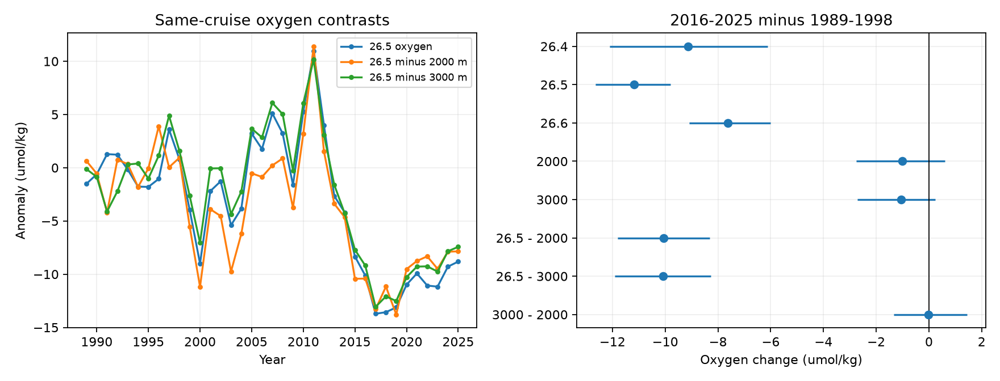
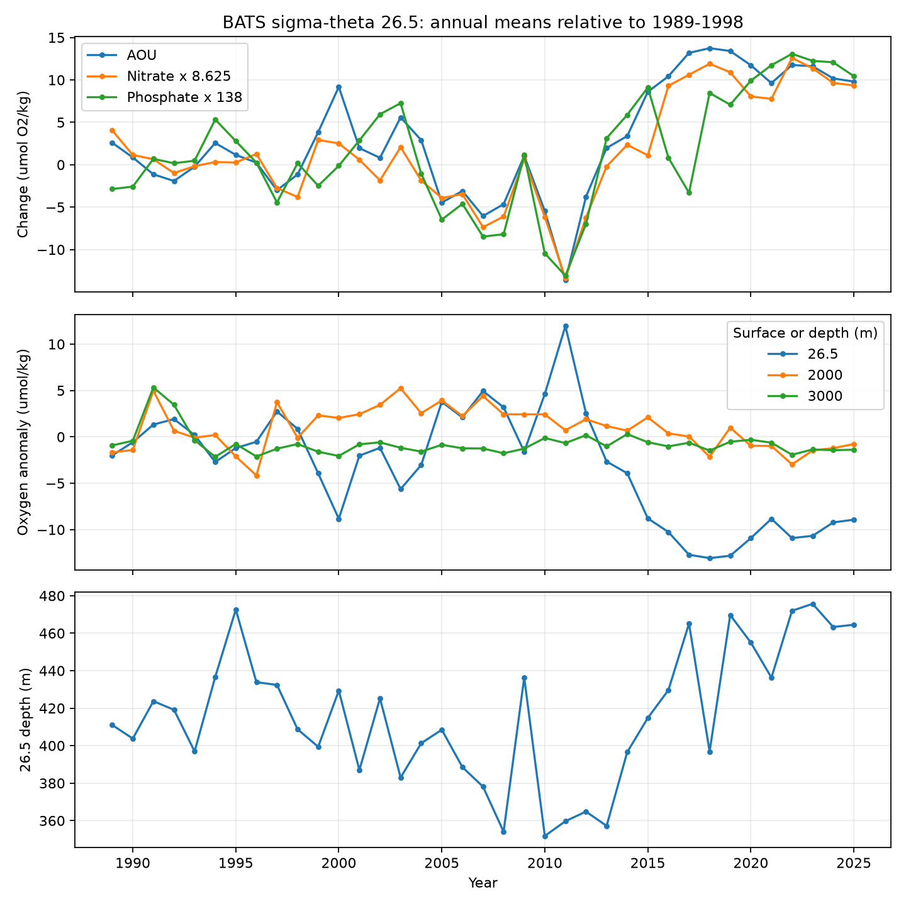

# BATS oxygen loss on sigma-theta 26.5 persists after same-cruise deep-water subtraction, 1989-2025

## Result

A single oxygen offset shared by all depths cannot explain the observed BATS loss. From 1989-1998 to 2016-2025, oxygen on sigma-theta 26.5 fell by 11.18 umol/kg. Oxygen at 2000 and 3000 m fell by 1.02 and 1.05 umol/kg. The oxygen difference between 26.5 and each deep level fell by 10.05 and 10.07 umol/kg. These are same-cruise differences, formed before monthly and annual averaging. The 95% two-year block bootstrap intervals are -11.98 to -8.16 and -12.30 to -7.89 umol/kg. The deep-to-deep difference changed by -0.02 (-1.25 to +1.32). Thus about 90% of the measured upper loss remains relative to either deep reference. This fraction is descriptive, not an estimate of a calibration correction.

The new result is a direct test of common oxygen offsets. Earlier campaign work had already shown the upper loss, its relation to density-class thickness, and its nutrient signal. We do not claim those findings as new. This test strengthens the evidence that the large oxygen changes missed by a decadal North Atlantic outcrop model require a depth-specific process or a depth-specific measurement error. It does not identify that process.

## Question and prior work

The near-outcrop model in sci:sha256:dcfc9b0b167460ca079b8153d875c9bebad2d3e5968a58aadb16e3ba4aff2f88 reproduced much of the recent North Atlantic AOU rise, but missed large changes in 1997-2012. Could oxygen offsets account for those changes, instead of a missing ocean process? Stanley et al. (2012; doi:10.5194/bg-9-1969-2012) found likely method errors in older Bermuda oxygen data. That is a reason to test offsets, not evidence that modern BATS data have such errors.

We ran `sci search "outcrop ventilation" --in ./campaign --json` before choosing the test. We read the above model study and sci:sha256:597145cb4c8205876e18fb51374f103088ee1c2989fb260a5ef11699576b4e5f. The latter had already reported nutrient slopes and density-class thickness at BATS. Our original nutrient test therefore became a replication. The dated order of decisions is preserved in `files/plan.md` and `files/amendment.md`; neither is a registered protocol. The deep contrast question was set before the numerical outputs were read. The ratio and seasonal tests were added after the first contrast results.

## Method

Data: Johnson, R. J., Bates, N. R., Lomas, M. W., Smith, D., Lethaby, P. J., Bakker, R., Davey, E., Derbyshire, L., Enright, M., Garley, R., Hayden, M. G., Lomas, D., May, R., Medley, C., Stuart, E., and Chambers, E. (2026). BATS bottle data, version 10, 24 July 2026. BCO-DMO, doi:10.26008/1912/bco-dmo.3782.10, CC BY 4.0. The shared directory name contains 20260705; the source page states 24 July 2026. The file hash, not the directory date, fixes the input.

1. Select BATS Core bottles in 31-32.5 N, 65-63.5 W. Require bottle and depth flag 2. Require oxygen and potential-density flag 2 for their use.
2. Combine casts within each cruise. BATS often samples the upper and deep column in separate casts. Average repeated observations at the same interpolation coordinate. Interpolate oxygen linearly on the reported sigma-theta scale to 26.4, 26.5 and 26.6, and on depth to 2000 and 3000 m. No extrapolation. Require a positive depth bracket no wider than 250 m for density surfaces and 600 m for deep levels. Repeat with 200 m for density surfaces.
3. Form C_r = O(26.5) - O(r) within each cruise, for r = 2000 or 3000 m. Also form D = O(3000) - O(2000). If measured oxygen is O_obs(z,t) = O_true(z,t) + b(t), C_r and D cancel b(t) exactly. This requires the same additive offset for all casts of that cruise. It does not cancel a depth-specific or cast-specific offset, or a common gain error.
4. Average cruises within each calendar month, then months within each year. Require at least six observed months for each annual variable. A contrast uses only cruises that have both values. Thus a contrast mean need not equal the difference between two separately sampled means.
5. Compare 1989-1998 with 2016-2025. Use 10,000 independent-year bootstrap draws for the table file, and 20,000 circular two-year block draws as a serial-dependence check. Also compare three-year windows centered on 1997, 2003, 2012 and 2021. These windows each have only three years; their intervals are descriptive and omit long-memory uncertainty. No claim of 11 independent section changes is made.
6. Added checks: use 1992-2001 as the reference; use winter (January-April) and summer (July-October), requiring two months per season per year; use the two-year block bootstrap for these long contrasts. Seeds are fixed in code.

## Main estimates

Values are umol/kg. Intervals in this table use independent years; the wider block results for the long change are above and in `season_block.csv`.

| Later minus earlier window | O(26.5) | C_2000, 95% interval | C_3000, 95% interval |
|---|---:|---:|---:|
| 2002-2004 minus 1996-1998 | -4.62 | -8.45 (-11.47, -5.44) | -4.75 (-7.44, -2.07) |
| 2011-2013 minus 2002-2004 | +7.60 | +10.01 (+3.35, +17.68) | +6.09 (+0.62, +12.17) |
| 2020-2022 minus 2011-2013 | -14.76 | -12.05 (-20.12, -5.63) | -13.49 (-19.77, -8.01) |
| 2016-2025 minus 1989-1998 | -11.18 | -10.05 (-11.80, -8.31) | -10.07 (-11.91, -8.28) |
| 2016-2025 minus 1992-2001 | -9.75 | -8.40 (-11.05, -5.41) | -9.60 (-11.71, -7.34) |

The earlier oscillation and the later loss retain their signs with either deep reference. Deep oxygen has its own changes: 2000 m oxygen rose by 3.57 in the first step and fell by 2.40 in the next. Thus subtraction is a diagnostic, not a correction that makes deep water constant. The difference between the two deep levels changed by +3.26 (+1.90 to +4.87) in the second step. This also warns against assigning all deep variability to calibration.

The 200 m bracket gives long C_2000 and C_3000 changes of -9.94 and -9.99. Winter gives -10.27 and -10.01; summer gives -9.41 and -9.88. All four seasonal block intervals exclude zero. Each long window has ten annual means. Month counts for each variable and year are supplied.

## Cast-level nutrient replication

The separate cast-level analysis uses Core and Bloom casts, the same site mask, flag 2 values, bottle salinity, TEOS-10 solubility, and a 200 m maximum bracket. It averages to months and years in the same way. It gives a long oxygen change of -10.83 and an AOU change of +11.55 umol/kg, close to the cruise-composite main result. Nitrate plus nitrite rose by 1.18 (0.99 to 1.36) and phosphate by 0.060 (0.032 to 0.084) umol/kg. These agree with a change in regenerated material, as the prior BATS work found. They do not separate reduced ventilation from increased respiration.

For the three short steps, AOU changed by +4.40, -8.24 and +16.17; nitrate changed by +0.14, -0.70 and +1.86; phosphate changed by +0.039, -0.070 and +0.125. The nitrate intervals include zero for both early steps. Phosphate has the matching sign with intervals excluding zero in all three steps. Thus nutrient support for the early oxygen swings is mixed, rather than a precise stoichiometric confirmation. Nutrient and oxygen values have variable-specific masks, so their annual means do not all represent the same bottles. The nutrient-ratio residual files are exploratory and cannot give a closed regenerated oxygen budget. Solubility changes have the opposite sign to the large 2012-2021 oxygen loss.

## A failed extension

We tried I = [O(26.5)-O(2000)]/[O(3000)-O(2000)]. For any cruise-wide transform O_obs = a O_true + b, with nonzero a, this ratio cancels both a and b. It failed as a stable diagnostic here. The deep oxygen difference was nonpositive in 94 of 866 cruise-gap rows (the two gap settings repeat cruises), and ranged from -3.63 to +16.14. Small denominators led to extreme ratios. The epoch-mean deep difference was only about 6.1 umol/kg. We retain the computed ratio columns for inspection but reject their bootstrap intervals as evidence about calibration gains. This is a useful limit on applying an affine-invariant oxygen index to these deep reference levels.

## Interpretation and limits

The missing 1997-2012 model response cannot be removed by a single additive oxygen offset shared across depths. A process specific to upper density classes remains a viable explanation. Changes in mode-water renewal, lateral exchange and respiration remain possible. This study does not separate them, does not close an oxygen budget, and does not quantitatively validate the outcrop mechanism. It gives no new projection.

Deep water is not known to be constant. A real deep trend can add to or hide an upper trend in a contrast. A gain error, a different offset in shallow and deep casts, or changes in oxygen sample treatment with depth can survive this test. The reported bottle flags do not measure such errors. Interpolation across a stratified upper column is another source of error; the 200 m check reduces but does not remove it. One site cannot test the full North Atlantic. The year bootstrap does not include analytical bias, interpolation uncertainty, uncertain source nutrient ratios or variability longer than the tested blocks. The short-step windows give few independent samples.

## Reproduction and package

Run from a copy of the bundle, with Python 3.12 and network access for dependencies:

    bash files/reproduce.sh /absolute/path/to/scratch /absolute/path/to/BATS.csv

Omit the second argument to retrieve the exact source URL into scratch. The code checks the source SHA-256 in `analyze.py`. All outputs go to scratch, outside the signed publication. Two processes at most were used; numerical thread pools were limited to one. See `files/requirements.txt` for exact package versions. `contrast.py` is the main analysis; `sensitivity.py` supplies the seasonal and block results. `analyze.py` supplies the planned cast-level AOU/nutrient replication and stricter-gap checks. The scripts, aggregate outputs and PNG figures are in `files/`. No record-level source data are bundled.

## Provenance and rights

Campaign 11_07_2026. Job sci-1107-dell-earth-and-ocean-sciences-e59f6c3bcca5. Topic earth-and-ocean-sciences. Machine dell. Account codex-olen. Model gpt-6.1-sol, high reasoning effort. The campaign-machine signing key identifies the publication, not personal authorship. Source paths, URL and hash are in `files/provenance.json`. Raw source data remain in the shared data store. External attribution is in `files/NOTICE_external_data.md`. Our code is MIT; our text, figures and aggregate results are CC BY 4.0 under the exact SCI baseline LICENSE. No outside data rights are replaced by this notice.
