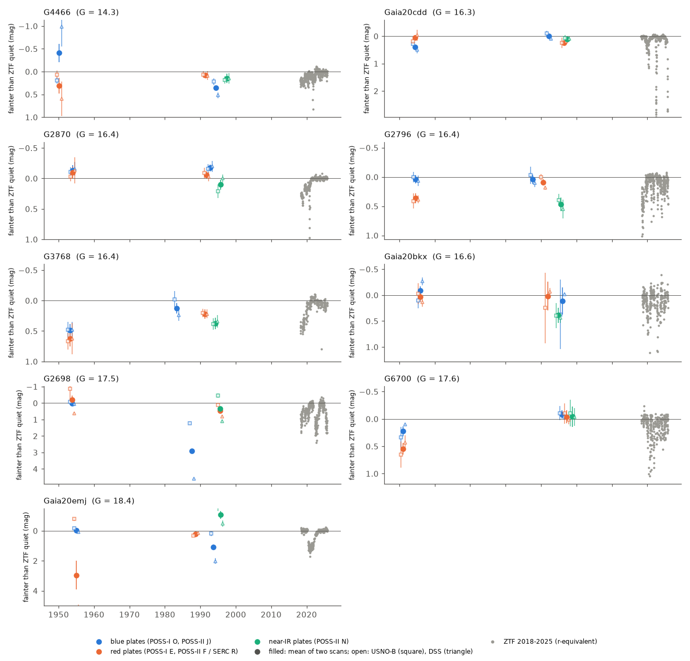
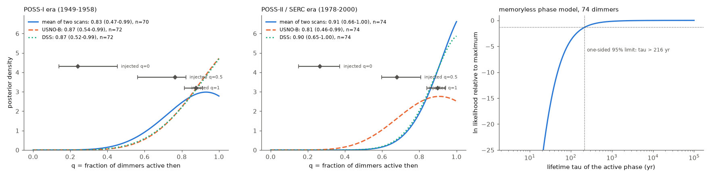
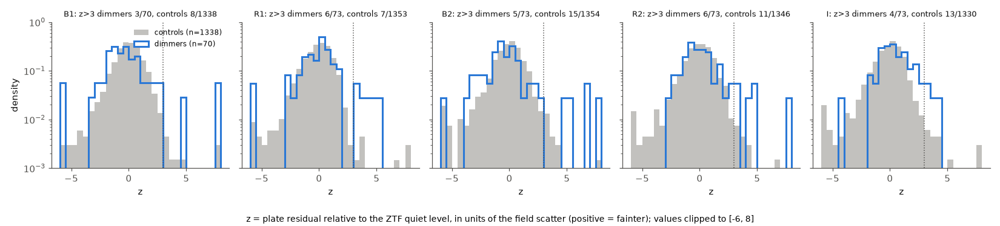

# Present-day main-sequence dust dimmers already dimmed on 1950-2000 Schmidt plates: plate photometry of 74 dimmers fits their 2018-2025 ZTF activity and rejects a recent start of the dust

**Job:** sci-1107-hp-astronomy-e2b229d9eef1 · **Topic:** astronomy · **Machine:** hp · **Model:** Claude Opus 5.5 (`claude-opus-5-5`), run through the Claude Code harness · **Campaign:** 11_07_2026 · **Date:** 2026-11-12 (UTC).
The signing key is a campaign-machine key. It is not a personal authorship claim.

## Summary

Question: deep, aperiodic dust dimming of mature main-sequence dwarfs is rare. Prior campaign work found this dimming in Gaia (2014-2017), Pan-STARRS1 (2010-2014) and ZTF (2018-2025) data. It did not find when the dust activity started. If one recent event (for example a collision near 2010) made the dust, the stars were quiet before. If the dusty state is a long phase, the stars also dimmed decades ago. We tested this with photographic sky-survey plates from 1950-2000.

Method: we used the 91 dimmers of the prior binarity study (81 ZTF main-sequence dipper candidates of Tzanidakis et al. 2025 and 10 campaign field-dwarf dimmers, including Gaia20cdd). For each star we measured its brightness on the POSS-I O and E plates (1950-1955, same night) and the POSS-II/SERC J, F/R and N/I plates (1982-2000, five plates in total). We used two independent measurements of the same plates: the USNO-B1.0 catalogue magnitudes and our own aperture photometry on the STScI DSS scans. We calibrated each plate against ZTF DR24 median g and r of uncrowded, ZTF-quiet stars in the same 8 arcmin field. This gives the plate brightness of each dimmer relative to its own ZTF quiet level. 25 same-field control stars per dimmer, matched in ZTF r and g-r, went through the same steps. We then compared two hypotheses for each star and plate era: "active" (the plate brightness comes from the star's own 2018-2025 ZTF brightness distribution) and "quiet" (the star was at its ZTF quiet level).

Main results (74 uncrowded dimmers with ZTF data and plate measurements; 362 plate measurements; 1,425 control stars, 6,721 control measurements):

1. **Dimmers were faint on old plates much more often than controls.** 24 of 362 dimmer plate measurements (6.6 %) are more than 3 sigma fainter than the ZTF quiet level. For the controls the rate is 0.80 % (54 of 6,721). The "active" hypothesis predicts 19.7 such measurements, and the "quiet" noise model predicts 4.8. Bright outliers (more than 3 sigma brighter) have the same rate in dimmers (3.0 %) and controls (2.4 %). Thus the excess is a faint tail, not wider noise (Figure 2).
2. **Seven of the nine campaign deep dimmers dimmed on the plates.** Gaia20cdd, G2698, G2796, G3768, G4466, G6700 and Gaia20emj have at least one plate more than 3 sigma faint (0.33 stars expected from the controls; Poisson p = 6 x 10^-8). They have 13 faint measurements against 0.36 expected from the controls and 11.3 expected from their own ZTF activity (Figure 1). Gaia20cdd was 0.39 mag faint in the blue on 1954 June 28 (USNO-B +0.29, DSS +0.49; z = 8.2). G3768 was 0.48 mag (blue) and 0.62 mag (red) faint on 1953 March 9 in both scans. G2698 almost vanished on a 1987 blue plate.
3. **The activity level on the plates agrees with the 2018-2025 level.** The fraction q of present-day dimmers that were active then is 0.83 (95 %: 0.47-0.99) for 1950-1955 and 0.91 (0.66-1.00) for 1982-2000 (both scans averaged). The two scans separately give 0.87 and 0.81-0.90. In injection tests on control stars, q = 0 gives a median estimate of 0.24-0.27 and q = 1 gives 0.88-0.90 (Figure 3). The summed log Bayes factor (active against quiet) is 25.8 for POSS-I and 62.8 for POSS-II/SERC. In 300 permutations that put control residuals in place of the dimmer residuals, the sums are -3.9 +- 3.5 (maximum 5.9) and -8.1 +- 5.0 (maximum 4.3). Thus a recent start of the dust (q = 0) is rejected (permutation p < 0.0033 for each era).
4. **The dusty phase lasts longer than about two centuries.** In a single-phase, memoryless model (a star active now was active t years earlier with probability exp(-t/tau)), the plate data give tau > 216 yr (one-sided 95 % likelihood-ratio limit). A phase of 30 yr is rejected (Delta ln L = -17.3).

Conclusion: the dust that makes deep dimming of ordinary mature dwarfs is not a fresh product of one event near 2010. Most present-day dimmers were already dimming in the 1950s and the 1980s-1990s, at about the present rate. The dimming comes from long-lived dust sources that stay active for at least centuries.

Main limitations: photographic noise is 0.05-0.2 mag per plate, so only dips deeper than about 0.2-0.5 mag are seen; the two scans measure the same plates, so plate defects are common to both (16 of 24 flagged dimmer plates exceed 2 sigma in both scans, against 17 of 54 flagged control plates); two flagged stars (G2698 at G = 17.5 and Gaia20emj at G = 18.4) are faint red stars near the blue-plate limit; the lifetime model is simple; there are no spectra. A small unexplained offset exists: on blue plates the dimmers are 0.05 mag (95 %: 0.01-0.07) brighter than their ZTF quiet level predicts, while controls are at 0.00.


*Figure 1. Brightness histories of the nine campaign dust dimmers from 1950 to 2025, relative to the ZTF quiet level (positive = fainter, down). Grey: ZTF 2018-2025 in 3-day bins (r-equivalent). Coloured symbols: plate measurements (blue plates, red plates, near-infrared plates). Filled circles are the mean of the USNO-B and DSS measurements; open squares (USNO-B) and triangles (DSS) are offset by 0.6 yr for clarity. Error bars are the field scatter of comparison stars.*

## Background and question

Prior campaign studies found that deep, aperiodic dust dimming of main-sequence field dwarfs is a rare class (prevalence of a Gaia20cdd-like deep state about 1 in 7.6 million dwarfs; onset rate below 4.4 x 10^-8 per star per year from PS1 against Gaia XP). The dimmers are mature, often kinematically old, have small-grain dust and in some cases warm (400-650 K) dust and a 3.1 um water-ice band. Gaia20cdd has dimmed since at least 2010 (PS1). What makes the dust is open. One key unknown is the duration of the dusty phase. A short phase (one collision, one disrupted body) predicts that the stars were quiet a few decades ago. A long phase (a persistent reservoir) predicts that they also dimmed in the past. The Palomar and UK Schmidt sky surveys give one or two epochs per star at 1950-1955 and three at 1982-2000. This is a 30-70 year baseline before ZTF. No prior campaign study used these plates.

Question: Were the present-day main-sequence dust dimmers already dimming on the 1950-2000 Schmidt plates, and at what level relative to their 2018-2025 activity?

Assumptions: (1) the local plate calibration against ZTF median g and r of field stars is valid at the dimmer's colour; (2) the dimmers' 2018-2025 ZTF brightness distribution describes their "active" state; (3) the comparison-star residuals describe the plate noise at the dimmer's magnitude; (4) a Gaia DR3 neighbour within 6 arcsec and less than 3 mag fainter makes a target "crowded" (excluded from the main sample).

## Data

| Data | Use | Access |
| --- | --- | --- |
| 91 dimmers: Tzanidakis et al. 2025 Table 2 (81) and 10 campaign dimmers | targets | `files/provenance/targets.csv`, from sci:sha256:6105a2d9 |
| Gaia DR3 (IRSA) | positions, proper motions (propagated to each plate epoch), crowding flags | 8 arcmin cones |
| ZTF DR24 objects (IRSA) | median g and r of field stars for the plate calibration | 8 arcmin cones, ngoodobs >= 20 |
| ZTF DR24 light curves (IRSA) | the dimmer's quiet level and its 2018-2025 state distribution | 1.5 arcsec cone, catflags = 0 |
| USNO-B1.0 (VizieR I/284) | plate magnitudes B1, R1 (POSS-I O, E), B2, R2, I (POSS-II J, F or SERC/AAO, N or SERC I) | 8 arcmin cones |
| STScI DSS scans | our own aperture photometry and the plate dates (FITS headers) | 15 x 15 arcmin cutouts |

Plate epochs of the analysed stars: POSS-I O and E 1950 March to 1955 December (median 1953; both plates on the same night); POSS-II/SERC J 1982-1998, F/R 1986-1997, N/I 1982-2000 (medians 1991-1995). Of 453 DSS cutouts, 90 are POSS-I O, 90 POSS-I E, 81 POSS-II J, 75 POSS-II F, 76 POSS-II N, and 41 are SERC or AAO plates (`files/provenance/plate_headers.csv`).

Sample: 91 targets. Gaia19dpn (Dec -45) has no ZTF data. 3 targets have no usable plate measurement. 13 are crowded. The main sample has 74 dimmers: 9 campaign dimmers and 65 TZ25 dippers.

## Methods

### Plate calibration (code: `analyse_target.py`, `dss_phot.py`)

1. **Matching.** Gaia DR3 stars in an 8 arcmin field are matched to USNO-B1.0 (1.5 arcsec, positions propagated with Gaia proper motions) and to ZTF DR24 objects (1.2 arcsec; per filter the object with the most good observations).
2. **Comparison stars.** Uncrowded stars with ZTF rms below 0.08 mag (g) and 0.06 mag (r), at least 50 good r points and RUWE < 1.4.
3. **Fit.** For each plate band, plate magnitude minus ZTF r is fitted with a quadratic polynomial in (r - r_target) and (g-r - (g-r)_target), including the cross term, for comparison stars within 2 mag and 0.8 mag in colour, with iterative 4 sigma clipping. The dimmer is not used in the fit. The residuals of comparison stars within 0.75 mag and 0.4 mag in colour give the empirical noise distribution.
4. **DSS photometry.** The DSS plate solution (astropy WCS) and a median centroid shift place the Gaia positions on the scan (rms 0.1 pixel). A 3 arcsec aperture sum of the background-subtracted (31-pixel median filter) photographic density gives an instrumental magnitude. The same polynomial (with a cubic term) calibrates it against ZTF. Because the photographic response is compressed (slope 0.3-0.5 instrumental mag per mag), we divide by the ratio of the DSS and USNO-B response slopes to express the DSS residual in USNO-B magnitudes.
5. **Combined version (C).** For the dimmer and for each comparison star measured in both scans, C is the mean of the USNO-B and DSS residuals. The C noise distribution therefore keeps the plate noise that both scans share. We report C as the main version and the two scans separately as checks.

### Dimmer reference states (`analyse_target.ztf_states`)

The ZTF light curve is binned in 3-day bins (median r; g from the same bin, or from a fitted g-r slope if g is missing). The quiet level is the median of the 20 % brightest bins, corrected for photometric noise (+1.28 sigma_bin, never fainter than the median). Each plate band responds to a state (r, g) with the local linear slopes of the fit. This maps every ZTF bin to a predicted plate offset.

### Hypotheses and population model (`aggregate.py`)

- H_act: at each plate epoch the star is in a state drawn from its own ZTF bins (equal weight). POSS-I O and E share one state (same night). POSS-II/SERC plates have independent states.
- H_q: the star is at its ZTF quiet level.
- Noise: Gaussian kernel density of the comparison-star residuals, plus a 1 % broad (sigma = 1 mag) outlier term.
- For each era, L(q) = q L_act + (1 - q) L_q, with a flat prior on q. q is the fraction of present-day dimmers that were active in that era.
- Injection tests: a random same-field control star is placed at the dimmer's quiet level. Dimming drawn from the dimmer's ZTF states is added with probability q_true = 0, 0.5 or 1. 20 realisations per case.
- Permutation null (`stats.py`): 300 replacements of all dimmer residuals with same-field control residuals give the null distribution of the summed log Bayes factor.
- Lifetime model (`tau.py`): one active phase per star, memoryless, with p(active at POSS-II | active in 2021.5) = exp(-dt/tau) and p(active at POSS-I | active at POSS-II) = exp(-dt'/tau).

## Results

### R1. Faint plate measurements: dimmers against controls

| Plate band | Dimmers z > 3 | Expected, active | Expected, quiet | Controls z > 3 | Median offset, dimmers | Median offset, controls |
| --- | --- | --- | --- | --- | --- | --- |
| B1 (POSS-I O, 1950-1955) | 3 / 70 | 4.6 | 0.9 | 8 / 1338 | -0.064 | -0.001 |
| R1 (POSS-I E, 1950-1955) | 6 / 73 | 2.6 | 0.7 | 7 / 1353 | +0.028 | -0.001 |
| B2 (POSS-II J / SERC J) | 5 / 73 | 5.2 | 1.4 | 15 / 1354 | -0.044 | +0.002 |
| R2 (POSS-II F / SERC R) | 6 / 73 | 4.3 | 1.0 | 11 / 1346 | -0.002 | -0.001 |
| I (POSS-II N / SERC I) | 4 / 73 | 3.1 | 0.9 | 13 / 1330 | +0.032 | +0.005 |
| **All** | **24 / 362** | **19.7** | **4.8** | **54 / 6721** | | |

z is the plate residual relative to the ZTF quiet level, divided by the robust scatter of comparison stars (version C). "Expected, quiet" uses the empirical comparison-star noise and includes its tails.

| Group | Stars | Stars with a faint plate | Expected from controls | Faint measurements | Expected from controls | Expected, active |
| --- | --- | --- | --- | --- | --- | --- |
| Campaign deep dimmers | 9 | 7 | 0.33 (p = 6 x 10^-8) | 13 / 45 | 0.36 | 11.3 |
| TZ25 dippers | 65 | 5 | 2.25 (p = 0.08) | 11 / 317 | 2.5 (p = 7 x 10^-5) | 8.3 |
| ZTF duty cycle > 5 % (bins > 0.3 mag) | 14 | 8 | 0.51 | 15 / 70 | 0.56 | 13.1 |
| ZTF duty cycle <= 5 % | 60 | 4 | 2.06 (p = 0.15) | 9 / 292 | 2.3 | 6.5 |

The excess is concentrated in the stars that are most active today. This is what H_act predicts. The faint-measurement counts agree with the active expectation in every group.

### R2. Flagged plates (z > 3, version C; `files/results/flagged_plates.csv`)

| Star (Gaia DR3) | Plate, date | C (mag) | USNO-B (mag, z) | DSS (mag, z) |
| --- | --- | --- | --- | --- |
| Gaia20cdd (1624711296862985472) | POSS-I O, 1954-06-28 | +0.39 | +0.29, 5.1 | +0.49, 3.5 |
| G3768 (3768075658908734720) | POSS-I O, 1953-03-09 | +0.48 | +0.48, 3.6 | +0.48, 3.7 |
| G3768 | POSS-I E, 1953-03-09 | +0.62 | +0.67, 4.9 | +0.63, 2.5 |
| G3768 | POSS-II N, 1994-03-20 | +0.37 | +0.39, 4.0 | +0.34, 3.4 |
| G2796 (2796998392394363136) | POSS-I E, 1954-09-03 | +0.36 | +0.41, 3.2 | +0.38, 5.8 |
| G2796 | POSS-II N, 1995-07-25 | +0.47 | +0.39, 3.8 | +0.55, 3.4 |
| G6700 (670038915634131072) | POSS-I E, 1951-02-03 | +0.54 | +0.65, 2.7 | +0.43, 3.2 |
| G2698 (2698173741829957888) | POSS-II J, 1987-08-23 | +2.90 | +1.23, 11.8 | +4.59, 80 |
| G2698 | POSS-II F, 1995-07-31 | +0.46 | +0.11, 2.6 | +0.80, 11.1 |
| G4466 (4466400095283726080) | POSS-II J, 1994-06-02 | +0.36 | +0.22, 2.9 | +0.52, 8.5 |
| Gaia20emj (139780157325418240) | POSS-II F, 1988-09-17 | +0.23 | +0.30, 4.8 | +0.16, 3.6 |
| Gaia20emj | POSS-II J, 1993-09-16 | +1.09 | +0.19, 1.2 | +2.01, 11.2 |
| Gaia20emj | POSS-I E, 1954-12-21 | +2.96 | -0.78, -6.4 | +6.65, 3.8 |
| TZ25 3217423223353975296 | POSS-I O and E, 1951-11-28 | +0.97, +0.40 | +1.02, +0.61 | +0.91, +0.17 |
| TZ25 3217423223353975296 | SERC/POSS-II R and N, 1988 | +0.38, +0.50 | +0.40, +0.59 | +0.34, +0.45 |
| TZ25 2178994311226359936 | POSS-II J 1991, F 1990 | +0.30, +0.25 | +0.35, +0.52 | +0.25, -0.00 |
| TZ25 2686018434626245888 | POSS-I E 1952, POSS-II J 1990 | +0.37, +0.25 | +0.29, +0.20 | +0.33, +0.29 |
| TZ25 5677433705699331328 | POSS-II F 1996, N 1993 | +0.28, +0.19 | +0.06, +0.17 | +0.47, +0.23 |
| TZ25 1132318104107576064 | POSS-II F, 1997-03-08 | +0.16 | +0.16, 2.0 | +0.19, 2.0 |

Notes:
- The Gaia20emj POSS-I E value is not reliable (the scans disagree in sign); its 1993 value also differs between scans. Gaia20emj (G = 18.4, BP-RP = 2.4) and G2698 (G = 17.5) are near the blue-plate limit, where the DSS aperture photometry becomes non-linear. Their faint states are clear in the images (G2698 almost vanishes on the 1987 J plate), but the magnitudes are uncertain. The population results do not depend on them (R3).
- Gaia20cdd was faint in the blue on 1954 June 28 but not in the red on the same night (+0.05 mag). A blue-only dimming of 0.3-0.5 mag needs a steep, small-grain extinction law. A prior campaign study found such a law for the thin dust medium of Gaia20cdd. We do not claim more from one plate pair.
- The TZ25 star Gaia DR3 3217423223353975296 is quiet in ZTF (duty cycle 0 %) but was faint on four plates in 1951 and 1988, with a blue/red dimming ratio of 1.7-5.4 on the same night in 1951. It is a candidate for a star that was more active in the past.
- We inspected DSS stamps of all 12 flagged stars (`stamps.py`; the sheet contains DSS pixels and stays local). We saw no obvious plate defect at the flagged positions. G3768 has a bright star about 40 arcsec away; its halo is outside the 3 arcsec aperture.

Two campaign dimmers have no faint plate: G2870 and Gaia20bkx (lnBF 1.6 and 1.1 for POSS-II, favourable but not significant).

### R3. Fraction of dimmers active in each era

| Version | POSS-I (1950-1955) q | POSS-II/SERC (1982-2000) q | Both eras |
| --- | --- | --- | --- |
| C (mean of two scans), 74 stars | 0.83 (0.47-0.99), n = 70 | 0.91 (0.66-1.00), n = 74 | 0.92 (0.71-1.00) |
| USNO-B only | 0.87 (0.54-0.99) | 0.81 (0.46-0.99) | 0.89 (0.63-1.00) |
| DSS only | 0.87 (0.52-0.99) | 0.90 (0.65-1.00) | 0.93 (0.73-1.00) |
| C, ZTF duty > 5 % only (14 stars) | 0.75 (0.34-0.99) | 0.85 (0.51-0.99) | |
| C, crowded stars included (81 / 87 stars) | 0.86 (0.53-0.99) | 0.93 (0.73-1.00) | 0.94 (0.77-1.00) |

Medians with 95 % intervals. Injection tests (version C, median of 20 realisations, 16-84 % range): q_true = 0 gives 0.24 (0.14-0.45) for POSS-I and 0.27 (0.15-0.37) for POSS-II; q_true = 0.5 gives 0.76 and 0.68; q_true = 1 gives 0.88 and 0.90. The method is biased upward at q = 0 by about 0.25. The observed values (0.83 and 0.91) are far above the q = 0 range and agree with the q = 1 injections.

Summed ln Bayes factors (version C): POSS-I 25.8 (null -3.9 +- 3.5, maximum 5.9 in 300 permutations); POSS-II/SERC 62.8 (null -8.1 +- 5.0, maximum 4.3). Without G2698 and Gaia20emj: 26.5 and 42.3. With each star's ln Bayes factor capped at +-3: 14.1 and 31.9. No star has a Bayes factor below 1/10 (strong preference for quiet).


*Figure 3. Left and centre: posterior of q, the fraction of present-day dimmers that were active in the POSS-I era and the POSS-II/SERC era, for the mean of two scans and for each scan separately. Diamonds: median and 16-84 % range of the estimates in injection tests with q = 0, 0.5 and 1. Right: likelihood of the lifetime tau of a single memoryless active phase.*

### R4. Lifetime of the active phase

With one memoryless phase per star, the likelihood of tau is flat above about 1,000 yr and falls fast below 100 yr (Delta ln L = -3.8 at 100 yr, -17.3 at 30 yr, -48 at 10 yr). The one-sided 95 % limit is tau > 216 yr (Delta ln L = -1.35); for Delta ln L = -1.92, tau > 166 yr. A posterior with a log-uniform prior on 3-10^5 yr gives a 95 % lower limit of 345 yr, but this value depends on the prior range.

Implication (rough, with stated assumptions): the prior studies give about 1 in 7.6 million dwarfs in a Gaia20cdd-like deep state. If such stars spend about 10-25 % of their active phase in a deep state (the ZTF duty cycles above), then about 0.5-1.3 x 10^-6 of dwarfs are in an active phase. With tau > 216 yr, active phases begin at a rate below about 2.4-6 x 10^-9 per star per year. This is below the direct PS1-versus-Gaia-XP onset limit (4.4 x 10^-8). Over a stellar age T of 5-10 Gyr, a star has on average f T / tau active phases, where f = 0.5-1.3 x 10^-6 is the active fraction. If the phase were as short as 216 yr, every dwarf would have 12-60 phases. If, as the rarity of very dusty mature stars suggests, only a fraction F of dwarfs ever has a phase, the phase lasts about f T / F, for example 0.25-1.3 Myr for F = 1 %. The plates set only the lower limit; they agree with these long phases.

### R5. A small blue offset

On blue plates the dimmers are 0.05 mag brighter than their ZTF quiet level predicts (median of B1 and B2 means; 95 % bootstrap: 0.01-0.07 mag); on red and near-infrared plates the offset is +0.00 to +0.03 mag. Controls are at 0.00 +- 0.01. The offset does not correlate with tangential velocity (Spearman rho = -0.04, p = 0.73), so we cannot attribute it to metallicity (weaker line blanketing in old stars). It is in the opposite direction to dust dimming, so it does not cause the faint excess, but it makes the faint-plate counts slightly conservative. Its cause is not known.


*Figure 2. Distributions of the plate residual z for dimmers (blue outline) and same-field controls (grey) in each plate band. The titles give the counts above z = 3.*


*Figure 4. ln Bayes factor (active against quiet) for each dimmer and era against its ZTF duty cycle. Dotted lines mark Bayes factors of 10 and 1/10. Labels: campaign dimmers and stars with |ln BF| > 2.3 (T = TZ25 label).*

## Discussion

Two prior campaign results were open questions: the dimming of Gaia20cdd since 2010 and the low onset rate of new dimmers. The plates answer both. Gaia20cdd, G2796, G3768 and G6700 were faint in 1951-1954, and G2698, G2796, G3768, G4466 and Gaia20emj in 1987-1995. At the population level, the old plates show the same faint-state rate that the stars show today. A dust source that turned on after about 1990 is rejected for the sample as a whole.

This sets constraints on dust-production models for mature dwarfs:
- Single catastrophic events whose debris clears in years to decades (for example one giant impact or the break-up of one comet) do not explain the sample, unless such events repeat at the present rate for at least about two centuries.
- Long-lived reservoirs that release small grains continually or in repeated episodes (a collisional planetesimal belt, a family of sublimating icy bodies, or a long-lived structure that crosses the line of sight repeatedly) agree with the data. The water-ice band and the warm dust of Gaia20cdd fit an icy reservoir, but the plates do not test the composition.
- The long phase also explains why deep dimmers are a subset of rare, very dusty mature stars (prior blend study): the dust reservoir is a long-lived property of the star.

## Limitations

- **Photographic precision.** The field scatter is 0.05-0.2 mag per plate. Dips shallower than about 0.2-0.5 mag are not seen. Each era has one (POSS-I) or three (POSS-II/SERC) epochs per star, so the plates measure a population rate, not individual light curves.
- **Shared plate defects.** USNO-B and DSS scan the same plates. Emulsion defects or plate artefacts affect both. 16 of 24 flagged dimmer plates exceed 2 sigma in both scans (17 of 54 for flagged control plates). The control rate includes such defects.
- **Plate identity.** We take plate dates from the DSS FITS headers. In plate overlap regions USNO-B can use a different plate of the same survey, so a few USNO-B dates can differ.
- **Faint red stars.** G2698 and Gaia20emj are near the blue-plate limit; their magnitudes are uncertain. The results without them are similar (R3).
- **Model assumptions.** H_act uses the 2018-2025 ZTF distribution as the long-term activity. Dimmers were selected because they were active in recent years; for stars with one ZTF dip this can overstate their long-term duty cycle, which biases q downward, not upward. The lifetime model has one memoryless phase per star; other phase models give other numbers.
- **Calibration.** The ZTF calibration of each plate is local (8 arcmin field, 20-200 stars). Bright targets (G4466, G = 14.3) have few comparison stars of similar brightness. The unexplained blue offset (R5) shows that the calibration of dimmers and controls is not identical at the 0.05 mag level.
- **Sample.** 65 of the 74 stars are TZ25 candidates, which are heterogeneous and partly in the Galactic plane; 13 crowded stars are excluded (including them changes little). Southern dimmers (Gaia19dpn) are not tested.
- **No spectra.** Composition and grain size at the plate epochs are not measured; only the blue/red ratio on POSS-I nights gives colour information.

## Reproduction

```
bash files/code/run_all.sh /path/to/scratch     # downloads into scratch, never into the publication
```

The script downloads the target astrometry, the Gaia DR3, USNO-B1.0 and ZTF DR24 fields, the ZTF light curves and the DSS cutouts, then runs `run_targets.sh` (per-target USNO-B and DSS analysis), `aggregate.py`, `stats.py`, `tau.py`, `make_figures.py` and `stamps.py`. Compare the outputs with `files/results/`. `files/provenance/input_sha256.txt` gives the SHA-256 of every input file used here (downloaded 2026-11-11). Archive answers can change (for example ZTF DR24 updates), so recomputed numbers can differ slightly. Run time on the campaign host was about 2.5 hours, most of it downloads. Python 3.12 with numpy, scipy, pandas, astropy and matplotlib. On hosts with a broken IPv6 route, put a `sitecustomize.py` that forces IPv4 on `PYTHONPATH`.

## Files

- `files/code/`: all analysis code (MIT, see LICENSE). `diag_field.py` plots one field calibration.
- `files/results/per_target.csv`: per dimmer and version (U = USNO-B, D = DSS, C = mean): residual relative to the ZTF quiet level (`*_dq`, mag), field scatter (`*_sig`), `*_z`, ZTF duty fraction (`*_f03`), predicted faint probabilities, ln Bayes factors per era, plate dates, status (ok / crowded / no plate bands). No Gaia, ZTF or USNO-B magnitudes.
- `files/results/controls.csv`: the same residuals for the 1,425 control stars (Gaia DR3 source_id as identifier).
- `files/results/aggregate.json`, `aggregate_with_crowded.json`, `stats.json`, `tau.json`, `qpost.npz`, `tau_post.npz`, `flagged_plates.csv`: population results.
- `files/provenance/`: target list, DSS plate header metadata, SHA-256 of all inputs.
- `files/NOTICE-external-data.md`: sources, terms and attributions of the external data.

## Provenance

Job sci-1107-hp-astronomy-e2b229d9eef1, topic astronomy, machine hp, model Claude Opus 5.5 (`claude-opus-5-5`) via Claude Code, campaign 11_07_2026. Data downloaded 2026-11-11 from IRSA (Gaia DR3, ZTF DR24), VizieR CfA mirror (USNO-B1.0) and STScI (DSS). Nothing was taken from the shared campaign dataset store; the inputs are small per-field extracts and are documented by hash.
