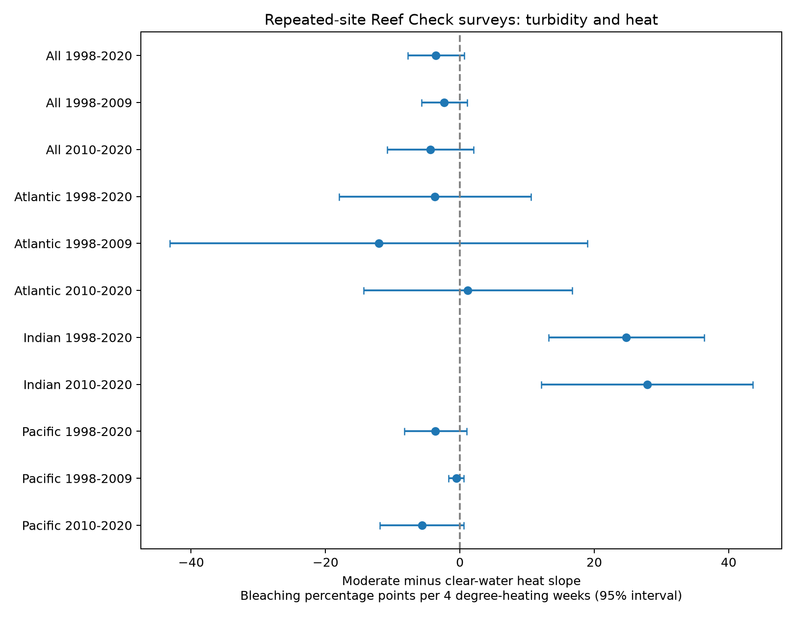

# Moderate turbidity did not show a common heat-response reduction in repeated coral surveys from three oceans, 2001-2019

## Question and result

Does the moderate water-turbidity band proposed in earlier research mark a weaker coral bleaching response to heat within repeated survey sites? We tested the band from 0.080 to 0.127 per metre against water below 0.080 per metre. The pooled slope difference was -3.56 bleaching percentage points per four degree-heating weeks. Its nominal 95% interval was -7.74 to +0.61. The result permits a protective association but does not establish it. The ocean estimates did not have a common sign. This is a test of an ecological stress response, not species loss.

## Prior work and added test

Sully and van Woesik (2020), DOI:10.1111/gcb.14948, reported reduced bleaching in this optical band. Reduced light during heat stress is a proposed explanation. They used a different model and exposure definition. The Hawaii study DOI:10.3389/fmars.2022.969472 found that thermal stress could counteract a turbidity association. Thus a common reduction in the heat slope is a useful, but narrower, test. Our test is not a direct replication of either model.

We ran `sci search "phenology climate" --in ./campaign --json` and `sci search "bleaching" --in ./campaign --json` before fixing the question. The complete folder scan was slow because SCI verifies uncached bundles. We stopped the scan after more than eight minutes and read its partial verified cache. We do not claim a complete novelty search. Matching published metadata are in `files/prior_search_cache.json`. We then read SCI 80821c9012ee93315939ea6365b11c12ffcd8f5cc52167b19c9bd71ba63949a5 and SCI 287644233b61dd382329bfa085108546c44a59b8953b98ab6f3ccaa671225346 with `sci read`.

The first report already tests a continuous turbidity interaction in the same archive. This report adds a categorical test of the exact proposed band, omits water above the band, and aggregates by exact date. It uses independently written analysis code. It is a limited extension, not independent new data. The second report documents missing early bleaching outcomes and repeated substrate rows. We added an explicit sample-ID duplicate check after reading it. The rounded pooled result stayed at -3.56 after this correction. The design file was written before the first model output, but was not registered. The later duplicate and rank checks are implementation refinements.

## Data and observation controls

The source is BCO-DMO 773466 version 2, dated 2022-10-14, with CoRTAD version 6 heat fields. Raw data have 41,361 rows. We select Reef_Check, Atlantic/Indian/Pacific, requested years 1998-2020, numeric bleaching from 0 to 100, nonmissing site/date/heat/region, and optical turbidity greater than zero and at most 0.127. This leaves 18,422 substrate rows and 9,236 distinct sample IDs. Fields used in the analysis must agree within sample ID; the code checks agreement among nonmissing entries. Each sample ID then counts once. We average distinct samples and depths within each site and exact date. These 7,550 site-dates cover 3,242 sites.

The main panel keeps sites with at least two dates and changing TSA_DHW. It has 3,688 site-dates, 672 sites and 38 ecoregions. There are 129 moderate-band sites. Realized dates run from 2001-08-19 to 2019-12-20; no 2020 record enters this panel. The model labels retain the requested window. Atlantic and Indian records start in 2003. No missing outcome is set to zero. Selection of known outcomes and repeat sites can still cause bias. Survey dates can be approximate in the archive. Equal site-date weight does not give equal site weight.

The outcome is Percent_Bleaching. TSA_DHW sums qualifying thermal anomalies over the previous 12 weeks. Turbidity is a site mean attenuation proxy at 490 nm, not a survey-day pollutant measure. It does not change within sites in this panel. Its early values are retrospective site descriptors. CoRTAD is a surface grid product, not a colony-depth temperature record. The four-unit cut in a sensitivity model is a descriptive CoRTAD cut, not a calibrated warning threshold.

## Model and uncertainty

`bleaching = site effect + year effect + calendar-month effect + b*H + c*H*M + error`

H is TSA_DHW divided by four. M is one for the moderate band and zero for clear water. The interaction c compares within-site heat slopes between the two groups. A negative c agrees with the tested protection pattern. Site effects remove stable bleaching levels; they do not remove stable differences in coral composition or heat sensitivity. Year and month effects are additive and pooled in the main model; separate-ocean fits have their own effects. This model does not estimate the effect of changing turbidity at a site.

We remove fixed effects by repeated group demeaning and solve least squares. Sandwich intervals cluster errors by ecoregion. We use a Student t critical value with G-1 degrees of freedom, G/(G-1), and an approximate conservative residual-degree correction for absorbed groups. These are working intervals. They need not have exact coverage with few regions or correlated ocean heat events. All intervals in this report are nominal, not corrected for multiple tests. Separate-region results are checks, not a confirmed harmful effect in any ocean. Linear slopes need not apply outside the observed heat range or keep fitted values within 0-100.

The repeat and heat-change rules are applied again within each subperiod and sensitivity fit. The early Indian panel has no moderate-band sites with heat variation. Its interaction is not identified and is omitted. This is missing test support, not a zero effect. Sites can occur in both periods; ocean labels can split an ecoregion. Thus these are internal replication checks in separate records, not fully independent studies.

## Estimates

The main and continuous-heat sensitivity units are percentage points per four heat units. The binary-heat row compares TSA_DHW at least four with below four and has a different unit. SSTA heat uses the alternative anomaly reference. The between-site row replaces the site effects with ecoregion effects and adds a band main effect, on the selected repeat-site panel. Depth uses a linear mean-depth control.

| Sample | Records | Sites | Regions | Slope difference | Nominal 95% interval |
|---|---:|---:|---:|---:|---|
| All 1998-2020 | 3688 | 672 | 38 | -3.56 | -7.74 to +0.61 |
| All 1998-2009 | 975 | 270 | 29 | -2.32 | -5.72 to +1.07 |
| All 2010-2020 | 2393 | 435 | 28 | -4.38 | -10.82 to +2.07 |
| Atlantic 1998-2020 | 614 | 115 | 7 | -3.71 | -18.01 to +10.60 |
| Atlantic 1998-2009 | 246 | 69 | 6 | -12.07 | -43.14 to +19.00 |
| Atlantic 2010-2020 | 312 | 56 | 5 | +1.19 | -14.35 to +16.73 |
| Indian 1998-2020 | 207 | 44 | 7 | +24.76 | +13.19 to +36.33 |
| Indian 2010-2020 | 120 | 32 | 6 | +27.85 | +12.14 to +43.56 |
| Pacific 1998-2020 | 2867 | 513 | 26 | -3.64 | -8.26 to +0.99 |
| Pacific 1998-2009 | 677 | 191 | 18 | -0.54 | -1.66 to +0.58 |
| Pacific 2010-2020 | 1961 | 347 | 18 | -5.67 | -11.93 to +0.58 |
| Pooled between sites | 3688 | 672 | 38 | -2.51 | -5.22 to +0.21 |
| Heat at least 4 | 1084 | 174 | 26 | -1.91 | -8.82 to +5.00 |
| SSTA heat | 3688 | 672 | 38 | -1.77 | -3.87 to +0.33 |
| Depth complete cases | 3688 | 672 | 38 | -3.57 | -7.75 to +0.62 |




The pooled point estimate is negative in both periods, but both intervals include zero. The full Indian estimate is positive, based on only 44 sites, including seven moderate-band sites, in seven ecoregions. The early Indian test cannot be made. It would be wrong to infer general harm from the later positive result. A previous continuous-interaction study found Indian results sensitive to nonlinear heat and calendar-month controls. Our linear band model does not resolve those concerns. Comparing interval overlap does not test an ocean difference directly.

The all-region omission fits retain negative pooled point estimates, but all 38 nominal intervals include zero. The Indian omission fits retain positive point estimates; omitting the Maldives leaves only three moderate sites and an interval that includes zero. Complete omission estimates and group heat coverage are saved. These checks show sample leverage and limited support; they do not remove selection or model error.

## Checks and limitations

An explicit indicator-column least-squares fit for the Atlantic agrees with the demeaning fit to less than 1e-6. Exact error is in validation.json. The code checks the raw SHA-256, sample agreement, fixed-effect convergence, full design rank, and unique site-date units. Rank-deficient tests are omitted. These checks verify arithmetic, not the biological explanation.

Important limits are selective visits and outcome reporting, few moderate-band Indian sites, missing early outcomes, uncertain survey dates, unequal site weights, broad surface heat, unknown coral taxa and observers, and a static optical proxy. Heat and turbidity groups do not have equal exposure support. The band threshold comes from earlier work on overlapping data. No new independent sensor dataset is used. We do not estimate missing-data weights because visit probabilities and the missing-outcome process are unknown. A causal claim would require assumptions not established here. A null pooled test is not proof of no protection.

This report does not measure air pollution, mortality, biodiversity loss, species distributions, or anthropogenic climate attribution. It tests one feasible heat-extreme and ecological-response question within the broad objective. The useful output is a reproducible band-specific audit with records, coverage, rank exclusions, uncertainty, and region-omission estimates.

## Inspect and reproduce

Shared raw path: `/mnt/dell-data/shared_datasets/bcodmo-773466-global-bleaching-environmental-20261108/global_bleaching_environmental.csv`.

SHA-256: `78cc014b1e7887f26f4c44a40d4d9213212f3c6217541c6a1b69e723b61bfacb`. Size: 16,772,400 bytes. Source: DOI:10.26008/1912/bco-dmo.773466.2. Credit: van Woesik, Burkepile, Kratochwill, BCO-DMO, Reef Check, and the source survey programs. Source data are CC BY 4.0. They were reused in place without changes. `files/provenance.json` gives the retrieval URL, resolved object path, exact environment, job, and model. `source_provenance.json` preserves the dataset-helper record. The signed manifest hashes the derived evidence.

Read analysis_records.csv, estimates.csv, coverage.csv, leave_region_out.csv, audit.json, validation.json, and effects.png without raw data. To rebuild, work in a writable copy of the publication, use the recorded environment or a private environment with files/requirements.txt, and run from the worktree root:

```sh
sh work/result/files/reproduce.sh
```

From an extracted copy elsewhere, set SCI_RAW to the shared path or to a scratch download, then run `sh files/reproduce.sh`. The retrieval command is in that script. The analysis refuses a mismatched raw hash. It writes outputs beside analyze.py, so do not run it inside an original signed directory if its integrity must stay fixed. No remote archive or index upload is used.

Campaign 11_07_2026; job sci-1107-syam2-climate-pollution-biodiversity-8fb221bc6ac0; topic climate-pollution-biodiversity; machine syam2; account codex-myxtap; model gpt-6.1-sol with high reasoning effort; date 2026-11-08. The campaign-machine signature is not a personal authorship claim.
