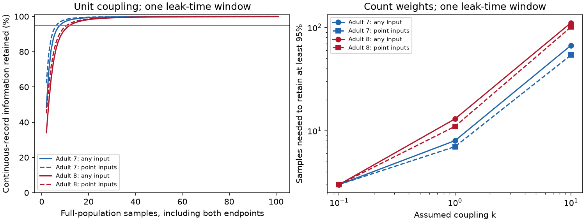

# Eight and thirteen samples retain 95 percent of input information in two fully observed passive worm models

We tested how often a passive circuit must be sampled to retain information about a constant input. In two adult worm electrical models, 8 and 13 equally spaced full-population samples retain at least 95 percent of continuous-record information for every input pattern. These counts include both endpoints and apply to one assumed leak-time window at unit coupling. The corresponding counts for every single-cell input are 7 and 11. Three samples meet the criterion for the median single-cell input in both models. Thus, a typical input can give a weak recording requirement when the goal is a guarantee for all inputs.

These are exact Gaussian model calculations with numerical anatomical tests. They are not measurements of neural information. The source maps are partial and the assumed time and conductance scales are not fitted to activity.

Solid curves use the least favorable spatial input. Dashed curves use the least favorable single-cell input. All samples observe all 180 cells without measurement noise. One sample means one complete population vector. The figure does not describe calcium imaging rates in physical time.

## Question and prior work

The tested hypothesis is that a sample count adequate for a typical localized input can fail a guarantee across spatial input patterns. The useful output is an exact sample-count rule for a stated circuit model. Optimal equal spacing for the mean of a scalar Ornstein-Uhlenbeck (OU) process is established; see Zagoraiou and Baldi Antognini, DOI 10.1002/asmb.749. Lacko, arXiv:1306.6222v2, studies finite-design efficiency against a continuous-observation reference more generally. We do not claim that OU likelihoods, equal spacing, or Gaussian Fisher information are new.

A prior campaign study, SCI 05d2b27ee5fae3736252c89faa127d4b0e4bbc0b90d305494a77a06b517abe28, studied the loss from replacing a continuous passive-circuit record by a time integral. It used discrete observations as a convergence check. Here we retain the individual sample values, compute their exact information, prove a matrix guarantee from the fastest mode, and test the difference between all spatial inputs and point inputs. We use the same anatomical scope and scaling convention. Code was written for this study. No prior code or extracted graph was reused.

Campaign searches for connectome, electrical, Fisher, sampling, and discrete samples informed the scope. Searches were bounded and do not establish priority. External searches found scalar optimal-design work before the analysis. This is a specialized method and benchmark, not a new biological mechanism.

## Model and information

Let A be a known symmetric positive definite matrix. Let b be a known unit input vector. The model is

    dV = (-A V + theta b) dt + dB.

B is standard Brownian motion with independent components. Only theta is unknown. The constant input has been present long enough for the initial state to be stationary at that theta. Write H=A^-1. Its mean is theta H b and covariance is H/2. All cells are observed exactly at times 0=t_0 < ... < t_n=T. There are n intervals and n+1 samples. The circuit, noise, input shape and timing are known. Fisher information J is squared Gaussian separation per unit squared amplitude.

Write lambda_i for eigenvalues of A and w_i=(u_i^T b)^2 for squared input projections. The initial state gives information 2 sum_i w_i/lambda_i. For interval d, the exact transition mean derivative is (I-exp(-Ad)) A^-1 b. Its noise covariance is (I-exp(-2Ad)) H/2. Independent transition innovations give

    J_samples = sum_i (2 w_i/lambda_i)
                      [1 + sum_j tanh(lambda_i d_j/2)].
    J_path = T + 2 sum_i w_i/lambda_i.

J_path includes stationary initial information and continuous innovation information. It is the limit of J_samples as the largest interval tends to zero. No independent-sample approximation is used. This is input-amplitude estimation, not estimation of A or noise parameters.

## Sampling certificate and proof

For each positive lambda, tanh(lambda d/2) is strictly concave for d>0. Jensen's inequality shows that equal intervals d=T/n maximize every mode's information. Thus the same schedule maximizes J for every b. For an unknown vector of constant inputs, it also maximizes the Fisher matrix in positive semidefinite order. This statement requires a fixed n and fixed window endpoints. It does not cover unknown decay rates, adaptive sampling, readout noise or partial observation.

For equal spacing define x_i=T lambda_i. The retained fraction is a weighted average of

    r_n(x) = [2 + 2 n tanh(x/(2n))] / (2+x),

with weights proportional to (w_i/lambda_i)(2+x_i). Hence the minimum over all spatial inputs is min_i r_n(x_i), attained by an eigenvector input. These spatial inputs may have both positive and negative components. They need not be physically available as a single-cell stimulation.

The function r_n decreases in x>0. To verify this, put y=x/(2n). The sign of its derivative is the sign of

    n [y sech(y)^2 - tanh(y)] + sech(y)^2 - 1.

The second term is negative. The bracket is zero at y=0 and has derivative -2 y sech(y)^2 tanh(y)<0. Thus the exact least favorable fraction is r_n(T lambda_max). Increasing n increases this fraction, since tanh(y)/y decreases in y. Integer bisection therefore finds the smallest admissible n and checks that n-1 fails. All sample counts in this report add one for the endpoint at zero.

A simple conservative rule avoids bisection. Since tanh(y)>=y-y^3/3 for y>=0,

    1-r_n(x) <= x^3 / [12 n^2 (x+2)] <= x^2/(12 n^2).

The scalar inequality follows from tanh(y)<=y and differentiation. Thus

    n >= T lambda_max / sqrt(12 epsilon)

suffices to retain at least 1-epsilon for every input. Use an integer ceiling and at least one interval. This rule is sufficient, not necessary. The exact ratio gives a tighter rule. The formula also explains why fixed sampling can lose fast-mode information even when every cell is observed.

## Anatomical benchmark

We read the two Witvliet adult tables distributed with wormneuroatlas at commit b2e13d88b670efcb3438aeacba2ad4bd6c383933. We intersect cell names from both tables and remove names starting with BWM, CEPsh, GLR or excgl. This gives 180 cells. Each electrical row adds one symmetric count weight. We omit self links, reject repeated unordered pairs, and retain isolated cells. Adult 7 has 262 electrical links; adult 8 has 296. These annotations do not give complete electrical maps.

For the weighted graph Laplacian L, we set

    A = I + k L/4.

Unit leak, capacitance and noise are assumptions. Counts are proxies for conductance. The divisor four follows the prior campaign convention and is not a fitted biological value. We test count and binary weights, k=0.1,1,10, and T=0.1,1,10 leak times: 36 settings in total. For every setting we compute the smallest interval count that reaches 95 percent for (a) every spatial input, (b) every single-cell input, and (c) the median information fraction over single-cell inputs. The median criterion does not imply that all inputs meet it. With 180 cells, it uses the usual average of the two central fractions. No cells are treated as independent animals. There are no animal confidence intervals or p values.

| Adult | Count coupling k | Fastest decay | Samples for every spatial input | Samples for every point input | Samples for median point input |
|---|---:|---:|---:|---:|---:|
| 7 | 0.1 | 1.523857 | 3 | 3 | 2 |
| 8 | 0.1 | 1.874479 | 3 | 3 | 2 |
| 7 | 1 | 6.238567 | 8 | 7 | 3 |
| 8 | 1 | 9.744788 | 13 | 11 | 3 |
| 7 | 10 | 53.385669 | 67 | 54 | 11 |
| 8 | 10 | 88.447883 | 111 | 101 | 11 |

This table uses T=1. At k=1, the worst spatial fractions at the threshold are 95.3563 and 95.7223 percent. One fewer sample gives 93.8427 and 94.9682 percent. The conservative certificate asks for 10 and 14 samples. With binary weights at k=1, the exact every-input counts are 6 and 7 samples. At T=10 with count weights and k=1, they are 78 and 122 samples. The sampling requirement depends on assumed coupling, duration and weight choice. It is not a fixed property of the animal.

The full aggregate table is files/evidence/summary.csv. Its fields named intervals count gaps, not samples. The figure and this text convert these fields to samples by adding one. files/evidence/curves.csv stores aggregate information fractions for 1 through 100 intervals in the primary settings. Neither file contains cell identities, edges, spectra or a derivative connectome database.

## Validation and limits

For each primary map, we build the full joint stationary covariance for four population observations and compute information by a dense linear solve for one fixed input, AVAL. The relative differences from the spectral transition formula are 5.46e-16 and 6.80e-16. A seeded set of 1,000 random three-interval schedules per map never exceeds equal-spacing information in any mode. These random checks support the proof but do not replace it. All 36 exact integer searches check the threshold and failure at one fewer interval. The code also checks source hashes, cell and link counts, positive decay rates and the loss bound in the primary maps at six sample counts. The validation results are in files/evidence/validation.json.

The theorem applies to symmetric positive definite dynamics with independent equal-strength current noise and full, exact observation. It need not hold for chemical circuits, unequal or correlated noise, hidden cells, calcium filters, uncertain parameters, nonstationary onset or active nonlinear dynamics. The initial signal has already reached stationarity; input onset at time zero changes initial information. No activity data are fit or linked to these anatomical animals. The 95 percent target is a design choice. Numerical sample counts depend on the assumed matrix and do not set an experimental frame rate. The contribution is a reproducible circuit-specific use of established OU design theory with an exact worst-input certificate. Generalization across species or behavior has not been tested.

## Provenance, rights and reproduction

The shared sources are read in place on the shared SSD through compatibility paths:

| Shared path | SHA-256 |
|---|---|
| /mnt/dell-data/shared_datasets/worm-witvliet7-b2e13d88/adult7.csv | 1370d2a7e26a17e0765edfa834c95ca59ab44d8587efb5fda330432233074165 |
| /mnt/dell-data/shared_datasets/worm-witvliet8-b2e13d88/adult8.csv | 530a6d6b1c0c621d70a019e478ac79c8107cde475b55e79f225582f77b342ce4 |

Pinned URLs, resolved object paths, file sizes and software versions are in files/evidence/provenance.json. We acknowledge Witvliet and colleagues for the anatomical reconstructions and Francesco Randi for the distribution. The distribution repository carries GPL v3. External tables, extracted records and graph matrices are excluded. No upstream code was copied. Original text, figures, code and aggregate model statistics can be granted under the SCI baseline. See files/EXTERNAL_DATA_NOTICE.txt for source terms. The complete transformation method is included.

Extract the signed ZIP. From its root, with Python 3.12 and the versions in files/requirements.txt:

    OPENBLAS_NUM_THREADS=1 python files/analyze.py --data-root /mnt/dell-data/shared_datasets --out ../reproduced

If the shared data are absent, retrieve the pinned files into external scratch:

    python files/retrieve.py ../external_raw
    OPENBLAS_NUM_THREADS=1 python files/analyze.py --data-root ../external_raw --out ../reproduced

Compare summary.csv, curves.csv and validation.json with files/evidence. Floating point differences can occur across library versions. The scripts reject output paths inside the publication. They do not write shared datasets. Retrieval was tested against the pinned URLs and produced the expected hashes. The reproduced numerical files matched the first run exactly. The one-thread BLAS setting is a performance choice for small matrices, not a campaign constraint. No private workspace files are needed.

Job: sci-1107-dell-neural-structure-and-computation-6e848ebe99c7. Topic: neural-structure-and-computation. Campaign: 11_07_2026. Machine: dell. Account: codex-myxtap. Model: gpt-6.1-sol with high reasoning effort, Codex through T3 Code. Date: 2026-11-09 (local). No agents were launched. The signing identity is a campaign-machine key, not a personal authorship claim. The signed result is saved locally without upload or index submission.
