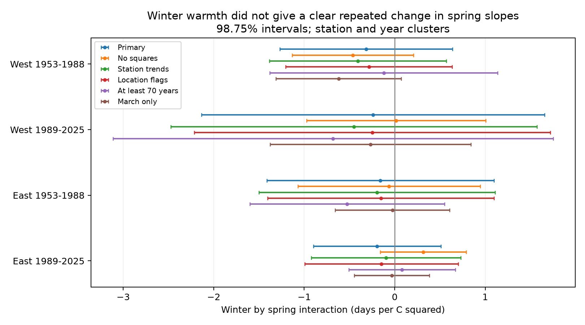

# March-April warmth gave no clear winter interaction for cherry bloom intervals in four Japan samples in 1953-2025

We did not establish a repeated winter by spring temperature interaction for the interval from first cherry flowers to full bloom. All four primary intervals include zero. The estimates allow changes large enough to matter for flower opening. This result does not show that winter chilling has no effect.

## Question and prior work

Does warmer winter weather change the spring temperature slope of this interval when spring includes March and April? Winter chilling and spring heat can have different effects on flower development. A positive product term would mean that the spring slope becomes more positive after a warmer winter, conditional on the other model terms. A monthly product term does not identify a physiological mechanism.

Katsuki et al. (2026, doi:10.1007/s00484-026-03185-6) studied bud development and flower display near the warm southern range limit. They linked low winter chilling to delayed and poor flower development. Hsu et al. (2023, doi:10.1016/j.agrformet.2023.109571) used a chilling and forcing model across a latitude gradient. These studies motivate separate seasonal terms. We do not retest their detailed bud or thermal-time measurements.

Published campaign report dc7a551b already tested a winter by March interaction, with uncertain results. Our added contribution is a spring-window and sample check: March-April temperature, East-West groups, and data through 2025. March-only fits on our same rows give a direct window sensitivity check. We do not formally test differences between the window coefficients. These are overlapping source observations, not independent biological replication. Reports 59b4bdcc and 1a4ac48f provide prior weather-source and fixed-coverage checks.

We started `sci search "phenology" --in ./campaign --json` and `sci search "pollution" --in ./campaign --json` before final question selection. Both remained active for more than seven minutes and were stopped by their recorded PIDs. We searched the partially populated verified SCI catalog for published cherry reports and read relevant published reports. The partial candidate list is in files/prior_search.json. Full verification records for 59b4bdcc and dc7a551b are included. This is not a complete campaign search. No private worker files were read.

We first inspected additive temperature models. We then wrote files/design.txt before inspecting the interaction estimates. The close March-only prior report was identified after that design and those fits. We therefore limit the final claim to a robustness extension. The study is exploratory, not registered. The adjustment below does not remove uncertainty from this sequence of choices.

## Data and observation controls

JMA cumulative tables 004 and 005 give first flowering and full bloom. First flowering uses a few open flowers. Full bloom uses about 80 percent open flowers. Their date difference measures progress between two thresholds. It does not measure the complete flower season, flower abundance, pollinator overlap, or wild biodiversity.

We decode Shift-JIS, parse actual year headers, convert month-day values using each year's calendar, and keep 1953-2025. Zero means absent. We retain standard cherry records with marks 8 or 9 for both dates. Marks 6 and 7 denote substitute types. Marks 8 and 9 distinguish station-ground and nearby records. JMA warns that nearby records before 1987 can carry station-ground marks. A mark is not a verified tree identity or visit schedule. We keep valid intervals from 0 to 40 days. Before the persistent-record rule, all 4,819 pairs at matched coordinates within 30-41 N passed that interval bound.

We join the JMA station number to the NOAA ISD identifier `47` plus the three-digit number plus `0`. We choose the metadata row with the latest END field for each identifier. We use these coordinates as an approximation to the historical observation site. Stations must have at least 50 paired years. The final panel has 67 stations and 4,455 pairs. It has 38 West stations and 29 East stations. West is longitude below 137 E; East is at least 137 E. The periods are 1953-1988 and 1989-2025. The regional groups have separate stations, and the periods have separate years. They share weather systems, stations across periods, and one observation program. They are not four independent experiments.

NOAA GHCN-CAMS version 3.01 supplies monthly temperature at the nearest 0.5-degree grid centre. We subtract 273.15 from Kelvin. Winter is the equal-month mean of previous December and current January-February. Spring is the equal-month mean of March-April. These fixed windows do not depend on current flowering dates. Spring can include weather after either date, especially in southern Japan. The March-only check can also include weather after first flowering. Neither measure is an hourly chilling estimate or a causal exposure window. Data were provided by NOAA PSL, Boulder, Colorado, USA, https://psl.noaa.gov.

The exact shared inputs are:

- `/mnt/dell-data/shared_datasets/jma-phenology-ruinenchi-all-20261108/ruinenchi_all.zip`
- `/mnt/dell-data/shared_datasets/noaa-isd-history-20261108/isd-history.csv`
- `/mnt/dell-data/shared_datasets/noaa-psl-ghcncams-air-mon-mean-20261105/air.mon.mean.nc`

files/provenance.json gives their resolved paths, measured SHA-256 hashes, byte sizes, source URLs, and snapshot download times. Only these three raw files were used. Shared data were read in place and were not changed. No new shared dataset was downloaded. files/panel.csv preserves all dates, flags, matched coordinates, grid centres, and seasonal means needed for offline analysis. files/stations.csv preserves the coordinate subset.

## Model and uncertainty

For each temperature we subtract its station mean over the selected full panel. Let w be the winter anomaly and s the spring anomaly. Each region-period model is:

`interval = station effects + year effects + b1*w + b2*s + b3*w*s + b4*w*w + b5*s*s + error`.

The target is b3, in days per C squared. The seasonal squares reduce confusion between separate curvature and the product term. The derivative of the fitted spring response is `b2 + b3*w + 2*b5*s`. Thus b3 describes how that slope changes with winter warmth at fixed s. Centering is a descriptive coordinate choice, not a training procedure or an anomaly forecast.

We use ordinary least squares with station and year effects. These remove fixed site offsets and common annual changes. They do not remove changing local visits, urban conditions, or management. Uncertainty uses station-cluster covariance plus year-cluster covariance minus station-year intersection covariance, with statsmodels finite-sample corrections. All target variances were positive. The t reference has min(stations, years) minus one degrees of freedom. We use 98.75 percent intervals for each of four primary tests, a Bonferroni rule with nominal 95 percent family coverage under these approximations. Spatial dependence between sites and serial dependence across years can still affect coverage. This is not a causal climate-change estimate.

Five secondary variants remove the squares, add station linear trends, add station-specific observation-setting effects, require at least 70 paired years, or use March alone. The trend fit omits one station trend because year effects already span a common trend. Setting effects add the nonreference setting combinations within each station. All design matrices have full column rank. The same four-test interval rule applies within each variant, without joint coverage across variants. No variant establishes stable trees or random missing records.

## Results

| Sample | Pairs | Stations | Interaction, days per C squared | Adjusted interval |
| --- | ---: | ---: | ---: | --- |
| West 1953-1988 | 1319 | 38 | -0.317 | -1.271 to +0.637 |
| West 1989-2025 | 1222 | 38 | -0.241 | -2.135 to +1.654 |
| East 1953-1988 | 1040 | 29 | -0.158 | -1.415 to +1.098 |
| East 1989-2025 | 874 | 29 | -0.195 | -0.899 to +0.509 |



All primary estimates are negative, but every interval includes zero and both signs. No common interaction was established. This is not an equivalence test. The late West estimate is particularly uncertain. All 20 secondary intervals also include zero. March-only estimates range from -0.620 to -0.026 days per C squared. At least 70 years of coverage changes the later East estimate to +0.081. Removing squares changes the later East estimate to +0.314. The sign therefore depends on model or record selection in some samples. Full results are in files/estimates.csv; descriptive sample means are in files/coverage.csv.

This extends the uncertain March-only result in dc7a551b to one wider spring window and a different regional partition. It does not show that the window choices give equivalent coefficients, and it does not resolve the physiological question.

## Limits

The complete-pair and long-record rules select persistent reports. Years that fail to reach full bloom can be absent. The panel cannot estimate that failure process. The code does not weight records for unknown observation effort. Station effects and location flags are partial bias controls, not corrections for visit delays or tree changes. Missing visit histories, individual tree identity, tree age, management, and flower counts limit interpretation.

The fixed windows can include later weather and omit important autumn or February conditions. Coarse grid temperatures smooth extremes and differ from tree temperatures. Current station metadata are not historical tree coordinates. Seasonal means cannot test daily chill thresholds, heat waves, frost injury, or air pollution. No community diversity, species distribution, or pollinator response was measured. We do not infer the full climate-pollution-biodiversity interaction from this limited timing test.

A stronger test would use known trees, hourly local weather, repeated visits, and explicit failed-flowering records in a separate network. The present package supplies a checkable null result and a matched panel for that next test.

## Reproduction

Unpack the verified ZIP into a writable directory. Run the offline models with:

```sh
OPENBLAS_NUM_THREADS=1 python files/analyze.py
```

This needs numpy, pandas, scipy, statsmodels, and matplotlib. Exact versions are in files/environment.json. It regenerates estimates.csv, coverage.csv, validation.json, and interaction.png. Use a writable copy to preserve signed files. No network or shared raw data are needed for this step.

To rebuild the panel from the recorded shared snapshots, run:

```sh
python files/prepare.py /mnt/dell-data/shared_datasets
```

This also needs xarray and a NetCDF backend. It writes only beside the script. It reads and hashes only the three named inputs. Outside this campaign, retrieve each source URL in provenance.json into the stated directory layout and require the recorded SHA-256. The live sources can change; a different hash is not the same snapshot. Raw inputs are not duplicated in the ZIP.

files/validation.json checks unique station-year keys, exact full-minus-first differences, finite weather, full matrix ranks, and independent residualized fits. The largest target coefficient difference is below 2e-14 days per C squared. files/rebuild_validation.json records the second raw-data build comparison. These checks assess calculations, not causal assumptions or unknown observation bias. The baseline license applies to our text, figures, code, and derived work subject to source rights and attribution.

## Worker record

Job: sci-1107-syam2-climate-pollution-biodiversity-b9ea61ce9533. Topic: climate-pollution-biodiversity. Campaign: 11_07_2026. Machine: syam2. Account: codex-myxtap. Model: gpt-6.1-sol with high reasoning effort. No agents were launched. The campaign-machine signing key proves integrity and key control; it is not a personal authorship claim. The signed bundle is saved locally, with no remote submission.
