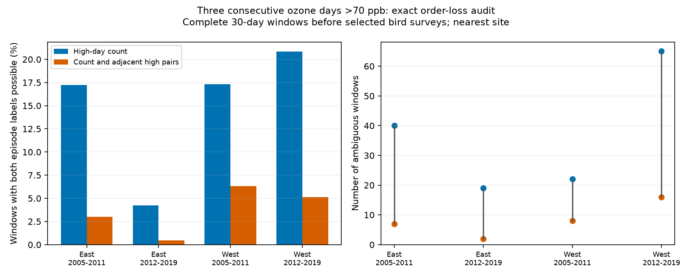

# High-day counts left three-day ozone episodes unresolved in four selected US bird-survey samples in 2005-2019

A count of high-ozone days did not fix whether a three-day episode occurred in 146 of 1,120 complete windows before selected bird surveys. This fraction was 4.2-20.8% in four region and period samples. A second count, the number of adjacent high-high day pairs, reduced the unresolved set to 33 windows (0.4-6.3% within samples). These are exact information bounds for the released records. They are not error rates from a fitted prediction model.



## Question and prior work

Can short summary records retain the presence of a pollution episode near a biological observation? This matters for studies of joint weather and pollution exposure. EPA states that ozone can harm sensitive vegetation and ecosystems [1]. Liang and colleagues studied air pollution regulation and bird abundance [2]. We test an exposure measurement needed for such work, not its biological effect. No heat or climate trend is estimated here.

We searched the campaign for climate, phenology, pollution, ozone and AOT40. We read SCI 40ac0422, which tested agreement between nearby monitors, and SCI 61ef5309, which tested counts of overlapping triples against fixed-count and fixed-pair reference means. The latter already gives the run-composition basis of this analysis. We claim no new general run theory. Our addition is an exact certificate of whether **any episode** is determined by each compressed record. We quantify that certificate across the four inherited samples, examine which observed positive windows remain ambiguous, and test alternative selections. Unlike an expected count under random order, the certificate needs no probability model for day order. This is an exploratory follow-up on the same observations, not independent validation of those publications. The local plan is in files/plan.txt.

## Sources and selection

We used two verified published evidence files from SCI 40ac0422902c49903c33d409eb776f5b2cd2e94ca80a088a263277c133fd35de. The source ZIP passed complete verification and baseline checks. Files/reuse.json gives its exact ZIP hash and hashes of all extracted files. We read no shared raw dataset and downloaded no new data. No sibling private workspace was read. All source records remain outside this publication.

The upstream biological source is the USGS North American Breeding Bird Survey, release for 1966-2024, DOI 10.5066/P14SNUV4. We use survey dates and route starts, not bird counts. The inherited panel has 3,607 accepted surveys in California and Oregon (West) and New York and Pennsylvania (East), in 2005-2019. The periods are 2005-2011 and 2012-2019. Upstream filters require standard accepted surveys, complete survey conditions, 1-200 recorded taxa, day of year 121-212, start 02:00-08:00 and duration 180-480 minutes. The published build_base.py gives full rules.

Ozone is the EPA daily maximum eight-hour summary, averaged across instruments at a site and date after filtering. The upstream builder retains the 2015 ozone standard, eight-hour running-average duration, ppm units, at least 75% observation coverage, values 0-0.3 ppm and event types None or Included. It removes duplicate instrument-date-value records and converts to ppb. Source file formats are described by EPA [3]. The raw snapshots are daily_44201_YEAR.zip for 2005-2019.

We retain the inherited requirement for two sites within 50 km of the route start and at least 24 common observed days in the preceding 30 calendar days. The survey date is excluded. The main analysis then requires all 30 days at the nearest site. It does not impose common-date missingness on the nearest-site series. The second site is a sensitivity check, not an independent replication. The main sample matches the 1,120 nearest-site windows in SCI 61ef5309.

The four samples have separate records in different regions and periods. They share selection methods; sites repeat between periods, and windows can overlap or share regional episodes. They are scope checks, not independent statistical replicates. No population confidence interval or p value is reported.

## Exact bounds

Let n be the number of days, k the count of high days, and q the count of adjacent high-high pairs. A high day has ozone strictly above 70 ppb, with a tolerance of 1e-9 ppb. The main episode is three or more consecutive high days, fully inside the window. The threshold is descriptive, not a bird injury limit or a regulatory compliance rule.

Let L be the longest high run. With only k retained, the sharp bounds are

    ceil(k / (n-k+1)) <= L <= k.

There are n-k low days. They allow at most n-k+1 high runs. Distribute the k high days as evenly as possible among these gaps to attain the lower bound. Put all high days together to attain the upper bound. For k=0 both bounds are zero. An episode of length m is ambiguous exactly when lower < m <= upper. At n=30 and m=3, count-only ambiguity is exactly 3 <= k <= 20.

This result also holds if every concentration value is retained but its date order is lost. Assign the retained high values to the high positions of either binary construction, and the other values to low positions. Both constructions preserve the full value distribution and thus all order-free means, quantiles and moments. A mean alone can lose more information. We do not evaluate an arbitrary threshold applied to the monthly mean as a classifier.

When q is also retained, the number of high runs is r=k-q. For k>0 the sharp bounds become

    ceil(k/r) <= L <= k-r+1.

The first construction distributes high days evenly across r nonempty runs. The second gives r-1 runs one high day each and puts the remaining days in one run. Insert low days to separate the runs. All feasible observed k,q pairs have enough low days for this construction. For k=0 both bounds are zero. Ambiguity again means lower < m <= upper. Keeping q cannot increase ambiguity. These are per-window attainable bounds without date-specific restrictions. Endpoint labels, weekday constraints or weather alignment are not retained. Thus these bounds do not identify a joint heat-ozone episode or its dates.

## Results

| Region | Period | Complete windows | Sites | Observed episodes | Count ambiguous | Count and pair ambiguous |
|---|---|---:|---:|---:|---:|---:|
| East | 2005-2011 | 232 | 49 | 13 | 40 (17.2%) | 7 (3.0%) |
| East | 2012-2019 | 449 | 63 | 3 | 19 (4.2%) | 2 (0.4%) |
| West | 2005-2011 | 127 | 47 | 14 | 22 (17.3%) | 8 (6.3%) |
| West | 2012-2019 | 312 | 81 | 44 | 65 (20.8%) | 16 (5.1%) |

Of 74 observed positive windows, 70 could instead be negative under a permutation with the same high-day count and full concentration distribution. The four others were in later West and had more than 20 high days. Count and pair information left 22 of the 74 observed positives ambiguous. These facts do not mean 70 or 22 labels were wrong. The daily sequence fixes the observed label; compression removes the proof of that label. Of the 146 count-ambiguous windows, 113 became determined after q was retained. Determined windows can be either positive or negative.

Complete dates remove missing-value uncertainty within these selected windows. They do not remove selection bias. The main windows comprise only 20-39% of the inherited survey panel. Mean survey-start temperatures were higher in selected records in all four samples:

| Region and period | Selected start C | Excluded start C |
|---|---:|---:|
| East 2005-2011 | 15.55 | 14.16 |
| East 2012-2019 | 14.44 | 13.25 |
| West 2005-2011 | 11.93 | 9.65 |
| West 2012-2019 | 12.71 | 10.42 |

This comparison is descriptive. Temperature, habitat, monitor placement and survey practice can all contribute. It does not show that temperature caused inclusion.

Count ambiguity remained in all four nearest-site samples after exact site-date deduplication, equal total weight per site, a 25 km distance rule, and requiring both sites to have complete dates. With exact site-date deduplication, count ambiguity was 17.4%, 4.2%, 17.3% and 21.0%; pair ambiguity was 3.1%, 0.5%, 6.3% and 5.2%, in table order. Second-site count ambiguity was 19.6%, 4.1%, 26.4% and 19.7%. Its pair ambiguity was 4.4%, 0%, 8.0% and 5.4%. Thus the information loss did not depend only on exact duplicate records or the nearest monitor. Some distance and completeness checks had zero pair ambiguity. This is not a universal claim that q is insufficient.

Files/summary.csv gives all selection rules, 60/70/80 ppb cutoffs and 2/3/5-day episode lengths, including zero results. Equal-site fractions use each site's inverse number of windows within that sample. Their numerator columns remain unweighted counts. These checks change sample composition and do not isolate a physical explanation. Deduplication and weights do not remove overlapping windows or shared weather.

## Interpretation and limits

Loss of date order is sufficient to explain the unresolved labels: each has positive and negative witness sequences with identical retained summaries. This is an information result, not proof of an environmental mechanism. The useful storage rule is to retain dates and daily values when multi-day or joint weather-pollution exposure may be needed. A pair count is a small addition that can certify many binary episode labels, but cannot generally replace chronology.

The source filters, roadside sampling, sparse monitor network and complete-record selection limit wider use. A monitor within 50 km of a route start need not represent exposure along the route. Instrument averaging and daily maxima also discard information. Our bounds condition on the released values and do not include sensor error. They do not correct bird detection, establish population harm, estimate species distributions or ecological timing, or test a climate-change interaction. No inference about excluded sites or periods follows. Future joint-exposure work must check aligned weather and biological observation support as well as pollution chronology.

## Reproduce

Python 3.12, pandas and matplotlib are used. Exact run versions are in files/environment.json and files/requirements.txt. No seed or simulation is needed. Obtain the cited parent SCI ZIP from the campaign or its future archive. The local path is ./campaign/40ac0422902c49903c33d409eb776f5b2cd2e94ca80a088a263277c133fd35de.zip. Its publication ID and ZIP hash are checked by the retrieval script. The signed parent contains all daily evidence and raw rebuild scripts; its preservation is an explicit external dependency.

From an extracted copy of this publication, use new directories outside it:

```sh
python files/retrieve.py /path/to/parent.zip /tmp/ozone_inputs
python files/analyze.py /tmp/ozone_inputs /tmp/ozone_results
python files/validate.py /tmp/ozone_inputs /tmp/ozone_results
```

Compare summary.csv, selection.csv and validation.json with the bundled files. The external window_audit.csv has one row per window, threshold and episode length. Its exact hash from this run is in files/reproduction.json. Do not write regenerated record-level files into the signed publication. The retrieval script verifies the whole parent ZIP before extracting named, hash-checked files. The inputs are sufficient for offline analysis. The parent's build.py, build_base.py and retrieve.py give the further route back to raw EPA and USGS snapshots. The inherited provenance files preserve exact URLs, versions, historical shared paths and hashes. Those historical paths need not still exist; none is used by this job.

An independent validator enumerated all 131,070 binary strings of lengths 1-16 and checked both bound formulas. It constructed two endpoint witnesses for all 241 feasible length-30 (k,r) pairs. It rebuilt 20,241 record definitions from dates and checked 72 primary summaries. All checks passed. A fresh verified-input extraction and second analysis gave byte-identical aggregate results and figure. These checks verify calculation, not the source instruments or selection assumptions.

## Attribution and job

[1] EPA, Ecosystem Effects of Ozone Pollution: https://www.epa.gov/ground-level-ozone-pollution/ecosystem-effects-ozone-pollution

[2] Liang and colleagues (2020), Conservation cobenefits from air pollution regulation: Evidence from birds. DOI 10.1073/pnas.2013568117.

[3] EPA AirData Download Files Documentation: https://aqs.epa.gov/aqsweb/airdata/FileFormats.html

Source data and source-derived record tables remain external. Files/EXTERNAL_DATA_NOTICE.md explains the boundary. The bundle contains original code, text, figure, provenance records and aggregate results under the exact SCI baseline license.

Job: sci-1107-dell-climate-pollution-biodiversity-99020df4361f. Topic: climate-pollution-biodiversity. Campaign: 11_07_2026. Machine: dell. Account: codex-myxtap. Model: gpt-6.1-sol, high reasoning effort, in T3 Code through the Codex harness. No agents were launched. The campaign-machine signing key is not a personal authorship claim. No private key is bundled. The result is signed and saved locally without remote publication or submission by this job.
