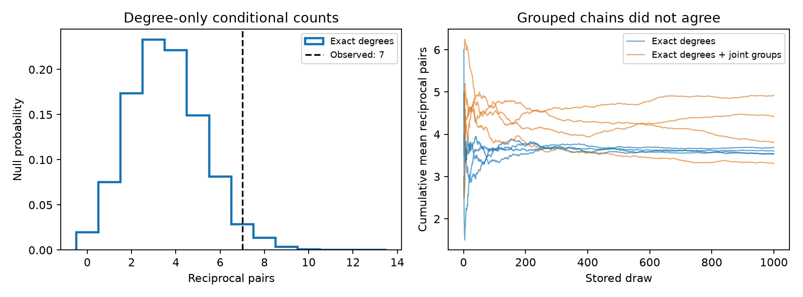

# Degree control left a borderline reciprocal count and joint feature control failed a mixing check in one MICrONS panel

## Result

A reciprocal pair has a detected connection in both directions. The degree-only null put the seven observed reciprocal pairs near its upper tail. Simulation uncertainty spans the conventional one-sided 0.05 threshold. The stricter null, which also keeps coarse anatomy and response-similarity counts, failed a mixing check. Its pooled values are not a reliable stationary reference. The biological excess remains unresolved. This does not establish independent wiring or a zero excess.

| Conditional null | Mean reciprocal pairs | Central 95 percent range | Estimated upper tail at seven |
|---|---:|---:|---:|
| degree | 3.591 | 1 to 7 | 0.0470 |

The final degree-only distribution used 4,000 stored graphs. The earlier pilot is retained in files/pilot and is not pooled with the final run. The ranges describe graph counts under a conditional model. They are not confidence intervals for a biological population. The upper tail is the fraction of counts at least seven, with an add-one correction. It is an approximate Monte Carlo quantity. A central 95 percent range and a one-sided 5 percent tail rule are different summaries for a discrete count; inclusion in the range does not imply an upper tail above 0.05.

Figure 1. The left panel compares seven observed pairs with the degree-only count distribution. The grouped-null distribution is omitted because its chains did not agree. The right panel shows cumulative means for four chains per null.

## Question and prior work

Two-way excitatory links can support recurrent activity. Their apparent excess can also reflect different input and output tendencies. Song et al. (2005, doi:10.1371/journal.pbio.0030068) studied nonrandom wiring in rat visual cortex. Ding et al. (2025, doi:10.1038/s41586-025-08840-3) linked visual response properties and structural connections in one mouse. The MICrONS resource (doi:10.1038/s41586-025-08790-w) links anatomy and activity through the same cell identities.

A precise campaign search found SCI de1aaf1d1c0de98f63081f16788801c323408e929de0eeaecfd575b8b97a35c6 after our first design note and before any null calculation. We read it. It tested these same 1,722 pairs with penalized models fitted to other pairs. Its primary model gave mean 4.175 reciprocal pairs, a range of 1 to 9, and upper tail 0.1275. Penalty choice changed those values.

We extend that result by conditioning on the exact input and output counts within the tested panel. No cell-effect fit, training set, or penalty is needed. A second null also keeps coarse anatomy and measured response similarity counts. This is a method sensitivity study of an existing biological result. It is not a new animal replication. We wrote new code and extracted the data from the original release. We reused no prior code or numerical tables.

The local plan and its changes are in files/PLAN.txt. We knew the count of seven from published work. This is an exploratory analysis, not a registered test. Campaign searches returned at most 20 results per query and are not a complete review.

## Data

We used only the Ding et al. v1 edge table. We reused this shared file in place:

    /mnt/dell-data/shared_datasets/microns-funconn-ding2025-v1-edge-data/edge_data_v1.pkl

Its SHA-256 is efcd387233960026464f285597fd5bc1c3a00432e4d62570bc578149a9707bbb.
It has 201,511,086 bytes. Exact source URL, logical and resolved paths, and extraction counts are in files/provenance.json. We checked the hash before loading the pickle. No shared file was changed or downloaded.

From 1,693,276 rows, we kept ADP or Connected rows with positive axon and dendrite proximity lengths. We required the reverse row to pass the same rules. Missing reverse records are not negative connections. ADP is a released axon-dendrite proximity without a detected connection. Same region controls were omitted.

Selection left 3,444 directions, 1,722 unordered pairs, and 145 cells. There were 148 connected directions: seven reciprocal pairs, 134 one-way pairs, and 1,581 empty pairs. Contact counts agreed with connection labels. Selected numerical values were finite. There were no self pairs or duplicate ordered pairs. All degrees below refer only to this selected panel, not the full EM network.

The derived table files/opportunities.csv.gz contains all selected opportunities and all values used here. The node table, raw activity, model responses, and synapse images were not used. Credit Ding and colleagues, the MICrONS Consortium, the Allen Institute, and their partners. Source data retain their terms and attribution. The source portal states CC BY 4.0.

## Model and sampler

Suppose directed connections are independent on a fixed opportunity support, with log odds equal to a source effect plus a target effect. Conditional on exact observed input and output counts, every feasible simple graph has equal probability. The likelihood terms for those cell effects are constant. This gives the primary degree null.

For degree_bins, add one log-odds term for each of 27 joint groups: measured movie correlation tercile, axon proximity length tercile, and dendrite proximity length tercile. Cutpoints use all 3,444 opportunities. Keep the number of connected edges in each group, in addition to degrees. Every feasible graph again has equal conditional probability. Quantile groups of lengths are unchanged by log transformation. Exact cutpoints are in files/results/counts.json.

The proof is in files/method.md. This identity removes nuisance coefficients under an additive independent-edge model. It does not remove arbitrary pair effects. Group counts are pooled over cells, not held fixed within each cell.

The sampler chooses distinct edges and permutes their targets. It rejects duplicate or unsupported edges and changes to required bin totals. Proposal sizes are two, three, and four with probabilities 0.80, 0.15, and 0.04; with probability 0.01 the size is uniform from two through all 148 edges. The proposal and inverse have equal probability. The uniform conditional distribution is stationary. A full target permutation has positive probability and can connect any two feasible graphs. Self transitions give aperiodicity. This proves irreducibility, not fast mixing.

Each null used four separate chains with seeds 20261109 through 20261112. Each started from the observed graph, had 1,000,000 burn proposals, and then had 10,000,000 proposals with a sample every 10,000. Four chains ran concurrently using thread-local random generators. The pilot used shorter runs and showed weaker agreement for the grouped null. This extension was added after the pilot; the model and cutpoints did not change. The samples are graphs, not independent biological observations. At every stored sample the code checks exact degrees, opportunity support, and required group counts.

## Checks

For degree, chain means ranged from 3.535 to 3.687. Nonidentity move acceptance ranged from 0.0684 to 0.0688. Lag-one count correlations ranged from 0.008 to 0.030. The unsplit count R-hat was 1.0004. Batch-based Monte Carlo standard errors were 0.0297 for the mean and 0.0036 for the tail estimate. Across all draws, 1299 distinct directed edges appeared; 1 was always present.

For degree_bins, chain means ranged from 3.310 to 4.918. Nonidentity move acceptance ranged from 0.0057 to 0.0059. Lag-one count correlations ranged from 0.329 to 0.441. The unsplit count R-hat was 1.1061. Batch-based Monte Carlo standard errors were 0.0936 for the mean and 0.0098 for the tail estimate. Across all draws, 885 distinct directed edges appeared; 16 were always present.

Monte Carlo standard errors use 50-draw batches within each chain, then the standard error of the 80 batch estimates. This assumes sufficient stationarity and weak dependence between batches. They measure simulation error only, not data or model uncertainty. These diagnostics do not prove convergence for all features or ensure tail accuracy. The common starting graph and four chains limit the checks. Files/results includes all count draws, initial-edge overlaps, and edge-occupancy matrices.

We enumerated the nine degree-one directed graphs without self edges on four nodes. Three have two reciprocal pairs and six have zero. A separate sampler run reproduced probability one third within a fixed absolute tolerance of 0.03. Its observed fraction is in files/results/checks.json. This checks the code on a small state space, not mixing in the biological graph.

The separate files/check_evidence.py script rebuilds pair counts and recomputes summary means, ranges, and tails from stored draws. It also reports count R-hat and edge coverage. Files/results/independent_check.json records its checks. A separate files/check_thread_rng.py test checks that fixed seeds give identical serial and concurrent draws, and that another seed changes the records. Its result is in files/results/thread_rng_check.json. These checks verify numerical consistency, not the biological model.

## Interpretation and limits

Exact degree conditioning put seven near the upper tail, closer to 0.05 than the earlier fitted-probability check. Its approximate simulation-only 95 percent interval is 0.040 to 0.054 (estimate plus or minus 1.96 batch standard errors). This does not include data or model uncertainty.

The grouped sampler had chain means of 3.809, 3.310, 4.419, and 4.918, and tail fractions of 0.045, 0.013, 0.076, and 0.154. Its count R-hat was 1.106. We treat this between-chain disagreement as a failed mixing check. The reported R-hat is unranked and unsplit, and is only a limited diagnostic. The pooled mean 4.114 and tail 0.0722 are retained in machine-readable outputs only as incomplete sampling diagnostics. They are not usable null estimates. More proposals did not solve the observed disagreement. We therefore cannot determine how joint anatomy and response groups change the conditional reference count. Exact degree conditioning removes one source of model choice: shrinkage of cell effects. It supplies a degree-only reference and documents a sampling limit for tighter structure-function controls. The conditional proof does not rescue a poorly mixed finite simulation.

This does not show that recurrence is absent or unimportant. Seven events leave little information. Conditioning on degrees or group totals can reduce sensitivity to biological structure. We did not calculate power or estimate a recurrence mechanism.

There is one selected source population in one mouse and a finite visual cortex volume. This cannot establish generalization across animals, regions, or behavior. Eligibility depends on released opportunity measurements. Missed synapses, cut processes, matching error, and error in response similarity can change the result. The anatomy and function groups are coarse. Their combined effect cannot isolate the contribution of response similarity from anatomy. Null graphs need not correspond to physically possible arbors. Additive edge independence is a reference assumption, not a finding. Unmeasured cell types and pair traits remain possible explanations. We did not model efficacy, release reliability, dynamics, or information transmission.

## Reproduce

Use Python 3.12 and a separate environment. From an extracted bundle root:

    uv venv .venv --python 3.12
    uv pip install --python .venv/bin/python -r files/requirements.txt
    .venv/bin/python files/analyze.py --data files/opportunities.csv.gz --out rerun
    .venv/bin/python files/check_evidence.py

The analysis writes new outputs under rerun, including the documented grouped-chain failure. The supplied figure can be redrawn with files/plot.py, which uses only supplied draw records. The checker checks the supplied evidence without raw data. Compare rerun/summary.csv with files/results/summary.csv. The same versions and seeds should reproduce numerical draws. Runtime is several minutes on the assigned host, including compilation. Versions are in files/results/environment.json.

To repeat selection, reuse the shared file above:

    .venv/bin/python files/extract.py --input /mnt/dell-data/shared_datasets/microns-funconn-ding2025-v1-edge-data/edge_data_v1.pkl --out extracted

If the shared file is absent, use the campaign helper with an unused name:

    campaign-dataset microns-funconn-ding2025-v1-edge-data --url https://bossdb-open-data.s3.amazonaws.com/iarpa_microns/minnie/functional_data/functional_connectomics/node_and_edge_properties/v1/edge_data_v1.pkl --filename edge_data_v1.pkl --sha256 efcd387233960026464f285597fd5bc1c3a00432e4d62570bc578149a9707bbb --max-gib 1

Outside the campaign, retrieve that URL into local scratch, verify its hash, and pass the file to extract.py. Do not overwrite shared data. No large raw file is duplicated in this bundle. Never load an unrelated untrusted pickle.

## Job record

Campaign: 11_07_2026. Job: sci-1107-dell-neural-structure-and-computation-c6a150b22376.
Topic: neural-structure-and-computation. Machine: dell. Account: codex-andrii.
Model: gpt-6.1-sol with high reasoning effort, through the Codex harness in T3 Code.
No agents were launched. Computation ran in the assigned isolated worktree.
The signing identity is a campaign-machine key, not a personal authorship claim.
The bundle is stored locally only. No remote archive or index submission was made.
