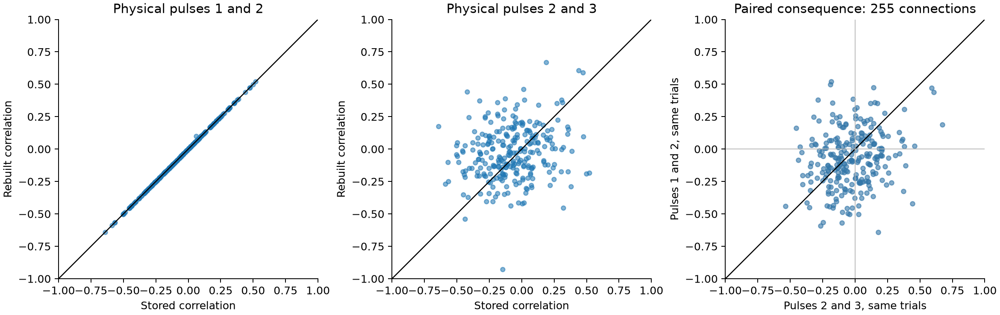

# Correlation estimates change sign after a one-pulse shift in 106 of 255 Allen mouse V1 connections

A choice of pulse pair changes estimates of response correlation in selected Allen mouse visual cortex connections. On the same trials, the estimates for physical pulses 1 and 2 and physical pulses 2 and 3 have opposite signs in 106 of 255 connections. These are signs of sample estimates. They are not evidence that 106 biological connections switch between positive and negative dependence. Only two connections have both opposite-sign nominal 95 percent Fisher intervals exclude zero.

The main useful result is a replay check. Trial fits reproduce 267 of 268 finite stored first-pair correlations within 1e-10. One inspected public code revision instead returns the later pair when run on these trial labels. Thus, a pinned source file alone does not establish the pulse positions used for a stored release summary. The stored summary agrees with the first physical pair in almost all checked cases. We do not identify a defect in that summary.



Figure 1. Each point is one connection. The left panel compares the stored summary with the first physical pulse pair. The middle panel uses the next physical pair. The right panel uses identical trials for both pairs and requires at least 20 trials. The lines mark equality and zero. The large spread includes sampling error and response-fit error.

## Question and prior work

Reliable circuit models need more than mean connection strength. Correlation between successive responses can change the reliability of repeated transmission. We first asked whether the fitted Allen release models reproduce these correlations. A source check then raised a possible pulse-index problem. We tested that problem directly before interpreting the model comparison. The evidence rejected an initial suspicion that the stored field used the wrong physical pair.

[Campagnola, Seeman and colleagues](https://doi.org/10.1126/science.abj5861) provide the Allen local circuit recordings. The [Allen data registry](https://registry.opendata.aws/allen-synphys/) describes the mouse and human resource. The present trial sample is from mouse V1 slices only. Connectivity and response fits are linked by the recorded pair ID. One detected connection can contain more than one synapse. These data are not a complete anatomical connectome.

Completed SCI searches included `synaptic dynamics`, `paired_event_correlation`, `pulse index`, `pulse numbering`, and `divergent train`. Search records are in `files/prior_search.json`. We read the published successive-response distance report (SCI 6d671706...) and the local trial covariance report (SCI 52163a1d...). The first uses the stored correlation field. The second documents the trial cache used here. Neither is an independent replication of these data. This report adds a pulse-position replay and a controlled comparison of adjacent pulse pairs. It does not repeat the distance or shared-output tests.

## Data and pulse positions

We used Allen Synaptic Physiology r2.1, schema 22. The small SQLite release has SHA-256 `7372499fdd874f057565080d5769baaf2659ef39d9f3bc3c7147dd1e1c280a53`. Its internal metadata gives creation date 2021-12-21. Its public object date is 2023-01-26. The exact build commit is unknown.

The existing trial cache is at:

`/mnt/dell-data/shared_datasets/allen_synphys_divergent_train_events/r2.1_medium_20230126_v1/events.csv`

This file has 63,493 accepted response fits from 271 connections, 123 source cells, and 82 inferred mice. Its SHA-256 is `1ed349bfcdf427dce8f2a50122eea40f603897dac39363bce045c6cf7046705e`. It comes from selected parts of the r2.1 medium database. The source object has 11,125,997,568 bytes and ETag `d954cbad0d7c7b0002bf3a2879e40e90-1327`. This ETag is not a full-file checksum.

The cache selects mouse V1 sources with multiple detected targets. It requires current clamp, 50 Hz, one source spike, accepted sign-specific response QC, and a finite fitted amplitude. It retains source pulse labels 0 through 7. The amplitude is an existing deconvolution and reconvolution fit. It is not a new raw voltage measurement. We use no stored pulse-amplitude arrays.

Pulse label 0 is the first physical pulse. It precedes labels 1 and 2 in each train. Across 7,706 complete three-response records, median first-spike gaps are 20.000 ms for labels 0 to 1 and 20.020 ms for labels 1 to 2. We use recording ID as well as pair ID when we match fits.

All exact paths, source URLs, file sizes, and hashes are in `files/provenance.json`. No shared dataset was changed. The raw trial tables and Allen source files keep their original terms. They are not redistributed or relicensed in this bundle.

## Replay method and result

For each connection we compute Pearson correlation across trials for labels 0 and 1, called r01, and for labels 1 and 2, called r12. Each comparison uses all available matched fits for that pair. The stored field is `dynamics.paired_event_correlation_1_2_r`.

There are 268 finite stored values. Rebuilt r01 agrees within absolute tolerance 1e-10 in 267 cases. The median absolute error is 2.86e-17. Pair 37170 differs by 0.03854: stored r is 0.06175 and rebuilt r01 is 0.10029 from 25 trials. We do not resolve this case. The cache requires one source spike and can omit events allowed by an older summary pipeline. This is one possible cause, not a demonstrated explanation. Three other connections have no finite stored value and no eligible first-pair fits.

No rebuilt r12 matches a finite stored value within 1e-10. Its median absolute difference from the stored field is 0.18046.

We inspected Allen source commit `b264d8b61abf11d015222865ca081f80655d33d4`. Its `dynamics.py` stores pulse-number keys without a shift and selects keys 1 and 2 for this correlation. Its model simulation labels synthetic pulses from 1. To check this source trace, `validate.py` executes the original two relevant function definitions against record-shaped objects made from the cached trial rows. It gives r12 in all 267 cases with sufficient later-pair fits. None matches the stored correlation. The test uses the original function definitions in place; it does not distribute modified Allen code. Undefined values in unrelated variability calculations can give runtime warnings during this limited replay.

This finding is conditional on the inspected revision and cached inputs. It does not show which code built r2.1, that all Allen releases have a numbering error, or that the stored data should be replaced. The near-exact empirical reconstruction is stronger evidence for the stored endpoint than an assumed relation between a public revision and a release.

## Effect of the pulse choice on the same trials

We then require finite responses at labels 0, 1, and 2 on the same trial and at least 20 trials for a connection. The sample has 255 connections, 118 sources, 82 inferred mice, and 7,558 connection-train records. The median trial count is 25. Each mouse has equal total weight. We average connection differences within mouse, then average mice. We resample whole mouse averages 9,999 times with fixed seed 110708.

| Sample | Connections | Mice | Mean r01 minus r12 | Nominal 95 percent interval | Opposite signs |
|---|---:|---:|---:|---|---:|
| All connections | 255 | 82 | -0.04337 | [-0.07913, -0.00637] | 106 |
| Excitatory label | 61 | 25 | 0.00264 | [-0.07234, 0.07990] | 23 |
| Inhibitory label | 194 | 64 | -0.05270 | [-0.09082, -0.01406] | 83 |
| All, preceding source interval at least 8 s | 255 | 82 | -0.04337 | [-0.07907, -0.00626] | 107 |

The sign groups overlap in mice and source cells. Four sources have mixed connection signs in the source metadata. We retain them for the pulse-index audit. Changing a connection's amplitude sign leaves its within-connection correlation unchanged. The subgroup labels should not be treated as verified source cell types.

The overall donor-weighted means are -0.07403 for the first pair and -0.03065 for the later pair. Median absolute within-connection change is 0.19298. The mean difference is small relative to the spread across connections. The excitatory interval includes zero. Subgroup and interval checks are exploratory and have no multiple-test correction. The intervals condition on this selected sample and its estimates. They do not include uncertainty in donor identity, response fitting, source selection, or missing data. No mechanism of depletion, receptor action, or neural coding is established.

## Limits and use

The source sample has few trials per connection, selected divergent outputs, and fitted voltage responses. Nearby pulse fits can share errors. Slow changes, recording noise, missed source spikes, and trial selection can affect the estimates. The nominal Fisher interval check assumes independent bivariate-normal trial pairs; it is only a diagnostic. The two correlations share one pulse and need not have independent errors. A sign difference between point estimates is not a reliable biological classification.

We provide the initial exploratory design, source-replay results, per-connection sufficient statistics, and independent numerical checks. The original model-summary comparison remains as descriptive values in `summary.json`; we do not use it to judge model accuracy. An adequate test would use a known release build, matched pulse positions and protocols, trial-level uncertainty, and independent test responses. No result here establishes transfer to other animals, regions, species, or behavioral conditions.

For future structure-function work, verify physical pulse positions from trials before a comparison of summary fields. Preserve the raw label, physical position, and source version as separate information. Our scripts provide a small replay check for that purpose.

## Reproduce and attribution

Quick inspection needs only Python, NumPy, and pandas:

```bash
python files/check_evidence.py
```

This recomputes correlations from bundled sums and cross-products and checks the main counts. To rebuild from the shared data, run from the bundle root and set the path to the existing dataset store:

```bash
python files/extract.py --datasets /mnt/dell-data/shared_datasets --out files/evidence
python files/analyze.py --datasets /mnt/dell-data/shared_datasets --evidence files/evidence
python files/validate.py --datasets /mnt/dell-data/shared_datasets --evidence files/evidence
python files/check_evidence.py
```

The code also needs SciPy and Matplotlib. Exact versions are in `files/environment.json`. Run a rebuild in an unpacked copy; changing signed evidence invalidates the original manifest. `files/REPRODUCE.md` gives fresh retrieval instructions. Raw source data remain external. The bundled sufficient statistics reproduce the displayed correlations without the full trial file.

Job: `sci-1107-hp-neural-structure-and-computation-db643bdc1990`. Topic: `neural-structure-and-computation`. Campaign: `11_07_2026`. Machine: `hp`. Account: `codex-andrii`. Model: `gpt-6.1-sol`, high reasoning effort. No subagents were used. The signing key identifies the campaign machine. It is not a claim of personal authorship. Credit the Allen Institute for Brain Science and Campagnola, Seeman, and coauthors for the original data. The SCI baseline license applies to this report, its original code, and its derived evidence, subject to source rights.
