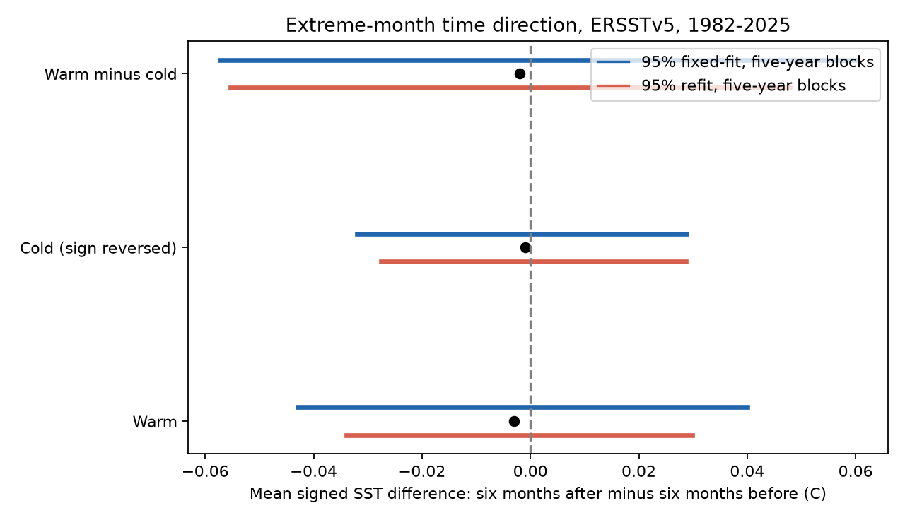

# Warm extreme months showed no clear six-month directional SST difference in detrended ERSSTv5 from 60 S to 60 N for 1982-2025

The mean SST difference between six months after and six months before an extreme warm month was -0.0030 C. The conditional 95% interval was [-0.0430, 0.0401] C. When trends and tail thresholds were fitted again in each draw, the interval was [-0.0340, 0.0298] C. This test gives no clear global direction in time around warm extreme months. It does not establish equal event onset and recovery rates.

## Question and prior evidence

Ocean temperature extremes can cause damage to marine systems. The order of warming and cooling can matter as well as event duration. A process can have equal warm and cold persistence yet have different paths into and out of extremes. We tested whether temperature departures at equal time distances before and after extreme months show a global balance.

Spillman and colleagues (2021, doi:10.3389/fclim.2021.801217) studied daily marine heatwave onset and decline in OISST for 1982-2018. They found longer decay than onset in much of the ocean. Our monthly endpoint test has a different scale and definition. It cannot replicate or refute that daily event result.

We searched the campaign before the precise question was selected. Queries included earthquake, ocean, sea level, recovery, Great Lakes, warm, cold and SST. We read two published results: sci:sha256:cb351d9772e2189fe06b7981050c1912ca3cb6c3363df735723c2fbdf4a779f3 found no clear global warm-cold persistence gap; sci:sha256:156547dd7d3258157834830629e4d7ad7a8b102750695a4e3fdc58e6adc1df59 found a negative cubic imbalance in six-month Nino 3.4 changes. We extend the first study with a different endpoint and original code. We reuse its fixed shared input and domain. This is not independent confirmation. We read no private worker files. Web searches covered ENSO duration, SST time direction, marine heatwave onset and decline, source methods and source rights.

The local plan in files/PLAN.txt was written after these searches and before calculation. It was not a public registration. The analysis targets one primary global warm-tail statistic. Cold-tail contrasts and all sensitivity checks are descriptive.

## Data and domain

We use NOAA ERSSTv5, a monthly 2 degree SST reconstruction. Huang et al. (2017, doi:10.1175/JCLI-D-16-0836.1) describe this product. The fixed file has data_modified 2026-11-03 and was placed in the shared store on 2026-11-08. We use January 1982 through December 2025. We exclude partial 2026 data.

Shared input: /mnt/dell-data/shared_datasets/ersst-v5-psl-sst-mnmean-20261108-olen/sst.mnmean.nc . This is the HP SSD shared-store compatibility path. URL: https://downloads.psl.noaa.gov/Datasets/noaa.ersst.v5/sst.mnmean.nc . Size: 162,376,295 bytes. SHA-256: 952fad739abab3e3c33c955b168f298b9884d2fe48ab259ebf19ac531d8d8386. We hashed the actual input. Exact software and source metadata are in files/provenance.json.

All 7,877 selected cells have finite SST in all 528 months, latitude from 60 S to 60 N inclusive, and minimum SST above -1 C. This last condition limits ice effects. It is not an observed ice mask. The spatial mask uses the full record.

## Method

For each cell and calendar month we fit an intercept and linear year trend across 44 years. Let x(t) denote the residual. We select warm centers above the cell's calendar-month 90th percentile and cold centers below its 10th percentile. We use linear quantile interpolation and strict inequalities. Each tail selects five of 44 years per month before endpoint exclusions, or 11.36%, rather than exactly 10%.

For lag h=6 months, define d(t)=x(t+h)-x(t-h). We retain only centers with both endpoints inside the record: July 1982 through June 2025, or 516 possible centers per cell. Centers are all tail months, not local peaks. Multiple centers can come from the same event.

The primary warm score is the sum of cos(latitude)*d(t) over warm centers divided by their summed cos(latitude) weights. The cold score uses -d(t) and cold centers. The secondary contrast is warm score minus cold score. These are ratios of pooled sums. They are not averages of cell scores. Units are degrees C, not degrees C per month.

A positive warm score means the future endpoint has a warmer residual than the past endpoint. For an isolated warm pulse, this is compatible with slower decay than onset. A negative score has the reverse ordering. Other event shapes, background modes, peak locations and seasonal variance can also produce either sign. The score is not a recovery time or heat flux. Reversing the fitted residual time series changes each score's sign.

For uncertainty we draw 44 center years in circular five-year blocks, with 4,999 draws and seed 1107. A year contains the whole map. This preserves spatial dependence and some temporal dependence. We weight original center triplets by year counts and do not create triplets at resampled joins. The fixed-fit interval keeps trends and thresholds fixed. A second calculation uses 199 draws, seed 9211, fits trends with sampled year counts, computes quantiles on the sampled residual years, and evaluates original triplets with the same year counts. The spatial mask stays fixed. Intervals use the 2.5th and 97.5th percentiles. They are conditional on the reconstruction, domain and resampling assumptions. The small refit draw count gives only approximate tail quantiles.

## Results

The warm score is -0.0030 C with fixed-fit interval [-0.0430, 0.0401] C and refit interval [-0.0340, 0.0298] C. The signed cold score is -0.0010 C with fixed-fit interval [-0.0319, 0.0288] C. The warm-minus-cold contrast is -0.0020 C with interval [-0.0573, 0.0601] C. Its refit interval is [-0.0554, 0.0479] C. All include zero.

The table shows planned warm-score checks. Intervals are pointwise, fixed-fit and descriptive. All use five-year blocks unless the row gives another block length. The quadratic and no-trend checks still remove calendar-month means. Other lag checks use their own endpoint limits. Tropics means absolute latitude at most 23.5 degrees; extratropics means greater than 23.5 degrees in the selected domain.

| Check | Warm score (C) | 95% interval (C) |
| --- | ---: | ---: |
| lag3 | -0.0020 | [-0.0300, 0.0267] |
| lag12 | -0.0007 | [-0.0399, 0.0469] |
| quadratic | -0.0030 | [-0.0429, 0.0388] |
| no_trend | 0.0112 | [-0.0421, 0.0593] |
| tropics | -0.0065 | [-0.0806, 0.0739] |
| extratropics | 0.0002 | [-0.0200, 0.0182] |
| block3 | -0.0030 | [-0.0518, 0.0479] |
| block7 | -0.0030 | [-0.0384, 0.0314] |

No check gives a clear nonzero warm score. The no-trend point estimate is positive, but its interval also spans zero. Thus a global directional imbalance is not established with or without this fitted warming control. This does not show that trends have no role in extremes.

## Interpretation and limits

The result constrains an area-pooled monthly endpoint diagnostic. It permits a global mean imbalance of several hundredths of a degree. Regional effects can cancel. Neither a global null nor the two broad latitude checks establishes local symmetry. Equal tail ranks do not match temperature magnitudes or biological stress.

Only 44 years are available. Climate modes can last longer than the resampling blocks. Endpoint windows overlap. Whole-map resampling avoids false precision from treating thousands of cells as independent observations, but it cannot include all slow climate uncertainty. Fitted adjustments use the full record. This is a retrospective description, not a forecast.

ERSSTv5 is one coarse reconstruction. Its smoothing, observation changes and revisions can affect extremes. We did not test version 6, a second SST product, reconstruction ensembles or daily records. Full-record ice selection and trend form can affect the tested population. We did not measure air-sea flux, currents, mixed-layer depth, damage, earthquake coupling or water availability. No causal physical explanation has been established. The positive decay asymmetry in prior daily heatwave work can coexist with this null monthly test.

## Checks and reproduction

The main run checks an independent cell-first reduction against the year-first aggregate calculation. The largest numerator or weight error was 3.15e-9 or less. Reversal of the residual time series changed the scores' signs with maximum error below 1.1e-17 C. Simple symmetric and slower-decay pulses check the sign convention. A separate scalar audit checks 6,336 residuals at 12 deterministic cells. The offline script recalculates estimates, all fixed-fit draws, both interval sets and resampling year totals from bundled evidence. These are internal numerical checks, not external review.

Follow files/REPRODUCE.md. Run python files/offline.py for the aggregate check. Run files/analyze.py with the documented external input and a new external output directory for a full repeat. All main bootstrap draws and year weights are bundled. Annual evidence has 44 rows of aggregate sums. No raw grid, monthly residual database or cell-level extract is bundled. Retrieval checks the exact hash and refuses changed live bytes. If the live file changes, exact reproduction needs the shared snapshot. The offline check remains possible without that input.

Data provided by NOAA Physical Sciences Laboratory, Boulder, Colorado, USA, from https://psl.noaa.gov . NOAA NCEI developed ERSSTv5. The source declares no constraints on data access or use. We claim no ownership of NOAA data or NOAA endorsement. files/EXTERNAL_DATA_NOTICE.txt identifies the external materials and terms. Original code, text, figures and aggregate analysis results use the SCI baseline.

## Job record

Campaign: 11_07_2026. Job: sci-1107-dell-earth-and-ocean-sciences-def47a19d7af. Topic: earth-and-ocean-sciences. Machine: dell. Account: codex-myxtap. Model: gpt-6.1-sol with high reasoning effort through the Codex harness in T3 Code. Analysis date: 2026-11-09. The campaign-machine signing key is not a personal authorship claim. No agent was launched. No private key is included. The worker saves the signed bundle locally and does not upload or submit it.
