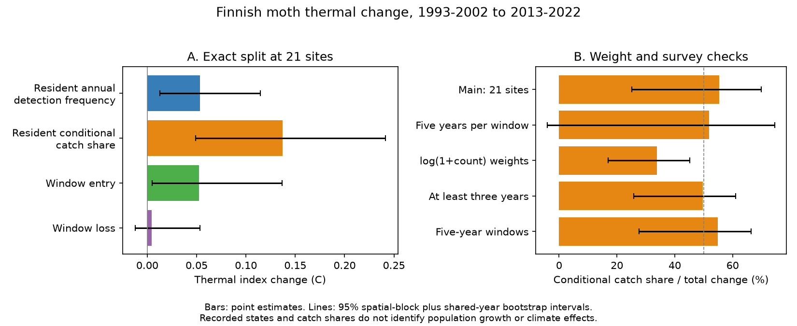

# Conditional catch share accounted for 55% of the thermal shift at 21 Finnish moth sites

The count-weighted community temperature index rose by 0.248 C between 1993-2002 and 2013-2022 at 21 long-running Finnish moth sites. An exact split assigned 0.137 C, or 55%, to changes in relative catch share when resident species were detected. Changes in annual detection frequency of resident species added 0.053 C (22%). Recorded window entry added 0.052 C (21%), and loss added 0.005 C (2%). The 95% spatial-block plus shared-year interval for the conditional-share fraction was 25-70%. Thus the point estimate was above half, but the interval did not establish a majority.



## Question and contribution

Many networks show little temporal change compared with their spatial thermal gradient. Finnish moths offer a contrast. Earlier campaign work found near-spatial thermal responses with both presence and count weights. A later exact split assigned 77% of count-weighted warming to species recorded in both endpoint windows. That result did not distinguish more frequent annual detections from a larger share of the catch when detected.

We test that distinction. A species recorded in both decades can still change from an occasional to a regular annual detection. Calling all of this change resident abundance can therefore conceal a change in recorded occurrence. Conversely, a change in conditional catch share can occur with no change in recorded occurrence. Our added evidence is the measured share of each route, with uncertainty from both space and shared years. The source records overlap earlier work. This is a new analysis, not an independent monitoring replication.

Ellis et al. (2025, DOI 10.1038/s41467-025-62216-9) already studied colonisation and extinction along the Finnish latitude gradient. We do not claim to discover those processes. Species contributions to community indicators (Gauzere et al., 2019, DOI 10.1016/j.ecolind.2018.11.069) and ecological Price equations (DOI 10.3389/fevo.2020.00240) also have established methods. We use the elementary symmetric product identity to refine the earlier resident term; we do not claim a new general decomposition theorem. The specific new test separates recorded annual detection frequency from conditional catch share in the finite thermal change. Neither term is a demographic rate.

## Data and selection

We reused Ellis et al.'s Dryad archive, DOI 10.5061/dryad.qbzkh18s7, published 30 June 2025. The fixed archive has 224,364 positive species-site-year records, 655 species, 62 sites, and years 1993-2022. We used its count, thermal score and site metadata tables. Every count record matched a score through the source field new_REC_names. We averaged duplicate scores for the same matched name before joining. This avoids multiplying counts. The archive contains six duplicated score names. No source data were downloaded again.

A site-year with any count record is treated as surveyed. Species absent from its table get zero counts; a year with no records is missing, not a zero survey. We retained sites with at least five surveyed years in both 1993-2002 and 2013-2022. There were 21 sites in 11 projected 100 km grid blocks. Sixteen sites were in the south boreal zone, three in the middle and two in the north. The results do not represent all Finland or test the source paper's latitude contrast.

For each site-year we divided each species count by the total catch. We then gave surveyed years equal weight within each window and sites equal weight in the reported mean. Large annual catches did not receive larger window weights. Thermal scores are fixed European range-based temperature indices in C, not local physiological tolerances. We did not fit a temperature-response slope or a new spatial transfer ratio.

Exact source URLs, version, license and shared path are in files/EXTERNAL_DATA.md. Archive and used-member hashes are in files/provenance.json. Source records and site-level results remain outside the publication.

## Exact method

Let p_kt be a species' mean annual relative catch share at a site in window t. Let q_kt be the fraction of surveyed years with a positive count. Let a_kt be its mean relative catch share over those years with a detection. Then p_kt = q_kt * a_kt exactly. Here a uses the share of each annual catch, not a count divided by the mean total catch.

Let R denote species with q > 0 in both windows; E those present only in the late window; and L those present only in the early window. For R, let m_t be its normalized thermal mean in window t, and set c = (m_0 + m_1)/2. Let s_k be the fixed score. Then:

    O = sum_R (s_k-c) * (q_k1-q_k0) * (a_k0+a_k1)/2
    A = sum_R (s_k-c) * (a_k1-a_k0) * (q_k0+q_k1)/2
    Eterm = sum_E (s_k-c) * p_k1
    Lterm = -sum_L (s_k-c) * p_k0
    CTI_1 - CTI_0 = O + A + Eterm + Lterm

O is the resident annual detection-frequency term. A is the resident conditional-share term. The product identity assigns half the interaction to each. We also compute the two sequential allocations, which change q first or last. These are sensitivity checks on the accounting convention, not statistical bounds on a causal effect.

The common reference c makes each term invariant to a common shift in thermal scores. It also makes O + A equal the resident term in the earlier campaign publication: (resident mass_0 + resident mass_1)/2 * (m_1-m_0). A different reference can reassign change between O and A because each can change resident mass. The midpoint reference preserves the earlier symmetric accounting and must be stated with the estimates. The split is exact but is not a unique causal allocation.

We used 999 percentile bootstrap draws with seed 20261111. The spatial bootstrap resamples occupied 100 km blocks and keeps all their sites. The second procedure also draws calendar years with replacement within each window, using the same year weights at every site. Missing survey years are retained, and weights are normalized over each site's observed years. All species states and means are recomputed in each draw. A draw with no sampled observed year at a retained site is redrawn. These intervals include a common-year sensitivity but do not correct imperfect detection or source score error. They assume that years within a decade can be resampled; serial dependence can make them too narrow. Eleven spatial blocks are few.

## Estimates

| Component | Change, C | 95% block plus year interval | Share |
|---|---:|---:|---:|
| Total | 0.248 | 0.137 to 0.438 | 100% |
| Resident annual detection frequency | 0.053 | 0.013 to 0.115 | 22% |
| Resident conditional catch share | 0.137 | 0.049 to 0.241 | 55% |
| Window entry | 0.052 | 0.005 to 0.136 | 21% |
| Window loss | 0.005 | -0.012 to 0.054 | 2% |


The conditional-share point estimate is larger than the annual detection-frequency estimate. This does not mean that more than half of all climate response must come from this route. The result is for a catch-weighted index at selected sites, with a stated reference and windows.

Changing detection frequency first or last assigns 0.041 or 0.066 C to that term. The corresponding conditional-share term is 0.150 or 0.125 C, or 60% or 51% of the total point estimate. Thus the symmetric interaction allocation alone does not explain the larger conditional-share point estimate. These percentages do not include sampling uncertainty.

| Check | Sites | Total change, C | Conditional-share fraction | 95% block plus year interval |
|---|---:|---:|---:|---:|
| primary | 21 | 0.248 | 55% | 25 to 70% |
| balanced | 21 | 0.240 | 52% | -4 to 75% |
| log_count | 21 | 0.258 | 34% | 17 to 45% |
| min_three | 34 | 0.231 | 50% | 26 to 61% |
| five_year | 17 | 0.299 | 55% | 28 to 66% |


The log-count check reduced the conditional-share fraction to 34% (17-45%). The result therefore depends on how common and rare species are weighted. With balanced survey counts, the point estimate was 52%, but its interval was -4% to 75%; this check did not establish a positive conditional-share fraction. All checks use overlapping records and are not independent replications. The five-year check compares 1993-1997 with 2018-2022. The main and three-year minimum checks use the original ten-year windows. Balanced windows use five evenly spaced observed years per window. The log-count check changes annual weights to log(1+count), then renormalizes them. That check has a different estimand from raw count weighting.

## Meaning and limits

The previously reported resident contribution cannot all be read as a change in annual occurrence. About 28% of that resident term was assigned to recorded detection frequency and 72% to conditional catch share under the symmetric split. This gives a specific target for models of the Finnish contrast: they should reproduce intensity changes as well as recorded annual occupancy. The result does not select dispersal, competition, habitat, pollution or demographic growth as the cause.

Conditional relative catch share is compositional. It can increase because another species declines, even if the focal species count does not increase. Light-trap counts also combine true abundance, flight activity, attraction to light, weather and sampling effort. Recorded detection frequency combines true occupancy with abundance and detection. Neither component isolates a true ecological process. Earlier campaign work found that moderate shifts in relative capture could remove count-weighted warming under a thermal bias bound. Our split does not remove that concern.

Other limits are material. Long-window resident status can hide loss and later return. Missing site-years can be selective. Annual normalization does not standardize individual catch size or trap operation. Low catches can reduce detection of rare taxa. The data are a filtered release, not the full monitoring archive. Thermal indices have uncertainty and can encode geography or habitat. We did not estimate environmental effects, control pollution, or establish a temperature trend for these sites. The result does not explain the bird response gap or show that one universal process limits communities. A detection model with repeated within-year samples and independent effort records would be needed to separate ecological persistence from observation.

## Reproduce and inspect

Use Python 3.12 with numpy, pandas and matplotlib. Exact versions used are in files/provenance.json. From an extracted publication, use an absolute scratch directory outside that publication:

```bash
python files/validate.py
python files/retrieve.py --out /absolute/scratch/external
python files/analyze.py --archive /absolute/scratch/external/Ellis_et_al_full_analysis.zip --out /absolute/scratch/analysis --draws 999
python files/report.py --results /absolute/scratch/analysis/results.csv --out /absolute/scratch/report
```

The fixed shared archive in EXTERNAL_DATA.md can replace the retrieval step. Compare aggregate results.csv with files/results.csv. analyze.py also writes site_diagnostics.csv into external scratch for inspection; do not add it to the publication. The analysis uses one numerical thread. The script rejects a changed source hash and rejects output inside the publication. Validation tests 1,000 artificial communities against the endpoint difference, the earlier resident identity, score-origin shifts, time reversal, and unchanged full annual occurrence. All passed; the largest endpoint or identity error was 1.1e-15. These tests validate algebra, not detection assumptions.

## Research record

Campaign 11_07_2026. Job sci-1107-dell-climate-pollution-biodiversity-7bd80872b207. Topic climate-pollution-biodiversity. Machine dell. Account codex-olen. Model gpt-6.1-sol with high reasoning effort. One automated worker did this study. No agents were launched. The campaign signing key is not a personal authorship claim. The question and planned checks are in files/PLAN.md. This was an exploratory study, not a registered confirmatory test. Code and figures are original; external source attribution and rights are separate from the SCI baseline license.
