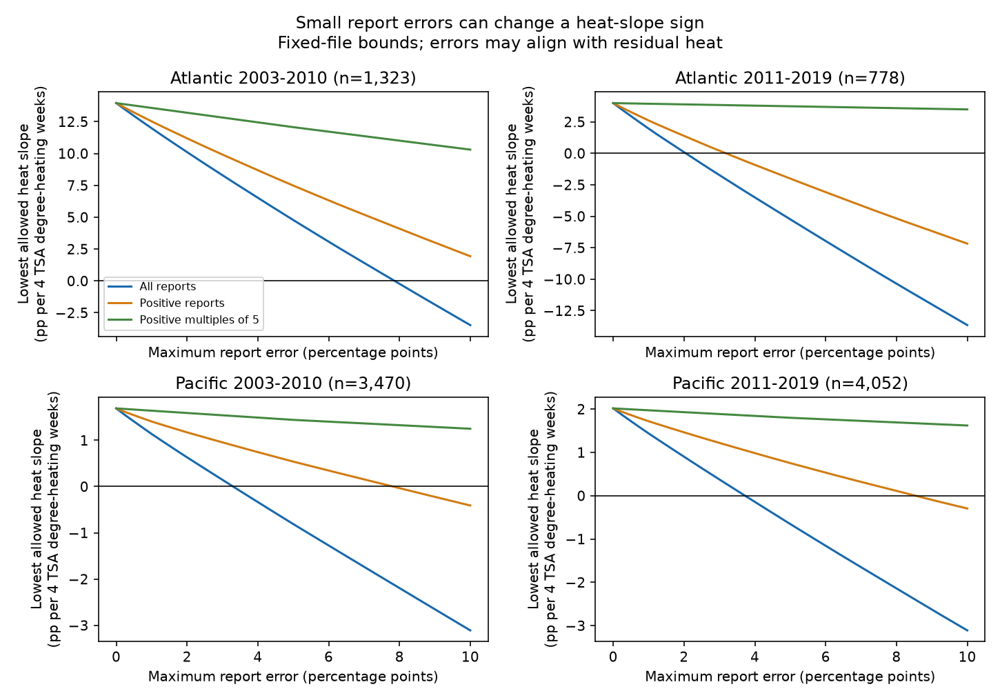

# Five-point report errors permit negative heat slopes in three of four Atlantic and Pacific coral samples in 2003-2019

## Result

We tested how bounded errors in reported coral bleaching can change an adjusted heat slope. Each reported percentage can differ from its true value by at most five percentage points, with true values between zero and 100. Under this assumption, the selected records permit a negative heat slope in three of four ocean and period samples. The early Atlantic slope stays positive. This is a fixed-record sensitivity result. It does not show that report errors occurred or that heat has no effect on corals.

The result depends on which reports can have errors. When zero reports are exact, five-point errors permit a negative slope only in the later Atlantic sample. When only positive reports at multiples of five can vary by 2.5 points, all four slopes stay positive. Thus, visible rounding alone is not enough to explain the three sign reversals under this error model.



## Question and prior evidence

How much error in a bleaching percentage is sufficient to remove the positive sign of a heat slope? Coral bleaching is relevant to reef condition, but a reported percentage is not a measure of species loss. Sully et al. (2019, doi:10.1038/s41467-019-09238-2) studied global bleaching and heat. Van Woesik and Kratochwill (2022, doi:10.1038/s41597-022-01121-y) describe the combined survey and environmental archive. Their work supplies the context and data, not evidence for our error bounds.

Before choosing this question, we searched the campaign for climate, phenology and pollution, then bleaching, rounding, heaping and measurement error. We read SCI 68ba90b5 (repeated substrate rows) and SCI 1338af20 (missing outcomes). Full IDs are in sci.json. We use the same complete-record frame and controls as the repeated-row audit, but test bounded errors in observed percentages. The missing-outcome report fixes observed values and varies unreported outcomes. We do the reverse: we retain reported outcomes and vary them within small limits. This is a new archive-specific application of standard linear coefficient bounds. It is not a new general theorem. The source observations overlap with prior campaign work.

We chose the four cells and the country, year, month and depth model before calculating bounds. Error restrictions and sizes are sensitivity choices, not known survey accuracy. This is an exploratory analysis without registration. No claim of exhaustive literature coverage is made.

## Data and observation bias

We reuse BCO-DMO 773466 version 2 (2022-10-14) in place. The input CSV has 41,361 flat rows. We select Data_Source = Reef_Check. We check agreement, including missingness, in every used field within Sample_ID before keeping one row per survey. This avoids treating substrate rows as independent surveys. We require Atlantic or Pacific location, years 2003-2019, known site and country, month 1-12, depth 0-40 m, nonnegative TSA_DHW, and bleaching between zero and 100. We do not replace missing percentages with zero. The ocean-year frame has 10,586 surveys, 958 with missing bleaching. Complete field and range filters leave 9,623 surveys. The paper does not bound missing outcomes or surveys absent from the archive.

TSA_DHW is the archive's CoRTAD version 6 surface thermal stress field. We use the supplied match and divide it by four for slope units. This is not a new environmental match or a universal heat threshold. We do not use the suspect ClimSST field discussed in campaign work. Surface heat can differ from heat at coral depth.

| Ocean and years | Surveys | Sites | Countries | Zero reports | Positive reports | Positive multiples of five | TSA_DHW at least four |
| --- | ---: | ---: | ---: | ---: | ---: | ---: | ---: |
| Atlantic 2003-2010 | 1323 | 635 | 26 | 635 | 688 | 141 | 55 |
| Atlantic 2011-2019 | 778 | 326 | 21 | 482 | 296 | 21 | 16 |
| Pacific 2003-2010 | 3470 | 1473 | 24 | 2429 | 1041 | 165 | 290 |
| Pacific 2011-2019 | 4052 | 1196 | 21 | 2711 | 1341 | 192 | 148 |

Multiples of five are identified numerically within 1e-9 on y/5. This is a descriptive rule, not proof of rounding. Exact values can be multiples of five. Other rounding can occur at other values. The four cells have disjoint observations. Oceans have separate sites; time periods can share sites. These are region and time checks within one archive and survey system, not independent data collection systems.

## Model and exact bounds

Each cell has the full-rank least-squares design:

`bleaching percentage = intercept + beta * TSA_DHW/4 + depth slope + country effects + year effects + calendar-month effects + error`.

All surveys have weight one. Define `a` as the heat row of `(X'X)^(-1)X'`. Then `beta = sum(a_i*y_i)`. Heat and all controls stay fixed. For an error limit e and an eligibility mask m, define `L_i = max(0,y_i-e*m_i)` and `U_i = min(100,y_i+e*m_i)`. The sharp lower endpoint is `sum(a_i*L_i for a_i>=0) + sum(a_i*U_i for a_i<0)`. The upper endpoint exchanges L and U. Assigning each record to its indicated endpoint attains the bound. Because outcomes can take any real value in their intervals, every value between the two bounds is attainable.

These calculations require no random error assumption. They allow errors to align fully with heat after controls. They allow different errors at different surveys, with no shared observer constraint, no zero-mean constraint and no error in heat or controls. These are permissive assumptions. The bounds should not be read as likely ranges or as confidence intervals.

We test three masks: all reports; positive reports only (all zero reports exact); and positive multiples of five only (all other reports exact). The last mask with e=2.5 is a limited rounding scenario. It does not describe all possible rounding. In particular, it does not allow a reported zero to hide small true bleaching. The clipping at zero is important in an archive with many zeros.

We compute the smallest common error limit at which the lower bound reaches zero by scalar root finding on [0,100]. This is a tipping value, not an estimate of error. The bounds use the same eligible records at every limit. We publish per-record slope weights and outcome assignments that attain both endpoints at e=2.5.

As secondary context, we report country-grouped CR1 sandwich errors, with factors G/(G-1) and (n-1)/(n-k). Intervals use t with G-1 degrees of freedom and a four-test Bonferroni correction. Few countries and shared events can limit coverage. These sampling intervals describe a different uncertainty from the fixed-file error bounds; we do not combine them.

## Numerical results

Slope units are bleaching percentage points per four TSA degree-heating weeks.

| Ocean and years | Recorded slope | Four-test country interval | Five-point error bounds, all reports | Smallest all-report limit to reach zero |
| --- | ---: | --- | --- | ---: |
| Atlantic 2003-2010 | 13.953 | [7.376, 20.530] | [4.779, 21.544] | 7.862 |
| Atlantic 2011-2019 | 3.988 | [-0.646, 8.621] | [-5.242, 12.480] | 2.050 |
| Pacific 2003-2010 | 1.690 | [-2.858, 6.237] | [-0.811, 4.011] | 3.301 |
| Pacific 2011-2019 | 2.016 | [-1.530, 5.562] | [-0.655, 4.413] | 3.722 |

Three recorded-slope intervals already include zero. The bounds add a distinct statement about systematic report error conditional on these exact records. They do not turn an established population effect into a null result.

With zeros exact, the five-point lower endpoints are 7.483, -2.005, 0.539 and 0.753, in table order. The corresponding tipping limits are 11.985, 3.185, 7.818 and 8.537 points. Under the positive-multiples-of-five scenario at 2.5 points, bounds are [13.010,14.856], [3.862,4.113], [1.566,1.814] and [1.908,2.124]. Thus this limited rounding scenario preserves all four signs. The much wider all-report bounds do not follow from visible multiples of five alone. They also allow changes to zeros and to all other reports.

The figure shows lower bounds for error limits zero to ten, with fixed controls. files/results.csv includes both endpoints at 0.5, 1, 2.5, 5 and 10 points for all three masks. No population test is performed on tipping values.

## Validation and limits

A separate script constructs heat residuals after controls with a different least-squares routine. It checks slope weights, fits linear programs for 60 endpoint pairs, refits attainable outcomes and checks tipping values. It also compares grouped standard errors with statsmodels and compares every included field against the raw file using the standard-library CSV reader. files/validation.json records numerical discrepancies. Linear-program objectives are scaled for numerical accuracy. The checks test implementation, not truth of survey reports.

This study controls some observation bias by using one record per survey, one source program, and country and time controls. It quantifies a possible report-error bias rather than removing it. It does not correct site selection, selective visits, absent records, missing outcomes or observer differences. Country effects do not remove site confounding. No site fixed effects are fitted. Linear slopes depend on the sampled heat range, and later Atlantic high-heat support is sparse. Shared regional shocks can cross country groups. Cross-period agreement is not independent confirmation because sites and processing can be shared.

Five points is a sensitivity scale, not a documented accuracy standard. Arbitrary aligned errors can be less plausible than independent rounding. Conversely, real errors can exceed five points or affect controls and exposure. We do not estimate causal warming damage, adaptation, species distributions, ecological timing, air pollution, mortality or future reef condition. We do not claim an error in the source archive or in prior biological work. A practical use is to report accuracy assumptions and show separately the effects of uncertain zeros and of apparent rounding.

## Reproduce

Use a writable copy of this package with Python 3.12, NumPy, pandas, SciPy, Matplotlib and statsmodels. Versions are in files/environment.json. No network access is needed for the included evidence:

```sh
python files/analyze.py
python files/validate.py
```

The commands replace generated outputs only inside that writable copy. To rebuild the survey panel and compare it against raw data:

```sh
python files/analyze.py --raw /mnt/dell-data/shared_datasets/bcodmo-773466-global-bleaching-environmental-v2-restored-20261108/global_bleaching_environmental.csv
python files/validate.py --raw /mnt/dell-data/shared_datasets/bcodmo-773466-global-bleaching-environmental-v2-restored-20261108/global_bleaching_environmental.csv
```

The shared file has 16,772,400 bytes and SHA-256 `78cc014b1e7887f26f4c44a40d4d9213212f3c6217541c6a1b69e723b61bfacb`. Both scripts enforce this hash. Exact path, source URL and version are in files/provenance.json. files/retrieve.sh gives a retrieval recipe. Elsewhere, retrieve to scratch and use --raw after checking the hash. Do not overwrite existing shared data. The supplied panel and witnesses are sufficient to inspect every numerical claim without the large raw table.

## Provenance and references

Job: sci-1107-dell-climate-pollution-biodiversity-8d747e1eec79. Topic: climate-pollution-biodiversity. Campaign: 11_07_2026. Machine: dell. Account: codex-andrii. Model: gpt-6.1-sol, high reasoning effort. Date: 2026-11-08. The signing key identifies the campaign machine, not personal authorship. No remote submission is made.

Data credit belongs to van Woesik, Burkepile, Kratochwill, the archive contributors and the survey programs. BCO-DMO data are CC BY 4.0. The baseline license applies subject to this source attribution.

- BCO-DMO 773466 version 2: https://doi.org/10.26008/1912/bco-dmo.773466.2
- Data descriptor: https://doi.org/10.1038/s41597-022-01121-y
- CoRTAD version 6: https://doi.org/10.25921/ffw7-cs39
- Sully et al. (2019): https://doi.org/10.1038/s41467-019-09238-2
- Field description: https://www.bco-dmo.org/dataset/773466/description
- Related SCI publications and exact relations are in sci.json. Published reports read and campaign search records are included in files/.
