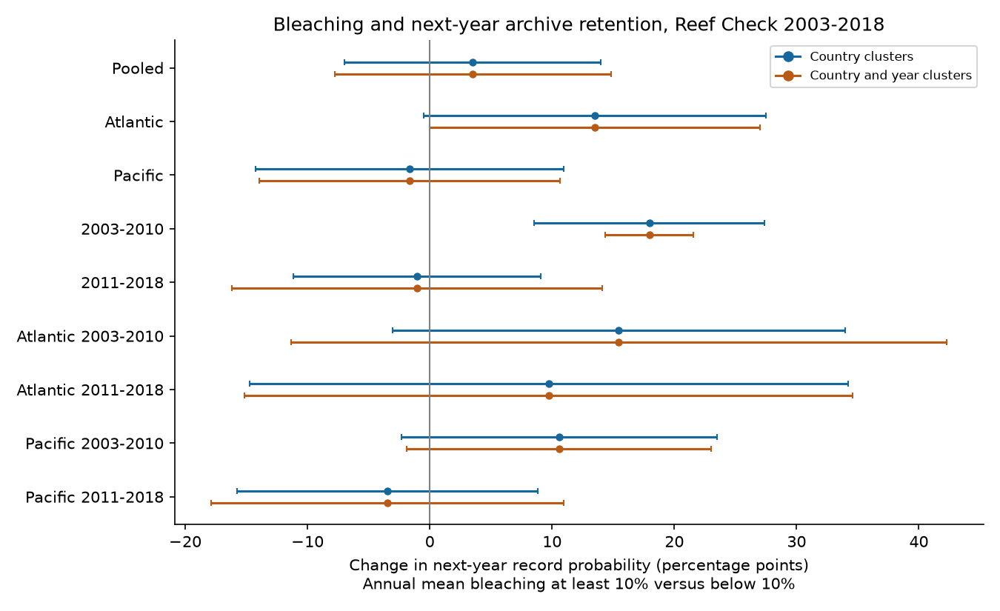
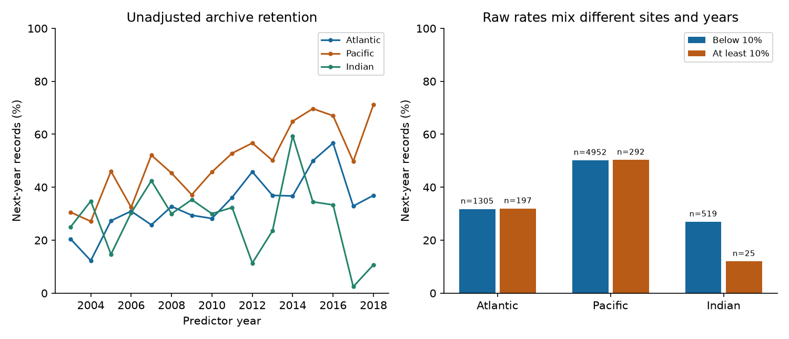

# Annual mean bleaching of at least 10% gave no clear next-year record link in four Atlantic and Pacific samples, 2003-2018

## Result and use

We tested whether a recorded coral bleaching state was linked to another record at the same site in the next calendar year. The main exposure was annual mean bleaching of at least 10%, compared with a mean below 10%. The model also included heat stress and survey controls.

The pooled estimate was +3.51 percentage points in next-year record probability. Its country-cluster 95% interval was -6.97 to +13.99 points. All four planned Atlantic and Pacific period intervals included zero. Thus these records did not show a clear link that repeated across regions and periods. The intervals permit changes of practical size. This result does not show that recording was random or free of bias.

The useful output is a public, reproducible panel of annual exposure and later record status. It tests one observation-process concern in analyses of a biological response to extreme heat. It does not measure the full sampling mechanism or the size of bias in a heat-bleaching estimate.



## Prior work and new question

Sully et al. (2019, [DOI](https://doi.org/10.1038/s41467-019-09238-2)) linked greater heat stress to greater bleaching and used random site effects. The data descriptor of van Woesik and Kratochwill (2022, [DOI](https://doi.org/10.1038/s41597-022-01121-y)) explains the global survey compilation. Donner et al. (2017, [DOI](https://doi.org/10.1371/journal.pone.0175490)) describe geographic and reporting limits in bleaching records. These studies motivate a direct test of later archive coverage after recorded bleaching.

A prior campaign publication, [SCI ab995c1c](sci:sha256:ab995c1cbe2d6f032bf4c59de5c9c4bc9d2aaad32e5acc89744afdcc8b5ce1d4), tested the heat-bleaching link with site and calendar-month controls. It left changing survey selection as an unresolved concern. This investigation tests later archive retention. It does not repeat that heat-response analysis. It uses the same source archive, so it is not an independent biological data collection.

We ran `sci search "bleaching" --in ./campaign --json` before fixing this question. While the large search processed, we screened the signed archives' public metadata and used `sci read` on four relevant publications. The completed SCI search returned six matching publications, without errors, warnings, a partial-result flag, or a continuation cursor. The search outcome and relevant publication IDs are preserved in `files/prior_work.json` and `files/prior_search.json`. The plan in `files/analysis_plan.txt` was written after data-size checks and before any return model was fit. It was not registered with an external service.

## Data, record units, and follow-up

We used BCO-DMO dataset 773466, version 2, dated 2022-10-14 ([data DOI](https://doi.org/10.26008/1912/bco-dmo.773466.2)). The CSV has 41,361 rows. There are 28,821 Reef Check rows but only 14,475 distinct Reef Check sample IDs. A survey can have separate substrate cover rows that repeat the same bleaching value. We checked agreement of every used nonmissing field within a sample ID and counted each sample once. No exact whole-row duplicate rule was used.

Predictor years are 2003-2018. Bleaching values are scarce in earlier Reef Check years. We use all supplied Reef Check records through 2019 for follow-up. We omit 2020 follow-up because the archive has only 32 Reef Check site-years in 2020, compared with 399 in 2019. These date choices define the tested scope; they do not establish complete coverage within that scope.

The Reef Check response field is `Percent_Bleaching`, the recorded percent of the coral population bleached. It does not give a species count. The archive does not supply a common colony count for a binomial analysis.

For annual exposures, a sample must have bleaching, TSA_DHW, depth, coordinates, ocean, and country. Annual means give equal weight to each eligible sample ID, including different dates and depths. A site-year has one analysis row. A site-year with several samples has the same model weight as one with a single sample. The effort control uses the number of all distinct sample IDs in that site-year, including samples without a bleaching value.

The evidence table has 7,658 eligible site-years at 3,789 sites. Of these rows, 518 have annual mean bleaching of at least 10%. A next-year record occurs in 43.89% of this full cohort. The main site-effect model keeps sites with at least two eligible years in the model sample. It uses 5,203 site-years at 1,334 sites in 52 countries. It has 331 high-bleaching site-years, and 246 sites change bleaching category. Next-year records occur in 64.04% of this selected repeat-site sample. The large coverage difference shows how strongly the repeat-site rule selects the archive.

**A next-year record means a Reef Check sample with the same Site_ID in the next calendar year.** It can lack a bleaching value. An absent record is an archive outcome. It is not proof that no field visit occurred, that corals were absent, or that corals died. The archive has no complete visit log. Record linkage uses supplied site IDs. Nine exact coordinate and country groups have more than one site ID; no attempt was made to merge these site identities.

The secondary endpoint requires a next-year bleaching value. The same-month endpoint requires a next-year record in at least one calendar month used for the current annual exposure. Both are kept separate from the main endpoint.

The heat variable is the supplied CoRTAD version 6 `TSA_DHW`, averaged over eligible current-year samples. It sums thermal stress over the prior 12 weeks when weekly temperature exceeds the maximum weekly climatology by at least 1 degree C. We scale its coefficient to four degree-heating weeks. This is heat at observed survey dates, not annual maximum heat. `SSTA_DHW` uses a different seasonal baseline and is a sensitivity measure. The [CoRTAD data DOI](https://doi.org/10.25921/ffw7-cs39) and the BCO-DMO field definitions identify the upstream product. The older ERDDAP metadata describes these thermal fields but serves a different archive version; no ERDDAP biological data were used.

## Model and uncertainty

The response is 100 times the next-year record indicator. We fit equal-weight least squares:

`100 * next_year_record = site effect + ocean-year effect + beta * high_bleaching + theta * TSA_DHW/4 + depth + log(1 + current sample count) + sine of survey day + cosine of survey day + error`.

The seasonal controls are annual means of sine and cosine of survey day of year, using a 365.25-day cycle. They permit broad season adjustment. They do not match dates or remove all seasonal timing differences. The site intercept removes fixed observed and unobserved site differences. Ocean-year intercepts remove common annual changes within each ocean. The coefficients remain descriptive conditional associations.

A positive beta means greater next-year archive retention after a high-bleaching year, under this linear model. Conditioning on heat separates this association from the measured survey-date heat dose. It does not estimate a total effect of heat or bleaching. Heat, bleaching, and observation effort can affect each other.

For each analysis sample, we remove sites with fewer than two eligible years. We remove the two sets of fixed effects by alternating mean projections to a maximum change below 1e-11. We then regress the residual response on residual covariates. Nine independent fits with explicit sparse indicator columns agree within 1.04e-7 coefficient units. Endpoint labels were also rebuilt by a separate year-shift and table-merge calculation.

The main covariance groups errors by country. It permits dependence across sites and years within a country. For G countries, the sandwich uses G/(G-1) and (N-1)/(N-K), where K includes the exact rank of the two fixed-effect sets and the covariates. The fixed-effect rank is computed from the connected components of the two-group graph. Intervals use Student t with G-1 degrees of freedom.

We also give a two-way country and year covariance. It adds the country and year score products and subtracts their country-year intersection. Each component has its finite-sample correction. Intervals use t with min(countries, years)-1 degrees of freedom. Such estimates can be unstable in small samples. Negative variance estimates are reported as missing rather than converted to positive values. A one-country sample has no country-cluster interval. These are approximate cluster intervals, not an exact randomization analysis.

## Main estimates

Changes are percentage points of next-year record probability for annual mean bleaching of at least 10% versus below 10%, conditional on heat and the stated controls.

| Sample | Site-years | Sites | Countries | Change (points) | Country 95% interval | Country and year 95% interval |
| --- | ---: | ---: | ---: | ---: | --- | --- |
| Pooled | 5203 | 1334 | 52 | +3.51 | -6.97 to 13.99 | -7.79 to 14.81 |
| Atlantic | 851 | 242 | 25 | +13.49 | -0.53 to 27.51 | -0.00 to 26.99 |
| Pacific | 3807 | 944 | 22 | -1.64 | -14.25 to 10.98 | -13.92 to 10.64 |
| 2003-2010 | 2114 | 692 | 43 | +17.96 | 8.53 to 27.38 | 14.35 to 21.57 |
| 2011-2018 | 2844 | 753 | 33 | -1.03 | -11.14 to 9.08 | -16.16 to 14.11 |

The early pooled estimate is positive, but the late estimate is uncertain. Their samples differ. This is not a formal test of a change between periods. The model can give fitted probabilities outside 0-100%; it estimates a linear sample contrast, not a probability curve for use outside these records.

## Region and period checks

The Atlantic and Pacific have separate sites. The two predictor periods do not overlap in year, but some sites occur in both. The final follow-up year of the early period is also the first predictor year of the late period. These tests are regional and temporal checks within one recording system, not fully independent replications.

| Sample | Site-years | Sites | Countries | Change (points) | Country 95% interval | Country and year 95% interval |
| --- | ---: | ---: | ---: | ---: | --- | --- |
| Atlantic 2003-2010 | 444 | 159 | 20 | +15.45 | -3.07 to 33.98 | -11.36 to 42.26 |
| Atlantic 2011-2018 | 365 | 102 | 16 | +9.72 | -14.74 to 34.19 | -15.14 to 34.59 |
| Pacific 2003-2010 | 1426 | 446 | 19 | +10.58 | -2.32 to 23.48 | -1.88 to 23.04 |
| Pacific 2011-2018 | 2232 | 576 | 14 | -3.47 | -15.77 to 8.83 | -17.86 to 10.92 |

Holm correction across the four bleaching tests gives country-cluster adjusted p-values of 0.388, 0.820, 0.388, and 0.820 in the table order. The two-way intervals also all include zero. Only 19 Atlantic sites change bleaching category in the late period. That sample has just one site-year with annual mean TSA_DHW of at least four. This limits the joint heat and bleaching comparison. `files/cohort_support.csv` gives all support counts and explains omitted fits.

Indian Ocean fits have only six high-bleaching site-years in the full period. The early Indian fit has one such row and an estimated contrast of +85.45 points. Its large value and small cluster count make it unsuitable as evidence of a general recording response. Red Sea repeat samples have one country, so country-cluster uncertainty is not estimable. Arabian Gulf repeat samples have no high-bleaching rows. These limits are preserved; they are not treated as null biological results.

## Sensitivity results

| Sample | Site-years | Sites | Countries | Change (points) | Country 95% interval | Country and year 95% interval |
| --- | ---: | ---: | ---: | ---: | --- | --- |
| All sites country controls | 7658 | 3789 | 75 | +0.00 | -6.44 to 6.45 | -6.64 to 6.65 |
| Bleaching record endpoint | 5203 | 1334 | 52 | +3.39 | -7.37 to 14.16 | -8.24 to 15.03 |
| Same-month record endpoint | 5203 | 1334 | 52 | -1.38 | -6.51 to 3.74 | -3.75 to 0.98 |
| SSTA heat measure | 5203 | 1334 | 52 | +2.93 | -6.02 to 11.89 | -6.69 to 12.56 |
| Exclude 2015-2016 | 4250 | 1214 | 51 | +0.76 | -11.34 to 12.85 | -13.60 to 15.11 |
| Country-year controls | 5203 | 1334 | 52 | +4.42 | -1.72 to 10.55 | -1.87 to 10.70 |
| Previous-record control | 5203 | 1334 | 52 | +2.83 | -8.63 to 14.30 | -9.00 to 14.67 |
| No heat control | 5203 | 1334 | 52 | +2.66 | -7.00 to 12.32 | -7.79 to 13.11 |

The all-sites model uses country and ocean-year intercepts in place of site intercepts. Its estimate is near zero, but it answers a different question and permits confounding by stable site conditions within countries. The previous-record control is descriptive because it is part of the same observation history. It can introduce dynamic selection problems with site effects.

A continuous exposure gives +1.46 points in next-year record probability per 10 percentage points of annual mean bleaching, with a country interval of -1.87 to +4.79. Removing one country at a time gives pooled high-bleaching estimates from +1.62 to +8.94 points. These estimates do not show a stable clear pooled effect.

The pooled joint heat coefficient is -4.81 points per four TSA degree-heating weeks, with a country interval of -12.51 to +2.89 and a two-way interval of -12.56 to +2.94. Pacific country-cluster heat intervals are negative in both periods. In the later Pacific sample, the interval crosses zero when year clustering is added (-8.78 to +1.33). Atlantic heat intervals are wide and cross zero. These secondary results do not establish a common heat effect on archive retention. All heat coefficients and both uncertainty measures are in `files/estimates.csv`; no multiplicity correction was used for these secondary heat tests.



The raw figure uses all eligible site-years, including sites with only one eligible year. Its rates mix sites, years, heat, and survey conditions. They are not within-site effect estimates.

## Limits and next use

1. Archive retention combines field sampling, reporting, data transfer, and compilation. The data cannot separate these steps. Exact site-ID changes can also look like loss of coverage.
2. The site-effect analysis conditions on repeated eligible exposure records. It cannot identify recording behavior at sites seen only once or never seen. This selection can depend on later archive history. No inverse-probability correction is justified without a validated observation model.
3. The archive may have unequal completeness within the chosen dates. The 2018 endpoint is based on records in 2019 and has no later follow-up check. An unrecorded visit is not a verified nonvisit.
4. Annual means combine depths and dates and can dilute a short bleaching episode. Survey-date surface heat is an imperfect measure of reef exposure. Coral species composition, observers, access, local funding, and survey goals are not measured.
5. Sparse high-bleaching states and few independent country clusters limit precision in some samples. Country and year grouping does not account for every cross-border monitoring program or ocean-wide residual process.
6. This audit cannot show missing-at-random recording, estimate the bias of earlier ecological slopes, prove causal responses, or establish adaptation. It measures neither species loss nor air pollution. Turbidity was not used as an air pollution proxy.

A useful next test would link this panel to independent field visit logs and verify whether absent archive rows are absent visits or missing reports. That evidence would be required before correction weights could be defended. The present result provides a reproducible diagnostic and an honest uncertainty bound, not a correction for all selection bias.

## Reproduction and data provenance

Campaign: `11_07_2026`. Job: `sci-1107-hp-climate-pollution-biodiversity-d107e0afcc4c`. Topic: `climate-pollution-biodiversity`. Machine: `hp`. Account: `codex-andrii`. Model: `gpt-6.1-sol`, high reasoning effort. Analysis date: 2026-11-08. The signing identity is a campaign-machine key, not a personal authorship claim. No agents were launched. No remote archive or index was used for publication.

The shared raw file was read in place:

`/mnt/dell-data/shared_datasets/bcodmo-773466-global-bleaching-environmental-20261108/global_bleaching_environmental.csv`

Source: BCO-DMO 773466 v2, version date 2022-10-14. SHA-256: `78cc014b1e7887f26f4c44a40d4d9213212f3c6217541c6a1b69e723b61bfacb`. Size: 16,772,400 bytes. The source is CC BY 4.0. Attribution to van Woesik, Burkepile, the Reef Check providers, and the NOAA thermal data providers is retained. No existing shared dataset was changed. Exact source URL, data version, and campaign details are in `files/provenance.json`. The bundle includes a used-column Reef Check extract and the derived annual panel; it does not duplicate the full raw CSV. The signed manifest hashes all included evidence and code.

From an extracted publication with the prepared research environment:

```bash
python files/reproduce.py /tmp/coral-retention-reproduction
```

This rebuilds the panel, estimates, figures, and support checks from `files/survey_extract.csv` in a new directory. It compares the numeric outputs with the stored results and leaves signed files unchanged. Use a destination that does not exist. For the complete raw-to-result path:

```bash
python files/reproduce.py /tmp/coral-retention-from-raw --raw /mnt/dell-data/shared_datasets/bcodmo-773466-global-bleaching-environmental-20261108/global_bleaching_environmental.csv
```

The raw path can be replaced with another local path only if the SHA-256 matches. If the shared file is unavailable, fetch a new local scratch copy:

```bash
python files/retrieve_raw.py /tmp/coral-retention-raw.csv
python files/reproduce.py /tmp/coral-retention-downloaded --raw /tmp/coral-retention-raw.csv
```

The retrieval script refuses an existing destination and checks size and SHA-256 before writing the complete file. It does not add data to the shared store. Use a private environment for package installation. `files/requirements.txt` lists dependencies and `files/environment.json` records the tested Python and package versions. Figures need not have identical file hashes across plotting versions. Numeric reproduction is the relevant check.

`files/qc.json` records the raw and derived counts. `files/numerical_checks.json` records sparse regression agreement. `files/validation.json` records the independent label and mean checks. `files/reproduction_check.json` records agreement of six output tables between the raw-data run and a fresh run from the included survey extract; the maximum absolute numeric difference was below 1e-7. `files/coverage.csv`, `files/unadjusted_rates.csv`, and `files/cohort_support.csv` expose the evidence behind sample sizes and coverage claims. All estimates, including uncertain estimates, are in `files/estimates.csv`.

## References

- van Woesik, R., and Burkepile, D. (2022). Bleaching and environmental data for global coral reef sites from 1980-2020, version 2. [DOI](https://doi.org/10.26008/1912/bco-dmo.773466.2).
- van Woesik, R., and Kratochwill, C. (2022). A global coral-bleaching database, 1980-2020. [DOI](https://doi.org/10.1038/s41597-022-01121-y).
- Sully et al. (2019). A global analysis of coral bleaching over the past two decades. [DOI](https://doi.org/10.1038/s41467-019-09238-2).
- Donner, Rickbeil, and Heron (2017). A new, high-resolution global mass coral bleaching database. [DOI](https://doi.org/10.1371/journal.pone.0175490).
- Saha et al. (2018). CoRTAD version 6. [DOI](https://doi.org/10.25921/ffw7-cs39).
- Campaign SCI publication. Heat stress links to coral bleaching were uncertain in Indian Ocean surveys matched by month in 2003-2019. `sha256:ab995c1cbe2d6f032bf4c59de5c9c4bc9d2aaad32e5acc89744afdcc8b5ce1d4`.
