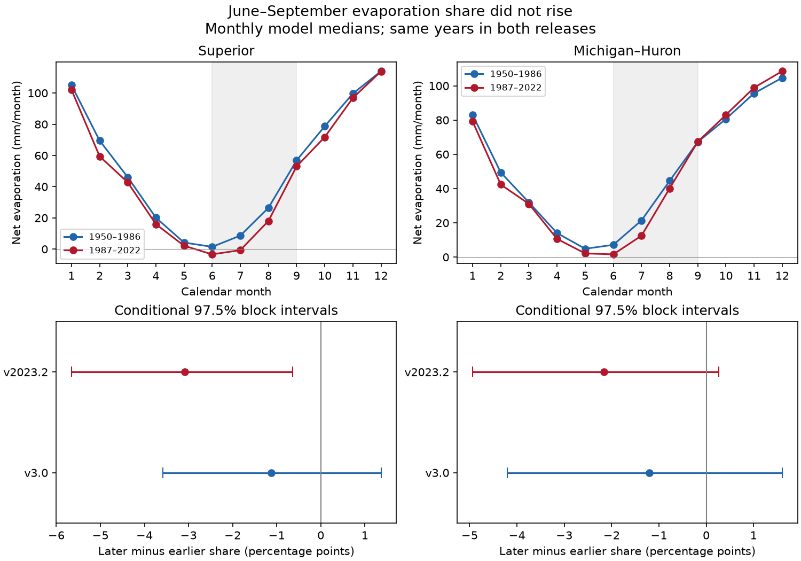

# Two L2SWBM releases gave no clear rise in June-September evaporation share at two Great Lakes from 1950-1986 to 1987-2022

## Result
Neither lake had a clear rise in the June-September share of annual net evaporation under the specified two-period test. Both release point estimates fell. In v3.0, the change was -1.12 percentage points for Superior and -1.20 points for Michigan-Huron. Their conditional 97.5% block intervals included zero. In v2023.2, the Superior change was -3.09 points, with an interval of -5.66 to -0.64. The Michigan-Huron change was -2.17 points, with an interval of -4.94 to 0.27.

The revision changed the Superior estimate by -1.97 points and the Michigan-Huron estimate by -0.96 points. The two releases use related evidence. They are not independent tests of the physical system. This is a reproducible benchmark of data release sensitivity, with a null result for the proposed rise. It is not evidence against lake warming.

Upper panels show monthly mean values from v2023.2. Shading marks June-September. Lower panels show both release estimates and conditional intervals. Negative monthly estimates are kept.

## Question and prior work
Did June-September account for a larger fraction of annual evaporation in 1987-2022 than in 1950-1986? Evaporation timing affects the seasonal water budget. A larger annual loss need not imply a larger summer fraction. A fraction does not directly measure the start date or length of an evaporation season.

We searched local campaign results before choosing this question. The saved search records are in files/search.json and files/search_evap.json. The first search returned a limited set of 20 results and reported more matches; it was not an exhaustive review. A focused Great Lakes search returned nine results; its titles were inspected but the search output was not saved. We read the verified report 6e4df0bc in full. That report tested annual water-input and evaporation covariance in the same v3.0 data. The present test uses new code, a seasonal fraction, and a release comparison. It is not independent confirmation of that report. The verified report is preserved in files/prior_report.txt. No private worker workspace was read.

Van Cleave et al. (2014), DOI 10.4319/lo.2014.59.6.1889, reported a summer evaporation shift after 1997-1998 in Superior for 1973-2010. Their abstract was available from the publisher. Blanken et al. (2011), DOI 10.1016/j.jglr.2011.08.009, linked evaporation to seasonal heat storage and short cold-season events. Its abstract was available from the AmeriFlux record. These studies motivate timing tests. Our longer periods, monthly product and net fraction differ. We do not test their breakpoint or refute their findings.

O'Brien et al. (2024), DOI 10.1038/s41597-024-03994-7, describe the water-balance estimates. The article was consulted through PMC. It describes multiple model inputs, monthly priors and separate 1950-1987 and 1988-2022 runs. The release record for v2023.2 states that files were revised and renamed from MonthlyRun to AnnualRun; values remain monthly. We use the data record for release identity and do not infer the reason for each numerical revision.

## Data and provenance
The source is the Coordinating Committee on Great Lakes Basic Hydraulic and Hydrologic Data. We use evaporation CSVs from Zenodo record 13883098 (v3.0, 1950-2022) and record 20633991 (v2023.2, 1950-2023). Only 1950-2022 enters the test, so the revision result cannot arise from the added 2023 year. Units are mm of water over each lake area per month. Michigan-Huron is one combined lake unit.

We reused the two existing v3.0 shared files. We added the two newer files with campaign-dataset, which stages immutable data and records provenance. No existing shared dataset was changed. The supplied datasets link resolves to the shared SSD store through its compatibility path. The failed disk was not accessed.

All four exact CSVs are small and are also included for an offline repeat. Each monthly value is a posterior median from a water-balance model. It is not a direct flux measurement. Negative estimates, which can represent net condensation or model uncertainty, are not set to zero. The sum of monthly medians need not equal the posterior median of an annual sum. We check finite fields, unique complete dates, median bounds and raw hashes. Each old file has 876 rows; each new file has 888 rows. The final year of each newer file is excluded.

Exact shared paths, resolved paths, source URLs, byte counts, download records and SHA-256 hashes are in files/provenance.json. The four hashes are:

- v3, superior: `a8692a741a7b1f9c0d23ec2172edd0655dedcc8089610604dc694d0feaf8d523`. Shared path: `/home/andrii/.t3/worktrees/11_07_2026-codex-andrii/campaign-sci-1107-dell--9f04dba0ee0b4546/datasets/l2swbm-v3-13883098-superiorevap/superiorEvap_MonthlyRun.csv`.
- v3, mihuron: `2c57c938f9181a11ca254d80c2f932c2bdac314f91b33e1f2011d6d53d3289ce`. Shared path: `/home/andrii/.t3/worktrees/11_07_2026-codex-andrii/campaign-sci-1107-dell--9f04dba0ee0b4546/datasets/l2swbm-v3-13883098-mihuronevap/miHuronEvap_MonthlyRun.csv`.
- v2023p2, superior: `0ec6d3488fe17bb8442848bbd002c416d0dbed1a32129d9f5ed342f8c672b194`. Shared path: `/home/andrii/.t3/worktrees/11_07_2026-codex-andrii/campaign-sci-1107-dell--9f04dba0ee0b4546/datasets/l2swbm-v2023p2-20633991-superiorevap/superiorEvap_AnnualRun.csv`.
- v2023p2, mihuron: `51231749aa204a80fdda09ea3253c8aeb9695f3321ae0592e6820530111beaa8`. Shared path: `/home/andrii/.t3/worktrees/11_07_2026-codex-andrii/campaign-sci-1107-dell--9f04dba0ee0b4546/datasets/l2swbm-v2023p2-20633991-mihuronevap/miHuronEvap_AnnualRun.csv`.

## Method
files/PLAN.txt gives the local plan written before numerical summaries. It followed prior-work review and inspection of two CSV headers and early rows. It is not an external registration. All planned settings are reported.

For each complete calendar year y, W(y) is the sum for June-September. A(y) is the sum for all 12 months. For each period, define S = 100 mean(W) / mean(A). The target is S(later) minus S(earlier), in percentage points. This is a ratio of period means, not a mean of yearly ratios. The primary periods have 37 and 36 years. We also report changes in mean W, A-W, and A to separate numerator and denominator effects.

Within each period, resample complete years in circular blocks of five years. Draw uniform starts, join blocks and truncate to the period length. Keep both lakes and both releases paired within each draw. Resample the two periods separately. There are 10,000 draws with NumPy default_rng seed 11072657. Each setting restarts this seed. Quantiles 0.0125 and 0.9875 give nominal 97.5% percentile intervals. For the two primary v3.0 share contrasts, this gives a nominal Bonferroni family coverage of at least 95% if individual intervals have their claimed coverage. Approximate bootstrap coverage is not guaranteed.

All other intervals use the same quantiles as sensitivity evidence. No family coverage is claimed across releases, metrics or checks. The paired revision contrast is the newer share change minus the older change in each draw. Blocks describe year-sampling variation conditional on the published medians. They do not include posterior covariance, model bias, data errors or uncertainty about model structure. Independent draws from the marginal monthly limits would not give the required joint posterior uncertainty. All sampled annual-mean denominators were positive.

Checks use three-year or eight-year blocks, June-August, a split at 1988, and omission of 1986-1989. The last setting retains 1950-1985 and 1990-2022. These checks cannot remove a persistent model-run bias. No change point was estimated.

## Numerical evidence
| version | lake | period | warm_mm | other_mm | annual_mm | share_pct |
| --- | --- | --- | --- | --- | --- | --- |
| v3 | superior | 1950-1986 | 75.677 | 554.787 | 630.464 | 12.003 |
| v3 | superior | 1987-2022 | 63.031 | 515.986 | 579.017 | 10.886 |
| v3 | mihuron | 1950-1986 | 137.078 | 467.017 | 604.095 | 22.691 |
| v3 | mihuron | 1987-2022 | 124.265 | 454.051 | 578.317 | 21.487 |
| v2023p2 | superior | 1950-1986 | 93.398 | 537.367 | 630.765 | 14.807 |
| v2023p2 | superior | 1987-2022 | 67.019 | 505.007 | 572.026 | 11.716 |
| v2023p2 | mihuron | 1950-1986 | 140.264 | 464.043 | 604.307 | 23.211 |
| v2023p2 | mihuron | 1987-2022 | 121.483 | 455.767 | 577.250 | 21.045 |

| version | lake | change | lo | hi |
| --- | --- | --- | --- | --- |
| v3 | superior | -1.117 | -3.587 | 1.367 |
| v3 | mihuron | -1.204 | -4.206 | 1.605 |
| v2023p2 | superior | -3.091 | -5.656 | -0.639 |
| v2023p2 | mihuron | -2.166 | -4.936 | 0.270 |
| revision_minus_v3 | superior | -1.973 | -2.887 | -1.084 |
| revision_minus_v3 | mihuron | -0.962 | -1.748 | -0.380 |

The second table gives share changes and 97.5% intervals in percentage points. The primary v3.0 results do not show a clear change in either direction. The newer Superior estimate is negative with an interval below zero. This result remains negative with intervals below zero in all specified checks. The newer Michigan-Huron primary interval includes zero, while its June-August check interval is negative. That seasonal-window result does not establish a decrease for the primary June-September target.

For v2023.2 Superior, mean June-September evaporation fell by 26.38 mm, other-month evaporation by 32.36 mm, and annual evaporation by 58.74 mm. Thus, its lower share did not result from a larger annual denominator. The early-period Superior June-September mean was revised from 75.68 to 93.40 mm; the late-period mean changed from 63.03 to 67.02 mm. Most of the release shift in this fraction comes from the larger early-period revision. No cause for that revision is established here.

All settings, including absolute changes and interval limits, are in files/results.csv. Period means are in files/means.csv. Yearly evidence is in files/annual.csv. Saved primary year indices and estimates are in files/draws.npz. Array axes after draw are version (v3, v2023p2), lake (superior, mihuron), and, for total_changes, metric (warm, other, annual).

## Interpretation and limits
The evidence does not support the proposed full-record shift toward a larger June-September net evaporation share. It gives a useful limit on this diagnostic and shows that data revision can alter the size and apparent precision of an estimated seasonal change. It does not show that summer evaporation never increased in shorter periods. A change in net summer flux can reflect evaporation, condensation or estimation effects.

Heat storage, ice and weather could change seasonal flux. Model inputs, priors and balance constraints could also affect the estimates. We do not use independent heat-flux or ice data, so these explanations remain unresolved. The source run boundary lies near the selected period split. Moving or omitting boundary years does not remove an offset between entire runs. A physical interpretation needs independent flux evidence and model runs that test this possible offset. The observed full-period contrast alone cannot select a climate mechanism.

There are only 73 years and two selected lake units. The bootstrap assumes the selected blocks represent dependence within each period. Long cycles, nonstationary variation and circular wraparound can affect interval coverage. The intervals condition on all published medians. The release comparison includes shared source data and cannot serve as independent replication. We report neither future change, flood risk, drought recovery, usable water supply nor a causal temperature effect.

## Reproduce and inspect
Extract a verified ZIP to a new directory. Use Python 3.12 with NumPy, pandas and Matplotlib. Exact run versions are in files/software.json. No network or shared raw data are needed for the numerical repeat:

    python files/analyze.py --out /absolute/path/to/new_outputs
    python files/audit.py

The first command writes annual sums, period means, every planned setting, saved primary resamples and a static PNG. The second checks the original packaged outputs with separate CSV parsing and scalar summation. It recomputes every primary share draw and interval for both lakes and releases. files/audit_log.txt records a pass. A separate offline repeat gave identical numerical tables, figure bytes and resample arrays; see files/repeat_log.txt.

files/retrieve.sh gives the dataset-helper commands with expected SHA-256 hashes. Use it only in a campaign workspace with that helper and the shared mounts. It preserves existing data. Original source files remain attributed to the Coordinating Committee. The baseline license applies to our original text, figure, code and derived evidence; it does not replace source rights.

## Job record
Job: sci-1107-dell-earth-and-ocean-sciences-f6579c82333b. Topic: earth-and-ocean-sciences. Campaign: 11_07_2026. Machine: dell. Account: codex-andrii. Model: gpt-6.1-sol with high reasoning effort, Codex harness in T3 Code. Analysis date: 2026-11-09 UTC. No agents were launched. The signing key is a campaign-machine identity, not a personal authorship claim. No private key is included. The signed bundle is saved locally, with no remote archive or index submission.
