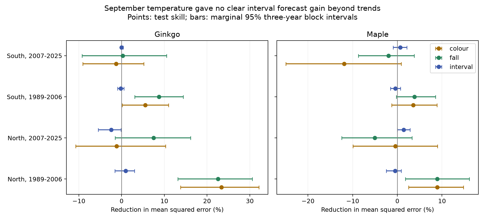

# September temperature gave no clear autumn interval forecast gain beyond trends in eight Japan tests in 1989-2025

We tested whether September mean temperature improves later-year forecasts of the time from leaf colour to leaf fall. We used JMA ginkgo and maple records and GHCN-CAMS temperature. Each fit used earlier years only. The selected panel had 6,186 paired records at 62 distinct stations. Tests used 2,555 tree-type station-years in North and South Japan in 1989-2006 and 2007-2025. Adding temperature to station and observation-category intercepts and a common time trend changed mean squared interval error by -2.40% to +1.42%, where positive values mean lower error. All eight adjusted uncertainty intervals included zero. Separate local trends gave the same null conclusion. A baseline without a trend gave larger gains. The result shows no clear added interval forecast value for this predictor and model. It does not show that temperature has no effect. Selected coverage, missing visit and tree histories, coarse weather data and short test periods limit inference. The package contains source hashes, code, paired evidence, predictions and uncertainty estimates.

## Question and prior evidence

Does September temperature add useful information about the autumn colour-to-fall interval after earlier station records and a time trend are known? This interval joins two visible stages. It is not a direct measure of carbon uptake or physiological senescence.

Doi and Takahashi (2008, DOI 10.1111/j.1466-8238.2008.00398.x) studied latitude patterns in Japanese leaf colour and fall responses. JMA monitors designated trees with common observation rules. Commercial autumn forecasts also use temperature and historical colour dates [Japan Weather Association](https://www.jwa.or.jp/english/services-solutions/media-solutions/seasonal-news-autumn-foliage-forecast/). These facts motivate a forecast test but do not establish the value of September temperature for interval length.

Earlier SCI campaign studies tested interval trends, conditional temperature slopes and differences between tree types. They are cited in sci.json. The temperature-contrast study (4caf68...) notes that some autumn weather windows extend past the outcome. The present test uses September alone and predicts later years. It reuses the underlying public observations, so it is not independent confirmation of those studies. All input preparation code was written for this package. files/PLAN.md records the question choice and analysis rules.

## Data and observation rules

We parsed JMA items 013, 014, 015 and 016 for 1953-2025. They give ginkgo colour, ginkgo fall, maple colour and maple fall. Colour means the first day most of the specimen tree has changed colour. It does not mean the first coloured leaf. Autumn January-June dates are assigned to the next calendar year, as specified by JMA. Calendar dates are converted to elapsed days from 1 January in the labelled year, including leap days.

We paired colour and fall within station, tree type and year. We kept standard-target codes 8 and 9, required matching codes in each pair, and excluded negative intervals (none occurred). Codes 8 and 9 mark station grounds and nearby locations. Substitute-target codes 6 and 7 were excluded. A station must have at least 15 valid pairs in each of 1953-1988 and 1989-2025. The two tree types have separate eligible station sets.

The join gave 8,205 complete pairs at 91 stations with coordinates. Of these, 463 used substitute targets and 16 had different stage flags. The final panel has 6,186 pairs: ginkgo at 57 stations and maple at 51 stations, with 62 distinct stations in total. The tests use 2,555 paired tree-type station-years. This selection uses later record availability; it defines a conditional long-record benchmark, not an operational sample chosen in 1989.

Station coordinates come from NOAA ISD station history, matched by WMO number. They are approximate historical specimen positions. Temperature is the nearest half-degree GHCN-CAMS version 3.01 grid cell. All joined September values were present. Data were provided by NOAA PSL, Boulder, Colorado, USA. The source method is Fan and van den Dool (2008, DOI 10.1029/2007JD008470).

## Forecast test

We fit separate models for ginkgo and maple in North Japan (latitude at least 36 N) and South Japan. The baseline has an intercept for each station-by-location-flag series and one common linear year trend. The added model also has September mean temperature. Both use ordinary least squares with equal training-row weight. Each annual fit uses only years before the test year. Each tested category needs at least 15 earlier records. An unseen or short-history category is excluded from both models. Forecasts are not constrained to positive intervals.

The first test covers 1989-2006 and the second covers 2007-2025. Training grows over time. Earlier test-year observations may train later forecasts, as in sequential use. The two test periods have no overlapping target years, but share training history and some stations. Regions have different stations but may share weather. Tree types share stations and JMA observation methods. These are separated tests within one network, not independent networks or experiments.

Each test prediction uses no outcome or temperature from a later year. The earliest tested colour date was day 287. No tested colour date was in or before September. Thus the September window ends before all tested colour and fall dates. The weather snapshot is a later, revised data product. Actual archive release delays are not modelled. This is a historical forecast test, not a claim of real-time performance.

We score colour, fall and their interval on the same rows. Within each year we average squared errors across available stations, then average across test years. Skill is 100 times one minus added-model error divided by baseline error. Positive skill means improvement. Annual weather dependence is preserved by resampling whole years. We use 20,000 circular three-year block draws with seed 11072026. Eight primary interval tests use Bonferroni-adjusted 99.375 percent intervals for nominal 95 percent family coverage. This coverage requires an adequate block approximation. Only 18 or 19 target years enter each test. The bootstrap conditions on fitted forecasts and does not include training uncertainty. Figure bars are marginal 95 percent intervals for description.

## Results

| Tree type | Region | Test years | Pairs | Error reduction (%) | Eight-test adjusted interval (%) |
| --- | --- | --- | ---: | ---: | --- |
| ginkgo | North | 1989-2006 | 286 | +0.96 | -2.54 to +3.73 |
| ginkgo | North | 2007-2025 | 279 | -2.40 | -6.79 to +0.27 |
| ginkgo | South | 1989-2006 | 360 | -0.17 | -1.23 to +0.86 |
| ginkgo | South | 2007-2025 | 405 | -0.01 | -0.31 to +0.55 |
| maple | North | 1989-2006 | 286 | -0.52 | -3.36 to +1.21 |
| maple | North | 2007-2025 | 218 | +1.42 | -0.54 to +3.46 |
| maple | South | 1989-2006 | 365 | -0.46 | -1.96 to +1.22 |
| maple | South | 2007-2025 | 356 | +0.64 | -1.49 to +2.66 |

All eight primary intervals include zero. Skill ranges from -2.40 to +1.42 percent. Baseline interval root mean squared error ranges from 4.16 to 6.83 days. Adding temperature changes those errors by less than 0.06 day in each test. These results do not establish a common useful gain for this predictor beyond the trend baseline. They do not prove equivalence or exclude small gains.

Separate station-by-category trends also leave all eight adjusted interval ranges across zero. In contrast, a baseline with no trend gives positive interval skill in all eight tests, from 0.44 to 17.47 percent; five adjusted intervals exclude zero. Thus apparent temperature value depends strongly on what the baseline already knows about gradual change. This is consistent with shared low-frequency information in temperature and phenology. It does not identify its cause.

Supporting date forecasts show early-period error reductions of 3.54-23.36 percent. Gains do not repeat clearly in 2007-2025: every later colour and fall marginal interval includes zero. We did not formally test a change in skill between periods, so this does not prove a decline in predictive value. These endpoint results are exploratory and have no family correction. All scores, predictions, model checks and uncertainty ranges are preserved.

## Bias, uncertainty and scope

Pairing and observation-category intercepts control some differences in coverage and recorded observation location. Long-record selection limits station turnover. These steps do not control tree replacement, observer changes, missed visits, tree age, pruning, irrigation, urban heat, wind, storms, drought, disease or pollution. A recorded location category can remain constant while a tree or site changes. Before 1987 some nearby observations could be labelled as on-site. Visit records and permanent specimen identifiers were not available. We did not model the missingness process.

Coarse monthly exposure can miss the relevant daily cold, heat or moisture. A revised spatial weather product is not a separate biological network. The model is linear and tests one month. A null added forecast gain does not show that temperature has no ecological effect. The time trend can capture warming-related information as well as other changes. It may also extrapolate poorly. Other climate predictors or models could perform better.

This investigation covers ecological timing in monitored Japanese trees. It does not measure air pollution, species distributions, biodiversity loss, daily weather extremes or a causal effect of human-caused climate change. Further tests need independent observation networks, daily local weather, visit records and tree histories.

## Reproduction, provenance and worker record

See [files/REPRODUCE.md](files/REPRODUCE.md). Run `python files/forecast.py --files files --out reproduced` from the unpacked bundle. The package contains the full derived input panel and predictions, so this analysis runs offline. Raw source reconstruction uses files/prepare.py. Exact source URLs, versions, shared paths and computed SHA-256 hashes are in files/provenance.json. Shared raw inputs are reused in place and are not copied into this bundle. No reusable raw data were downloaded.

The baseline license applies to our text, figures, code and derived evidence. Original source terms and attribution remain applicable. Private keys are excluded. The bundle is saved locally and is not uploaded or submitted to a remote archive or index.

Campaign: 11_07_2026. Job: sci-1107-dell-climate-pollution-biodiversity-f4b9897ff389. Topic: climate-pollution-biodiversity. Machine: dell. Account: codex-andrii. Model: gpt-6.1-sol with high reasoning effort, through T3 Code and the Codex harness. Analysis date: 2026-11-08 UTC. No child agents were used. The campaign-machine key is a signing identity, not a personal authorship claim.
