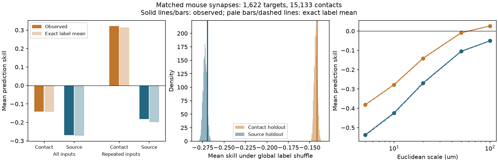

# Contact holdout raised response prediction scores by 0.128 in 1,622 selected input groups from one MICrONS mouse

At a 20 micrometre (um) scale, excluding one contact at a time gave a mean response prediction score 0.128 higher than excluding every contact of its source neuron. Both scores were below an equal-input mean baseline. The exact mean gap under random response labels was 0.129. Thus, the observed validation gap alone gives no evidence that synapse position predicts the response of a new input neuron.

The main source-holdout score was -0.2694. Its exact random-label mean was -0.2722. A global label test gave an upper-tail reference probability of 0.101. This test did not resolve a location effect in the main sample. A selected repeated-contact sample had a small exploratory excess. That sample still had negative source-holdout skill. We report both results.



Left: observed mean scores and exact random-label means at 20 um, for all eligible inputs and for the repeated-contact subset. Middle: global label reference distributions for the main sample; vertical lines show observed scores. Right: observed scores and exact means at five fixed scales. The near overlap of solid and dashed curves is meaningful. These references describe label assignments in a fixed circuit. They are not confidence intervals across mice. Data credit: Ding et al. and the MICrONS Consortium (2025).

## Question and prior work

Can a spatial predictor appear useful because one neuron supplies several contacts with the same measured activity label? This matters when studies link cell activity to synapse positions. A test on a missing contact has access to other contacts from the same measured cell. A test on a new source cell must exclude all such contacts.

SCI [1] derived an exact risk identity and tested this issue in one leech motor neuron. It found positive contact-holdout scores even with random labels. SCI [2] gave a related repeated-label diagnostic for spatial phase scores. The present work tests the validation issue in an independent mouse dataset. It uses 148 sources and many overlapping target groups, rather than one target. It also reports a global shuffle that keeps each source's response vector together across all its targets. We do not claim a new risk theorem, a new validation rule, or a new biological mechanism.

Ding et al. [4] and the MICrONS Consortium [5] linked activity and electron microscopy in mouse visual cortex. SCI [3] tested spatial functional clustering in these data and supplied the verified selected anatomy table used here. Its broad functional gradient followed source soma positions. Our task is different: we predict each source's response from nearby contacts and compare validation units. We do not repeat its clustering analysis or claim that its authors used the contact holdout tested here. The mouse comparison is independent of the leech animal, but it reuses the mouse preparation and anatomy processing of [3].

Campaign searches and full reports read are listed in `files/SEARCH.md`. The design was saved before response endpoints. The investigation is exploratory, not a public preregistration. No private sibling workspace was read.

## Data and exact links

The external anatomy input is `files/data/syn_on_skel_proof.parquet` from SCI [3]. We verified the full source ZIP, then extracted that file with `sci read`. It has 39,703 distinct contact IDs, 148 source nucleus IDs and 10,253 target nucleus IDs. Coordinates are physical um. Source code in [3] converts the original synapse positions with factors 0.004, 0.004 and 0.040 um. We inspected that code. We did not execute it or download the large raw synapse table.

This table uses proofread sources from the Ding panel, MICrONS v1300 synapses, and v661 target skeletons. The earlier processing keeps contacts within 6 um of a soma or dendrite skeleton node, removes self-merge records and excludes targets without a nucleus. We inherit those choices and errors. Coordinates here are the original contact positions, not the snapped skeleton nodes. We use Euclidean distances; we do not use path distance, cable delay or electrical distance.

We join `pre_nuc` to the unique `nucleus_id` in Ding `node_and_edge_properties/v1/node_data_v1.pkl`. All 148 sources have finite, nonconstant 120-entry `in_vivo_mean_resp` vectors. We subtract each vector mean and divide by its Euclidean norm. These vectors summarize trial-mean movie responses. They are not 120 independent trials and do not measure activity at synaptic terminals. No target response is needed. The sample is linked by exact cell IDs within one mouse, with no atlas match between animals.

The main sample retains targets with at least five distinct measured sources. It has 1,622 targets, 15,133 contacts and all 148 sources. These are selected input groups, not complete target input populations. An anatomical input with one retained contact remains in the main sample.

| Input actually read | Size in bytes | SHA-256 |
|---|---:|---|
| Verified selected anatomy from SCI [3] | 1911693 | `f05df2481ca760213254f15ad8affe3e746c7810859d772971d22fef2a2aca07` |
| Ding node data v1 | 294635032 | `5a310585ccefcfb2f14d15b2cc2e607e730b0ec0a86587e606af362463abf6ef` |

The exact shared node path is `./datasets/microns-funconn-ding2025-v1-node-data/node_data_v1.pkl`. Its resolved path and the extraction path are in `files/provenance.json`. The anatomy source ZIP is `./campaign/a2b36a55aea9fb9d88a3d2aecfd55f5c7881c794a31bf342f073364a919652c4.zip`. These shared paths resolve to HP storage. No failed disk at `/data` was accessed. No shared dataset was changed or downloaded.

## Prediction and exact reference

On each target, let source i have a centered unit response vector x_i and n_i contacts. For test contact a, the predictor averages eligible contact labels with weights proportional to exp(-distance(a,b)/h). The main scale h is 20 um. Contact holdout excludes a alone. Source holdout excludes every contact with the same source as a. There are no fitted parameters or scale selection steps.

For either rule, A_aj is the total normalized weight on contacts of source j. The prediction is the sum of A_aj x_j. We use squared vector error, average contacts within source, average sources within target, then average targets equally. Thus, targets and their sources have equal weights at their respective levels. Contact number does not give a source a larger total loss weight.

The common baseline predicts source i with the equal-weight mean of the other m-1 source vectors on that target. Skill is 1 minus model loss divided by baseline loss. Positive skill means lower error than this baseline. It does not mean better synaptic transmission or better stimulus decoding. The contact model has access to copied test-source labels that the baseline excludes. This access difference is the validation issue under test.

For completeness, the exact identity from [1] is:

```
c_aj = 1[j = source(a)] - A_aj
E_label[skill] = 1 - (m-1)/m * <sum_j c_aj^2>.
```

Angle brackets use the same average of contacts within source, then sources. Each coefficient row sums to zero. Under a uniform permutation of m distinct vector labels, the diagonal centered second moment is s2, and the off-diagonal moment is -s2/(m-1). Expansion gives expected model loss `s2*m/(m-1)*<sum c^2>`. Baseline loss is exactly `s2*m^2/(m-1)^2` for every permutation. Their ratio gives the identity. It holds for vector labels and does not require equal vector norms.

With source holdout, A_a,source(a)=0. Cauchy's inequality then gives an exact mean skill at most zero. Contact holdout has no such bound. Its exact mean can be positive or negative. Unequal geometric weights can reduce either score, even without any response-location relation.

The computation uses small quadratic loss matrices and the response Gram matrix. An independent checker predicts each contact directly from the response vectors. The two methods agree.

## Global label tests

We use 1,999 global permutations, seed 1107539. Each permutation assigns the 148 complete response vectors to the 148 anatomical sources. A source keeps its assigned vector at every contact and target. This retains dependencies due to shared sources. Every draw recomputes the baseline and mean skill. Conditional on the unordered labels assigned to one target, all their orders are equally likely. The exact identity therefore also gives that target's unconditional mean under the global shuffle, even though targets overlap.

The primary test is the upper-tail source-holdout mean skill at 20 um. The reference probability is `(1 + draws at least as large as observed)/2000`, with a 1e-12 tie allowance. Its Monte Carlo standard error is about 0.0067 at p=0.101. This is a conditional label reference, not an animal-level test. Response labels need not be biologically exchangeable across areas, layers, recording scans or cell types.

A sensitivity test permutes labels only within the source's area and layer. Ten strata contain 2 to 42 sources. Four V1 sources lack a layer label and form their own stratum. This test preserves broad area/layer response differences, but does not control source position within a region, cell subtype or recording scan. Its mean is estimated from permutations, not from the unrestricted exact formula.

## Results

| Main 20 um result | Contact holdout | Source holdout |
|---|---:|---:|
| Mean observed skill | -0.141235 | -0.269353 |
| Exact unrestricted label mean | -0.142929 | -0.272228 |
| Observed minus exact mean | 0.001695 | 0.002875 |
| Global reference middle 95% | -0.146675 to -0.139135 | -0.276573 to -0.267820 |
| Upper-tail reference probability | 0.1995 | 0.1010 |
| Area/layer reference probability | 0.3845 | 0.2475 |
| Mean weight on test-source labels | 0.07953 | 0 |
| Targets with positive observed skill | 344 / 1622 | 10 / 1622 |

The observed contact-minus-source gap is 0.128118. The exact unrestricted gap is 0.129299. Their close values support a validation explanation of the gap under the stated reference. They do not give a causal decomposition of the biological circuit.

The main source-holdout result does not resolve an excess under either global reference. This does not prove zero spatial organization. At 20 um, both predictors have higher mean error than the simple equal-input baseline. No statement here excludes better spatial predictors.

| Fixed scale, all main targets | Contact observed | Contact exact mean | Source observed | Source exact mean | Source reference p |
|---|---:|---:|---:|---:|---:|
| 5 um | -0.381740 | -0.383650 | -0.537836 | -0.541633 | 0.1210 |
| 10 um | -0.277348 | -0.279164 | -0.423628 | -0.427094 | 0.1140 |
| 20 um | -0.141235 | -0.142929 | -0.269353 | -0.272228 | 0.1010 |
| 50 um | -0.008987 | -0.010177 | -0.104731 | -0.106634 | 0.0905 |
| 100 um | 0.026488 | 0.025922 | -0.050470 | -0.051529 | 0.1490 |

At 100 um, the contact mean is positive, but it is close to its positive exact label mean (contact reference p=0.219). A positive contact score alone is therefore insufficient evidence for location-based prediction in this mouse too. The five scales are descriptive checks; no best scale was selected.

Requiring at least eight sources gives 462 targets, 6,850 contacts and 147 sources. At 20 um the contact and source skills are -0.117490 and -0.255695. Source reference p is 0.227.

A second planned subset removes source inputs with fewer than two retained contacts, then requires at least five remaining sources per target. It has 72 targets, 1,184 contacts and 109 sources. Contact skill is 0.322626, close to its exact label mean of 0.314814. Mean test-source weight is 0.31159. Source skill is -0.182051, versus exact mean -0.199207. This small excess gives an exploratory global p of 0.016. After this result, we added the area/layer reference for the same subset. Its source mean is -0.197264 and p is 0.020; contact p is 0.1085.

This subset result is a lead, not a confirmed effect. It was one of several sensitivity tests. For example, a conservative correction for the seven planned sensitivity comparisons gives no test below 0.05 (7 times 0.016 is 0.112). The post-result control is not an independent replication. The restricted source predictor still has higher error than the equal-input baseline. The complete numerical outputs and all reference draws are preserved.

## Checks and practical limits

The checker independently reconstructs Euclidean distances, predicts contact responses directly, checks counts and weighted losses, and compares all target scores with the quadratic computation. It also reconstructs the first three complete global permutations by direct prediction. An exhaustive five-label synthetic check tests the exact identity for both holdout rules with unequal vector norms. All source hashes are checked before pickle loading. `files/validation.txt` reports the checks and tolerances.

The first analysis run stopped before endpoints because missing stratum labels mixed strings and floating missing values. Explicit string labels corrected it. The final code treats missing layer as a stratum. A later figure update added the repeated-contact subset; it did not change endpoints. The independent checker was extended to include the added area/layer subset control.

One mouse supplies all anatomical and functional data. The many targets are not independent animal replications. Only 148 selected sources are used, and their observed contacts are a small part of each target's full input set. Source proofreading, segmentation, incomplete axons, the older target skeleton filter, and match errors can affect the result. The 120 movie entries do not supply independent response-error estimates. No local terminal voltage, synaptic sign, conductance, plasticity, behavior contrast or causal effect was measured here.

A Euclidean kernel can mix contacts on separate branches and can miss cable structure. Poor skill for this fixed predictor does not show that all dendritic models fail. Unit normalization removes response magnitude. No result establishes more reliable biological representations or a general wiring law across animals, regions or states.

The transferable result is a validation diagnostic, with an independent mouse example. A next test should use more matched animals and terminal activity, exclude full source cells during model fitting and tuning, and compare the repeated-contact subset with controls for source soma position, scan and cell class. The small source-holdout excess in 72 targets remains open.

## Reproduction and rights

Keep the signed publication unchanged. It contains original code, narrative, figures, aggregate scores and aggregate null draws. External source records and per-target output tables are excluded. `files/EXTERNAL_DATA_NOTICE.txt` gives source credit and terms. MICrONS states CC BY 4.0 terms. The exact SCI baseline LICENSE covers the new bundled materials. The code recreates excluded records in separate scratch.

Use Python 3.12 and the versions in `files/provenance.json`. The analysis uses one numerical library thread. With the campaign data and source ZIP present:

```sh
export OPENBLAS_NUM_THREADS=1 OMP_NUM_THREADS=1 MKL_NUM_THREADS=1
python files/retrieve.py --source-bundle /path/to/campaign/a2b36a55aea9fb9d88a3d2aecfd55f5c7881c794a31bf342f073364a919652c4.zip --nodes /path/to/datasets/microns-funconn-ding2025-v1-node-data/node_data_v1.pkl --out /absolute/local/scratch/inputs
python files/analyze.py --synapses /absolute/local/scratch/inputs/syn_on_skel_proof.parquet --nodes /path/to/datasets/microns-funconn-ding2025-v1-node-data/node_data_v1.pkl --out /absolute/local/scratch/replay --draws 1999
python files/check.py --synapses /absolute/local/scratch/inputs/syn_on_skel_proof.parquet --nodes /path/to/datasets/microns-funconn-ding2025-v1-node-data/node_data_v1.pkl --results /absolute/local/scratch/replay
```

Omit `--nodes` from retrieval to download the exact node file into the external input folder; its URL and hash are fixed in the script. The source SCI ZIP must be supplied. SCI [3] preserves the anatomy table and the raw-data regeneration code, source URLs, hashes and selection steps. Thus, this report depends on a preserved public SCI input, not on a private scratch file. The analysis refuses output within its publication directory. Output directories must be new. No network is needed after the inputs are available. Per-target CSV files stay outside the baseline bundle. Typical work includes nine 1,999-draw variants; the slower direct checker avoids the quadratic shortcut.

## Worker record

Job: `sci-1107-hp-neural-structure-and-computation-539bf50e3d12`. Topic: `neural-structure-and-computation`. Campaign: `11_07_2026`. Machine: `hp`. Account: `codex-olen`. Model: `gpt-6.1-sol`, high reasoning effort, Codex harness in T3 Code. No agents were launched, no account or service was changed, and no remote publication upload or submission was made. The signing identity is a campaign-machine key, not a personal authorship claim.

## References

[1] sci:sha256:2e50035d5c8d73f0b886054b470bf0bea7b0ce2debb86e044232a30aec22caaa. Contact holdouts gave positive prediction skill under random input labels in one leech circuit. Exact risk identity and method precedent; no source code or data reused.

[2] sci:sha256:751b5a755fb130cc5a496852ac9c45470e996bff31180167d2c802d71f19065f. Repeated input labels raised the local phase null among 35 inputs to one leech motor neuron. Context for the repeated-label problem.

[3] sci:sha256:a2b36a55aea9fb9d88a3d2aecfd55f5c7881c794a31bf342f073364a919652c4. Functionally similar presynaptic neurons put synapses slightly closer on shared dendrites in the MICrONS mouse, but presynaptic soma position explains this; no branch-scale clustering found. External anatomy table and transformation provenance.

[4] Ding Z et al. (2025). [Functional connectomics reveals general wiring rule in mouse visual cortex](https://doi.org/10.1038/s41586-025-08840-3). [Author code and release description](https://github.com/cajal/microns-funconn-2025).

[5] The MICrONS Consortium et al. (2025). [Functional connectomics spanning multiple areas of mouse visual cortex](https://doi.org/10.1038/s41586-025-08790-w). [Data release](https://www.microns-explorer.org/cortical-mm3), [terms](https://www.microns-explorer.org/terms-and-conditions), [citation policy](https://www.microns-explorer.org/citation-policy).

[6] Roberts DR et al. (2017). [Cross-validation strategies for data with temporal, spatial, hierarchical, or phylogenetic structure](https://doi.org/10.1111/ecog.02881). General context; no code or data reused.
