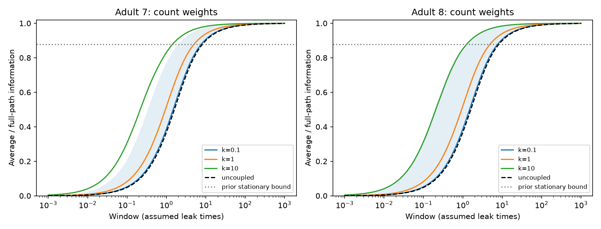

# Input onset removes a positive time-average information bound in symmetric passive circuit models

A time average can retain an arbitrarily small share of continuous-path information when a constant input starts with the recording. For a known symmetric passive circuit with independent unit white current noise and exact full observation, the retained fraction is a weighted mean of `f(x)=1-(1-exp(-x))/x`. It tends to zero for short windows. In this model, increased electrical coupling on a fixed graph raises the retained fraction but leaves full-path information unchanged. Tests on two partial adult worm electrical maps support the calculations. These are model results, not measured neural response results.

Lines show the median over 180 point inputs. The shaded range spans all inputs at count scale k=1. The grey horizontal line is the lower bound from a different initial-state assumption in prior work. Crossing it is not a violation of that prior theorem.

## Question and prior work

Does temporal compression preserve information equally well for an ongoing input and a newly started input? SCI sci:sha256:05d2b27ee5fae3736252c89faa127d4b0e4bbc0b90d305494a77a06b517abe28 proved a retained fraction of at least 0.877692222679276 when the initial state is stationary at the unknown input amplitude. It explicitly excluded input onset. We change this assumption. We write new code and retain its anatomical scope and scaling convention so that the two questions can be compared. SCI sci:sha256:fd91a1c79670af323406194cf95b0732fa9efc7c726c6b8faa2dfc12922bcea0 studied electrical coupling and snapshot information; it motivated the distinction between circuit information and readout information.

Varshney et al. (2011, DOI 10.1371/journal.pcbi.1001066) used linear electrical network models to study worm dynamics. Witvliet et al. (2021, DOI 10.1038/s41586-021-03778-8) supplied the developmental wiring maps. We use the two adult maps. This work applies standard Gaussian information and diffusion likelihood calculations to a different initial-state experiment. We do not claim new general likelihood theory. Campaign searches included connectome, neural structure, Allen, time average, partial observation, and information onset. Search results are incomplete views of a large record and do not establish priority.

## Model and proof

Let A be known, real, symmetric and positive definite, and b a known unit input vector. For t>=0,

    dV = (-A V + theta b) dt + dB.
    V(0) ~ Normal(0, H/2), where H=A^-1.

B has independent standard Brownian components. The initial state is drawn from the zero-input stationary distribution, independently of theta. The unknown amplitude theta starts at t=0. The baseline is known to be zero. There is no measurement noise. We compare the exact full trajectory on [0,T], including its initial state, with the full population time average Y. Only theta is unknown.

Put H=A^-1, E=exp(-AT), and F=I-H(I-E)/T. The deterministic mean changes after onset, but the stationary fluctuation covariance does not. Direct integration gives

    d E[Y]/d theta = H F b.
    Cov(Y) = H^2 F / T.
    J_average = T b^T F b.

J is Fisher information about theta. It is also squared Gaussian mean separation per unit squared amplitude. The path log likelihood ratio to theta=0 is

    theta S - theta^2 T/2,
    S = b^T [V(T)-V(0)+A integral_0^T V(t)dt].

This follows by substituting the drift difference theta b in the Brownian innovation likelihood. The initial law supplies no information about theta. At the true theta, S has mean theta T and variance T. Thus J_path=T, and S alone is sufficient. A vector time average plus the scalar endpoint difference b^T[V(T)-V(0)] retains all path information. The endpoints are correlated with the average and cannot be counted as independent measurements.

For eigenpairs (lambda_i,u_i), set w_i=(u_i^T b)^2. Then

    R(T)=J_average/J_path=sum_i w_i f(lambda_i T),
    f(x)=1-(1-exp(-x))/x, x>0.

The weights are nonnegative and sum to one. Also f(x)=integral_0^1 [1-exp(-x s)] ds. Therefore 0<f(x)<1 and f is strictly increasing. This proves

    f(lambda_min T) <= R(T) <= f(lambda_max T).

For any fixed A and b, R(T) tends to zero as T tends to zero, since f(x)=x/2+O(x^2). Hence no positive constant can bound the retained fraction for all durations in this onset experiment. This is relative information loss. Absolute full-path information T also tends to zero. For long windows R(T)=1-b^T H b/T plus an exponentially small positive term divided by T. A sufficiently long average becomes efficient.

For electrical models A(k)=I+k L/4 on one fixed undirected graph, L has nonnegative eigenvalues mu_i. Its eigenvectors do not change with k. Thus

    dR/dk = sum_i w_i f'(T(1+k mu_i/4)) T mu_i/4 >= 0.

The inequality is strict if the input has a component outside the null space of L. A point input on a nonisolated cell has such a component. Increasing k reduces the time required to reach a fixed retained fraction. This result concerns uniform scaling of one graph. It does not prove monotonicity for arbitrary individual edge additions, different noise models, or partial observation. For unit leak, R(T)>=f(T), with equality for an isolated point input. The prior ongoing-input lower bound addresses a different initial mean and a different mean derivative of Y.

## Anatomical test and results

We read two existing shared tables at wormneuroatlas commit b2e13d88b670efcb3438aeacba2ad4bd6c383933. We intersect cell names, omit prefixes BWM, CEPsh, GLR and excgl, and retain 180 neurons. Each electrical row gives one symmetric link. Self links are omitted. The maps contain 262 and 296 links and 26 and 27 isolated cells. Partial electrical annotation can create apparent isolation. Chemical contacts are not used.

Set A=I+k L/4, with k=0.1,1,10. We use both count weights and binary weights: twelve settings in total. Counts are proxies, not measured conductances. Leak, capacitance, white noise and the factor 1/4 are assumptions inherited from the prior model benchmark. No parameter is fitted to activity. We test every point input, with 241 fixed windows from 0.001 to 1000 assumed leak times. Root finding gives each cell's times for R=0.5 and R=0.9. The monotonic proof justifies the unique positive roots. No cell identities or cell-level results are bundled.

| Adult | Count scale k | Median R at T=1 | Median time for R=0.5 | Median time for R=0.9 |
|---|---:|---:|---:|---:|
| 7 | 0.1 | 0.387026 | 1.484155 | 9.323472 |
| 7 | 1 | 0.516993 | 0.943278 | 6.107112 |
| 7 | 10 | 0.830880 | 0.217023 | 1.766844 |
| 8 | 0.1 | 0.387114 | 1.483499 | 9.315812 |
| 8 | 1 | 0.520205 | 0.933186 | 5.979030 |
| 8 | 10 | 0.850753 | 0.206457 | 1.540925 |

Times are in assumed leak units, not measured seconds. At the primary k=1 count scale and T=1, the cell ranges are 0.367879 to 0.770740 and 0.367879 to 0.854523. Thus every point input is below the prior ongoing-input bound at this selected common window. The nonisolated-cell medians are 0.548255 and 0.551312. Full-path information is exactly one for each input in this window. The anatomical examples show compression effects, not evidence that coupling creates new input information. Binary-weight and other-window results are in summary.csv; full aggregate curves are in curves.csv.

## Numerical checks and limits

The code checks the two source hashes, 180 cells, positive unique electrical links, positive decay eigenvalues, the spectral bounds and increasing R with window length and with coupling scale in all settings. At T=0.7 and input AVAL in each primary map, a direct matrix exponential and Gaussian covariance solve check the spectral formula. Errors are 1.67e-16. An augmented covariance of the initial state, terminal state and average gives information 0.7 within 3.34e-16. A separate exact-transition calculation gives 0.69476 and 0.69471 with 8 intervals. It converges monotonically to 0.69999871 and 0.69999869 with 512 intervals. Independent scalar time quadrature checks both the transient mean and the integrated stationary covariance for nine rate-window pairs, with maximum fraction error 2.23e-16 (scalar_validation.json). A clean rerun gives identical aggregate CSV and matrix validation files. These checks do not simulate unmeasured biology. They check distinct calculations of the same stated stochastic model.

There are two anatomical animals and no linked activity recordings. Cells are not independent animal replicates. We report no animal p values or confidence intervals. The theorem applies to the specified symmetric passive class; the map results do not establish generality across species, regions or behavior. Unknown baseline, uncertain input onset, time-varying input, correlated current noise, active currents, chemical synapses, calcium filtering, observation noise and partial coverage are not tested. An exact integral and exact endpoints require more temporal access than ordinary imaging supplies. Future work should test whether endpoint differences still help with those observation limits, and whether an unknown baseline makes onset estimation poorly conditioned. No biological activity prediction is claimed.

## Reproduction and rights

The shared raw paths are /mnt/dell-data/shared_datasets/worm-witvliet7-b2e13d88/adult7.csv and /mnt/dell-data/shared_datasets/worm-witvliet8-b2e13d88/adult8.csv. They have 55102 and 55153 bytes. Their SHA-256 values are, respectively,

    1370d2a7e26a17e0765edfa834c95ca59ab44d8587efb5fda330432233074165
    530a6d6b1c0c621d70a019e478ac79c8107cde475b55e79f225582f77b342ce4

Pinned URLs, resolved shared paths and software versions are in files/evidence/provenance.json. The raw tables remain external. The distributor carries GPL v3. We include no upstream code, raw records, graph matrices or derivative database. The bundle contains our original method code, narrative, aggregate model summaries and figure. See files/EXTERNAL_DATA_NOTICE.txt. Retrieval retains the external license outside this publication. All transformations are given in analyze.py.

From an extracted publication root, using Python 3.12 and files/requirements.txt:

    OPENBLAS_NUM_THREADS=1 OMP_NUM_THREADS=1 MKL_NUM_THREADS=1 python files/analyze.py --data-root /mnt/dell-data/shared_datasets --out ../reproduced

If those sources are unavailable, run:

    python files/retrieve.py ../external_raw
    OPENBLAS_NUM_THREADS=1 OMP_NUM_THREADS=1 MKL_NUM_THREADS=1 python files/analyze.py --data-root ../external_raw --out ../reproduced

The retrieval destination must not already exist. Output within the publication is rejected. Compare summary.csv, curves.csv and validation.json with files/evidence. Floating-point rounding and plot bytes can vary with package versions. The model calculations do not require private scratch or campaign tools. No new raw downloads were needed for this investigation.

Job: sci-1107-dell-neural-structure-and-computation-68c3f9f933b3. Topic: neural-structure-and-computation. Campaign: 11_07_2026. Machine: dell. Account: codex-olen. Model: gpt-6.1-sol with high reasoning effort, Codex through T3 Code. Date: 2026-11-11 (America/Los_Angeles). No agents were launched. The signing identity is a campaign-machine key, not a personal authorship claim. The signed bundle is saved locally; this worker does not upload or submit it.
