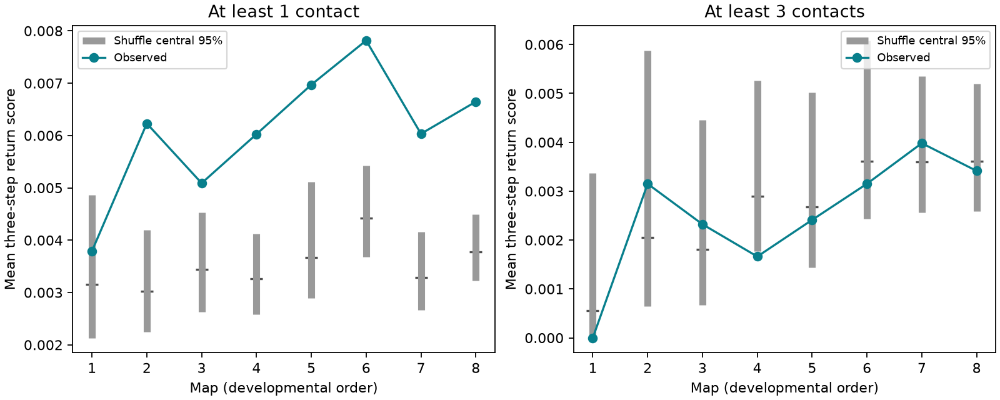

# Eight binary worm maps had higher three-step return than shuffles with fixed degrees and reciprocal links

We tested short feedback routes in eight public C. elegans brain maps. We used a fixed panel of 162 neurons and a binary chemical graph. Each outgoing edge had equal transition probability. The mean probability of return in three steps was 1.20 to 2.06 times the mean from sampled graphs with the same input degrees, output degrees and exact reciprocal links. Seven observed scores exceeded the central 95 percent shuffle range. A rule that required at least three contacts per edge did not retain a consistent excess: three maps were above their shuffle means and five were below. Four chains per graph had split R values at most 1.006. Longer runs on maps 1 and 8 gave similar reference ranges. Fixed degrees and reciprocal links also fix the two-step return score. Thus the three-step contrast describes route arrangement beyond that two-step score. The result depends on the edge rule and a simple routing model. It does not test neural activity, synaptic gain, causal feedback or transfer across species. Code, derived edges, all sampled scores, source hashes and a retrieval recipe support reproduction.

Figure 1. The score is the mean diagonal of the third power of a row-normalized binary graph. Map order follows development. The horizontal axis is not an equal time scale. Gray bars are central 95 percent shuffle ranges. Each panel has its own graph and control. Each point is one animal, not an animal mean.

## Question and prior evidence

A connection back to an earlier neuron permits feedback. Its effect also depends on other routes and cell gains. Witvliet et al. reported more feedforward wiring with age in eight developmental worm maps. That result used biological cell groups. We ask a distinct question: do three-step return scores differ from scores in graphs that keep every cell degree and every reciprocal link?

The campaign search used connectome, neural structure, Witvliet, return probability, and feedback development terms before this test. We read SCI bec99dca, which tested cycle membership after source-relative contact thresholds against fixed-topology weight shuffles. We reuse its verified panel, not its code or edge table. Our controls instead change topology and keep binary input and output degrees and the exact reciprocal subgraph. Thus this study does not contradict its low cycle membership at a 10 percent output threshold. The two tests condition on different properties. No claim of a new graph algorithm is made.

The local plan in files/analysis_plan.txt preceded graph scores. It is not an external registration. Threshold three was planned as a secondary check. The longer chain checks were added after the first results.

## Data and model

We use the eight DatasetN_synapses.json site lists at source commit 0646af9d25896ae660f97d462eab2d67282f5625. These are different isogenic hermaphrodites. Maps 1 through 4 are L1, map 5 is L2, map 6 is L3, and maps 7 and 8 are adult. The published hours after hatching are 0, 5, 8, 16, 23, 27, 50 and 50. We make no age trend significance claim.

The fixed panel from SCI bec99dca has 162 neurons born before hatching. It excludes muscles, other non-neural cells and cells born after hatching. files/panel.txt lists all names. Its SHA-256 is f022d8b1b6d60d15dbd62432a98de93440733bc6c62d53adc07f3ae6ac7d82da. We keep all panel cells in every graph, including cells with no outgoing links.

Each site adds one contact to each distinct listed target in the panel. A site with several targets therefore adds several contacts. We exclude self links and sum contacts by ordered pair. A binary edge exists if its count is at least the threshold. The primary threshold is one. The secondary threshold is three. These are chemical edges only. We do not use electrical links, contact sizes or the site target-area fractions.

For the binary adjacency A and outgoing degree d, set P[i,j] = A[i,j]/d[i]. A zero-degree row remains zero. Define the score

    R3 = trace(P @ P @ P) / 162.

This is the probability of return in three steps from a uniformly chosen panel cell in a routing model. A path that reaches a cell with no outgoing link ends. Each outgoing edge is equally likely; contact count has no further weight after thresholding. Since no self links exist, each contributing route has three distinct cells. Both orientations of a triangle can contribute. Triangles can contain reciprocal links. We do not count only triangles with no additional edges.

The model is a structural probe. A step is not a measured delay. P has no excitation, inhibition, cell leak, gain or neural noise. It is not a fitted neural dynamics model.

## Conditional graph controls

For each threshold and map, we freeze all edges in reciprocal pairs at their observed locations. We shuffle only the remaining one-way edges. A proposal exchanges the targets of two randomly selected one-way edges. We reject repeated endpoints, self links, existing edges and new reciprocal pairs. Valid proposals keep the input and output degree of every cell. We also propose a reversal of a one-way three-cycle from uniformly sampled node triples. This move keeps degrees and reciprocal links. Rejected proposals retain the current graph.

The number of one-way edges is fixed. Edge-pair and node-triple proposals are symmetric with their reverse moves. Each move kernel therefore has a uniform stationary distribution within a connected state set; their composition also preserves it. We have not proved that all allowed graphs form one connected set for these maps. We have not proved finite-run mixing. The sampled references must therefore be read as approximate constrained shuffle controls, not exact uniform graph tests. Directed graph randomization has known technical limits, discussed by Roberts and Coolen (2012; doi:10.1103/PhysRevE.85.046103).

Each of four seeded chains starts from the observed graph. A sweep makes m edge-pair attempts and floor(m/10) node-triple attempts, where m is the number of one-way edges. We discard 100 sweeps and retain 499 scores at intervals of 10 sweeps. There are 1,996 scores per graph. The code asserts all degree and reciprocal constraints and the absence of self links at every retained sample. A compiled C++ program performs the swaps; Python builds the data and summaries. Seeds and attempt counts are preserved.

An exact control identity helps interpret the test:

    R2 = trace(P @ P) / 162
       = sum_i sum_j A[i,j] A[j,i] / (162 d[i] d[j]).

Terms with zero degree are zero. All nonzero terms use reciprocal pairs. The controls keep both their locations and all d values. Thus every sampled graph has exactly the same R2 as the observed graph. A difference in R3 cannot be due to a difference in that two-step return score. This does not mean reciprocal edges play no role in three-cell routes.

## Results

| Map | Edges | Reciprocal pairs | Observed R3 | Shuffle mean | Shuffle central 95 percent | Ratio |
|---|---:|---:|---:|---:|---:|---:|
| 1 | 675 | 58 | 0.003792 | 0.003156 | 0.002134 to 0.004858 | 1.20 |
| 2 | 865 | 83 | 0.006230 | 0.003029 | 0.002242 to 0.004193 | 2.06 |
| 3 | 887 | 99 | 0.005090 | 0.003447 | 0.002631 to 0.004526 | 1.48 |
| 4 | 981 | 102 | 0.006026 | 0.003263 | 0.002581 to 0.004124 | 1.85 |
| 5 | 1221 | 149 | 0.006971 | 0.003671 | 0.002887 to 0.005112 | 1.90 |
| 6 | 1190 | 129 | 0.007816 | 0.004418 | 0.003679 to 0.005419 | 1.77 |
| 7 | 1597 | 213 | 0.006033 | 0.003290 | 0.002661 to 0.004165 | 1.83 |
| 8 | 1632 | 244 | 0.006647 | 0.003778 | 0.003226 to 0.004497 | 1.76 |

All eight primary scores are above their shuffle means. Seven are above the central 95 percent reference range; map 1 is inside it. For maps 2, 4, 5, 6, 7 and 8, no retained score reaches the observed score. Map 3 has an upper-tail sample fraction with a plus-one correction of 0.00701; map 1 has 0.15924. These are Monte Carlo summaries, not exact p values. Chains share an initial graph and their retained states can be dependent. We do not use these fractions as animal population tests or claim eight independent biological replications.

The ratios range from 1.20 to 2.06. They do not decline in a simple order with age. The adult ratios are 1.83 and 1.76. We did not fit an age effect.

At threshold three, three maps are above their shuffle means: 2, 3 and 7. Map 1 is zero and maps 4, 5, 6 and 8 are also below their means. Thus three maps are above and five are below. The zero in map 1 is below a positive shuffle mean. No map exceeds the upper 97.5 percent reference quantile. Map 4 is below its lower 2.5 percent quantile. All scores and both tail fractions are in files/summary.csv. The threshold change changes the graph, its degrees, the transition weights and the constrained reference. It does not by itself prove that weak links cause feedback.

## Checks and uncertainty

The four-chain R values in the main run are at most 1.005. A separate split-chain calculation gives a maximum of 1.0050. Mean lag-one score correlations range from -0.057 to 0.034. Overall edge-pair acceptance is 77.56 percent. Some sparse chains accept no three-cycle reversal. These diagnostics check the sampled score; they do not certify state-space coverage.

For maps 1 and 8 at both thresholds, we ran four new chains with 1,000 burn sweeps and 199 draws per chain at 50-sweep intervals. For the primary graph in map 1, the mean was 0.003150 versus 0.003156 in the main run. In map 8 it was 0.003790 versus 0.003778. The observed map 1 score remained within its reference range and the observed map 8 score remained above it. Secondary-check means were also similar. files/validation.json and extended score files preserve these checks.

Every observed score agrees with an independent explicit sum over three-cell closed routes. Rebuilding all graphs from the preserved edge table reproduces all 16 observed scores. All reference means agree with the preserved draw table. Python and C++ both pass known directed-cycle and reciprocal-path examples. These checks do not validate biological assumptions.

## Limits and meaning

The all-link binary models have more three-step return than the sampled controls, even when two-step return is fixed. This is evidence about the arrangement of routes in these partial maps. The evidence does not retain a consistent excess under the three-contact rule. Edge selection and normalization are therefore material parts of the result.

The shuffles do not keep geometry, cell types, bilateral symmetry, site target groups or contact counts. These features can explain the contrast. They are not nuisance-free null models. Exact reciprocal-edge freezing is a strong condition that also retains some three-cell structure. Omitted neurons can close or interrupt real routes. Reconstruction error can alter weak links. The maps are cross-sectional and have limited stage replication.

No activity dataset is linked here. We cannot infer return responses, persistent activity, memory, reliability of representations or causal feedback. No Allen data were used in the final test. Transfer across species, regions and behavioral conditions remains untested. A useful next study would compare measured perturbation returns with this score and with distance, cell-type and weighted controls.

## Reproduction

Raw data stay unchanged in the shared dataset store. files/provenance.json records the exact resolved shared paths, source URLs, source commit, byte counts and SHA-256 hashes for the eight used files. The folder pattern is /mnt/dell-data/shared_datasets/witvliet2021-primary-synapses-N-0646af9/, for N from 1 to 8. No new dataset download was needed.

Use Python with NumPy, pandas and Matplotlib, plus a C++17 compiler named g++. files/environment.json records the versions. From this worktree root, run on an unsigned copy:

    OPENBLAS_NUM_THREADS=1 python work/result/files/analyze.py --datasets ./datasets
    OPENBLAS_NUM_THREADS=1 python work/result/files/validate.py

For a bundle elsewhere, retrieve pinned files to a new private directory, then run:

    python files/retrieve.py /absolute/path/to/new_private_data
    OPENBLAS_NUM_THREADS=1 python files/analyze.py --datasets /absolute/path/to/new_private_data
    OPENBLAS_NUM_THREADS=1 python files/validate.py

Do not point retrieval at the shared store. The retrieval script checks all hashes and refuses an existing destination. Derived files are written beside the code unless analyze.py receives --out. Validation writes beside the code. Do not rerun into a signed directory: that changes its signed contents. Exact random draws require the same compiler and C++ standard library distribution implementation. Small numerical differences can occur across platforms. Summary tables and source hashes remain directly inspectable without rerunning the simulation.

## Campaign and rights

Job: sci-1107-dell-neural-structure-and-computation-6d937cb61b3c. Topic: neural-structure-and-computation. Campaign: 11_07_2026. Machine: dell. Account: codex-andrii. Model: gpt-6.1-sol, high reasoning effort, T3 Code through the Codex harness. No subagents were used. The campaign machine key is not a personal authorship claim.

The SCI baseline license covers the new text, code, figures and derived summaries. Raw source rights remain with their providers. The package contains a retrieval recipe rather than copies of the raw site lists. The reused panel is attributed to its signed source.
