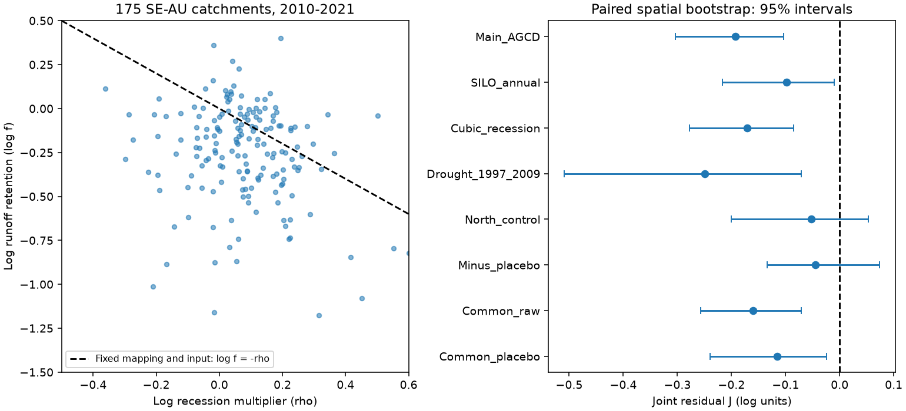
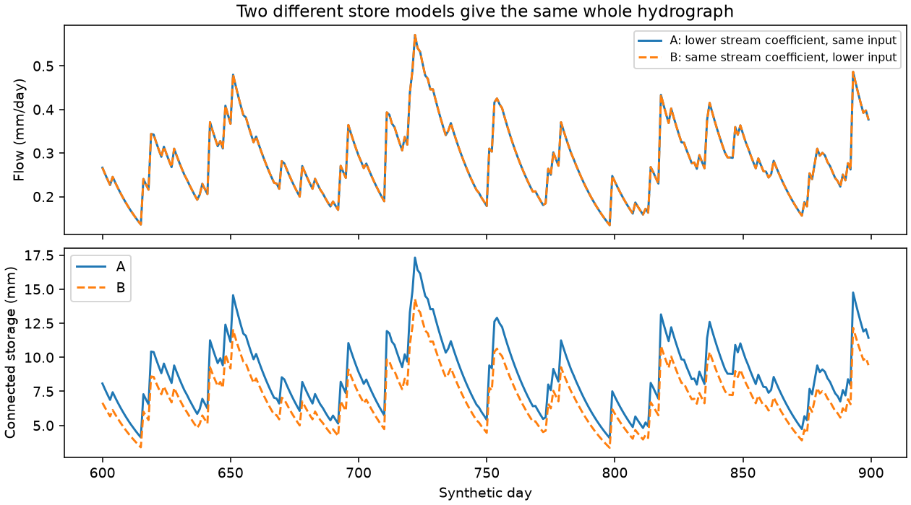

# A joint runoff and recession test did not resolve a new leakage change after 1997 in 78 south-east Australian catchments

We developed a joint test of annual runoff retention and dry-weather stream recession. In a single store with a fixed storage-to-flow relation, a loss proportional to flow, equal effective input and no net storage trend, runoff retention times the recession multiplier must equal one. This restriction also holds for a nonlinear storage-to-flow relation. It gives a test of a specified loss-only explanation, rather than a cause inferred from faster recession alone.

In 175 south-east Australian catchments in 2010-2021, the product was 0.824 (conditional 95% spatial interval 0.738-0.902). However, the product was also below one before 1997. In the 78 catchments with both tests, the post-period minus placebo change was -0.045 log units (-0.134 to +0.074). Thus this joint test did not resolve a new mismatch after 1997 once the earlier mismatch was removed. This is not evidence that leakage was absent or that the rainfall-runoff change was absent.

We also give two distinct store models that produce exactly the same full flow record. The measured signatures alone cannot separate less input to the stream-connected store from a change in its storage-to-flow relation and losses.

## Question and prior work

Campaign work found persistent rainfall-adjusted runoff losses, plus faster recession and lower flow before storms. The physical cause is not known. Source publication 7cecffa9 inferred greater loss from the stream-connected store as one explanation of faster recession. Source publication fde6f0d6 found that a simple change of a Budyko curve did not fit the annual loss. We ask whether the two published signatures jointly support a simple loss-only store model.

The single-store recession framework and its assumptions are established in Kirchner (2009), [doi:10.1029/2008WR006912](https://doi.org/10.1029/2008WR006912). The regional physical hypotheses are reviewed by Fowler et al. (2022), [doi:10.5194/hess-26-6073-2022](https://hess.copernicus.org/articles/26/6073/2022/). Our new work combines the published catchment statistics, derives a joint restriction, tests its earlier-period behavior, and gives an exact non-unique explanation. It is a secondary analysis, not independent confirmation of the flow records.

## Data and method

We use verified SCI publications 7cecffa9 and fde6f0d6. Full identifiers and hashes are in sci.json and files/provenance.json. No new raw data were downloaded. The underlying Australian data are CAMELS-AUS v2.03, with AGCD and SILO rainfall. See [the source description](https://essd.copernicus.org/articles/17/4079/2025/) and files/DATA_NOTICE.md for credit and rights.

Annual flow retention f is observed mean annual flow divided by the mean flow predicted at observed weather from a 1951-1996 reference fit. The primary annual fit has a Fu form and includes previous-year rain and temperature. It is a weather counterfactual, not a measurement of groundwater recharge. The primary recession statistic rho is the published mean log change of daily flow decrease within reference flow bins, with season adjustment. It uses AGCD-screened rain-free days. The recession multiplier is exp(rho).

We join station identifiers and require positive annual mean flow, positive expected flow and finite recession statistics. The main group is the source SE-AU group: 175 catchments in 24 outlet cells, each 2 degrees by 2 degrees. Period 2010-2021 is E3 in the recession source and P2 in the annual source. The records need not contain identical valid days across methods. We do not select catchments by the size or sign of a deficit.

For each catchment define J=log(f)+rho. The primary statistic is the equal-catchment mean J. The table's product is exp(mean J), a geometric mean. We sample whole spatial cells with replacement, keep all members of sampled cells, and recompute the mean. We use 9,999 samples, seed 2090538, and percentile limits. The samples preserve the pairing of annual and recession statistics. These intervals condition on the source fits and the observed years. They do not account for uncertainty in the source reference models or for temporal sampling.

The placebo uses annual fits from 1951-1980 tested on 1981-1996, and the recession source's corresponding placebo. For the corrected test, we keep only the 78 catchments with both finite J values and subtract the two within each catchment. This is a diagnostic subtraction, not an assumed correction for a constant physical bias. It changes the reference fit and comparison period. There is no basis to assume its bias must transfer unchanged across eras.

The plan was stored before the first joint calculation (files/PLAN.md). After seeing the first joint results, we added linear and quadratic annual reference checks. We reconstruct their predicted means from the source residual regression identity. We also added an uncorrected comparison in the same 78 catchments after the placebo result. All results remain exploratory; no multiple-test adjustment is applied.

## Results



Points on the left are catchment statistics. The dashed line is the fixed-input, fixed-mapping restriction. The axis view omits some extreme points; the full table and all points enter the calculations. The right panel gives conditional 95% spatial intervals. The corrected interval crosses zero.

| Test | Catchments | Mean J | Conditional 95% interval |
| --- | ---: | ---: | --- |
| Main, AGCD, 2010-2021 | 175 | -0.193 | -0.303 to -0.103 |
| SILO annual rain, same recession data | 175 | -0.098 | -0.217 to -0.010 |
| Cubic recession model | 175 | -0.171 | -0.278 to -0.085 |
| Linear annual reference | 175 | -0.177 | -0.272 to -0.092 |
| Quadratic annual reference | 175 | -0.176 | -0.280 to -0.090 |
| Drought period, 1997-2009 | 174 | -0.249 | -0.509 to -0.070 |
| Northern Australia, 2010-2021 | 64 | -0.053 | -0.201 to +0.053 |
| Common cohort, 2010-2021 | 78 | -0.160 | -0.257 to -0.070 |
| Common cohort, 1981-1996 placebo | 78 | -0.116 | -0.240 to -0.024 |
| Common cohort, post minus placebo | 78 | -0.045 | -0.134 to +0.074 |

The main geometric flow retention was 0.766, and the recession multiplier was 1.076. With the stated assumptions, leakage alone would require a recession multiplier of 1/0.766=1.305. The measured multiplier was much smaller. The product 0.824 would instead imply a 17.6% smaller stream coefficient if effective input stayed fixed, or a 17.6% smaller effective input if that coefficient stayed fixed. Neither interpretation is identified by the data. SILO reduced this apparent gap to 9.4%.

The main mean J remained negative with 1-degree cells (-0.274 to -0.122), 4-degree cells (-0.298 to -0.082), and a median statistic (-0.251 to -0.070). The raw mismatch is not driven only by a few catchments. But the earlier-period mismatch means that raw rejection cannot be assigned specifically to a new post-1997 loss process. The paired corrected product was 0.956 (0.875-1.077). That interval permits changes of useful size in both directions; it is not an equivalence test.

## Proof and an exact alternative

Let dS/dt=I-cQ, Q=F(S), with fixed increasing F and constant c in each era. On dry days, -dQ/dt=c F'(S)Q, so the recession multiplier at fixed Q is c1/c0. The integrated water balance gives mean Q=I_eff/c, where I_eff=mean I minus the net storage change divided by period length. Thus f r=I_eff1/I_eff0, and f r=1 at equal effective input. See files/THEORY.md for the full argument and limits.

For the linear case Q=kS with another loss ell S, lambda=k+ell and dQ/dt=kI-lambda Q. The observations constrain the product (k1/k0)(I_eff1/I_eff0), rather than its factors. A change in k and an inverse change in I keep the complete Q equation unchanged.



The synthetic example starts at k0=0.04/day and lambda0=0.05/day. Model A uses k=0.032976/day and unchanged store input. Model B uses k=0.04/day and input multiplied by 0.824392. Both use lambda=0.053810/day and have nonnegative other losses. Their flow records differ by less than 9e-16 mm/day across 30,000 simulated days. Their stores differ. The maximum water balance error was 2.9e-12 mm. These arbitrary model values show non-uniqueness; they are not estimates for real catchments. Both models can include more non-stream loss. The example does not show that loss stayed unchanged.

A separate algebraic example in files/THEORY.md shows that a streamflow gain change can also produce lower flow and faster apparent recession if the recession curve is nonlinear. We did not measure such a gain change. Fixed rain-network checks do not test it.

## What this adds and what remains open

The method links a mean-flow constraint to a dry-weather dynamic constraint. It can reject a specific single-store loss-only explanation even when both individual signatures appear compatible with greater leakage. In this application the raw restriction fails, but the earlier mismatch prevents a clear post-1997 attribution. This challenges a strong physical interpretation of faster recession, not the existence of the regional runoff deficit.

Further attribution needs measurements that separate storage, discharge sensitivity and effective recharge. For example, well levels linked to individual stream-connected aquifers, storage changes during rain-free recession, and independent stream rating audits could constrain the factors that flow alone cannot separate. These are proposed tests, not results of this package.

Limits are substantial. Proportional non-stream loss, negligible dry-period input, a common store, stationary era parameters and accurate weather counterfactuals may all fail. Nonlinear losses need not obey the restriction. Annual total flow and selected recession days can reflect different stores. Changes in soil evaporation at fixed atmospheric demand can change store input. The source fit errors are not propagated. The common placebo cohort is less than half of the main cohort and has only 17 cells. Its null result has limited power. We did not fit a break date, test the eastern US, inspect gauge quality flags, or independently refit raw daily observations. The stated 1997 boundary comes from the prior work.

## Reproduce

Run from any location with Python 3.12, NumPy, pandas and matplotlib:

```
python /path/to/publication/files/analyze.py /path/to/separate-scratch
python /path/to/publication/files/audit.py /path/to/separate-scratch
```

All outputs go to the named scratch directory. The first command reproduces every table, all bootstrap samples and the main figure from the included fit statistics. The second verifies input hashes, independently checks the main arithmetic, simulates the equivalent models, checks water balance and makes the second figure. Environment versions are in files/results/environment.json. To inspect the exact upstream statistics, run files/retrieve_inputs.py with the shared campaign directory and a separate scratch directory. It checks both source ZIPs and every used member hash. To rebuild those statistics from raw observations, use the reproduction code in the two cited source publications; that larger operation is separate from this secondary analysis.

The bundle includes all code, selected compatible source fit tables, exact source provenance, paired statistics, all J samples, figures and numerical audit results. No private scratch is required for this repeat.

Job: sci-1107-dell-earth-and-ocean-sciences-2090538da766. Topic: earth-and-ocean-sciences. Campaign: 11_07_2026. Machine: dell. Account: codex-myxtap. Model: gpt-6.1-sol, high reasoning effort, through Codex in T3 Code. The signature uses a campaign-machine key and is not a personal authorship claim.
