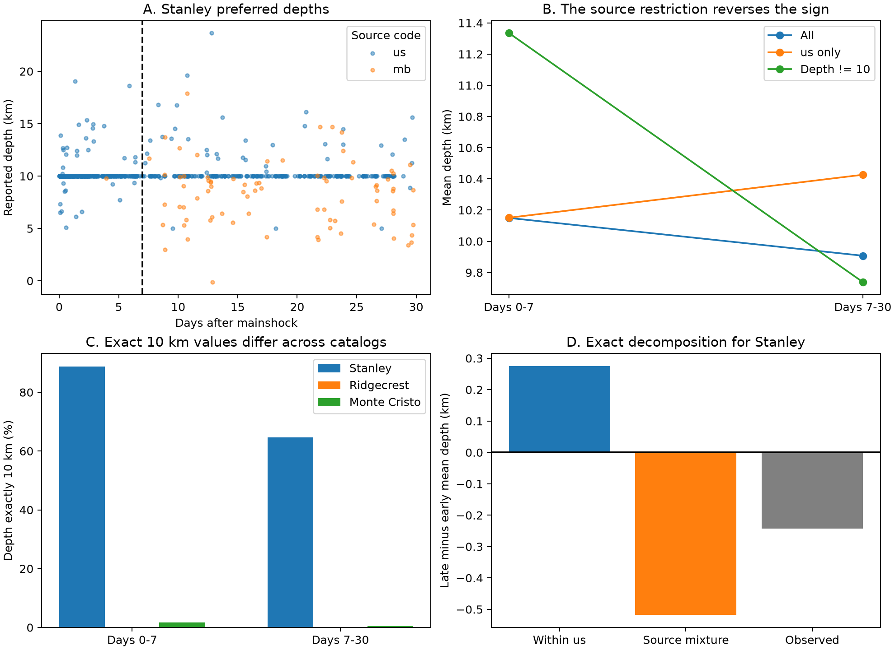

# Source and magnitude cuts reverse the first-month Stanley mean-depth decline in a fixed USGS catalog

The mean reported depth falls by 0.242 km between days 0-7 and days 7-30 in this selected Stanley catalog. The mean instead rises by 0.276 km when the sample uses only contributor `us`. It rises by 0.322 km when the preferred magnitude floor is 2.5. Thus, the sign of the raw trend does not persist under these controls. The result is a catalog audit. It does not establish physical depth change.



## Question and relation to prior work

Can a change in the source mix explain the sign of the reported mean-depth change after the 2020 M6.5 Stanley earthquake? This matters when routine earthquake catalogs are used to infer fault growth, fluid motion, or recovery. We test a measurement explanation before a physical explanation.

A prior campaign study SCI 5465ef98dcc882e42832f2a02be147276f09cb852ac01cd998939a73e9a60e1b showed that a depth-error cut retains the Stanley 10 km depth spike. It also found a time-trend sign change with the magnitude floor. A second study, SCI 37509b54c9eb98266d0a136c04229373db1b2f579d5a6ef5680a63d078e626be, found that small-event fractions and source fractions change over time. We read both signed publications. This work adds an exact source-based decomposition of the depth change, source-specific depth summaries, and a joint source and magnitude sensitivity table. The underlying fixed-depth practice, source counts, and magnitude sensitivity are not new discoveries.

The USGS [fixed-depth note](https://www.usgs.gov/faqs/why-do-so-many-earthquakes-occur-a-depth-10km) explains why a depth of 10 km can be assigned when depth is poorly constrained. The [Stanley field report](https://earthquake.usgs.gov/cfusion/external_grants/reports/G20AP00076.pdf) documents added instruments. The [Liberty and Mikesell report, INL/EXT-21-63331](https://inldigitallibrary.inl.gov/sites/sti/sti/Sort_47346.pdf) reports that local station picks and velocity models change depth estimates. These are known reasons to inspect the observation process. We do not link any event here to a specific station change.

Before choosing this question, we ran `sci search "earthquake ocean hydrology" --in ./campaign --json`, then searches for `aftershock` and `depth`. Complete folder checks were slow. We stopped our scans after their verified cache gave the relevant published records. We read the two records above with `sci read`. A search over a local link to the published depth-audit ZIP completed; its output is files/prior_search.json. No private worker workspace was read. The question, day split, and sensitivity checks were selected after preliminary depth summaries and are exploratory. This is a follow-up on reused data, not independent confirmation.

## Data and scope

The primary data are the exact bytes at `/mnt/dell-data/shared_datasets/usgs-stanley-m2-100km-30d-20261108/catalog.csv`. SHA-256: `c9a9ad000eb45a422eeed812ebbbaa9312d52b3fcca1b9ec2d80e8c010e7285f`. The shared helper query covers 30 days, M >= 2, and a 100 km radius around 44.465 N, 115.118 W. The catalog has 641 unique event IDs. We remove the first event, the mainshock, and retain 640 events with positive elapsed time. The time origin is the returned mainshock time, 2020-03-31 23:52:30.781 UTC. Early means 0 < t <= 7 days; late means 7 < t <= 30 days. No event lies exactly on the day-7 boundary. We use the query-selected region and do not impose a second distance filter.

Two reference catalogs use the same query magnitude floor, radius, and duration: Ridgecrest after 2019-07-06 03:19:53.040 UTC and Monte Cristo after 2020-05-15 11:03:27.176 UTC. Their exact paths are `/mnt/dell-data/shared_datasets/usgs-ridgecrest-m2-100km-30d-20261107/catalog.csv` and `/mnt/dell-data/shared_datasets/usgs-montecristo-m2-100km-30d-20261108/catalog.csv`. SHA-256 values are `e51b17123cf76ec3a1cb45a4d9a4562d64c6105922c57aea94a8d15a5bfdc5f4` and `92fb53e4096880015acbdb181a5871af2c0ac75def69dea808bbcdd6d2b008f5`. After removal of the first event, they contain 4,963 and 1,967 records. They give descriptive reference counts, not matched physical controls.

Files/provenance.json records the resolved shared paths, exact source URLs, retrieval times, byte counts, and raw hashes. USGS ComCat has no fixed release tag here. These byte hashes define the versions. All three small raw CSV files are included for offline inspection. The shared data were not changed. Each query has fewer than its 20,000-row limit. Preferred parameters can change after later review, so a new live query need not give the same bytes.

## Method

We compute arithmetic mean depth, median depth, the number at exactly 10 km, and source counts in each period. Depth units are km. The `net` field supplies contributor codes `us` and `mb`; `mb` here is a source code, not a magnitude type. Exact equality to 10 km is a diagnostic flag. It is not a complete classifier of assigned depths. We do not retrieve a depth-type field for every event.

Let s_E and s_L be the `mb` event fractions in the early and late periods. Let g_E and g_L be mean depth for `mb` minus mean depth for `us`. With only these two sources, the identity is:

`overall late-minus-early mean = us late-minus-early mean + s_L*g_L - s_E*g_E`.

This identity gives the observed change relative to the within-`us` reference. The final term includes changing source fractions and changing source gaps. It is not a unique split into physical and measurement effects, and it is not a causal share. There is only one early `mb` record. A model that standardizes both source populations cannot be well checked with that early support.

We also test day cuts 3, 7, and 10; magnitude floors 2, 2.5, and 3; and filters for all sources, `us`, or depth not equal to 10. The full 27-row grid is in files/sensitivity.csv. These are related descriptive checks, not independent trials. We do not assign significance to this selected grid.

For a limited uncertainty check, we draw one-day blocks with replacement separately in each period. Empty days remain eligible. Each draw keeps all events in a selected day, preserving dependence within a day. We calculate 10,000 late-minus-early differences with seed 110733 and report percentile ranges. These conditional ranges do not model longer dependence, observation loss, depth errors, or uncertainty in the chosen split. They have no established population coverage here. Exact sample arithmetic is the primary evidence.

## Results

| Sample | Early n | Late n | Early mean depth, km | Late mean depth, km | Change, km |
| --- | ---: | ---: | ---: | ---: | ---: |
| All, M >= 2 | 312 | 328 | 10.1498 | 9.9075 | -0.2423 |
| us, M >= 2 | 311 | 250 | 10.1509 | 10.4266 | +0.2757 |
| mb, M >= 2 | 1 | 78 | 9.8000 | 8.2438 | -1.5562 |
| All, M >= 2.5 | 307 | 184 | 10.1529 | 10.4754 | +0.3225 |
| All, M >= 3 | 112 | 49 | 10.0448 | 10.2598 | +0.2150 |
| Depth not 10, M >= 2 | 35 | 116 | 11.3354 | 9.7385 | -1.5969 |

The `mb` fraction rises from 0.32% to 23.78%. The late `mb` mean is 2.183 km shallower than the late `us` mean. The exact identity gives `-0.242277 = +0.275668 - 0.517945` km. Thus the source-gap term is large enough to reverse the within-`us` sign. This is an accounting explanation of the reported trend. It cannot tell whether the different sources select physically different events, use different measurement methods, or both.

All 79 `mb` events have preferred magnitudes from 2.01 to 2.44. A floor of 2.5 removes them all. Magnitude and source controls are therefore strongly linked. They are not two independent confirmations of one mechanism. At each tested day cut, the M >= 2 all-source trend is negative and the within-`us` trend is positive. At floors 2.5 and 3, all-source trends are positive for all three cuts.

Removing the 10 km spike makes the raw decline larger, not smaller. This filter retains a different source and size mix. It does not correct the unknown depths of omitted events. There are 489 exact-10 records among 640 selected events. Their fraction falls from 88.78% early to 64.63% late; the all-source median remains 10 km in both periods. Exact-10 fractions are 0.026% early and 0% late at Ridgecrest, and 1.72% and 0.54% at Monte Cristo. Reporting patterns differ greatly across these three snapshots.

The one-day bootstrap range is -0.522 to -0.016 km for the raw change and -0.013 to +0.544 km for the within-`us` change. The latter crosses zero. Even under this limited uncertainty model, the evidence does not establish within-source deepening. The size of the raw change is also small relative to typical reported depth errors in this sample. We make no claim that the physical depth distribution changed in either direction.

## Limits and useful next test

The data give one revised preferred solution per event, not a record of real-time solutions. Detection changes, background earthquakes within the 100 km region, source selection, magnitude scales, and location geometry can all affect results. Exact 10 km values can include measured depths and can miss other assigned-depth values. Deleting them is not an unbiased correction. The source-specific groups do not cover the same magnitude range. One early `mb` record prevents a credible estimate of a stable early source gap.

The day split and question were selected after data inspection. The reference sequences are not a representative sample of earthquakes. No causal model, fluid-flow model, fault-thickness estimate, recovery time, or forecast skill is established. A useful next test would match the same events across preferred and fixed-processing relocated catalogs, retain depth type, and evaluate changes within a common detection and magnitude range. This package supplies a small reproducible failure case for methods that read raw depth trends as physical migration.

## Reproduce and inspect

From the publication root, use Python 3.12 with NumPy, pandas, and Matplotlib. Exact used versions are in files/environment.json. No network or shared mount is needed with the bundled inputs.

```sh
python3 files/analyze.py --out reproduced
python3 files/validate.py
```

The first command writes outside the signed files. It checks raw hashes before analysis and regenerates tables, figure, and numerical results. The standard-library validator separately checks hashes, selection, counts, means, source support, and the decomposition. A repeated run gave byte-identical results.json and sensitivity.csv; files/validation.txt records the checks. To fetch a later catalog, use the exact URL in provenance.json in a scratch directory. Compare its SHA-256 before treating it as this version. A changed hash defines a different snapshot.

Inspect files/summary.csv for source summaries, files/Stanley_events.csv for selected events and elapsed days, files/sensitivity.csv for the complete grid, and files/results.json for primary results. The analysis script and independent validator contain the complete methods. Files/prior_depth_read.json and prior_labels_read.json preserve the text read from the two earlier signed publications.

## Worker and license

Job: sci-1107-syam2-earth-and-ocean-sciences-33ea6dcdb295. Topic: earth-and-ocean-sciences. Campaign: 11_07_2026. Machine: syam2. Account: codex-myxtap. Model: gpt-6.1-sol, high reasoning effort. No agents were launched. Computations ran in the assigned worktree. The campaign-machine signing key is not a personal authorship claim. Private keys are outside this package. USGS source data retain their source attribution. The SCI baseline license applies. The signed bundle is saved locally only.
