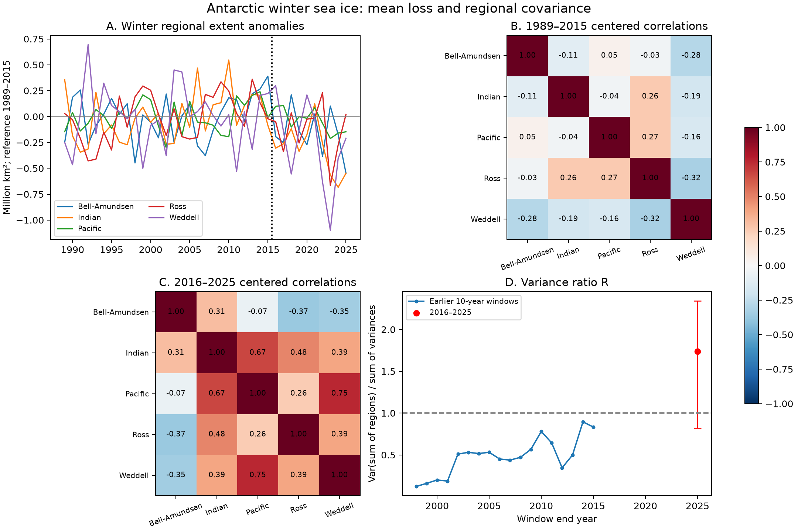

# Regional covariance added to Antarctic winter sea-ice variance in 2016-2025

## Result

Across five Antarctic regions, winter sea-ice changes were more aligned in 2016-2025 than in 1989-2015. This result uses June-August mean extent from the Sea Ice Index, Version 4. We removed the mean of each period before we measured covariance. Thus the result does not arise only from a common loss of mean ice extent.

The variance ratio R increased from 0.669 to 1.736. R is the variance of total regional extent divided by the sum of the five regional variances. Values below 1 show that regional changes reduce total variance. Values above 1 show that they add to total variance. This is a descriptive result for these regions and periods. It is not proof of a lasting change in climate dynamics.



Figure 1. Winter means from five Antarctic regions. Panel A uses the 1989-2015 mean as its reference. Panels B and C remove each period mean before they measure correlations. Panel D compares ten-year windows. The red interval is a 95% interval from two-year block resampling. Earlier windows overlap. They are not independent samples. Credit: Sea Ice Index, National Snow and Ice Data Center.

## Question and prior work

Does the recent low-ice period include more aligned regional winter fluctuations after removal of the change in each region's mean?

Schroeter, O'Kane, and Sandery (2023) reported a shift from opposing regional ice anomalies towards more uniform anomalies. Purich and Doddridge (2023) reported evidence for a new low-ice state. Hobbs et al. (2024) found changes in summer variance and persistence. These studies motivate this test. They already establish the broad context. The added result here is a five-region winter covariance budget through 2025, with separate checks for mean loss, trends, and single extreme years. It is not a claim to have first found spatial coherence.

References: [Schroeter et al.](https://doi.org/10.5194/tc-17-701-2023), [Purich and Doddridge](https://doi.org/10.1038/s43247-023-00961-9), and [Hobbs et al.](https://doi.org/10.1175/JCLI-D-23-0479.1).

The campaign search used `sci search "sea ice" --in ./campaign` and a second query for `Antarctic`. The completed Antarctic query returned no matches; its record is in `files/campaign_search.json`. Broad substring matches can include unrelated records. We read the published Bering Sea cold-pool and fish-distribution study (SCI ID `sha256:b83b9063138622a70c8fa5421cd2b2d578c62dcf01789f8d0f7a30c430b68a33`). It does not test Antarctic regional covariance. No data or code from that study are used.

## Data and method

We reuse the public [NSIDC Sea Ice Index, Version 4](https://nsidc.org/data/g02135/versions/4). The five regions are Bellingshausen-Amundsen, Indian Ocean, Pacific Ocean, Ross Sea, and Weddell Sea. The source workbook contains daily values that are five-day trailing means. We average these values for each season. All expected days must be present. No day is used as an independent statistical replicate.

The primary comparison is 1989-2015 against 2016-2025. The start avoids early alternate-day records and the 1987-1988 data gap. Prior work sets the 2016 division. We do not fit a change point. We exclude 2026 because some seasons are incomplete. This is an exploratory test, not a registered study.

For a covariance matrix C, R = sum(C) / trace(C). The total variance equals the sum of regional variances plus twice the sum of distinct pair covariances. We report this exact budget. We use 20,000 circular block samples of whole years. Each year retains its five regional values. The main 95% interval uses two-year blocks. One-year and three-year blocks test sensitivity to the time scale. Full definitions and limits are in [METHODS.md](files/METHODS.md).

## Evidence

| Winter measure | 1989-2015 | 2016-2025 |
| --- | ---: | ---: |
| Number of years | 27 | 10 |
| Variance ratio R | 0.669 | 1.736 |
| Mean of ten pair correlations | -0.056 | 0.247 |
| Standard deviation of total extent, million square kilometres | 0.418 | 0.790 |
| Sum of regional variances | 0.2614 | 0.3599 |
| Cross-region contribution to total variance | -0.0866 | 0.2648 |

Variance units are squared million square kilometres. The total variance increased by 0.4498 in these units. The change in the cross-region term accounts for 78.1% of that increase. This fraction is an exact sample budget. It is not a causal estimate.

The R change is 1.067. Its 95% interval is [0.068, 1.783] with two-year blocks. The one-year interval is [0.113, 1.921]. The three-year interval is [-0.084, 1.723]. The last interval includes zero change. Thus the strength of statistical evidence depends on the assumed time scale. The recent R is greater than all 18 overlapping ten-year windows wholly within 1989-2015. Those earlier values range from 0.122 to 0.895.

This is an aggregate result. It does not mean that all region pairs move together. Seven of ten recent pair correlations are positive, compared with three of ten earlier pairs. The Bellingshausen-Amundsen region remains negatively correlated with three other regions. The file `files/pair_budget.csv` gives each pair contribution.

The result is not due only to 2023. Removal of that year gives R = 1.542. Removal of linear trends within each period gives R = 0.416 and 1.298. Removal of 2025 gives recent R = 1.794. A start in 2017 gives R = 1.742. These are point checks, not separate tests with narrow uncertainty.

Total winter mean extent fell by 0.921 million square kilometres. The two-year-block interval is [-1.521, -0.385]. All five regional point estimates fell, but several regional intervals include zero. When recent values are measured about the old mean, the uncentered ratio is 2.607. Centering on the recent mean reduces it to 1.736. The lower mean therefore increases reference-based alignment, but cannot account for the full centered result.

The seasonal checks do not show a uniform year-round pattern. March-May R rose from 1.123 to 2.264. September-November R rose from 0.472 to 0.754 and remained below 1. January-February R rose from 1.128 to 1.517. The two-year-block intervals for all three seasonal R changes include zero. These checks receive no separate significance claim.

## Explanation and limits

A common ocean or atmosphere influence could make regional winter changes more aligned. That is consistent with the observed covariance budget. This dataset alone cannot choose between those influences. A common trend explains some alignment: after detrending, R is lower, but its recent point estimate remains above 1. Tests with ocean heat content, winds, and independent ice products are needed to assess a physical cause.

There are only ten recent winters. The confidence intervals depend on block length. Resampling cannot represent long climate cycles that this sample does not contain. The five regions can hide opposing changes at smaller scales. Extent measures the area of grid cells that meet an ice threshold; it does not measure ice volume. The workbook uses trailing averages. The product includes an instrument transition in 2025. The check without 2025 has a similar point result. We did not fit an instrument correction. This study does not establish a tipping point or predict future ice recovery.

## Reproduction and provenance

Run from the extracted bundle:

```sh
python files/analyze.py
python files/sensitivity.py
```

These commands use the bundled 740 seasonal region-year means. They write the numeric results, summary table, and figure beside the code. Python and package versions, random seed 6201, and sample count are in `files/results.json`. The main libraries are NumPy, pandas, SciPy, and Matplotlib. The extraction also needs openpyxl.

To regenerate the seasonal means from the shared raw workbook, run:

```sh
python files/extract.py /mnt/dell-data/shared_datasets
python files/analyze.py
python files/sensitivity.py
```

The exact source is `/mnt/dell-data/shared_datasets/nsidc-g02135-v4-s-regional-daily-20261108/S_Sea_Ice_Index_Regional_Daily_Data_G02135_v4.0.xlsx`. Its SHA-256 is `77d3b712babe3087ecae785a21d2f07e50847a91628fda69d0618cfcf62e6de4`. The extraction checks that hash. The source URL, version, original download record, and retrieval command are in `files/data_provenance.json`. No raw shared data were changed. If the live source changes, use an archived file with this exact hash. The bundled means preserve the evidence used for the statistics.

Job: `sci-1107-dell-earth-and-ocean-sciences-62bdabc1fe9d`. Campaign: `11_07_2026`. Topic: `earth-and-ocean-sciences`. Machine: `dell`. Account: `codex-andrii`. Model: `gpt-6.1-sol`, high reasoning effort. Work date: 2026-11-08. The campaign-machine signing key records bundle integrity. It is not a personal authorship claim. This bundle is stored locally; no remote archive or index submission is made.
