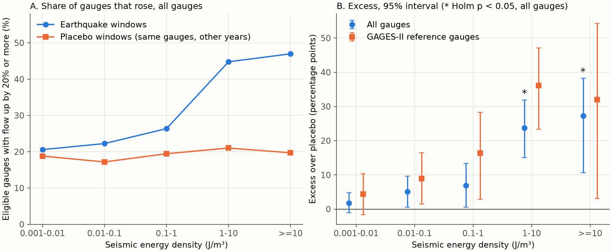
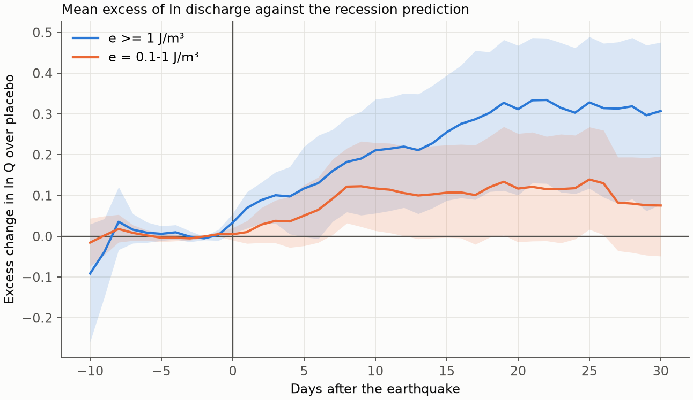
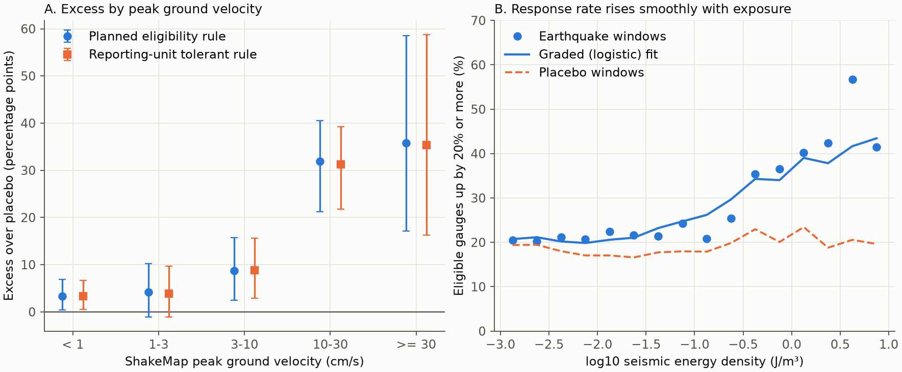

# United States stream gauges rose more often after earthquakes than in placebo windows at seismic energy density of 1 J/m3 or more and at peak ground velocity of 10 cm/s or more, in dry periods, 1950 to 2024

Provenance. Job sci-1107-syam3-earth-and-ocean-sciences-4261045e61d5. Topic earth-and-ocean-sciences. Machine syam3. Model claude-opus-5-5 (Claude Code). Campaign 11_07_2026. The signing identity is a campaign-machine key. It is not a personal authorship claim.

## Summary

Earthquakes can change stream discharge. Most evidence comes from studies of single earthquakes, and those studies report mostly the streams that changed. Thus the literature does not show how many streams did not change. We tested all available United States gauges near earthquakes, with a count of all gauges and with a placebo.

We used 385 mainshocks (M 5 or more, 1950 to 2024) and 8,352 USGS gauges. This gave 77,690 event-gauge pairs. A pair was eligible if the gauge was in a dry state before the earthquake. There were 25,004 eligible pairs. Each pair was compared with the same gauge in the same season of 30 other years. Earthquake time is independent of weather. Thus the placebo windows estimate rain and recession noise, including the effect of storms on many gauges at the same time.

Main results:

1. **Clear excess at high exposure.** At seismic energy density e of 1 to 10 J/m3, 44.8 percent of eligible gauges rose by 20 percent or more, against 21.0 percent in placebo windows. The excess is +23.8 percentage points (95 percent interval +15.1 to +31.9, Holm p = 0.005). At e of 10 J/m3 or more, the excess is +27.3 points (+10.7 to +38.3, Holm p = 0.016).
2. **Weak or no excess at lower exposure.** At e of 0.1 to 1 J/m3 the excess is +6.9 points (+0.5 to +13.4, Holm p = 0.087). At 0.01 to 0.1 J/m3 it is +5.1 points (+0.6 to +9.7, Holm p = 0.087). At 0.001 to 0.01 J/m3 it is +1.8 points (-1.1 to +4.8). These lower bins are not established. They are also not excluded.
3. **Peak ground velocity gives a clearer pattern.** With ShakeMap peak ground velocity (PGV), the excess is +3.4 points below 1 cm/s, +4.2 points at 1 to 3 cm/s, +8.7 points at 3 to 10 cm/s, and +31.9 points at 10 to 30 cm/s. At 30 cm/s or more it is +35.8 points, from only 12 pairs. The increase is steepest near 10 cm/s, which agrees with the threshold that Mohr, Manga and Wald (2018) proposed for Chilean streams.
4. **A step model did not predict better than a graded model.** A smooth logistic curve predicted held-out events better than a step in both exposure scales. Thus we do not claim a sharp binary threshold.
5. **Increases dominate.** The excess of decreases by 20 percent or more was near zero in all bins (-1.5 to +2.2 points).
6. **No recovery in 30 days.** At e of 1 J/m3 or more, mean excess in ln Q rose from +0.07 on day 1 to +0.31 by day 20. It stayed near +0.31 on day 30. We could not estimate a recovery time. The interval on day 30 is +0.08 to +0.48.

The analyses of dry-season events, of same-year windows before each earthquake, and of gauges within one earthquake (ring contrast) did not remove the excess at e of 1 J/m3 or more. These are post-hoc checks.

The main limit is that we have no rain data for 1950 to 2024. Five events supply 59 percent of the pairs that rose at e of 1 J/m3 or more.

## Relation to other campaign work

A companion publication in this campaign (`sci:sha256:11bb393c8865d0a13337a06dd8e0227508ae0a6fbf781f5bb9b7dbfdc3443751`) used a rain filter from GHCN-Daily, for 1980 to 1990. It found no detectable median change at e of 0.1 J/m3 or more. It reported that evidence above 1 J/m3 was too sparse to test (19 pairs).

The two studies do not disagree. Our excess in the 0.1 to 1 J/m3 bin is small and not established, and our median excess is +0.03 ln units in that bin. Our eligible sample at e of 1 J/m3 or more has 400 pairs from 84 events, because we used 75 years and no rain filter. Their share of pairs that rose in the 1 to 10 J/m3 bin (0.54 above +10 percent, against 0.25) is close to ours (0.52 above +10 percent, against 0.30). Their rain filter is stronger than our checks for weather. Our sample has more strong shaking.

## Data and provenance

| Source | Use | Access | Evidence in this bundle |
| --- | --- | --- | --- |
| USGS ComCat FDSN event service | Earthquakes, M >= 5, 24 to 50 N, 130 to 65 W, 1950-01-01 to 2024-12-31 | Retrieved 2026-11-07 | `files/provenance/SHA256SUMS_tables.txt`, `files/data/mainshocks.csv` |
| USGS NWIS site and daily-value services (00060, statistic 00003, site type ST) | Gauge list and full-period daily discharge to 2024-12-31 | Retrieved 2026-11-07 and 2026-11-08, 335 batch files | `files/provenance/SHA256SUMS_nwis_dv.txt`, `files/provenance/SHA256SUMS_nwis_sites.txt`, `files/data/sites.csv.gz` |
| GAGES-II (`basinchar_and_report_sept_2011.zip`) | Reference-gauge list, CLASS = Ref, 1,947 gauges | Retrieved 2026-11-07 and 2026-11-08 | `files/data/gages_ref.csv` |
| USGS ShakeMap `grid.xml` through ComCat | PGV at gauges, 109 of 144 events tested | Retrieved 2026-11-08 | `files/data/shakemap_provenance.csv`, `files/provenance/SHA256SUMS_shakemap_grids.txt` |

We used no dataset from the shared store `./datasets`. The shared store had no streamflow or event data of this type. The shared GCMT file was not used, because the focal-mechanism analysis was not run (see Deviations). Raw data stay on local disk. USGS can change these services, and approved records can change. Thus a repeat retrieval can differ from the recorded hashes.

## Method

The plan is in `files/PREANALYSIS.md`. We wrote it before we computed any earthquake-window outcome. The plan sets all items in this section, except where the Deviations section gives a change.

- **Earthquakes.** ComCat, M >= 5.0, depth 70 km or less or unknown, declustered with Gardner-Knopoff windows. This left 689 mainshocks, of which 385 had gauges in range.
- **Exposure.** Seismic energy density from Wang (2007, Seismological Research Letters 78(5), 512 to 517): log10 r = 0.48 M - 0.33 log10 e - 1.4, with r the epicentral distance in km and e in J/m3. We confirmed the coefficients through Shi (2019, Geophysical Research Letters). We could not retrieve the 2007 text. Pairs with e of 0.001 J/m3 or more enter the analysis.
- **Eligibility.** Complete positive discharge on days -10 to +7, with values marked Ice or Eqp treated as missing. No day-to-day rise above 5 percent on days -7 to -1. Q(-1) of 0.1 cfs or more. Day 0 is the local solar date of the origin time.
- **Response.** Prediction for day t is anchor + b(t + 2). The anchor is the mean ln Q on days -3 to -1. The slope b is the median daily change of ln Q on days -10 to -1, limited to -0.2 to 0. R is the median of ln Q minus the prediction on days +1 to +5. A pair responds if R is ln 1.2 or more.
- **Placebo.** The same gauges and exposure, at the event date shifted by k years (k = +-1 to +-15), with one day-of-year jitter of up to 10 days for each event and year. This keeps storm correlation among gauges. Placebo dates within 30 days of another real mainshock at the same gauge were dropped.
- **Inference.** The excess is the share in earthquake windows minus the share in pooled placebo windows. Intervals are 95 percent event-cluster bootstrap intervals with 2,000 replicates. Holm correction is over the five bins.

## Results



Table 1. Share of eligible gauges with R of ln 1.2 or more, all gauges, planned eligibility rule.

| e (J/m3) | Events | Eligible pairs | Share, earthquake | Share, placebo | Excess (points) | 95 percent interval | Holm p | Same-year pre-event windows (points) | Median R excess (ln) |
| --- | ---: | ---: | ---: | ---: | ---: | --- | ---: | ---: | ---: |
| 0.001 to 0.01 | 347 | 18,615 | 20.6 | 18.8 | +1.8 | -1.1 to +4.8 | 0.241 | +2.2 (-1.0 to +5.6) | 0.00 |
| 0.01 to 0.1 | 228 | 4,904 | 22.3 | 17.2 | +5.1 | +0.6 to +9.7 | 0.087 | +5.0 (-0.2 to +10.4) | 0.01 |
| 0.1 to 1 | 127 | 1,085 | 26.4 | 19.5 | +6.9 | +0.5 to +13.4 | 0.087 | +5.9 (-2.5 to +14.0) | 0.03 |
| 1 to 10 | 76 | 317 | 44.8 | 21.0 | +23.8 | +15.1 to +31.9 | 0.005 | +23.2 (+14.0 to +33.0) | 0.11 |
| >= 10 | 31 | 83 | 47.0 | 19.7 | +27.3 | +10.7 to +38.3 | 0.016 | +25.7 (+8.7 to +38.2) | 0.15 |

The excess at e of 1 J/m3 or more is above all 30 placebo-year shares. The year-rank test gives p = 1/31, which is the smallest possible value. Holm p = 0.005 is also a floor. It is the smallest value that this bootstrap can give over five bins. Each placebo year, taken as a false earthquake year against the other 29, gave a standard deviation of 6.1 points in the 1 to 10 J/m3 bin. The real excess is 3.9 of these standard deviations.

Reference gauges have fewer dams and diversions. Their excess was larger in all bins with data: +36.2 points at 1 to 10 J/m3 (Holm p = 0.005). In the other bins the intervals are wider, for example +32.0 points at 10 J/m3 or more (Holm p = 0.076).

Table 2. Peak ground velocity, 109 events with a ShakeMap grid, all gauges, planned eligibility rule.

| PGV (cm/s) | Events | Eligible pairs | Share, earthquake | Share, placebo | Excess (points) | 95 percent interval | Holm p |
| --- | ---: | ---: | ---: | ---: | ---: | --- | ---: |
| < 1 | 104 | 3,700 | 18.2 | 14.8 | +3.4 | +0.4 to +6.9 | 0.060 |
| 1 to 3 | 101 | 2,770 | 22.2 | 18.1 | +4.2 | -1.1 to +10.3 | 0.137 |
| 3 to 10 | 90 | 880 | 28.1 | 19.4 | +8.7 | +2.5 to +15.7 | 0.020 |
| 10 to 30 | 39 | 208 | 56.3 | 24.4 | +31.9 | +21.3 to +40.5 | 0.005 |
| >= 30 | 9 | 12 | 58.3 | 22.5 | +35.8 | +17.2 to +58.6 | 0.020 |

The placebo excess below 1 cm/s (+3.4 points) is small but not zero. Thus excesses of a few points can be noise floor or bias. We do not interpret them.



**Direction.** Excess decreases by 20 percent or more were -1.5 to +2.2 points in all energy bins. Earthquake windows did not add decreases in a measurable amount.

**Size.** For ratio thresholds of 1.5, the excess at e of 1 to 10 J/m3 was +10.1 points and at e of 10 J/m3 or more it was +11.3 points. For a ratio threshold of 2.0, only e of 10 J/m3 or more showed an excess (+9.5 points, +1.3 to +17.1). See `files/results/out_prereg/threshold_sensitivity.csv`.

**Graded response.** For energy density, the held-out log-likelihood over 10 event folds was -13,104.5 for background only, -13,074.7 for a step, and -13,027.5 for a logistic curve. For PGV it was -3,994.4, -4,028.6, and -3,941.3. The fitted logistic midpoint was about 3 J/m3 and 32 cm/s. These values are points on a coarse search grid, and the PGV amplitude is at the limit of the grid. Thus they are not well constrained. The step model gave a worse held-out score than background for PGV.



**Recovery.** We could not estimate a recovery time. Fig. 2 shows no decay to day 30 at e of 1 J/m3 or more. The excess grows over about 20 days. The placebo trajectory also rises, because dry recessions usually end. The interval on day 30 is +0.08 to +0.48.

**Event-level check.** For events with at least 5 eligible pairs at e of 1 J/m3 or more, 3 of 13 had a rank p of 0.05 or less, against 0.65 expected (Fisher p = 0.0017). For e of 0.1 J/m3 or more, 2 of 46 events had rank p of 0.05 or less, against 2.3 expected (Fisher p = 0.24). Thus the planned event-level test at e of 0.1 J/m3 or more did not show a response at most single events. The test at e of 1 J/m3 or more is post-hoc.

## Checks added after the first outcomes

These checks are post-hoc. The plan did not contain them. Their results are in `files/results/`.

The weather strata below use events with at least one eligible pair at e of 1 J/m3 or more. For these events the pooled excess is +25.5 points (+16.2 to +32.8). The pooled excess over all events is +24.5 points.

| Check | Result at e of 1 J/m3 or more, excess in points |
| --- | --- |
| Tolerant pre-event rule (one reporting unit) | +24.2 for 1 to 10 J/m3, +27.4 for 10 J/m3 or more |
| Same-year windows 21 to 60 days before the earthquake | +23.2 and +25.7 (Table 1), with intervals above zero |
| Ring contrast: strong minus outer rings, earthquake minus placebo, 30 events | +25.7 (95 percent interval +16.4 to +34.5; p = 0.001, the bootstrap floor) |
| June to October events | +20.8 (+12.1 to +29.0, 44 events) |
| Without the 1965 Puget Sound and 2001 Nisqually events | +21.5 (+12.7 to +29.2) |
| Without the top 5 events by responding pairs | +14.7 |
| Without the top 10 events by responding pairs | +8.6 |
| M below 6, M of 6 or more | +10.4, +29.5 |
| Before 1976, from 1976 | +24.7, +25.1 |

**Positive control.** The plan named the 1989 Loma Prieta response at the San Lorenzo River (USGS 11160500) as a positive control. The planned rule removed this gauge, because NWIS reports flows near 10 cfs as whole numbers, and 10 to 11 cfs counts as a 10 percent rise on 15 October. We added a tolerant rule that allows one reporting unit. With this rule the gauge is eligible, and R = 0.998 (a rise of about 2.7 times). This does not change the result: the excess stays at +24.2 points for 1 to 10 J/m3.

## Deviations from the plan

- We added same-year pre-event windows, the tolerant rule, ring contrast, weather strata, event-influence analysis, and the event-level test at e of 1 J/m3 or more. These additions came after we saw the first outcomes. Thus they are not confirmatory. The planned rule stays as the primary result.
- The plan pooled the recovery analysis at e of 0.1 J/m3 or more. We split it into 0.1 to 1 and 1 J/m3 or more, because one pooled curve hid the difference.
- The focal-mechanism analysis was not run. Only 210 of the 400 eligible pairs at e of 1 J/m3 or more are in the period that the shared GCMT file covers. Division into three mechanism classes over few events would have little power.
- For PGV we used all gauges of events with an eligible pair at e of 0.1 J/m3 or more and a ShakeMap grid. Of 144 such events, 109 had a grid.
- Discharge records end at 31 December 2024. Events in December 2024 have post-event windows shorter than 30 days.

## Limitations

- **No rain data.** We did not filter for rain. The placebo and the checks treat rain as noise that the placebo windows match on average. A single storm after one earthquake can raise many gauges in one region. The event bootstrap accounts for this in part. The companion study with rain data covered a shorter period.
- **Few events carry the result.** Five events supply 59 percent of the pairs that rose at e of 1 J/m3 or more. Without the top 10 events the excess is +8.6 points.
- **Dry state only.** The result applies to gauges in a dry pre-event state. Only 32 percent of real pairs were eligible.
- **Exposure errors.** Energy density uses epicentral distance. It ignores rupture geometry, directivity, and site effects, and it can be wrong near long ruptures. Wang (2007) calibrated the relation in southern California. Old events have uncertain locations and magnitudes. Of 109 ShakeMaps, 95 are atlas products that use ground-motion models.
- **Regulation.** Many gauges have dams or diversions. The reference-gauge result reduces this concern, but its sample is small.
- **The size of the response.** A gauge that rose by 20 percent or more can be small in discharge. We do not estimate volumes.
- **Mechanism.** This is a test for a change in flow. It does not show why flow changed.
- **Multiplicity.** Secondary and post-hoc analyses are many, and we did not correct across them. Treat them as checks.
- **Rounding.** NWIS rounds low flows, which affects the eligibility rule and very small flows.
- **Provisional data.** Recent records can be provisional.

## Files

- `files/PREANALYSIS.md`: plan written before outcomes.
- `files/code/`: all steps. Run order is 01, 02, 03, 04, 05, then 06, 07, 08. `run_diag.sh` and `run_pgv.sh` give the two rules and PGV.
- `files/data/`: mainshocks, event-gauge pairs, gauge table, reference list, ShakeMap provenance.
- `files/results/`: bin tables, event tables, trajectories, weather strata, summaries, and additive per-event summaries (`summary.npz`).
- `files/provenance/`: SHA-256 hashes of raw downloads, Python environment.

## Reproduce

Python 3.12 and `files/code/requirements.txt`. Library threads were set to one. Run from a directory with a `work/` folder. Commands:

```
curl -o work/raw/comcat_m5.csv "https://earthquake.usgs.gov/fdsnws/event/1/query?format=csv&starttime=1950-01-01&endtime=2025-01-01&minlatitude=24&maxlatitude=50&minlongitude=-130&maxlongitude=-65&minmagnitude=5&eventtype=earthquake&orderby=time-asc"
python -I work/code/01_inventory.py work/raw
python -I work/code/02_footprint.py work/raw 1e-3
curl -o work/raw/gagesii_basinchar.zip https://water.usgs.gov/GIS/dsdl/basinchar_and_report_sept_2011.zip   # then unzip, and write CLASS = Ref to work/raw/gages_ref.csv
python -I work/code/03_fetch_dv.py work/raw 25 3
bash work/code/run_diag.sh
python -I work/code/06_shakemap.py work/raw work/derived_prereg
bash work/code/run_pgv.sh
python -I work/code/08_strata.py work/raw work
python -I work/code/07_figures.py work work/figures
```

`06_shakemap.py` uses event IDs from `real_pairs.csv.gz`, so run it after `run_diag.sh`. Run every step on local disk. On the campaign host we used `campaign-compute`, with each script limited to 2 GB of memory. Inspection does not need raw data: `files/results/` holds all summaries that produce the tables and figures.
