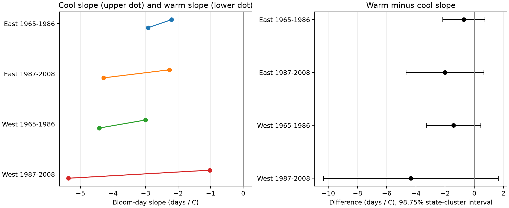

# Warm and cool spring slopes had no clear difference in four US lilac samples in 1965-2008

We tested whether lilac first-bloom dates had different temperature slopes in warm and cool springs. We used 9,015 repeated plant records in separate eastern and western US samples in 1965-1986 and 1987-2008. Models used plant and year effects, winter temperature, and separate March-April temperature slopes above and below each site mean. Warm minus cool slopes were -0.72, -2.02, -1.42, and -4.35 days per degree C. All four state-cluster intervals, adjusted for four tests, included zero. Two-way state and year intervals also included zero. Removing flagged dates, changing record-length rules, giving equal plant weights, and trimming large anomalies did not give a clear common difference. The raw-data rebuild matched the reused panel byte for byte. Monthly weather, unknown visit delays, selected sites, different lilac types by region, and few clusters limit the result. We do not test daily heat waves, pollution, biodiversity loss, or causal climate effects.

## Question and prior work

Can a single spring-temperature slope hide a different response in warm and cool years? This matters when a linear timing model is used to describe a warmer climate. A constant heat requirement can itself produce a nonlinear temperature response. Thus, a change in slope need not show a change in winter chilling or a biological constraint. This point motivates our test; see [Rethinking the interpretation of spring phenological temperature sensitivity](https://doi.org/10.1038/s44383-025-00004-6).

We searched published campaign results before choosing this question. SCI 551302875a5c81f37d7854aa0bbefe4669a61810d9d3573f192717bbbf19b501 tested winter-by-spring interactions. We fully verified that bundle and reused its panel and build code. SCI d5a0869da667653e53e0b889c192517346d4686cf02d4c448b1f27f335d0e966 tested date-delay bounds. We use its coefficient-weight approach for a further bias check. This is a new analysis of overlapping data, not independent validation of either paper. Search notes and a plan saved before fitting are in files/. The study is exploratory and was not registered.

## Data and selection

[Rosemartin et al. (2015)](https://doi.org/10.1038/sdata.2015.38) describe the USA-NPN legacy lilac and honeysuckle data and their observation rules. We use the v13 measurement workbook and v14 field definitions from USGS ScienceBase. We keep source programs 7 or 8, first bloom, years 1965-2008, days 1-250, latitude 24-50 N, longitude 66-125 W, and a known state. We remove all ambiguous duplicate plant-year keys. The plant key includes site, individual, and species.

East means longitude at least -100 and cloned lilac, Species_ID 35. West means longitude below -100 and common lilac, Species_ID 36. The field metadata call source program 7 Western and 8 Eastern; those program labels are distinct from our longitude split. The prior panel uses this same split. The regional species and historical bloom rules differ, so these samples cannot establish a biological East-West contrast. Each region is divided into 1965-1986 and 1987-2008. Within each cell we keep plants with at least five records. There are 9,015 selected records. Later West contains 18 observed years; the other cells each contain 22. Missing years are not filled.

Temperature is the NOAA PSL GHCN CAMS 0.5-degree monthly land air temperature product, version 3.01, shared snapshot 20261105. [Fan and van den Dool (2008)](https://doi.org/10.1029/2007JD008470) describe the product. The build selects the nearest grid cell and converts Kelvin to C. Spring is the equal-month March-April mean. Winter is the previous December through February mean. Site anomalies use all weather years 1965-2008, including years with missing bloom data. Some bloom events precede the end of April. These are seasonal associations, not forecasts or strictly prior exposure effects. A monthly anomaly is not a daily heat-wave measure.

files/provenance.json gives the exact shared paths, source URLs, versions, sizes, and SHA-256 hashes for the three raw inputs. Raw files were reused in place. The full raw rebuild gave a byte-identical 10,254-row candidate panel; files/raw_validation.json records both panel hashes. The four sample tables preserve the exact primary evidence.

## Model and uncertainty

For spring anomaly S, define C=min(S,0) and W=max(S,0). In each cell we fit reported bloom day to C, W, winter anomaly, plant effects, and year effects. The model is continuous at zero. Its contrast is delta=b_W-b_C. Positive delta means a weaker advance in warm years. Negative delta means a stronger advance. The split is fixed at the weather mean, not selected to maximize a result. It is a simple description, not a fitted thermal model or a proof of a threshold.

We remove plant and year means by repeated projections and fit the remaining three columns by least squares. State-cluster covariance uses cluster sums of regression scores and G/(G-1), with no extra correction for absorbed indicators. The t reference has G-1 degrees of freedom. Four two-sided tests use 98.75% intervals and p-values multiplied by four. We also report state variance plus year variance minus state-year variance, with a t reference based on the smaller cluster count. All primary contrast variances in this check are positive. Few clusters, spatial dependence across states, and estimated fixed effects can reduce interval coverage.

## Results

All slopes and differences below have units of days per C. A negative slope links warmth to earlier reported bloom.

| Sample | Records | Plants | States | Cool slope | Warm slope | Difference | Adjusted interval |
| --- | ---: | ---: | ---: | ---: | ---: | ---: | --- |
| East 1965-1986 | 2679 | 220 | 24 | -2.20 | -2.92 | -0.72 | -2.16 to 0.72 |
| East 1987-2008 | 723 | 58 | 16 | -2.27 | -4.29 | -2.02 | -4.68 to 0.65 |
| West 1965-1986 | 5085 | 503 | 12 | -3.00 | -4.43 | -1.42 | -3.30 to 0.45 |
| West 1987-2008 | 528 | 74 | 10 | -1.03 | -5.37 | -4.35 | -10.34 to 1.64 |

All four point differences are negative, opposite to the proposed weakening in warm years. Each adjusted interval includes zero. Adjusted p-values range from 0.177 to 0.757. The two-way state and year intervals also include zero in all cells. We cannot establish a common difference or equal slopes. The intervals still permit large changes, especially in the small later western sample.

Each of four sensitivity variants also gives intervals that include zero in every cell: remove flagged records; require three rather than five observed years; give each plant equal total weight; restrict spring anomalies to within 3 C of zero. Most point differences stay negative, but trimming changes the early eastern estimate to +0.09 days/C. Thus, the directional pattern has limited support near the mean. The main West early sample has 3,524 cool and 1,561 warm records; West late has 144 cool and 384 warm records. Unequal exposure support limits simple comparison of slope precision. All 20 fits, support counts, temperature ranges, and condition numbers are in results.csv. Sensitivity tests are descriptive; they do not add independent replications.

## Observation bias and numerical checks

Plant effects control fixed site and plant differences. Year effects remove the common annual timing signal within each cell. Equal plant weights reduce the influence of long records. Flag removal tests recorded quality concerns. None of these checks measures visit frequency, missing events, garden care, or temperature-dependent reporting delay. Selected long records may differ from short records.

As an additional diagnostic after the planned fits, let w be the linear weights that map bloom dates to the fitted delta. They sum to zero. If each date is late by any amount between zero and D days, the attainable delta range is [delta-D sum(w_positive), delta+D sum(-w_negative)]. We report the smallest D that permits zero in this fixed-sample coefficient. The caps are 0.44, 1.13, 0.99, and 3.25 days in table order. These are algebraic sensitivity values, not measured delays or confidence limits. Short unknown delays can change the direction of the fitted contrast. No inference about actual delays follows.

All fits agree with a separate sparse regression with explicit plant and year indicators within 1e-6 days/C. Primary errors are below 1e-9. Plant-year keys in each primary sample are unique. A repeated analysis of the rebuilt panel gave identical numerical outputs. These checks test implementation, not causal or sampling assumptions.

## Scope and next test

The four cells have separate records, but some sites occur in both periods and weather can be correlated across regions. They are not independent experiments. These ornamental plants do not represent native biodiversity. Coarse monthly temperature does not measure daily forcing, chilling hours, frost, soil water, or air pollution. Different phase rules, few clusters, missing visit histories and non-random sites limit general use. No result here establishes a causal human climate effect or a species-distribution change.

A useful next study would use independent repeated-visit records and daily weather, preserve negative observations, and compare continuous forcing models against the present two-slope description on held-out years. The present evidence gives a checked null result and a reusable test, not a verified mechanism.

## Reproduction and worker record

See files/REPRODUCE.md for an offline fit, raw rebuild, retrieval recipe and expected checks. The package includes source code, pinned software, derived data, hashes, results and a figure. NOAA data were provided by NOAA PSL, Boulder, Colorado, USA. Source data retain their source terms. Attribution for reused SCI code and data is above and in the metadata.

Campaign: 11_07_2026. Job: sci-1107-syam2-climate-pollution-biodiversity-ff045aa439e8. Topic: climate-pollution-biodiversity. Machine: syam2. Account: codex-myxtap. Model: gpt-6.1-sol with high reasoning effort, through T3 Code and the Codex harness. Date: 2026-11-08 UTC. All substantial computations used campaign-compute, with one numerical library thread. No agents were launched. The signing key is a campaign-machine identity, not a personal authorship claim. This publication is saved locally with no remote upload or index submission.
