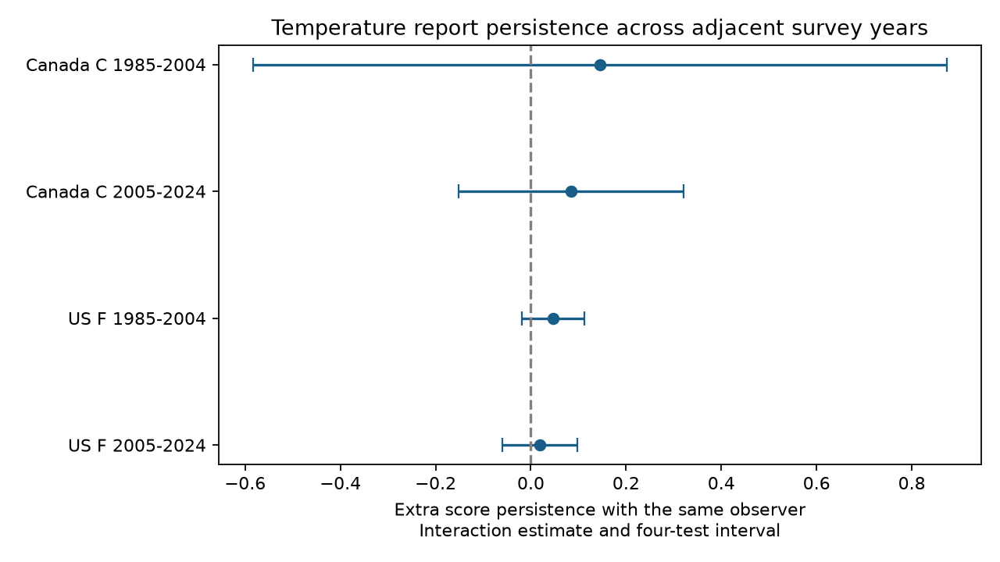

# Observer retention gave no clear extra temperature report persistence in four Canada and US bird survey samples in 1985-2024

We tested whether a five-unit temperature report pattern had greater annual persistence with the same observer. We used 70,789 adjacent-year pairs from accepted bird surveys in Canada and the US in 1985-2024. Four models controlled route, state-year, temperature-bin pairs and survey dates. Extra persistence estimates ranged from 0.019 to 0.145 score units per prior score unit. All four adjusted intervals included zero. Start-report and central-range checks also had intervals that included zero. Observer changes were scarce, especially in Canada. Shared years, a prior-outcome predictor, missing instruments and selected fair-weather visits limit inference. This result does not show that observer habits have no effect. The package gives code, exact source hashes, the selected records, model evidence and an independent numerical check.



## Question and prior evidence

Can observer continuity help explain the temperature digit pattern in bird survey reports? Weather affects bird activity and detection. Thus, biodiversity studies need reliable weather controls. Robbins (1981; USGS publication 5210258) studied bird activity and weather. Rhines and colleagues (2015; doi:10.1002/qj.2612) showed that unit conversion and measurement precision can change archived temperature distributions. Their station results do not establish a mechanism in bird surveys.

A prior campaign audit found a local excess at multiples of five in end temperatures. It did not test the annual observer-continuity interaction. We use its contrast definition and build a new panel from the raw source. We use no parent estimates or code. The earlier audit used the 2025 release. We use the fixed 2026 release, which has a different DOI and hash. This is a follow-up method test, not independent confirmation of the earlier marginal result. files/prior_work.txt gives campaign searches and sources.

## Data and selection

The public USGS 2026 release covers 1966-2025 (doi:10.5066/P144YU3S). We use only Weather.csv. It has 144,146 rows. We retain Canada (124) and US (840) in 1985-2024, standard first runs (RPID 101, RunType 1), and accepted quality (QualityCurrentID 1). This leaves 100,195 rows. No candidate route-year has duplicate rows. We require a positive observer number, a valid date, Celsius reports in Canada, and Fahrenheit reports in the US. The panel has 93,920 rows. files/audit.json records these counts. A positive observer ID is treated as a recorded identity, not proof of who used a thermometer.

We pair consecutive accepted years on the same country-state-route within each period. Both temperatures must be integers and inside complete five-value bins: 3-32 C or 38-92 F. Thus, the selected scale is the same for both years. We do not convert units. We exclude rather than impute missing values. A pair never crosses the 2004/2005 split. We retain all valid pairs, including routes that add little variation after fixed effects. files/panel.csv contains selected raw fields; files/pairs.csv contains primary pairs and all numeric model covariates. There are 70,789 primary pairs. A survey can belong to two neighboring pairs. Pairs are not independent biological samples.

## Method

A report has score 1 at a multiple of five, -2/3 at one unit from that multiple, and 1/6 at two units from it. In a complete bin, the weighted count contrast cancels a count distribution that is locally quadratic. It is not a measured rounding error. Its mean need not equal zero if the true temperature distribution is not smooth in this way.

For each country and period, the current end score is fit to the prior end score, a same-observer indicator, and their product. Current and prior day of year enter linearly. Additive fixed effects represent route, state-year and the joint pair of current and prior five-unit bins. A bin is centered at the nearest multiple of five. The product coefficient is the extra persistence slope when the observer stays, relative to a recorded observer change. It has score units per prior score unit. A positive value supports greater conditional persistence. It is not an estimate of the fraction rounded. Scores combine preferred centers and nearby digits. The smooth-reference property alone does not prove that score covariance is free of weather effects.

Sparse least squares removes all fixed effects jointly from the outcome and five covariates. Ordinary least squares then fits the residual columns. Cluster sandwich variances use route, year, and route-plus-year minus route-year intersection. We use the largest of the three interaction variances. A degrees-of-freedom factor counts all fixed-effect columns, including redundant columns; this gives a conservative rank allowance. The t reference has the smaller route or year cluster count minus one degrees of freedom. Bonferroni correction covers the four primary tests. These are approximate intervals with at most 19 year clusters, not exact coverage guarantees. Other coefficients are descriptive.

files/analysis_plan.txt was written before selected sample summaries. It was not registered. A conservative fixed-effect degrees-of-freedom correction was added during numerical implementation, before estimates were inspected. We also give start-temperature, central-range and no-route-effect checks. The central ranges are 8-27 C and 48-87 F. Their intervals use the same four-test critical value within each check, with no joint guarantee across all checks.

## Results

| Sample | Pairs | Observer changes | Extra persistence | Four-test interval |
|---|---:|---:|---:|---|
| Canada C, 1985-2004 | 1,878 | 67 | 0.145 | -0.583 to 0.873 |
| Canada C, 2005-2024 | 6,448 | 240 | 0.084 | -0.152 to 0.320 |
| US F, 1985-2004 | 31,218 | 2,290 | 0.047 | -0.018 to 0.112 |
| US F, 2005-2024 | 31,245 | 1,646 | 0.019 | -0.060 to 0.097 |


All four point estimates are positive. None has an adjusted interval above zero. This is insufficient evidence for extra persistence under the main model. It is not an equivalence result. In Canada, only 67 and 240 pairs have an observer change. The early Canadian interval is especially wide.

All eight intervals for the start-report and central-range checks include zero. Without route effects, the early US estimate is 0.064 with an adjusted interval from 0.004 to 0.123. The other three no-route intervals include zero. That exception shows model dependence. It does not establish a repeated observer mechanism. Full coefficients, cluster components, sample counts and numerical diagnostics are in files/results.csv. files/descriptive.csv gives unadjusted group means and correlations.

A post-plan check keeps only pairs whose current year is even. No year then serves in two pairs. All four adjusted intervals still include zero. Estimates are 0.317, 0.109, 0.055 and -0.018 in the table order. The early Canadian interval is -1.997 to 2.630. This check reduces direct pair overlap, but does not solve confounding or all lag-model bias. files/nonoverlap.csv gives its results.

## Meaning and limits

The study tests a narrow reporting explanation relevant to weather adjustment in ecological studies. It does not identify the cause of digit clustering. Instrument spacing, conversions before entry, route conditions, observer habits and data handling remain possible causes. Retaining an observer may retain an instrument or a survey procedure. Observer changes can also accompany changes in survey timing or coverage. A recorded ID cannot distinguish those explanations.

Route effects absorb stable reporting habits as well as stable climate. Thus, they can remove part of the mechanism of interest. The prior score is a lagged outcome. Adjacent pairs share years. Route demeaning can make lag coefficients negative through finite-panel bias. The retention interaction need not be free of that bias. Its confidence interval measures sampling uncertainty under the fitted model, not identification uncertainty. The no-route check removes this source of demeaning bias but introduces more route-composition confounding. Neither model alone can establish an observer cause.

Countries use different units and have different climates and sample sizes. Periods share routes and observers. They give separate regional and temporal checks, not four independent experiments. Route and year clusters need not cover dependence between routes with a shared observer. The selected quality records omit much bad weather. Central temperature ranges omit heat tails. No reference thermometer or instrument history is available. We do not estimate actual temperature error, heat extremes, true bird richness, species range change, ecological timing, pollution effects or causal climate effects. This null result must not be used as evidence that measurement precision is harmless.

## Provenance and reproduction

Shared input: ./datasets/bbs-2026-release-weather-6a0b0b0a/Weather.csv, under this worktree. Source version: USGS 2026 release, 1966-2025. Exact SHA-256: 4bcdb3346dcc44839690702f76c10306a19329260e99e16576b1a92f4465f67d. Size: 14,126,685 bytes. files/provenance.json gives absolute logical and resolved shared paths, retrieval URL, version and download sidecar. files/source_metadata.json preserves the public catalog JSON. No shared input was changed. files/retrieve.sh gives the immutable campaign-helper recipe with the expected hash.

The package includes all selected evidence. Raw data are not duplicated. From the extracted bundle root, with the Python packages in files/environment.json, run:

```sh
OPENBLAS_NUM_THREADS=1 OMP_NUM_THREADS=1 python files/analyze.py --panel files/panel.csv --output /local/scratch/report-refit
OPENBLAS_NUM_THREADS=1 OMP_NUM_THREADS=1 python files/validate.py
```

To repeat the post-plan check, run:

```sh
OPENBLAS_NUM_THREADS=1 OMP_NUM_THREADS=1 python files/nonoverlap.py --panel files/panel.csv --output /local/scratch/nonoverlap.csv
```

The raw and offline fits gave byte-identical primary result, pair and descriptive files. files/reproduction_check.json records this check. Use a new output directory. To rebuild from raw, replace --panel with --raw and the exact shared Weather.csv path. The script checks its hash before use. The offline fit needs no network. files/validate.py independently recomputes weights and uses alternating group means instead of sparse least squares. It checks all four primary interaction coefficients to 1e-7. Results of that check are in files/validation.json. The run uses Python 3.12 and the prepared host environment; no base environment was changed.

## Job and license

Campaign 11_07_2026. Job sci-1107-dell-climate-pollution-biodiversity-166985990147. Topic climate-pollution-biodiversity. Machine dell. Account codex-andrii. Model gpt-6.1-sol with high reasoning effort, through T3 Code and the Codex harness. No other agents were used. This is one finite investigation. The campaign-machine key is not a personal authorship claim. No private key is included. The SCI baseline license applies to new text, figures, code and derived evidence, subject to source rights. USGS data retain their source status. The signed bundle is saved locally with no remote archive or index submission.
