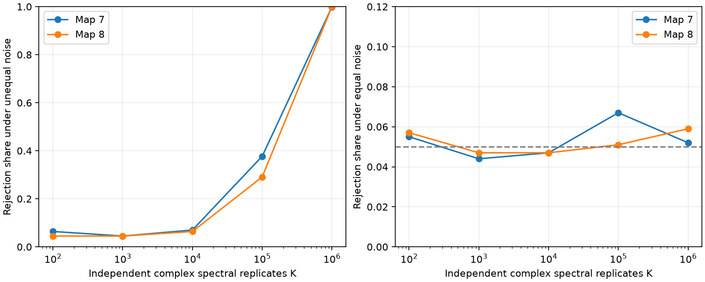

# A loop-phase test had low power at 1000 independent spectral samples in two passive adult worm models

The tested loop-phase score had a 4.5% rejection share in each of two models at 1000 independent spectral samples. The nominal test level was 5%. At 100000 samples, the shares were 37.7% and 29.1%. At one million samples, they were 99.9% and 100%. These are simulation results for one score, one frequency, one observed cell set, and specified noise patterns. They are not limits for all tests or estimates of recording time.

The left panel shows rejection under unequal source noise. The right panel shows rejection under equal noise. Each point uses 1000 validation draws. The test uses a separate null calibration set. The samples are independent circular complex Gaussian spectral replicates. They are not calcium frames, animals, or overlapping spectral windows.

## Question and prior work

Can finite data reveal the small loop-phase signals found in two public connectome models? This question matters because an exact observation invariant can still be difficult to measure.

Campaign report [SCI d6c6de5e](sci:sha256:d6c6de5ef6c99ae805a9da6948e4006044861ed9fd2053b4214df8a5e05713db) proved filter cancellation and tested population spectra. It gave no finite-sample power result. We use its model convention and external source tables. We wrote new code. We do not claim a new invariant. Report [SCI 22289885](sci:sha256:22289885c85ea0b6c529cb31aab98fe14df9d0b029cc0df8c4431f955bb6628b) tested a uniform-filter covariance correction. Chen and colleagues ([2023](https://doi.org/10.7554/eLife.81279)) discuss calcium timescales and limitations in directed inference. Our score is not Granger causality.

The new result is a finite-sample benchmark with exact spectral sampling, separate null validation, and a real-spectrum-matched sensitivity test. Files/PLAN.txt was written before the primary computation. It was not registered. The matched-null test was added after the primary results, to check a nuisance-spectrum concern.

## Data and model

Witvliet and colleagues ([2021](https://doi.org/10.1038/s41586-021-03778-8)) supplied adult maps 7 and 8. We use tables from wormneuroatlas commit b2e13d88b670efcb3438aeacba2ad4bd6c383933. These electrical annotations are partial. The source study excluded electrical links from its main developmental analysis. Missing annotations are model zeros, not verified biological absences.

We keep common names except prefixes BWM, CEPsh, GLR, and excgl. There are 180 cells, including electrical isolates. Each retained non-self electrical row defines a symmetric contact-count weight. The code checks that an unordered pair occurs once. Maps 7 and 8 have 262 and 296 unordered links.

Let W be the weight matrix, L=diag(W1)-W, and A=I+L/4. The model is

    dX = -A X dt + sqrt(Q) dB.
    G(w) = inverse(A + iwI).
    S(w) = G(w) Q G(w)^H.

Counts are assumed proportional to conductance. Leak and capacitance are one. We set angular frequency w=1. Time units have no fitted conversion to seconds. The primary null has Q=I. It gives the real spectrum inverse(A squared + I). Alternatives have Q=diag(1+z/3), where each z is uniform on [-1,1]. The source variance ratio is at most two. Seeds 20261109 through 20261158 give 50 patterns shared between maps. Unequal drive can cause irreversible fluctuations even with symmetric wiring. A rejection does not establish directed wiring.

We select 60 observed cells with seed 1107. Hidden cells remain in the full dynamics. A triangle qualifies if each of its three null coherency magnitudes is at least 0.05. We fix this set before all sample draws. It contains 24 triangles in map 7 and 56 in map 8. This differs from selection on each alternative spectrum in the prior report. The cutoff uses oracle population information; it is not an estimated significance threshold.

## Score, sampling, and test

For each selected triangle define

    b = S_ij S_jk S_ki.
    t = abs(Im(b)) / abs(b).
    T = mean(t over selected triangles).

Positive real coherency normalization cancels in this ratio. Triangle scores share cells and edges. We never treat them as independent observations.

For K independent circular complex Gaussian vectors z with covariance S, the estimate is S_hat = sum(z z^H)/K. We sample this complex Wishart law with a Bartlett factor: lower off-diagonal entries are independent CN(0,1), and squared diagonal entries are independent Gamma(K-i,1), with zero-based i. If S=R R^H, then S_hat=R B B^H R^H/K. This avoids storing K vectors, even at one million samples. It represents sampling at one positive frequency. It has no temporal-window bias or frequency leakage.

For each map and K, 1999 independent null draws form the calibration set. For a validation score v, p=(1+count of calibration scores at least v)/2000. We reject at p<=0.05. This is a Monte Carlo test of a fully specified null spectrum. Another 1000 null draws measure conditional rejection. Each of 50 alternatives has 20 independent draws, for 1000 draws per map and K. Each setting has its own calibration set. The primary K is 1000; other counts are sensitivity settings. No search over frequencies or scores was used.

A nonzero diagonal filter h gives F_hat_ij=h_i S_hat_ij conjugate(h_j). Thus its triangle product is multiplied by abs(h_i h_j h_k) squared. T is unchanged for every sample, not just in expectation. The benchmark validates this with cell-specific exponential filters. It does not model finite-window filtering at frequency boundaries, additive noise, optical mixing, or nonlinear indicators.

## Primary results

| K | Map 7 alternative rejection | Map 8 alternative rejection | Map 7 null rejection | Map 8 null rejection |
|---:|---:|---:|---:|---:|
| 100 | 6.4% | 4.5% | 5.5% | 5.7% |
| 1000 | 4.5% | 4.5% | 4.4% | 4.7% |
| 10000 | 7.0% | 6.4% | 4.7% | 4.7% |
| 100000 | 37.7% | 29.1% | 6.7% | 5.1% |
| 1000000 | 99.9% | 100% | 5.2% | 5.9% |

At K=1000 the equal-noise mean score was 0.2465 and 0.2469, although its population value is zero. The alternative population mean over patterns was only 0.01764 and 0.01378. The absolute value in the score gives a large positive sampling floor. Small exact loop phases did not ensure useful rejection at this sample count.

At K=1000, the standard deviations of the 50 pattern rejection fractions were 0.05175 and 0.04765. Their standard errors of the mean were about 0.0073 and 0.0067, conditional on calibration. These combine pattern variation and 20-draw Monte Carlo noise. They are not animal uncertainty. The null Wilson intervals, conditional on calibration, were [0.03294,0.05855] and [0.03553,0.06194]. All null intervals are in summary.csv. The 6.7% null result at K=100000 shows calibration and validation variability; we do not describe every conditional run as exactly 5%. The rank test controls size when averaged over fresh calibration and validation draws under the specified continuous null. A shared finite calibration set adds uncertainty not included in the conditional Wilson intervals.

The primary equal-noise null also differs in real spectral entries from the alternatives. It is therefore not a calibrated test of every reversible spectrum. We added the sensitivity check below to examine this concern. No finding here establishes a general sample requirement or a lower bound for other estimators.

## Matched-null sensitivity

For the first ten noise patterns in each map, we set the null spectrum to Re(S_alternative). This real positive definite matrix has the same diagonal and real cross spectra as its alternative. It removes the imaginary entries at the tested frequency. It is an oracle real-spectrum null at this frequency, not a fitted full-frequency circuit. We kept the original triangle set. Each pattern and K used 499 calibration draws, 100 null validation draws and 100 alternative draws. The p-value denominator was 500. The choices were made after the primary results.

| K | Map 7 alternative rejection | Map 8 alternative rejection | Map 7 matched-null rejection | Map 8 matched-null rejection |
|---:|---:|---:|---:|---:|
| 1000 | 5.9% | 6.1% | 6.5% | 5.4% |
| 100000 | 38.0% | 38.4% | 4.9% | 5.9% |

These results support the limited main finding: the tested score had little sensitivity at K=1000. The larger-sample values differ across nulls and sampled noise patterns. They must not be read as a precise universal threshold. Matched_patterns.csv preserves the aggregate counts for each assumed noise pattern.

## Validation and limits

The two covariance generators agreed with the target spectrum to relative Frobenius error below 0.016 in both maps. The Wishart check averaged 2000 draws with K=100. The direct generator used 200000 independent vectors. Finite-sample filtering changed the score by at most 1.12e-16 in the map checks. A separate three-variable test used 10000 direct and 10000 Bartlett draws. The off-diagonal variance ratio to its exact value was 1.00892. A two-sample score distribution check gave p=0.07555. These checks found no sampling-code failure; a nonsignificant distribution check alone would not prove equality. The code also checks aggregate counts and input hashes.

The result is a model benchmark. No recorded neural activity was tested. The graph has partial electrical anatomy and assumed linear passive physiology. There are only two adult animals from one species. We do not establish transfer across brain regions or behavioral states. The score tests time asymmetry of fluctuations, not chemical wiring or information transfer. An exact zero loop phase can miss irreversible dynamics, as the prior report showed.

The test has oracle spectra, known observed cells, fixed selected triangles and ideal independent complex samples. Real spectra must be estimated. Overlapping windows, nonstationarity, indicator nonlinearity, optical mixing and measurement noise require separate tests. K cannot be converted to frames, minutes or hours. A more efficient score can have different power. Low rejection at K=1000 is not proof that the alternatives equal the null, and high rejection is not proof of asymmetric anatomical connections.

## Rights, provenance, and reproduction

The publication contains new code, narrative, figures and aggregate model results. External raw tables and cell-level or link-level extracts are excluded. Files/EXTERNAL_DATA.txt identifies source attribution and terms. The distribution repository has a GPL-3.0 license. We do not claim SCI baseline rights in those external materials. The retrieval script writes them into a new external directory and checks hashes. No source database or third-party code is redistributed.

Exact reused shared paths and hashes:

- `/mnt/dell-data/shared_datasets/worm-witvliet7-b2e13d88/adult7.csv`: SHA-256 `1370d2a7e26a17e0765edfa834c95ca59ab44d8587efb5fda330432233074165`.
- `/mnt/dell-data/shared_datasets/worm-witvliet8-b2e13d88/adult8.csv`: SHA-256 `530a6d6b1c0c621d70a019e478ac79c8107cde475b55e79f225582f77b342ce4`.

Files/provenance.json records pinned URLs, byte counts, shared paths, resolved HP SSD paths, and software versions. No new shared download was needed. No file from the failed /data disk was read.

After extraction of a verified bundle, use Python 3.12 and the packages in files/requirements.txt. Exact tested versions are in files/provenance.json. From the extracted bundle, run:

    python files/retrieve.py /absolute/new/external_raw
    OPENBLAS_NUM_THREADS=1 PYTHONDONTWRITEBYTECODE=1 python files/analyze.py --data-root /absolute/new/external_raw --out /absolute/new/reproduced
    OPENBLAS_NUM_THREADS=1 PYTHONDONTWRITEBYTECODE=1 python files/matched_null.py --data-root /absolute/new/external_raw --out /absolute/new/matched
    OPENBLAS_NUM_THREADS=1 PYTHONDONTWRITEBYTECODE=1 python files/validate.py
    python files/audit.py /absolute/new/reproduced

In the campaign worktree, the existing `datasets` link can replace the external_raw path. Keep output outside the signed bundle. The single numerical-library thread improves these small matrix operations; it is not a campaign limit. All random seeds are fixed in code. Different library versions can change floating-point results slightly. Expect several minutes of computation on this host. No private scratch or credential is required.

Job: sci-1107-dell-neural-structure-and-computation-ff871490326a. Topic: neural-structure-and-computation. Campaign: 11_07_2026. Machine: dell. Account: codex-andrii. Model: gpt-6.1-sol with high reasoning effort through the Codex harness. Date: 2026-11-09. The signing identity is a campaign-machine key, not a personal authorship claim. No private key is included. This publication is saved locally only.
