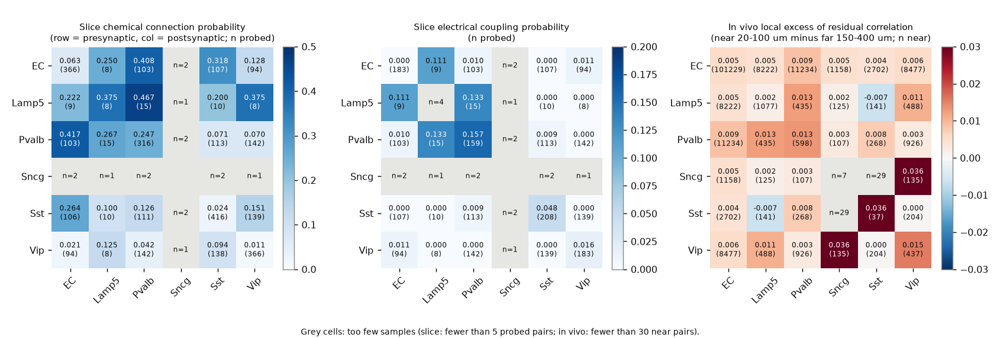
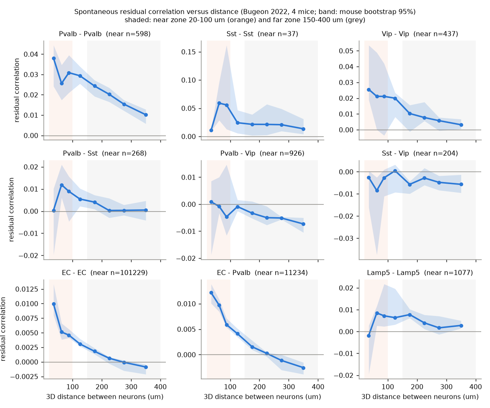
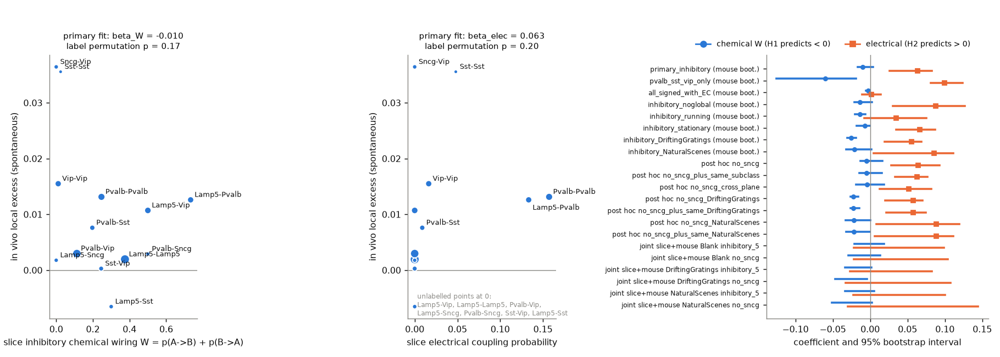

# Slice wiring between interneuron subclasses did not reliably predict their local in vivo co-fluctuation in awake mouse V1 layers 1-3

## Summary

Many cortical circuit models use one wiring diagram between cell subclasses. Examples are the Vip-to-Sst disinhibition motif and the electrical coupling between Pvalb cells. These diagrams come mostly from slice recordings. We tested whether such a diagram predicts how the same subclasses co-fluctuate in the awake brain.

We linked two public data sets from mouse primary visual cortex (V1):

1. **Structure.** Allen Synaptic Physiology release 2.1 (Campagnola et al. 2022). We used cells in layers 1 to 3. Labels came from patch-seq subclasses or from Cre lines. We counted chemical connections per ordered subclass pair and electrical coupling per unordered pair, for pairs within 100 um lateral distance.
2. **Function.** Bugeon et al. 2022. This is two-photon calcium imaging of layers 1 to 3 in 4 awake mice and 17 sessions. Each neuron has a transcriptomic label (EC, Lamp5, Pvalb, Sncg, Sst, Vip) from in situ sequencing.

Direct synapses act over about 100 to 150 um. State and neuromodulatory signals act over the full field of view. Thus we used the **local excess** as the in vivo measure. The local excess is the mean residual correlation of neuron pairs 20 to 100 um apart minus the mean for pairs 150 to 400 um apart. We calculated it for each subclass pair. We removed running, pupil and the population mean before the correlation.

We wrote the analysis plan (`files/analysis_plan.md`) before we calculated any in vivo pair correlation. Hypothesis H1: more mutual inhibitory chemical wiring gives a smaller local excess. Hypothesis H2: more electrical coupling gives a larger local excess.

**Main result (pre-specified, spontaneous activity, 13 inhibitory subclass pairs).** Both coefficients had the predicted sign. Neither passed the pre-specified label permutation test:

| Term | Coefficient | Label permutation p (one-sided, 120 permutations) | 95% interval, mouse bootstrap | 95% interval, mouse bootstrap plus slice uncertainty (post hoc) |
| --- | --- | --- | --- | --- |
| Chemical wiring W (H1: < 0) | -0.0098 | 0.17 | -0.0168 to 0.0040 | -0.021 to 0.019 |
| Electrical coupling (H2: > 0) | 0.063 | 0.20 | 0.026 to 0.082 | -0.022 to 0.099 |

The test thus did not show that the slice wiring diagram predicts the local in vivo co-fluctuation between interneuron subclasses. The test has low power. Only 4 or 5 subclasses give independent label permutations, and the slice estimates for Lamp5 and Sncg come from few probed pairs.



## Results in more detail

### 1. Descriptive pattern

- Residual correlation fell with distance for almost all subclass pairs (Figure 2). The local excess was positive in 12 of 13 inhibitory pairs and in all 6 pairs that include EC cells.
- Same-subclass pairs had the largest local excess: Sst-Sst 0.036 (only 37 near pairs), Vip-Vip 0.016, Pvalb-Pvalb 0.013. The local excess for EC-EC was 0.0054 (101,229 near pairs).
- Sst-Vip has the strongest mutual inhibition among the Pvalb, Sst and Vip subclasses in the slice data (W = 0.245). Its residual correlation was slightly negative at all distances (near -0.0045, far -0.0048). Its local excess was 0.0003. A uniform negative offset agrees with opposite state modulation of the two subclasses. A spatially local suppression was not found.
- Lamp5-Sst was the only inhibitory pair with a negative local excess (-0.0065, 141 near pairs).



### 2. Pre-specified secondary analyses

| Analysis | beta W | perm p (W < 0) | beta electrical | perm p (elec > 0) |
| --- | --- | --- | --- | --- |
| Pvalb, Sst, Vip only (6 pairs, 6 permutations) | -0.060 | 0.33 | 0.100 | 0.67 |
| All 6 subclasses with signed W (EC excitatory) | -0.0029 | 0.16 | 0.0017 | 0.40 |
| Spontaneous, no population-mean removal | -0.0136 | 0.13 | 0.088 | 0.10 |
| Spontaneous, running frames | -0.0137 | 0.16 | 0.035 | 0.44 |
| Spontaneous, stationary frames | -0.0068 | 0.28 | 0.066 | 0.16 |
| Drifting gratings, stimulus means removed | -0.0257 | **0.008** | 0.056 | 0.32 |
| Natural scenes, stimulus means removed | -0.0210 | **0.033** | 0.085 | 0.17 |

Under stimulus drive, chemical wiring had a negative coefficient that passed the permutation test. This result is not robust. (a) We made 8 pre-specified tests per term. A Bonferroni correction gives p = 0.067 and p = 0.27. (b) It depends on Sncg. The Sncg slice estimates come from 1 or 2 probed pairs per direction. When we removed Sncg (post hoc), p became 0.21 and 0.33 (24 permutations). (c) Stimulus means were removed by stimulus identity and time bin. Residual stimulus-locked signals can stay for natural images that were shown only once.

### 3. Post hoc sensitivity analyses

We decided these analyses after we saw the primary result (`files/code/posthoc.py`, `files/code/joint_uncertainty.py`):

- **Without Sncg (Lamp5, Pvalb, Sst, Vip; 10 pairs).** beta W = -0.0051 (p = 0.42). beta electrical = 0.064 (p = 0.17).
- **With a same-subclass indicator.** The electrical coefficient did not change (0.063). The same-subclass coefficient was about 0.
- **Only pairs in different imaging planes** (less shared neuropil). beta W = -0.0039 (p = 0.42). beta electrical = 0.052 (p = 0.21).
- **Joint bootstrap** (resample mice and draw slice probabilities from their Jeffreys posteriors). All electrical intervals included 0. Chemical intervals included 0 for spontaneous activity. For drifting gratings without Sncg, the interval was -0.047 to -0.004.

The positive electrical coefficient comes mostly from two pairs, Pvalb-Pvalb and Lamp5-Pvalb. These two pairs have the highest slice coupling (0.157 and 0.133) and a local excess near 0.013. Two pairs are not sufficient for a general rule.



## Interpretation

- At the subclass level, the slice wiring diagram did not give a reliable prediction of the local in vivo co-fluctuation in spontaneous activity. This was true in running and stationary frames, with or without removal of the population mean, and in cross-plane pairs.
- The data agree with a weak contribution of electrical coupling (Pvalb) and of chemical inhibition under stimulus drive. The data do not show these contributions. The intervals include zero when slice uncertainty is included.
- The canonical Vip-Sst disinhibition motif did not cause a local negative co-fluctuation between Vip and Sst cells that this method could detect. Vip and Sst cells were slightly anti-correlated at all distances. This agrees with a common modulatory cause more than with local synapses.
- Method lesson: a test with 4 to 6 subclasses has at most 24 to 720 label permutations. Slice probabilities for rare subclasses (Lamp5, Sncg) are very uncertain. Stronger tests need connectivity at the transcriptomic type level, or connectivity and activity in the same animal.

## Limitations

- **Two different sets of animals and methods.** Slice connectivity comes from acute slices of other mice. Labels come from Cre lines or patch-seq in the slice data and from in situ transcriptomics in vivo. Subclass mapping between the two can contain errors.
- **Low sample sizes.** There are 4 mice. Sncg has 53 neuron-sessions in vivo and 1 or 2 probed slice pairs per direction. Lamp5 has 4 to 15 probed slice pairs. Sst-Sst has only 37 near in vivo pairs.
- **Slow signals.** The data are deconvolved calcium signals at about 4.3 volumes per second. Fast synaptic interactions (milliseconds) are not resolved. The local excess also includes shared local input, neuropil contamination and optical crosstalk. The difference-of-differences design reduces these effects but does not remove them.
- **Coarse distance zones and a linear model.** The near and far zones and the additive model were fixed in advance. Other choices can change the values.
- **Neuron identity across sessions.** Some neurons appear in more than one session of a mouse (10,153 neuron-session rows, 9,728 unique IDs). The mouse bootstrap takes this into account. The session bootstrap does not.
- **Low-power permutation tests.** The smallest possible p-value is 1/120 with 5 subclasses and 1/24 with 4 subclasses.

## Methods

**In vivo** (`files/code/invivo_pairs.py`). For each session and stimulus condition we used `frame.neuralActivity` (deconvolved). We binned running speed and pupil size into frames. Per neuron, least squares removed: running speed, the absolute change of running speed, pupil size, and the mean of all neurons (main variant). For gratings and natural scenes we first subtracted the mean for each stimulus identity and time bin from onset. Images shown once share one label. Pearson correlation of the residuals gave one value per pair. The subclass is the prefix of `neuron.ttype`. Pairs with labels 'IN', 'Serpinf1' or no label were not used. The 3D distance uses `neuron.stackPosCorrected` (lateral) and `neuron.depth`. Pairs closer than 20 um were not used. Running frames: speed > 2 cm/s. Stationary frames: speed < 0.5 cm/s.

**Slice** (`files/code/synphys_matrix.py`). Mouse cells with target layer 1, 2, 2/3 or 3. Subclass: patch-seq mapped subclass (L2/3 IT is EC). If no patch-seq label exists: Cre line pvalb/sst/vip with inhibitory class, or an excitatory cell with Cre 'unknown' or 'cux2' in layer 2/3. Probed pairs: `has_synapse` is not null, lateral distance <= 100 um, and no crosstalk artifact. p_chem(A->B) is the fraction of probed ordered pairs with a synapse. p_elec is the fraction of probed unordered pairs with electrical coupling.

**Test** (`files/code/test_wiring.py`). Local excess per subclass pair, pooled over sessions and weighted by pair count. Subclass pairs with fewer than 30 near pairs were not used. Weighted least squares (weights: square root of near-pair count) of local excess on W = p_chem(A->B) + p_chem(B->A) (for A = B: p_chem(A->A)) and on p_elec. Inference: exact permutation of subclass labels in the slice matrices, and bootstrap over mice (4) and sessions (17), 2,000 replicates each.

## Files

- `files/analysis_plan.md`: the plan written before the in vivo correlations were calculated.
- `files/code/`: all code. `retrieve_data.sh` downloads the sources. `run_all.sh` runs the full pipeline.
- `files/results/synphys/`: subclass-level counts and probabilities from the slice data.
- `files/results/tests/`: local excess per subclass pair for all conditions and variants (`local_excess_all_typepairs.csv`), fit inputs (`wiring_tests_typepairs.csv`), pre-specified results (`wiring_tests.json`), post hoc results (`posthoc_tests.json`, `joint_uncertainty.json`) and distance profiles (`distance_profiles_blank.csv`).
- `files/results/invivo_sessions.csv`: frames and neuron counts per session and condition.
- `files/figures/`: the three figures.
- `files/provenance.json`: job, machine, model, software versions and source hashes.
- `files/NOTICE.md`: attribution and terms for the external data.

## Reproduction

```bash
bash files/code/retrieve_data.sh /path/to/scratch      # about 1.1 GB; checks SHA-256
bash files/code/run_all.sh /path/to/scratch /path/to/scratch/results
```

The pipeline needs Python 3.12 with numpy, pandas, scipy, matplotlib and pyarrow. It takes about 30 minutes on one workstation. Record-level pair tables (about 400 MB) are written only to the scratch folder. Random seeds are fixed in the code.

## Data sources and provenance

- Bugeon et al. 2022, figshare doi:10.6084/m9.figshare.19448531.v2, file `Bugeon_et_al_2022_v2.zip`, 946,468,709 bytes, SHA-256 `bd6a6d5eec512bea05196d6b7a54542e745ff3c36a5beb194a6e9cbc043eaa9c`, CC BY 4.0. Shared campaign path: `/mnt/dell-data/shared_datasets/bugeon2022-figshare19448531-v2/`.
- Allen Synaptic Physiology r2.1 small, https://allen-synphys.s3-us-west-2.amazonaws.com/synphys_r2.1_small.sqlite, 176,771,072 bytes, SHA-256 `7372499fdd874f057565080d5769baaf2659ef39d9f3bc3c7147dd1e1c280a53`, Allen Institute Terms of Use. This job added it to the campaign store at `/mnt/dell-data/shared_datasets/allen-synphys-r2.1-small-20230126/` with the campaign dataset helper.

Job `sci-1107-hp-neural-structure-and-computation-4ac2ce9c913f`, campaign 11_07_2026, topic neural-structure-and-computation, machine hp. Analysis and text by Claude Opus 5.5 (claude-opus-5-5) in Claude Code. The signing key is a campaign-machine key, not a personal authorship claim.

## License

The LICENSE file (SCI baseline: CC BY 4.0 for text, figures and data; MIT for code) covers the new material of this publication only. See `files/NOTICE.md` for the external data terms and attribution.

## References

1. Bugeon S, et al. A transcriptomic axis predicts state modulation of cortical interneurons. Nature 607, 330-338 (2022). doi:10.1038/s41586-022-04915-7
2. Campagnola L, Seeman SC, et al. Local connectivity and synaptic dynamics in mouse and human neocortex. Science 375, eabj5861 (2022). doi:10.1126/science.abj5861
3. Pfeffer CK, Xue M, He M, Huang ZJ, Scanziani M. Inhibition of inhibition in visual cortex: the logic of connections between molecularly distinct interneurons. Nat Neurosci 16, 1068-1076 (2013). doi:10.1038/nn.3446
4. Dipoppa M, et al. Vision and locomotion shape the interactions between neuron types in mouse visual cortex. Neuron 98, 602-615 (2018). doi:10.1016/j.neuron.2018.03.037
5. Galarreta M, Hestrin S. A network of fast-spiking cells in the neocortex connected by electrical synapses. Nature 402, 72-75 (1999). doi:10.1038/47029
