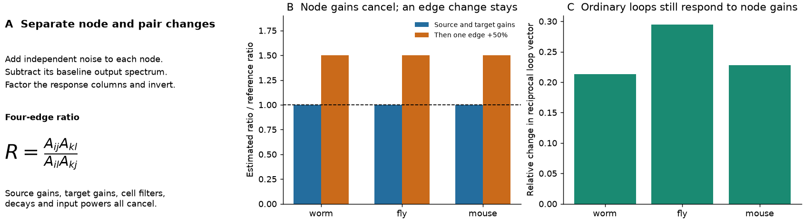
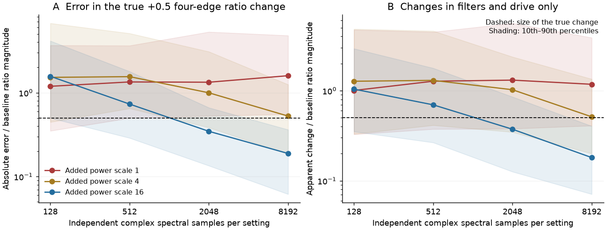
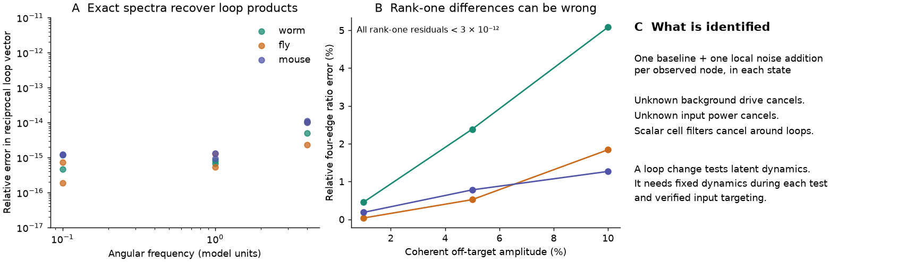

# Local noise additions identify weight ratios beyond node gains in fully observed linear circuits with scalar filters

Job: `sci-1107-hp-neural-structure-and-computation-0d6f6749bccf`. Topic: neural-structure-and-computation. Campaign: 11_07_2026. Machine: hp. Account: codex-myxtap. Model: gpt-6.1-sol, high reasoning effort. The signing key is a campaign-machine key. It does not state personal authorship. Exact input paths, versions and hashes are in `files/INPUTS.json`.

## Result

We give a controlled test for changes in a neural interaction pattern that separate source and target gains cannot explain. In a stable linear circuit, add independent noise to each observed node in turn. Subtract the output spectrum before each addition. Recover one response column from each spectral difference, then invert the response matrix. A ratio of four off-diagonal inverse entries equals a ratio of four latent connection weights. Unknown input powers, background drive, cell filters, source gains, target gains and decay terms cancel under the stated assumptions.

The proof applies at each fixed frequency. It needs all recurrent state variables to be observed, known single-node targets, and fixed circuit dynamics and background drive during each baseline and addition comparison. It does not need the extra input waveform or its power to be measured. A ratio change between brain states rejects a source-and-target gain explanation under these conditions. It does not show anatomical rewiring.

We checked the method in models on three published graphs. Source and target gain changes left the tested ratio fixed to numerical precision in the worm, fly and mouse models. A 50 percent increase in one tested edge multiplied the ratio by 1.5 in all three. The sampling test was less favorable. At the strongest input setting and 8,192 ideal spectral samples per setting, the median error in a true relative ratio change of 0.5 was 0.189. At the weakest setting it was 1.593. These are simulation results, not estimates from animal activity.

Figure 1. A ratio of four nonzero directed weights removes separate factors for each source and target. The exact state test changes real source gains, target gains, decays, observation filters and background drive. Those changes alter ordinary feedback loops but leave the ratio fixed. Increasing one numerator edge by 50 percent then multiplies the ratio by 1.5. Each graph has one selected ratio. The graphs are fixed test inputs, not biological replicates.

## Why this question matters

The selected campaign work found that indirect wiring measures predict functional coupling after direct wiring and distance controls (SCI e7136a69). A stronger surrogate test reproduced 48 to 100 percent of the gain with node strength and distance controls. The remaining gain was largest in sedated mouse fMRI (SCI 08231ec2). Such results do not by themselves identify a specific route or a state change in that route. Background input, observation gains and dynamics can all affect functional coupling.

We first considered a further mouse state reanalysis. The restored store did not contain the scan-level inputs needed for it, and the published direct-coupling study already tested reliability (SCI 40af6bdd). We therefore chose an identification method that states what additional controlled evidence would distinguish changes beyond node gains.

Spectral network reconstruction is established. [Shahrampour and Preciado (2013)](https://arxiv.org/abs/1308.2248) recover directed network information from output spectra under their model assumptions. [BACKSHIFT (2015)](https://proceedings.neurips.cc/paper_files/paper/2015/file/92262bf907af914b95a0fc33c3f33bf6-Paper.pdf) uses changes in second moments across shift interventions to identify cyclic systems. [Ogino and colleagues (2026)](https://doi.org/10.7554/eLife.110030.3) design perturbation inputs to improve neural system identification. Their main framework uses observed control signals. Higher-order steady-state statistics are another route under non-Gaussian assumptions ([Recke and Hansen, 2026](https://arxiv.org/abs/2603.17142)).

Campaign work also established that graph support can leave covariance weights unresolved (SCI b95314a3), that a two-condition solver can amplify small covariance errors (SCI 0dcdbdbd), and that unknown scalar filters cancel from passive cross-spectral loop phases (SCI d6c6de5e). Those passive loop phases can still change with source noise. Our spectral differences remove unchanged background noise before inverse-response ratios are formed.

We do not claim that spectral inversion, shift interventions, cross ratios or cycle spaces are new. The contribution is an explicit state test that combines them to remove both observation filters and separate biological source and target gains, with a proof of its target, a count of the remaining tests, exact failure examples and a reproducible error benchmark. It is a methods result. It does not measure the share of biological structure-function coupling that is due to pair-specific wiring.

## Model and proof

Let A have target rows and source columns. The latent dynamics are stable and linear. At angular frequency omega, put

    M = i omega I-A,       T = F M^-1,

where F is an unknown diagonal matrix of nonzero cell filters. The baseline spectrum is S0=T Q T*+V. Both the background input spectrum Q and the measurement-noise spectrum V can be unknown and correlated. They must stay fixed during each controlled comparison. The star denotes conjugate transpose.

An independent noise addition at node k, with unknown positive power p_k, gives

    S_k-S0 = p_k T e_k e_k.T T*.

This is a rank-one positive matrix. Its positive eigenvector recovers the kth column of T up to a nonzero complex factor. Stack the columns in target order into U. For an unknown invertible diagonal D,

    U = T D,       K = U^-1 = D^-1 M F^-1.

For four distinct nodes, use target rows i,k and source columns j,l. If all four tested connections are nonzero,

    R = K_ij K_kl / (K_il K_kj)
      = A_ij A_kl / (A_il A_kj).

Every input factor and filter cancels. All entries are off-diagonal, so decay terms also cancel. If a second state changes the off-diagonal weights only by A2_ij=r_i c_j A1_ij, the ratio remains fixed. The decay diagonal can change freely. Thus a ratio change rules out this node-gain model. One ratio does not locate which of its four edges changed.

The same inversion gives normalized local transfers Lhat_ij=-K_ij/K_ii. Directed cycle products of Lhat equal products of A_ij/(i omega-A_ii). They remove observation filters but remain sensitive to real node gains and decay. We report these weaker loop targets to show why the ratio of four weights is needed. Complete derivations and assumptions are in `files/METHOD.md`.

### How many independent node-gain tests remain

Treat each active source column and target row as separate vertices of a bipartite graph. Each nonzero off-diagonal weight is an edge. If this graph has e edges, v active vertices and c connected components, its log source-and-target design has rank v-c. There are e-v+c independent log contrasts. They can be represented by alternating cycles. Rectangles give four-edge ratios; some sparse supports need longer cycles. Equality of all such ratios is equivalent to source-and-target scaling for positive weights on a fixed support.

| Published graph product | Nodes | Directed edges | Active source and target vertices | Components | Independent log contrasts |
|---|---:|---:|---:|---:|---:|
| Cook worm, chemical plus gap counts | 302 | 5,099 | 604 | 1 | 4,496 |
| FlyWire v783, region flow | 75 | 5,505 | 150 | 1 | 5,356 |
| Knox mouse, parcel model | 304 | 92,112 | 608 | 1 | 91,505 |

These counts describe model degrees of freedom. They do not show statistical power, the number of independently sampled animal pairs, or the feasibility of targeting every node. Absence of a change in one selected ratio does not establish that all node-gain tests pass.

## Exact model tests

We used three verified compact graph products from SCI b95314a3. The source orientation is source rows; our model uses its transpose. We set the diagonal to zero and use A=-I+g W.T/rho(W). The main exact checks use gains g=0.4 and 0.8 and angular frequencies 0.1, 1 and 4. All weights are positive model values. They are not signed estimates of effective neural coupling. The graphs range from cells to regions and are not directly comparable biological samples.

The tests use unknown gains, first-order cell filters, cell delays, unequal input powers, correlated background input and measurement noise. The estimator receives only the baseline and added-input output spectra. Across all 18 settings, reciprocal-loop vector errors were below 1.2e-14. Triangle-vector errors among the first 30 nodes were below 2.4e-13. Arbitrary column phases did not affect the result. Independent signed asymmetric models also passed the reconstruction identity.

For the stronger state test, we used g=0.4 and frequency one. We chose one nonzero rectangle per graph by maximizing the smallest of its four edge magnitudes. We then changed source and target gains by factors from 0.85 to 1.15, changed decays, and changed the observation and background terms. The selected weight ratio changed by less than 4.7e-15. Ordinary reciprocal-loop vectors changed by 21.3, 29.4 and 22.8 percent in the worm, fly and mouse models. A further 50 percent increase in one numerator edge gave a ratio multiplier of 1.5, with error below 5e-15.

This state extension was exploratory. We added it after the first loop run showed that biological node gains were still a possible explanation. `files/PLAN.md` records the original plan and the extension. We did not use sample results to choose the graph, edge or ratio.

## Sampling errors

We generated six 12-node geometric directed graphs with bidirectional ring edges. Each graph has one selected strong reciprocal pair and one nonzero rectangle that contains the changed edge. The rectangle maximizes the smallest edge magnitude among eligible choices. This uses population weights and gives a favorable target. It is not a procedure for selecting measurable ratios from noisy recordings.

The three sampled states are a reference circuit, the same circuit with changed filters and background drive, and a circuit with one selected edge increased by 50 percent. The last state uses a third observation and drive setting. Each estimated spectrum is the mean of m independent proper complex Gaussian outer products. A complex Bartlett sampler gives that exact distribution. One estimated baseline is shared by all additions within a state. States and addition estimates are otherwise independent.

We tested m=128, 512, 2,048 and 8,192, and addition power scales 1, 4 and 16. Actual node powers also have fixed factors between 0.5 and 2. Every setting has 30 draws for each of the six fixed graphs. All 2,160 draws are retained. No solve failed. Large and unstable ratios are included.

Figure 2. Error in a true relative ratio change of +0.5, and apparent changes when only filters and background drive change. Lines are medians. Shading gives the 10th to 90th percentiles over 180 draws per setting. These are model mixtures, not biological confidence intervals. Samples are ideal independent complex spectral vectors, not frames, frequency bins or recording durations.

| Added power scale | Samples per setting | Median error in the +0.5 change | 10th to 90th percentile | Median apparent change with fixed circuit |
|---|---:|---:|---|---:|
| 1 | 128 | 1.191 | 0.351 to 3.662 | 1.005 |
| 1 | 8,192 | 1.593 | 0.553 to 4.797 | 1.177 |
| 4 | 8,192 | 0.526 | 0.185 to 1.250 | 0.513 |
| 16 | 2,048 | 0.346 | 0.135 to 0.663 | 0.373 |
| 16 | 8,192 | 0.189 | 0.062 to 0.362 | 0.181 |

Error is the absolute complex error divided by the true baseline ratio magnitude. At low addition power, increasing the sample count did not give small errors within the tested range. Inversion and ratios can remain unstable. At the strongest setting, median error fell, but the remaining error was still substantial relative to a change of 0.5. Stronger stimulation can also invalidate the fixed-dynamics assumption in real experiments. We did not test that tradeoff. No calibrated state-change significance test or confidence interval is provided.

## Failures that good rank checks do not exclude

Figure 3. Exact population spectra recover loop products under the model. Coherent input leakage can corrupt the ratio of four weights while every spectral difference remains rank one. Leakage sends each target partly to the next source-index node. It is a controlled sensitivity example, not an optical spread model.

A single random current can stimulate more than one node coherently. If B has the actual target vectors as columns, the inverse response contains B^-1 M in place of M. Every spectral difference still has rank one. Thus a zero rank-one residual cannot certify target selectivity. The saved leakage table gives all errors for amplitudes 0, 1, 5 and 10 percent. This error persists without sampling noise.

Hidden recurrent cells are another failure. The observed inverse response is a Schur complement. It includes hidden paths. A three-cell example has no direct link between the two observed cells, but the method gives a DC loop product of 16/441 through the hidden cell. Correlated external drive that stays fixed cancels; hidden recurrent dynamics do not.

There is also an exact weight ambiguity. Replacing A by D0 A D0^-1 for a positive diagonal D0, with matching unknown input powers and observation gains, preserves the entire set of output spectra at all frequencies. Our example changes the recurrent-weight norm by 82.7 percent while the output response changes by less than 2e-16. Ratios and loops stay fixed. An unchanged statistic cannot establish fixed individual weights.

With fewer than n separate single-node additions, unrestricted drift recovery can also fail. A saved n-1-target example has two stable drifts with identical tested response columns. This is not a lower bound for multiplexed or otherwise constrained intervention designs. BACKSHIFT and related methods can use different designs.

## Scope and limits

The method separates effective pair patterns from separate source and target gains under a controlled linear model. It does not measure biological wiring specificity in the selected animal studies. A state-dependent distance law could change the ratios without anatomical rewiring. Fixed geometry with state-dependent source and target gains could not. The test also cannot assign an observed ratio change to one edge, synaptic plasticity, neuromodulation or another cellular mechanism.

All recurrent state variables must be observed to interpret inverse entries as direct interactions. Cell filters must be diagonal and unchanged within each controlled comparison. Cross-channel mixing, altered background input, nonlinear responses, nonstationarity, changed circuit dynamics during stimulation and coherent targeting error can violate the result. Frequency averaging can destroy rank one. Finite-window bias and spectral leakage are outside the sampling benchmark.

The three external graphs validate algebra and scale. They do not validate a stimulation protocol for a worm, a fly region or a mouse parcel. The exact graph test uses only one selected ratio per graph for the source/target state comparison. The finite test has only six small positive models, an oracle choice of strong ratios, and ideal independent spectral samples. It does not establish performance with sparse biological recordings or prove an optimal experimental design.

## Files, rights and reproduction

The publication contains original code, proofs, figures, synthetic evidence and aggregate model validation scores. External matrices, node records and derivative databases are excluded. The external source terms remain separate in `files/EXTERNAL_DATA.md`. This separation is needed for FlyWire noncommercial terms and Allen Institute terms. We do not apply the SCI baseline license to those inputs.

Use `files/REPRODUCE.md` for complete commands. In brief, retrieve the exact three matrices from the verified SCI b95314a3 ZIP into an external folder, run `files/code/analyze.py` with a separate output folder, then run `validate.py` and `plot.py`. The synthetic tests need no external data. `files/requirements.txt` records package versions. `files/results/validation.json` records the independent checks. Results should agree within floating-point tolerance. No private scratch or old raw-data folder is needed if the cited source ZIP remains available.

This publication is saved locally. No remote SCI archive or index submission is part of this investigation.
