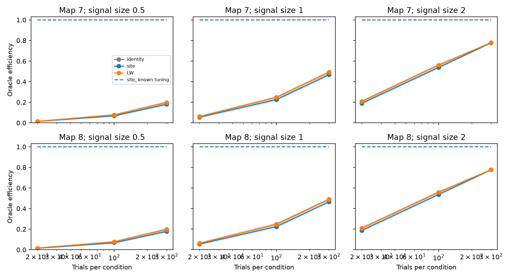

# Estimated tuning removed the readout benefit of a site covariance fit in two adult worm Gaussian models

With 20 trials per condition and unit signal size, a decoder with a fitted site covariance had lower median efficiency than a decoder that ignored correlations. This occurred in both adult worm maps. With known tuning, the same site fit was close to the optimum. The result tests a Gaussian model and a specific plug-in decoder. It does not measure brain coding.

Figure 1. Efficiency is true squared linear discriminability divided by its value with known signal and covariance. Each solid curve gives the median of 100 training-set medians across source tasks. Bands give the 2.5 and 97.5 percent training-set quantiles. The dashed curve uses known tuning with the fitted site covariance. Each map is one animal. Bands describe simulated training noise, not uncertainty across animals. Signal sizes are in units of standardized target noise.

## Question and prior work

Can a covariance fit based on synaptic sites keep its readout benefit when tuning must also be estimated? This matters because a useful structural prior must work with the signal measurements available in an experiment.

Witvliet et al. (2021, doi:10.1038/s41586-021-03778-8) supplied the primary developmental brain maps. Moreno-Bote et al. (2014, doi:10.1038/nn.3807) showed that signal direction matters for the effect of correlations. Ledoit and Wolf (2004, doi:10.1016/S0047-259X(03)00096-4) supplied an established covariance estimator. Heller and David (2022, doi:10.1371/journal.pone.0271136) studied trial limits and signal and noise dimensions in neural decoding. This work applies established Gaussian estimation and linear decoding. It does not claim a new general theorem.

We searched signed campaign results before choosing this test. SCI 51db7d18 found a benefit from a one-parameter site fit with simulated Gaussian trials and known signals. It also tested transfer between adult maps. SCI d4091867 defined the source-count signal used here. We read both publications. The new test estimates a separate unrestricted signal direction for each source task. It also uses two stimulus conditions and pooled within-condition scatter. The fixed panel was copied from the verified baseline SCI d4091867 file files/panel.txt. All analysis code is new. No source connectivity table or earlier analysis code was copied.

This is an extension on the same anatomy and model, not independent biological replication. The local plan preceded the outcomes. It is not an external registration. The exact-covariance, estimated-tuning control was added during calculation to separate tuning error from covariance error. No new measured activity data or Allen data were joined to the worm maps: these inputs do not provide matched release noise and tuning measurements.

## Data and selection

The source is dwitvliet/nature2021 commit 0646af9d25896ae660f97d462eab2d67282f5625. We reused Dataset7_synapses.json and Dataset8_synapses.json in place:

    ./datasets/witvliet2021-primary-synapses-7-0646af9/Dataset7_synapses.json
    ./datasets/witvliet2021-primary-synapses-8-0646af9/Dataset8_synapses.json

files/inputs.json records exact absolute shared paths, resolved paths, source URLs, byte counts and SHA-256 hashes. Only these raw files were hashed. Shared provenance hashes matched. The two maps are from different adult animals of one species. They are partial brain maps.

The fixed panel has 162 neurons born before hatching. Keep a site if its source is in this panel and at least one distinct panel target other than the source remains. Duplicate target names within a site count once. Readout targets must have positive input counts in both maps. There are 160 common targets. Map 7 has 3,168 retained sites, 5,893 contacts and 141 source tasks. Map 8 has 3,253 sites, 6,364 contacts and 142 source tasks. We omit site areas, target area fractions, receptor signs, electrical links and cells outside the panel.

## Noise and signal model

Let B have one row per site and one column per common target. Its entries are zero or one. Let d be its column sum, and let W[i,j] count sites from source i to target j. Define

    G = diag(d)^(-1/2) B.T B diag(d)^(-1/2)
    H = G - I
    R = I + rho H

R has unit diagonal. Sites have independent fluctuations of equal variance. Within a site, a fraction rho of contact noise is shared. The other fraction is independent between contacts. The primary rho is 0.5. A zero-sharing null uses rho=0. These values are assumptions. R is positive definite at the tested values.

The true signal v for each source is its count vector W[i,:]/sqrt(d), scaled to unit Euclidean length. Sources without retained output are omitted. All other sources add noise without changing their mean for this task. Each task has two Gaussian conditions with means -delta*v/2 and +delta*v/2 and covariance R. The tested delta values are 0.5, 1 and 2. These are assumed signal sizes. Each condition has n=20, 100 or 300 independent trials.

The decoder receives true marginal noise variances but must estimate the full signal direction. It does not receive the source support or the count direction as a signal prior. This restriction defines the plug-in method being tested. A method that trusts anatomy enough to constrain tuning can behave differently.

## Training and score

For each source, the mean difference estimate has the exact law

    e = delta*v + sqrt(2/n) L z,  L L.T = R,  z ~ N(0,I).

The pooled scatter S has 2(n-1) degrees of freedom. We generate S=X.T X/[2(n-1)] from that many independent zero-mean rows with covariance R. In Gaussian sampling, the condition means and within-condition scatter are independent. Thus this is exact sufficient-statistic sampling for the specified two-condition experiment, not an approximation to that experiment.

Each repetition shares one scatter estimate across source tasks. Mean-error draws are independent across tasks. Each task has the correct marginal two-condition training law. This device defines the joint simulation and its across-task median bands; it is not one joint experiment with all source stimuli. It isolates the same covariance fit across tasks. We do not treat tasks as independent animals. There are 100 repetitions per map, signal size and trial count.

The fitted matrices A are:

- Identity: A=I. This ignores correlations.
- Site: alpha=clip(<H,S> / <H,H>, 0, 0.95); A=I+alpha H. H has zero diagonal, so this is off-diagonal least squares.
- LW: centered-mean-known Ledoit-Wolf covariance on X, then rescaled to unit diagonal.
- Exact covariance: A=R. This control still estimates tuning.

The first three methods also have a known-tuning control on the same fitted covariance. No held-out observations choose alpha, shrinkage, signal size or method. Clipping keeps the site fit positive definite.

The plug-in readout is u=A^(-1)e. Its true efficiency is

    efficiency = (u.T v)^2 / [(u.T R u)(v.T R^(-1) v)].

The delta factors cancel in the score but affect training error. The score is at most one. It is squared-discriminability efficiency and is unchanged by the sign or scale of u. It does not test label orientation or classification accuracy. A reversed estimated direction can have the same squared score. We use exact true covariance for evaluation; no test-set error affects the score.

Known-tuning controls use e=v. We first take the median across source tasks, then summarize those medians across repetitions. Training-set bands are empirical quantile ranges. Paired method differences use the same repetitions and tasks.

## Results

At rho=0.5, delta=1 and n=20 per condition:

| Map | Tuning | Identity efficiency | Site efficiency | LW efficiency |
|---|---|---:|---:|---:|
| 7 | Estimated | 0.06269 | 0.05553 | 0.06208 |
| 8 | Estimated | 0.06352 | 0.05535 | 0.06289 |
| 7 | Known | 0.96862 | 0.99982 | 0.96675 |
| 8 | Known | 0.96263 | 0.99964 | 0.96190 |

With estimated tuning, site efficiency had training-set ranges of 0.04959 to 0.06161 in map 7 and 0.04754 to 0.06224 in map 8. Identity ranges were 0.05408 to 0.07000 and 0.05418 to 0.07243. Marginal ranges overlap; paired differences are the relevant comparison. The median paired site-minus-identity differences were -0.00696 and -0.00795. Every one of the 100 paired training sets had a negative difference in this primary condition.

With delta=1 and 300 trials per condition, site efficiencies rose to 0.46680 and 0.46459, but identity efficiencies were 0.49217 and 0.49142. For the largest signal and 300 trials the methods were close: site versus identity was 0.77738 versus 0.77979 in map 7, and 0.77687 versus 0.77693 in map 8. Individual paired differences then had both signs. Across the tested rho=0.5 grid, median paired differences were negative. This does not establish a universal order at larger sample sizes or with other tuning estimators.

With exact covariance but estimated tuning, primary efficiencies were 0.05524 and 0.05568. Thus exact covariance did not restore the lost efficiency. The known-tuning site control retained near-unit efficiency, as in the prior study. Therefore the current loss is not evidence that the site fit failed to recover a useful covariance. A good covariance estimate alone did not make this plug-in decoder good when its signal estimate was noisy.

At rho=0 the exact covariance and identity methods are the same, including with estimated tuning. The fitted site method can add a small cost by fitting noise. Aggregate results for all conditions, known-tuning controls and exact-covariance controls are in files/results/summary.csv. files/results/paired.csv gives paired method comparisons. files/results/simulation.csv has one aggregate row per training repetition and method, with no cell or connectivity records.

## Why exact covariance need not fix noisy tuning

Let tau=2/n and J=v.T R^(-1)v. For exact covariance weights with estimated tuning, standard Gaussian identities give

    E[(u.T v)^2] = delta^2 J^2 + tau J
    E[u.T R u] = delta^2 J + tau m

where m is the number of readout targets. Noise in 160 tuning coordinates can dominate a weak mean difference. Inverting covariance changes the directions of this estimation noise as well as the signal. The ratio of these expectations is not the expectation of efficiency and is not used as a reported performance estimate. The identities explain why knowing covariance and knowing tuning are different resources. Regularizing the signal, limiting the target set, or using a trusted count-direction prior could improve the result; none was tested here.

## Checks and limits

The independent check reconstructs site quadratic forms with scalar target loops. It agrees with the matrix calculation within 1.1e-12. Raw hashes match the shared dataset provenance. The small-model check generates actual two-condition trials and verifies the mean-error covariance and pooled scatter law used by the main sampler. It also compares a decoder with constrained numerical optimization and simulated readout variance. All calculated efficiencies obey the oracle upper bound. The numeric check outputs are bundled.

These checks test implementation, not biological assumptions. The Gaussian law, equal positive gains, independent sites, known marginal noise, fixed covariance, count-based tuning, exact anatomical template and unrestricted signed weights are strong assumptions. Source spike variation, recurrent effects, receptor signs, hidden cells, optical noise, temporal filtering and behavior are absent. Synaptic sites in an electron micrograph do not establish this release covariance.

The estimated signal is deliberately unrestricted even though its true direction comes from anatomy. This is a test of one common plug-in recipe, not an optimal joint estimator. The identity method can regularize estimation noise more strongly by ignoring correlations. No conclusion follows about all anatomical priors or all covariance estimation methods. The primary sign is consistent across two fixed maps, but these are not population replicates sufficient for a species claim. There is no cross-species, region, age or behavioral generalization. A useful next experiment would measure tuning and residual noise jointly and test whether a signal prior, covariance prior, or both improve a separate readout test.

## Reproduction and rights

Use Python 3.12 with the versions recorded in files/results/environment.json. Requirements are in files/requirements.txt. From this worktree:

    python work/result/files/analyze.py --datasets ./datasets --out ./work/reproduced
    python work/result/files/check_data.py --datasets ./datasets --out ./work/reproduced_check.json
    python work/result/files/validate.py --out ./work/reproduced_toy.json

Use 100 repetitions for the full table; --reps can reduce a smoke test. The seed is 74499. Floating point and linear algebra library differences can cause small changes. Runs must write outside the signed publication.

Elsewhere, extract the verified ZIP, install dependencies in a private environment, and run:

    python files/retrieve.py /absolute/path/to/new_private_inputs
    python files/analyze.py --datasets /absolute/path/to/new_private_inputs --out /absolute/path/to/new_results
    python files/check_data.py --datasets /absolute/path/to/new_private_inputs --out /absolute/path/to/new_check.json
    python files/validate.py --out /absolute/path/to/new_toy_check.json

The retrieval destination must be new. The script checks pinned SHA-256 hashes. Raw inputs and record-level matrices remain external. The signed bundle contains our code, narrative, figures and aggregate model results, plus the attributed baseline panel. It does not contain external synapse records or derivative connectivity databases. The primary repository had no top-level license grant for these raw records at the pinned commit. Public access is not treated as a baseline redistribution grant. See files/EXTERNAL_DATA_NOTICE.txt. No raw data are relicensed.

## Campaign record

Job: sci-1107-dell-neural-structure-and-computation-74499bfc1011. Topic: neural-structure-and-computation. Campaign: 11_07_2026. Machine: dell. Account: codex-myxtap. Model: gpt-6.1-sol, high reasoning effort, through the Codex harness in T3 Code. No agents were launched. The campaign-machine signature is not a personal authorship claim. No private keys are bundled. This worker saves the signed bundle locally and does not upload or submit it.
