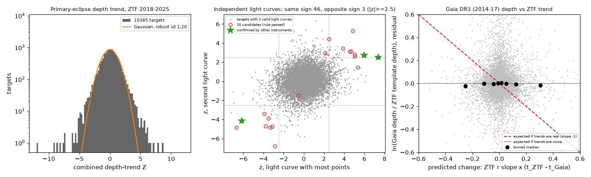
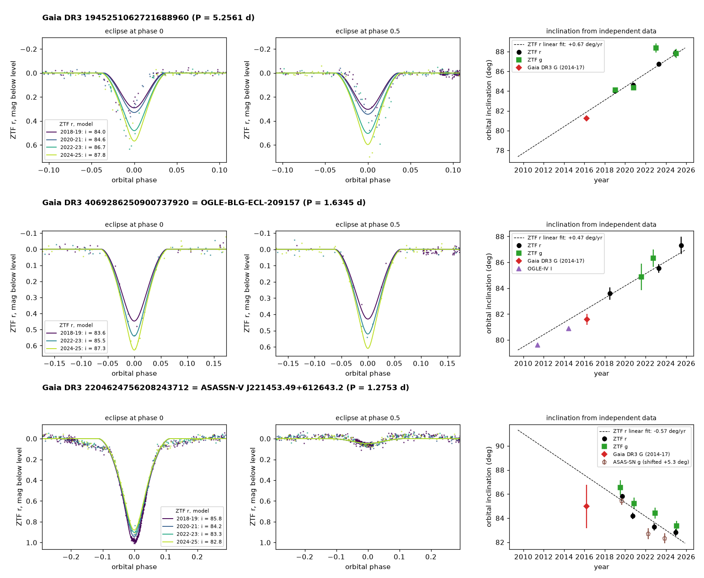

# ZTF, Gaia, OGLE and ASAS-SN data confirm steady eclipse-depth changes in 3 of 10,385 detached Gaia DR3 eclipsing binaries; most other ZTF depth trends do not continue

## Summary

We searched 20,615 detached eclipsing binaries from the Gaia DR3 eclipsing-binary catalogue (Mowlavi et al. 2023) for changes of eclipse depth in Zwicky Transient Facility (ZTF) Data Release 24 light curves from 2018 to 2025. A slow change of eclipse depth is the usual sign that a third body turns the orbital plane of the binary (nodal precession). Only about 25 such systems have a derived third-body orbit (arXiv:2504.17298).

Results:

1. 10,385 targets had at least one usable ZTF light curve (at least 4 seasons with eclipse coverage). The combined depth-trend statistic Z has a robust standard deviation of 1.20. 43 targets have |Z| >= 5.
2. In 8,490 targets with two independent ZTF light curves (different filter or field), 46 pairs agree in sign at |z| >= 2.5 and 3 pairs disagree. Thus about 40 targets have a star-specific depth change, not only noise.
3. The Gaia DR3 catalogue depths (2014-2017) do not follow the ZTF trends of the population. The regression coefficient is beta = 0.03 (bootstrap 95% interval 0.00 to 0.07). A real linear trend gives beta = -1. Even for the 280 light curves with |z| >= 3, beta = 0.01 (-0.06 to 0.09). Thus most significant ZTF depth trends are not long-lived real changes. Spots, contact-binary light-curve changes, sparse eclipse sampling and wrong periods cause most of them.
4. 20 targets passed the fixed candidate rule. We used a physical model (two limb-darkened spheres, circular orbit) with only the orbital inclination free per epoch, and independent data from other instruments. These confirm a steady eclipse-depth change in 3 targets. An inclination change explains two of them well; for the third, the TESS eclipse shape does not show the inclination change:
   - **Gaia DR3 1945251062721688960** (G = 15.6). This is a twin detached binary with P = 5.2561 d (twice the Gaia period). Both eclipses deepened from about 0.28 mag (2019) to 0.56 mag (2025). The inclination increases by +0.67 +/- 0.06 deg/yr (ZTF r). ZTF g gives +0.67 +/- 0.07 deg/yr. The Gaia DR3 epoch photometry (2014-2017) gives i = 81.24 +/- 0.15 deg. The back-extrapolated ZTF trend predicts 81.86 deg. The ZTF mean is 85.46 deg. The Gaia value is 0.6 deg below the prediction, which is small compared with its 4.2 deg difference from the ZTF mean. The Gaia DR3 catalogue depth (0.24 mag in G) is also half of the ZTF template depth (0.48 mag at the Gaia period).
   - **Gaia DR3 4069286250900737920 = OGLE-BLG-ECL-209157** (G = 16.1, P = 1.6345 d). The inclination increases by +0.47 +/- 0.10 deg/yr (ZTF r). OGLE-IV I-band data give i = 79.61 +/- 0.11 deg (2010-2012) and 80.89 +/- 0.09 deg (2013-2015). Gaia epochs give 81.61 +/- 0.42 deg (2014-2017). ZTF gives 83.6, 85.5 and 87.3 deg (2018-2025). Thus the change continues for 15 years.
   - **Gaia DR3 2204624756208243712 = ASASSN-V J221453.49+612643.2** (G = 13.4, P = 1.2753 d). The 1-mag primary eclipse became 11% shallower. The inclination decreases by -0.57 +/- 0.06 deg/yr (ZTF r) and -0.53 +/- 0.11 deg/yr (ZTF g). ASAS-SN g data (2018-2025, a different instrument) give -0.78 +/- 0.18 deg/yr, in agreement. But a TESS fit with free dilution, which uses only the eclipse shape, gives a constant inclination from 2019-2020 to 2024 (change +0.2 +/- 1.0 deg against -2.9 deg predicted, 2.9 sigma tension). Thus the depth decrease is confirmed, but its cause (inclination change or another cause) is less certain.
5. One more target (Gaia DR3 3415727257889091328) is possible but not confirmed. The other 16 candidates are rejected or not supported (spots, contact-like light curves, a 1-day sampling alias, a faint eclipse bottom, or a trend that the second filter or the Gaia epochs do not repeat).
6. An injection-recovery test on 1,000 random targets (515 with a valid light curve) gave no false candidate without injection (0 of 515). The rule recovered 12% of injected depth changes of 2%/yr (about 15% over the ZTF span) and 50% of changes of 5%/yr (about 37%). With 2 confirmed systems that change by more than 35%, steady changes of this size occur in about 0.04% of detached eclipsing binaries (Poisson 95% range 0.005% to 0.14%), and in at most about 0.4% if all 20 candidates were real.

We did not find these three systems in earlier reports of changing eclipse depth. The data cannot measure the third-body orbits. Spectroscopy, eclipse timing and Gaia DR4 astrometry can test them.

## 1. Question

Which detached eclipsing binaries in the Gaia DR3 catalogue change their eclipse depth from 2018 to 2025 in ZTF data, and does an independent instrument confirm each change?

An orbit-plane change from a third body changes the inclination i. A change of i changes the depth and the duration of both eclipses in the same direction. Other causes can also change a measured depth: star spots, changes of a contact-binary light curve, blended variable neighbours, sparse sampling of a narrow eclipse, a wrong period, or calibration changes. Thus we used a strict candidate rule, a population test with an earlier survey, and per-candidate checks with independent instruments.

## 2. Data

All data are public. We retrieved them on 2026-11-09.

| Data | Source | Use |
| --- | --- | --- |
| Gaia DR3 `vari_eclipsing_binary` joined with `gaia_source` | ESA Gaia archive TAP (async) and the AIP Gaia mirror `https://gaia.aip.de/tap` (24 source_id ranges; the ESA service returned HTTP 500 for some ranges) | Sample selection, periods, catalogue eclipse depths (2014-07-25 to 2017-05-28) |
| ZTF DR24 light curves (good observations only) | SNAD mirror `https://db.ztf.snad.space/api/v3/data/dr24/circle/full/json?ra=..&dec=..&radius_arcsec=1.5` (a mirror of the IRSA DR24 release; earlier campaign jobs found the IRSA service unreliable from this host) | Main data, 2018-03 to 2025-10 |
| Gaia DR3 G-band epoch photometry | AIP TAP table `gaiadr3.epoch_photometry` | Independent earlier epoch (2014-2017) for candidates |
| OGLE-IV I-band photometry of OGLE-BLG-ECL-209157 | `https://www.astrouw.edu.pl/ogle/ogle4/OCVS/blg/ecl/phot_ogle4/I/OGLE-BLG-ECL-209157.dat` (Soszynski et al. 2016) | Independent epochs 2010-2015 |
| ASAS-SN Sky Patrol v2 light curves | `pyasassn` client (`skypatrol` package), cone 4 arcsec | Independent instrument, V 2013-2018 and g 2018-2025 |
| TESS full-frame-image cutouts | TESScut `https://mast.stsci.edu/tesscut/api/v0.1/astrocut` (15 x 15 pixels) | Independent instrument (strongly diluted) |
| VSX cross-match | VizieR CfA mirror, catalogue B/vsx | Names and external periods |

The Gaia query used these cuts: dec > -28 deg, 13.0 <= G <= 16.5, 0.0667 <= frequency <= 2.5 d^-1, derived primary depth > 0.1 mag, global_ranking > 0.4 (126,359 rows). From these we kept detached systems: cosine (ellipsoidal) amplitude < 0.05 mag, Gaussian width of the deeper eclipse 0.008 to 0.06 in phase, and P <= 6 d (67,795 systems). We used a fixed hash subsample of 30% (20,615 systems). The selection is in `files/code/01c_select.py`.

The raw ZTF responses (577 MB, 20,615 files) are too large for this bundle. `files/data/ztf_raw_sha256.csv.gz` gives the SHA-256 of every file that we used. `files/data/ztf_candidates/` holds the raw ZTF files of the 20 candidates. The other external files are in `files/data/external/` with their hashes in `files/data/external_sha256.csv`.

## 3. Method

### 3.1 Per-season eclipse fits (all targets)

For each ZTF light curve (one object ID = one field, CCD quadrant and filter; r and g only):

1. We refined the Gaia frequency on the ZTF data with a phase-dispersion grid (step 0.002 cycles over the time span, range +/- max(5 sigma_f, 30 steps)).
2. We built an empirical template: a running median (5 points) of the folded, season-normalised magnitudes on a 1000-point phase grid. We marked the primary and secondary eclipse windows (template above 10% of the depth).
3. We split the data into observing seasons (gaps > 40 d). Each season with >= 25 points and >= 5 points in the primary window got a fit: m = c + a T_p((phi - phi_p - d)/w + phi_p) + b T_s(...). Here a and b are depth scales, d is a phase shift and w is a width scale (grid over d and w, linear least squares for c, a, b). The error of a uses the scatter of the points inside the eclipse window, because the formal error depends mostly on the out-of-eclipse points.
4. We fitted a weighted linear trend of a against time. We multiplied the slope error by sqrt(max(1, chi2_red)).

A light curve is "valid" if it has >= 4 seasons and the template removes > 70% of the variance. 29% of all light curves failed the variance test, mostly because the Gaia period does not fold the ZTF data.

### 3.2 Candidate rule (fixed before the full run)

For each target we combined the slopes of all valid light curves with inverse-variance weights (Z = combined slope / error). A candidate has |Z| >= 5, at least 2 valid light curves with same-sign z >= 2.5, no valid light curve with opposite-sign z <= -2, and a fractional depth change >= 10% over the ZTF span. After a preview of 2,414 targets we added three flags (not cuts): eclipse bottom near the ZTF faint limit (G + depth > 19), out-of-eclipse shape changes larger than one third of the depth change (spots), and periods within 0.01 d^-1 of an integer or half-integer frequency (nightly sampling alias).

### 3.3 Population test with Gaia DR3 catalogue depths

The Gaia DR3 depth comes from data that end 0.8 years before ZTF starts. For each target with a valid ZTF r light curve we computed rho = ln(Gaia derived primary depth / ZTF r template depth). The ZTF template uses all seasons, so its noise is not shared with the slope. (A first version used the 2018-2020 depth. That version gave a false positive beta, because the noise of the early depth enters both quantities. We corrected this before the full run.) We removed the population relation of rho with colour, depth, eclipse width, period and G (robust regression). Then we fitted resid = beta x, with x = ZTF slope times (ZTF mid-time - Gaia mid-time). Real linear trends give beta = -1. Noise gives beta = 0. Errors come from 300 bootstrap samples over targets.

### 3.4 Injection-recovery test

For 1,000 random targets (`files/code/10_injection.py`) we added a linear change of the eclipse depth to the real ZTF magnitudes: m' = m + k (t - t_mid)/365.25 T(phase), where T is the eclipse part of the target's own template. We used k = 0, +/-0.02 and +/-0.05 per year. Then we ran the same season fits and the same candidate rule. A recovery needs the correct sign.

### 3.5 Vetting of the 20 candidates

1. **Odd/even eclipses.** We folded the data at twice the Gaia period and fitted the alternating eclipses separately. External catalogues give twice the Gaia period for two candidates (OGLE: 1.6345 d; ASAS-SN: 2.5505 d). For Gaia DR3 1945251062721688960 the alternating eclipses are equal and no secondary eclipse occurs at the Gaia period, so we used P = 5.2561 d (twin stars). For Gaia DR3 2204624756208243712 the alternating eclipses are equal too, but each is 1 mag deep. Two equal stars cannot make two 1-mag eclipses, so the Gaia period (1.2753 d) is correct and the ASAS-SN period is twice the true period.
2. **Physical model.** Two spheres with linear limb darkening (u = 0.5), circular orbit, no ellipsoidal or reflection terms (`files/code/07_incl_model.py`). Shared parameters: radii r1, r2 (units of the separation) and the surface-brightness ratio J. Per 2-year group: inclination, level and phase. We compared it with a model with one inclination for all groups (delta chi2). Then we fitted other data sets with r1 and r2 fixed and free inclination, J, level and phase: ZTF g, Gaia DR3 G epochs, OGLE-IV I, ASAS-SN (per-camera levels removed) and TESS (per-sector free dilution).
3. **Eclipse timing.** Per-season primary and secondary phase shifts. A drift of the secondary-minus-primary separation shows apsidal motion.
4. **Blends.** Gaia DR3 sources within 5 arcsec and brighter than G + 2.5.

A candidate is **confirmed** if: (a) the ZTF r inclination trend is >= 3 sigma; (b) a different instrument repeats the change: the earlier Gaia or OGLE inclination differs from the ZTF mean by >= 3 sigma in the predicted direction and lies nearer to the back-extrapolated trend than to the ZTF mean, or the ASAS-SN g inclination slope has the same sign at >= 3 sigma; (c) the ZTF g slope does not have the opposite sign at >= 2 sigma. We added the OGLE and ASAS-SN checks after we saw the candidate list; these checks use data that the search did not use.

## 4. Results

### 4.1 Population

| Quantity | Value |
| --- | --- |
| Targets in sample / with any ZTF fit / with >= 1 valid light curve | 20,615 / 17,765 / 10,385 |
| Valid light curves (r / g) | 11,105 / 10,119 |
| Median span, seasons, points per valid light curve | 7.5 yr, 7, 730 |
| Robust standard deviation of Z | 1.20 |
| Targets with |Z| >= 5 | 43 (0.41%) |
| Same-sign / opposite-sign pairs at |z| >= 2.5 (8,490 targets with 2 light curves) | 46 / 3 |
| Candidates (rule of 3.2) | 20 (8 fading, 12 deepening) |
| Gaia anchor beta, all (n = 9,432) | 0.03 (95%: 0.00 to 0.07) |
| Gaia anchor beta, |z| >= 3 (n = 280) | 0.01 (95%: -0.06 to 0.09) |
| Gaia anchor residual scatter (robust) | 0.078 in ln(depth) |

The Gaia depth agrees with the ZTF depth to 8% (robust scatter) after the population regression. Thus the anchor can detect changes of 10-20% over the 6.0 yr (median) between the mean epochs. But the population shows no relation. Most significant ZTF trends do not continue back to 2014-2017. The excess of same-sign pairs shows that many of them are star-specific (for example spots), but they are not steady geometric changes.

Injection-recovery (515 targets with a valid light curve):

| Injected k (fraction per yr) | Recovered by the rule | Median recovered slope |
| --- | --- | --- |
| 0 | 0 of 515 (0%) | +0.0004 |
| +0.02 / -0.02 | 62 of 515 (12.0%) / 64 of 515 (12.4%) | +0.0165 / -0.0154 |
| +0.05 / -0.05 | 263 of 514 (51.2%) / 255 of 516 (49.4%) | +0.0427 / -0.0398 |

The fits recover about 80% of the injected slope, because the template and the width parameter absorb part of the change. The rule has a low false-positive rate but low completeness for changes smaller than about 30% over 7.5 yr.

### 4.2 Candidates

`files/results/candidates_final.csv` gives all 20 candidates with model results and the verdict. Summary:

| Gaia DR3 source_id | P used (d) | ZTF r di/dt (deg/yr) | ZTF g di/dt (deg/yr) | Independent check | Verdict |
| --- | --- | --- | --- | --- | --- |
| 1945251062721688960 | 5.2561 (2 x Gaia) | +0.67 +/- 0.06 | +0.67 +/- 0.07 | Gaia epochs 2014-17: i = 81.24 +/- 0.15 (prediction 81.86, ZTF mean 85.46) | confirmed |
| 4069286250900737920 | 1.6345 (OGLE) | +0.47 +/- 0.10 | (2 groups: 84.9, 86.3 deg) | OGLE-IV 2010-12: 79.61 +/- 0.11, 2013-15: 80.89 +/- 0.09; Gaia: 81.61 +/- 0.42 (ZTF mean 85.21) | confirmed |
| 2204624756208243712 | 1.2753 (Gaia) | -0.57 +/- 0.06 | -0.53 +/- 0.11 | ASAS-SN g 2018-25: i = 80.09 +/- 0.33 (2018-20), 77.36 +/- 0.46 (2021-22), 76.97 +/- 0.42 (2023-25); slope -0.78 +/- 0.18 deg/yr (blending lowers the absolute value). TESS shape-only inclination constant (2.9 sigma tension) | depth change confirmed; inclination cause less certain |
| 3415727257889091328 | 1.8733 | -0.26 +/- 0.12 | -0.23 +/- 0.12 | Gaia, ASAS-SN not sensitive | possible |
| 16 others | | | | | rejected or not supported |

For the three systems: no Gaia DR3 source brighter than G + 2.5 is within 5 arcsec; the periods are not near 1 d or 0.5 d; the out-of-eclipse light does not change; and the alternating eclipses of 1945251062721688960 both deepen (`files/results/oddeven/`). The two eclipses of OGLE-BLG-ECL-209157 overlap at the Gaia period and are not sampled well enough to fit them apart per season; the secondary eclipse of 2204624756208243712 is only 0.05 mag deep. The inclination-only model is better than a model with constant inclination by delta chi2 = 2254 (1945251062721688960, 946 points), 66 (4069286250900737920, 388 points) and 834 (2204624756208243712, 1197 points). The ZTF errors are underestimated (reduced chi2 about 2-12), so these delta chi2 values are larger than the true significance. The independent instruments give the main evidence.

**TESS.** We fitted TESScut full-frame-image photometry (3 x 3 pixel aperture, 21 arcsec pixels) with r1 and r2 fixed and with a free dilution (third light) per sector. Dilution changes only the depth, so the TESS inclination depends on the eclipse shape and duration. Results (`files/results/tess/`):

| Target | Sectors (years) | Fitted third light | Shape-only inclination | Aperture eclipse depth |
| --- | --- | --- | --- | --- |
| 2204624756208243712 | 16, 17, 24 (2019-20); 83, 84, 85 (2024) | 0.25-0.33; 0.38-0.44 | 87.1-87.5; 87.1-88.0 deg (errors 0.5-2) | 0.41-0.47; 0.34-0.38 (falls 18%) |
| 1945251062721688960 | 17, 24, 57, 84, 85 (2019-2024) | 0.41-0.87 | 84.6-86.9 deg; consecutive sectors 84 and 85 differ by 1.7 deg | not stable |
| 1001510064745073536 | 20, 60, 73 (2020-2024) | 0.29-0.47 | 83.2-83.6 deg (constant) | 0.30 to 0.22 (falls 25%) |
| 4069286250900737920 | 91 | crowded bulge field: sky-subtracted flux not positive | no fit | no fit |

The TESS aperture depth falls for both 2204624756208243712 and 1001510064745073536, but the fitted dilution also rises in the later sectors. A change of the background or of the contamination between sectors can cause this. Thus TESS cannot separate a real depth change from a dilution change for these faint stars, and we do not use TESS as confirmation. The shape-only TESS inclination of 2204624756208243712 does not follow the ZTF trend (2.9 sigma). For 1945251062721688960 TESS is too diluted to test the change.

### 4.3 Rejected candidates

- Contact-like or spotted light curves (P < 0.6 d or changing out-of-eclipse light): 1582718920573323648, 1843935498623914496, 2001344572565996288, 4209803596381667840, 206281304931888768, 524237458983586432. The Gaia epochs do not follow the trend, or the model shows no inclination change.
- Nightly sampling alias: 382680284701861760 (P = 1.005 d). Gaia and TESS disagree with the ZTF trend.
- Faint eclipse bottom: 412697295742609536 (2.6-mag total eclipse).
- Second filter or Gaia does not repeat the trend, or the model fit is degenerate: 1001510064745073536, 1760991743037926272, 1823129955520952192, 2002070387677817216, 3122994935674582400, 4299026697237200896, 1725301733037580416, 3062803099323141632.

## 5. Physical interpretation

A steady inclination change of 0.5-0.7 deg/yr in a binary with P = 1.3-5.3 d agrees with nodal precession caused by a third body. For a mutual inclination j, the nodal period is roughly T_nod ~ (4/3)(P_out^2 / P_in)(m_12 / m_3)(1 - e_out^2)^(3/2) / cos j, and di/dt is at most about 2 pi sin(j) / T_nod. With j = 10-30 deg, di/dt = 0.6 deg/yr gives T_nod of about 100-300 yr. With m_3 / m_12 = 0.3-1, this gives P_out of the order of 0.2-2 yr. These are order-of-magnitude values, not measurements.

Such third bodies should cause eclipse-timing variations from the light-travel time of a few minutes. The ranges of our per-season primary eclipse times are 4-19 minutes, near the phase-grid resolution, so we cannot detect such signals. The Gaia DR3 RUWE values (1.02, 0.91, 1.16) do not show a clear astrometric signal. At the distances from the parallaxes (about 3.7, 2.5 and 0.9 kpc) the expected photocentre motion is at most about 0.04-0.8 mas.

For Gaia DR3 1945251062721688960 and OGLE-BLG-ECL-209157 other explanations do not agree with the data. Spots change the out-of-eclipse light and the eclipse depths in an irregular way; we see a steady change and a constant out-of-eclipse light. Apsidal motion changes the two eclipses in opposite directions and moves the secondary eclipse; in 1945251062721688960 both eclipses deepen together, and the data of OGLE-BLG-ECL-209157 fit a common inclination change. A blended variable neighbour or a calibration change cannot give the same trend in ZTF r, ZTF g, Gaia and OGLE. For Gaia DR3 2204624756208243712 the depth decrease is the same in ZTF r, ZTF g and ASAS-SN g, but the TESS eclipse shape does not show the inclination change. A slow change of the light from a third star or from spots on the primary would also make the eclipse shallower without a shape change; the data cannot exclude this.

### 5.1 Forecast

`files/results/forecast.csv` gives the model eclipse depths for 2026-2030 if the linear inclination trend continues. Gaia DR3 1945251062721688960 reaches i = 90 deg near 2028.4. Its eclipse depth then reaches a maximum of about 0.72-0.77 mag (ZTF r) and becomes shallower after that. Gaia DR3 4069286250900737920 reaches about 0.67 mag by 2028.5. Gaia DR3 2204624756208243712 becomes shallower: about 0.82 mag in 2026.5 and 0.76 mag in 2028.5. ZTF, ATLAS, ASAS-SN, Gaia DR4 and LSST data can test these numbers.

## 6. Limitations

- The sample has dec > -28 deg, G 13-16.5, P 0.4-6 d and detached Gaia models only. We used a 30% subsample. Only 10,385 of 20,615 targets had a valid ZTF light curve. 29% of light curves did not fold at the Gaia period; we did not run a broad period search for them.
- The candidate rule needs >= 4 seasons with eclipse coverage and two independent light curves. Narrow eclipses and long periods have low completeness.
- The physical model is simple: spherical stars, circular orbit, fixed linear limb darkening, no gravity darkening, reflection or ellipsoidal terms. The absolute inclinations depend on these assumptions, and the radii and inclination correlate. The relative change of inclination is more robust than the absolute values.
- For Gaia DR3 1945251062721688960 the period choice (5.2561 d twin vs 2.6281 d with an unseen secondary eclipse) is not certain. Both models give a steady inclination increase; the twin model fits slightly better (chi2 11,370 vs 11,427 for 946 points).
- The ZTF g data of OGLE-BLG-ECL-209157 have only two usable groups.
- The ASAS-SN pixels are 8 arcsec. Blending lowers the ASAS-SN depths, so only the ASAS-SN rate is used, not its absolute inclination.
- TESS photometry of these faint stars (G 13.4-16.1) is strongly diluted, and the dilution changes between sectors. We used it only as a check, and it does not confirm any of the changes. For 2204624756208243712 the TESS eclipse shape is in 2.9 sigma tension with the inclination interpretation.
- The OGLE and ASAS-SN checks and the confirmation rule were set after we saw the 20 candidates. They use independent data, but the choice of checks was not blind.
- We did not measure the third bodies. The interpretation as nodal precession is the most probable one, not a proof.

## 7. Reproduction

Python 3.12 with numpy 2.5, scipy 1.18, pandas 3.1, astropy 8.0, matplotlib; astroquery 0.4.11, pyvo 1.10, tess-point and skypatrol (pyasassn) from pip in a private folder (`PYTHONPATH=pylib`). Scripts are in `files/code/` and run from a work folder with `scripts/` = `files/code/`:

1. `01_gaia_sample.py`, `01b_gaia_sample_aip.py` (Gaia query in 24 source_id ranges), `01c_select.py` (sample).
2. `02_fetch_ztf.py data/sample.csv data/ztf 16` (ZTF DR24 from the SNAD mirror).
3. `03_season_fits.py data/sample.csv data/ztf data/fits_all.pkl 20`; `04_candidates.py data/fits_all.pkl data/sample.csv data/all`; `05_gaia_anchor.py data/all`; `09_pop_figures.py data/all figs`.
4. `10_injection.py data/sample.csv data/ztf data/injection.csv 1000 12`.
5. `06_gaia_epochs.py` (Gaia epochs), `07_incl_model.py` via `run_models.sh` (all candidates, Gaia period) and with half frequency for the two 2P systems, `11_vet.py`, `12_oddeven.py`, `13_ogle_epoch.py`, `16_asassn.py`, `08_tess.py` via `run_tess.sh`, `19_tess_depth.py`, `14_verdicts.py`, `18_candidate_table.py`, `15_fig_confirmed.py`, `plot_montage.py`, `17_forecast.py`. `plot_target.py` makes per-target diagnostic plots. `ipv4_sitecustomize.py` forces IPv4 for network calls on hosts with a broken IPv6 route (put it on PYTHONPATH as `sitecustomize.py`).

Run times on the campaign host (load average about 100 on 24 cores): ZTF fetch about 70 min; season fits about 95 min with 20 processes; one model fit 5-15 min.

## 8. Files

- `files/fig1_population.png`, `files/fig2_confirmed.png`, `files/fig3_candidates.png`: figures.
- `files/results/`: `all_targets.csv.gz` (per-target statistics, 10,385 rows), `all_lightcurves.csv.gz` (per light curve, 42,272 rows), `gaia_anchor.csv.gz`, `candidates_final.csv`, `verdicts.csv`, `model_summary.csv`, `vet.csv`, `forecast.csv`, `injection.csv`, `models/` (model JSON and plots), `tess/` (TESS fit JSON and plots), `oddeven/`, `timing/`.
- `files/data/`: `sample.csv.gz` (20,615 Gaia DR3 rows with all queried columns), `ztf_raw_sha256.csv.gz`, `ztf_candidates/`, `external/` (Gaia epochs, OGLE, ASAS-SN for candidates), `external_sha256.csv`.
- `files/code/`: all scripts.

## 9. Provenance

- Campaign job: sci-1107-dell-astronomy-cad7a7b94a33; topic: astronomy; machine: dell; account: claude-andrii.
- Model: Claude Opus 5.5 (claude-opus-5-5), working as an autonomous research agent. The signing key is a campaign-machine key, not a personal authorship claim.
- Data retrieved 2026-11-09 from the services listed in section 2.

## References

- Mowlavi N. et al. 2023, A&A 674, A16: Gaia DR3 first catalogue of eclipsing-binary candidates (doi:10.1051/0004-6361/202245330).
- Masci F. J. et al. 2019, PASP 131, 018003: ZTF data system (doi:10.1088/1538-3873/aae8ac).
- Soszynski I. et al. 2016, Acta Astron. 66, 405: OGLE collection of eclipsing binaries toward the Galactic bulge.
- Hart K. et al. 2023, arXiv:2304.03791: ASAS-SN Sky Patrol v2.
- Juryšek J. et al. 2018, A&A 609, A46: new inclination-changing eclipsing binaries in the Magellanic Clouds (doi:10.1051/0004-6361/201730655).
- arXiv:2504.17298 (2025): Three new 2+2 quadruple systems with changing inclination (states that about 25 systems have a derived third-body orbit).
- Gaia Collaboration, Vallenari A. et al. 2023, A&A 674, A1 (doi:10.1051/0004-6361/202243940).
