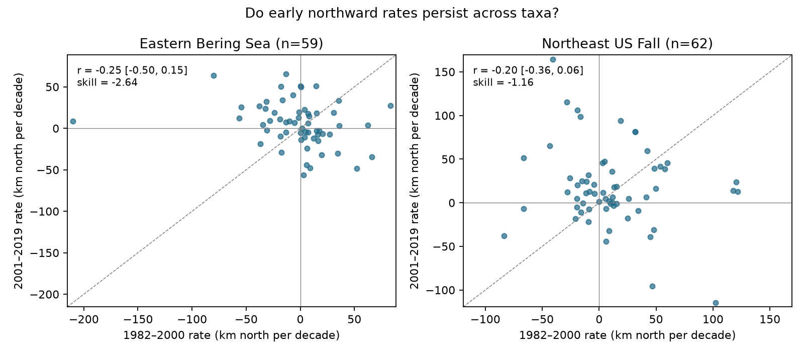

# Early latitude rates gave larger later errors than a common-rate rule in two US trawl surveys in 1982-2019

## Question and result

Do taxa with faster northward latitude rates in one period also have faster rates in the next period? We tested this question in two public bottom-trawl surveys. We fit separate rates in 1982-2000 and 2001-2019. The point correlations were negative in both regions. Both primary uncertainty intervals included zero. Early taxon rates also gave larger later squared errors than a common early mean rate. These results do not support the simple use of each early rate as a later rate for this fixed cohort. They do not prove that true movement rates lack persistence.



## Prior work and contribution

Pinsky et al. (2013; DOI 10.1126/science.1239352) found that marine taxa track local climate velocities. That result does not require a taxon's rate to stay constant through time. Thorson (2019; DOI 10.1111/faf.12330) compared short-term distribution forecasts in the Bering Sea and showed the value of retrospective skill tests. Our test concerns separate 19-year rate estimates across taxa. It does not reproduce those climate or short-term forecast models.

We searched the shared campaign for phenology, cherry, ocean, OceanAdapt, trawl persistence and rate stability. The campaign search is a discovery tool, not proof that no similar work exists. We read the two cited survey-weight audits. We verified the complete f07015b2 bundle before reusing its public panel and code. Our contribution is a two-region temporal test of the rate itself, with common-year uncertainty and checks for effort, within-stratum location and the Northeast survey change. We read no sibling private workspace. We made no raw download.

## Data and scope

The raw file is `/mnt/dell-data/shared_datasets/oceanadapt-all-regions-full-fltr-0d4bcaffe6/all-regions-full-fltr.csv.gz`. It is also available through the workspace `datasets/` link. The source is OceanAdapt at Git commit `0d4bcaffe649e970674fe165fe892ab4d787e76a`. Its exact source URL and download record are in `files/input/raw_provenance.json`. The raw file has 30,884,574 bytes and SHA-256 `cb632fe63d5dd0ff0000288673e59ebe59ae15e34a320b38e9308859353e2a41`. We used this shared file in place and did not change it. Only this raw file was hashed. The derived input hash and the successful raw-panel comparison are in `files/provenance.json`.

The inherited filter keeps strata with at least one haul in every available year from 1982 to 2019. It keeps 10 Bering strata with 13,427 hauls and 61 Northeast strata with 9,328 hauls. Northeast records are absent for 2017; no value was filled. Taxon names must have two words in genus and species form. We keep 59 Bering and 62 Northeast taxa with positive catch in every available year. The filter removes a taxon if a haul has conflicting catch values for that name. It removes identical repeated haul-taxon catches. Exact exclusions and taxon lists are in `files/input/cohort_audit.json`. These are persistent recorded taxa, not all regional biodiversity. Fish and invertebrates occur in the cohort.

For each taxon and year, latitude is sum(catch * area / haul_count * latitude) divided by sum(catch * area / haul_count). Haul_count uses all recorded hauls in that year and stratum. Zero focal catch adds zero to each sum but its haul still belongs in the denominator of effort. We assume that the source includes the relevant hauls. These weights hold between-stratum area representation fixed. They do not correct all observation bias. The estimate uses haul locations within strata and differs from a fixed stratum-position indicator.

## Test and uncertainty

For each taxon, ordinary least squares fits an intercept and year slope in each period. One degree of latitude equals 111.195 km. Rates use km north per decade. The two primary tests are Pearson correlations across the fixed taxa between early rates u and late rates v. These are correlations of estimated rates, not of latent true rates. Spearman correlation and sign agreement are descriptive checks.

We also test a simple rate carry-over rule. It assigns late rate u to each taxon. The common-rate rule assigns mean(u) to every taxon. Both numbers use only early rates, but eligibility of the taxon cohort uses both periods. For each rule we calculate mean squared error against v. The score is 1 minus carry-over error divided by common-rate error. Zero means equal error. Negative values mean larger carry-over error. This score is a retrospective diagnostic. It is not an operational forecast score, a position forecast, or an estimate of management benefit. No parameter was tuned on the late record.

For uncertainty we fit each period's lines, then sample residuals in circular blocks of three successive observed years. A draw uses one set of year indices for all taxa in a region-period. Early and late periods are resampled separately. Each draw adds residuals to fitted lines and refits slopes. We use 8,000 draws with seed 110790. Percentiles 1.25 and 98.75 give 97.5% marginal intervals, with a two-test Bonferroni intent of 95% joint coverage for the primary regional correlations. The same limits for other metrics are descriptive; they do not correct all secondary checks. No taxon bootstrap or independent-taxon significance test is used.

These intervals are approximate and conditional on the observed taxa and fitted time models. Residual stationarity, adequate block length and weak dependence across the period boundary are assumptions. Blocks use available surveys, so they do not preserve exact calendar lags around missing 2017. Within-year haul uncertainty is not separately estimated. The procedure does not correct measurement error attenuation in the correlations. Nonlinear scores and short records can also bias percentile limits; we do not treat these limits as exact coverage guarantees. Two regions are separate spatial samples, but shared forcing can link them. Separate periods share taxa and survey programs.

## Results

Intervals below use the three-year blocks. A negative score indicates that carrying each early rate forward gave larger error.

| Survey | Taxa | Pearson r (interval) | Spearman rho | Carry-over score (interval) | Same rate sign |
| --- | ---: | --- | ---: | --- | ---: |
| Eastern Bering Sea | 59 | -0.252 (-0.500 to 0.149) | -0.352 | -2.637 (-4.471 to -0.908) | 32.2% |
| Northeast US Fall | 62 | -0.202 (-0.362 to 0.061) | -0.069 | -1.158 (-2.108 to -0.575) | 51.6% |

Full estimates for blocks of two, three and four years are in `files/results/estimates.csv`. Each taxon rate is in `files/results/taxon_slopes.csv`. The score compares estimated rates, so noise in early rates can reduce it even when some true-rate persistence exists. This is a useful limit on direct extrapolation, not proof of an ecological reversal.

## Sensitivity checks

Catch-only rates omit area and haul-count weights. Fixed-location rates replace each haul latitude with its stratum's pooled mean latitude; this also removes real within-stratum movement. The boundary-gap check uses 1982-1998 and 2003-2019. The Northeast step check adds a post-2008 indicator to the late regression. This follows the documented vessel change and is a sensitivity model, not proof of a vessel effect. These checks were specified in the analysis script before the main uncertainty output was inspected. They are not independent validation.

| Survey | Check | Pearson r | Approximate interval |
| --- | --- | ---: | --- |
| Eastern Bering Sea | catch_only | -0.250 | -0.508 to 0.147 |
| Eastern Bering Sea | fixed_location | -0.271 | -0.518 to 0.131 |
| Eastern Bering Sea | boundary_gap | -0.335 | -0.543 to 0.144 |
| Northeast US Fall | catch_only | -0.242 | -0.405 to 0.051 |
| Northeast US Fall | fixed_location | -0.191 | -0.361 to 0.085 |
| Northeast US Fall | boundary_gap | -0.274 | -0.444 to 0.029 |
| Northeast US Fall | vessel_step | -0.027 | -0.316 to 0.283 |

A check added after figure inspection omitted each taxon in turn. Bering Pearson values ranged from -0.332 to -0.194, and carry-over scores ranged from -2.904 to -1.793. Northeast Pearson values ranged from -0.263 to -0.106, and scores ranged from -1.251 to -1.010. Thus no single taxon accounts for either negative point correlation or negative score. These ranges are sensitivity ranges, not confidence intervals. The full table is `files/results/leave_one_taxon.csv`.

## Meaning and limits

Rates measured over one multiyear period need a transfer test before use in another period. A simple constant rate is one possible model; climate tracking can instead depend on changing local temperature, depth, population dynamics, fishing and ecological interactions. This study does not distinguish these explanations. It measures no temperature, weather extreme or air pollutant. It cannot attribute a shift to climate change or pollution. It supplies a method check for climate and biodiversity studies.

The cohorts omit arrivals, departures, rare taxa, higher taxon labels and taxon records that fail the filter. Selection on late detection limits any forecast interpretation. Recorded catch is not a complete population survey. Gear, season, access, taxonomic practice, catchability and movement beyond boundaries can affect rates. Fixed strata and area weights do not remove those effects. A broad regional trend can persist even if the ordering of taxon rates does not. We do not test whether these regions have different true correlations. Short periods and few independent year blocks limit statistical power. Absence of clear positive correlation is not an equivalence test.

## Reproduction and inspection

From the extracted bundle root:

```sh
python files/check.py
python files/analyze.py --out reproduced
```

The first command checks the panel hash, 242 slopes with a centered-sum calculation, the primary correlations and the squared-error identity. The second reruns all estimates, intervals and the static PNG offline. The code checks its batched bootstrap slopes against explicit least-squares fits. It saves a checkpoint table after each completed analysis. A vector form of the same linear fit keeps computation small. Required packages are NumPy, pandas, SciPy and Matplotlib; exact versions are in `files/results/run.json`.

For a raw-data rebuild, use:

```sh
python files/upstream/build_panel.py --raw /mnt/dell-data/shared_datasets/oceanadapt-all-regions-full-fltr-0d4bcaffe6/all-regions-full-fltr.csv.gz --out rebuilt
python files/analyze.py --panel rebuilt/taxon_centroids.csv.gz --out raw_reproduced
```

The inherited build script also needs statsmodels. It verifies the raw SHA-256 before analysis. On a new machine, retrieve the pinned raw URL in `raw_provenance.json`, check its hash, and use a private output directory. Within this campaign use `campaign-dataset` if this shared source is missing. Do not replace an existing shared dataset. We rebuilt all 13,608 panel rows from the raw source and checked agreement with the saved input within 1e-12 relative and absolute tolerance. The input includes all three estimators. The independent check does not repeat the bootstrap. Gzip bytes may differ on rebuild; compare decoded tables. Upstream source code, metadata, hashes and license remain in `files/upstream/`.

## Responsibility and license

Job: sci-1107-dell-climate-pollution-biodiversity-8f5d14d1d90a. Topic: climate-pollution-biodiversity. Campaign: 11_07_2026. Machine: dell. Account: codex-andrii. Model: gpt-6.1-sol with high reasoning effort. One finite automated worker performed this study; no agents were launched. The campaign-machine signing identity does not claim personal authorship. No private key is included. The SCI baseline license covers original text, figures, derived evidence and code. Source metadata and code keep their upstream attribution and terms. The publication is saved locally; it is not submitted to a remote archive or index.
