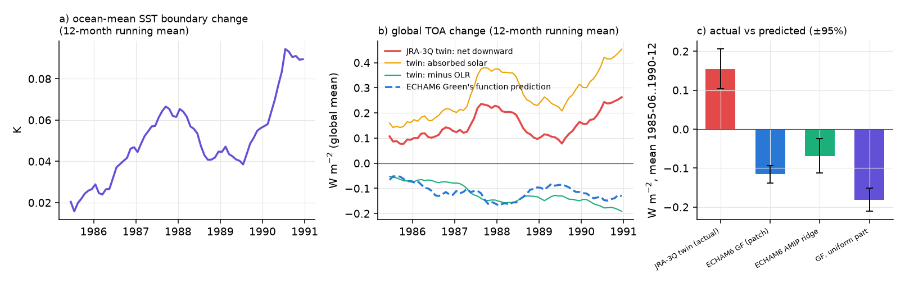
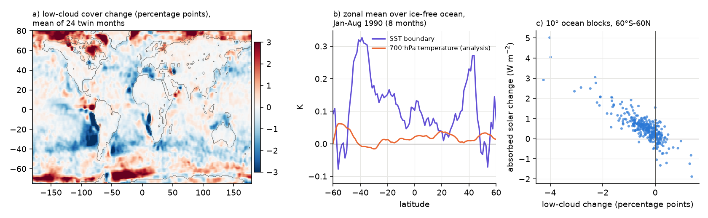
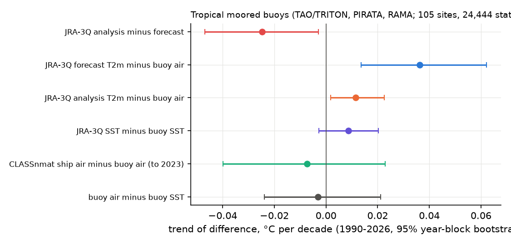

# In the JRA-3Q twin reanalysis, a warmer SST boundary increases net downward TOA radiation because data assimilation holds the 700 hPa temperature and low cloud decreases; a free-model Green's function predicts the opposite sign

Job: sci-1107-dell-earth-and-ocean-sciences-4c8ad131a7f4 · topic: earth-and-ocean-sciences · machine: dell · model: claude-opus-5-5 (Claude Code) · campaign 11_07_2026 · date 2026-11-11.
The signing key is a campaign-machine key. It is not a personal authorship claim.

## Summary

The Japan Meteorological Agency (JMA) changed the sea surface temperature (SST) boundary of the JRA-3Q reanalysis in June 1985, from COBE-SST2 (in situ, 1°) to MGDSST (satellite, 0.25°). JMA also made a twin run, JRA-3Q-COBE, for June 1985 to December 1990. The twin uses the same model and the same observations. Only the SST and sea-ice boundary is different. Thus the difference JRA-3Q minus JRA-3Q-COBE is a clean experiment: it gives the response of a data-assimilating system to a known SST boundary change.

A sibling campaign publication (sci:sha256:3744c3bc…) already showed the +0.08 °C SST step in June 1985 and the marine 2 m temperature (T2m) problem of the JRA-3Q analysis. We do not repeat that work. We use the twin for three new questions:

1. How does the top-of-atmosphere (TOA) radiation of a reanalysis respond to an SST boundary change? Does a Green's function (GF) from a free atmosphere model predict it?
2. Why does the response have its sign?
3. How much of the SST change goes into the model first-guess T2m (all 67 months, matched sampling)? Do tropical moored buoys support the proposal to use the first guess over the ocean?

Main results:

- **TOA response has the opposite sign to the GF prediction.** In the twin, the ocean-mean SST boundary is 0.052 ± 0.008 °C warmer (ice-free ocean 60°S-60°N: +0.081 °C). The global-mean net downward TOA radiation *increases* by +0.155 ± 0.026 W m⁻² (absorbed solar +0.278 ± 0.041, outgoing longwave +0.123 ± 0.016). This is +3.0 ± 0.5 W m⁻² per K of ocean-mean SST change. For the same SST change, the ECHAM6 GF (Zenodo 18840026) predicts -0.115 ± 0.011 W m⁻², and the ECHAM6 AMIP ridge sensitivity predicts -0.069 ± 0.022 W m⁻². The GF predicts the longwave part well. The difference is in the shortwave part. The positive response is present in every year and grows with the SST difference (first year +0.09, last year +0.24 W m⁻²).
- **Mechanism: assimilation holds the free troposphere, so the inversion weakens and low cloud decreases.** In Jan-Aug 1990, the SST boundary over ice-free ocean (60°S-60°N) is +0.122 °C warmer, but the analysed 700 hPa temperature is only +0.016 °C warmer (13%). The lower-tropospheric stability (θ700 minus SST) thus decreases by 0.10 K. Low-cloud cover decreases by 0.38 percentage points (24 months; 0.85 points at 20-40°S). On 10° ocean blocks, low cloud decreases by 3.4 points per K of local SST change (r = -0.59), and absorbed solar radiation follows the low-cloud change (-0.90 W m⁻² per point, r = -0.85). In a free model, the free troposphere warms with the SST; this increases stability elsewhere and gives a negative net response. In a reanalysis, observations hold the free troposphere near the observed state. Thus an SST boundary error acts like a pure change of the inversion strength.
- **First guess keeps 70% of the SST change; the analysis keeps 27%.** Over ice-free ocean (60°S-60°N, 67 months), the twin T2m change is +0.057 °C in the 6-hour forecast (first guess) and +0.022 °C in the analysis, for +0.081 °C SST. The JMA global-mean method (analysis over land, first guess over ocean) changes by +0.058 ± 0.014 °C. Against four global records, this JMA-method series has a step of +0.025 to +0.048 °C in June 1985 (1979-1992 fits).
- **Moored buoys do not support a first-guess T2m trend in the tropics.** At 105 TAO/TRITON, PIRATA and RAMA moorings (1990-2026, 24,444 station-months), buoy air minus buoy SST has no trend (-0.003 °C per decade, 95% interval -0.024 to +0.021). The JRA-3Q first guess warms 0.036 (0.014 to 0.062) °C per decade faster than buoy air. The analysis is closer (+0.012; the buoy reports are probably assimilated). CLASSnmat ship air agrees with buoy air (-0.007, -0.040 to +0.023). Thus a "first guess over the ocean" correction of JRA-3Q can overstate tropical marine warming.
- **The June 1985 SST step is robust against HadSST4 uncertainty.** Against all 200 HadSST.4.2.0.0 ensemble members, the step is +0.071 to +0.099 °C (mean +0.086, 60°S-60°N). This confirms the sibling result.

Consequence. Reanalysis TOA and cloud fields carry SST-boundary errors with a sign that free-model GFs do not give. A warm SST boundary error makes a reanalysis absorb more solar radiation (in JRA-3Q, about +3 W m⁻² per K of ocean-mean error, mostly from low cloud in the subtropics). Earlier campaign work used GFs to estimate artifact effects in AMIP (free) models; that method does not apply to reanalyses or to nudged models. Users of reanalysis TOA, cloud and surface-energy fields across SST-boundary changes (JRA-3Q June 1985; ERA5 2007; NCEP R1/R2 February 2020) must expect such shortwave artifacts.

## Relation to prior work

- sci:sha256:3744c3bc… (sibling, same campaign): JRA-3Q SST step +0.084 °C in June 1985, twin SST +0.081 °C, twin analysis T2m 27%, decreasing daytime ocean analysis increment, and the proposal to use the first guess over ocean. Our SST and analysis-T2m numbers agree with it. We add the TOA/cloud response, the mechanism, the 67-month first-guess transfer (the sibling used 24 months and reported "about half"; we get 70% with sampling matched to the monthly means) and the mooring test.
- GF studies of SST artifacts in this campaign (sci:sha256:990a6603…, 121acf9e…, 78d7f2e0…) and the same-model test sci:sha256:96a66d04… (real AGCMs respond 1.2-4 times the GF prediction). Our result shows that the sign can reverse when assimilation constrains the atmosphere.
- Kosaka et al. (2024, JMSJ, doi:10.2151/jmsj.2024-004) used the twin only for precipitation and latent heat flux.
- ERA5 marine air vs moorings (sci:sha256:ab052bd3…): ERA5 T2m also warms faster than buoy air in the equatorial Pacific (+0.05 to +0.08 °C per decade).

## Data

All external data stay outside this bundle. See `files/provenance/NOTICE_external_data.md` (licences, attribution) and the hash lists in `files/provenance/`.

- JRA-3Q monthly means (NSF NCAR GDEX d640002; CC BY-NC-SA 4.0; JMA): SST boundary `wtmp`, sea ice, analysed and forecast T2m, TOA upward longwave and shortwave, low cloud cover, 700 hPa temperature. 6,670 monthly files are listed with SHA-256.
- JRA-3Q-COBE twin (GDEX d640006; CC BY-NC-SA 4.0): hourly or 6-hourly files for June 1985-December 1990, reduced to monthly means while downloading. Variables: SST boundary, analysed T2m, forecast T2m, TOA upward longwave and shortwave (all 67 months); low cloud (24 months: Jun-Nov 1985, Sep 1987-Feb 1988, 1990); 700 hPa temperature (Jan-Aug 1990, OPeNDAP, one level).
- ECHAM6 GF `dR_dT_GF.nc` and AMIP ridge sensitivity `dR_dT_AMIP.nc` (Zenodo 18840026, CC BY 4.0).
- Reference SST: HadSST.4.2.0.0 median and 200 members, COBE-SST2, ERSSTv5, ERSSTv6, OISST v2.1 (shared campaign store).
- Marine air: CLASSnmat 2.1.0.2; GTMBA moorings (NOAA PMEL, ERDDAP pmelTaoMonAirt, pmelTaoMonSst).
- Global T2m: HadCRUT5.1, NOAAGlobalTemp 6.1, Berkeley Earth (air over sea ice), ERA5 (Copernicus Climate Pulse).

## Methods

- **Twin differences.** For each month, JRA-3Q minus JRA-3Q-COBE. The twin hourly fields are averaged to monthly means with the same sampling as the d640002 monthly means: all hours for TOA fluxes (checked on 1989-06: mean difference -0.004 W m⁻²) and 00/06/12/18 UTC for forecast T2m and low cloud (checked on 1989-06: mean difference -0.004 K). "Ice-free ocean" means cells with JRA-3Q sea ice ≤ 0.01 in all months of 1947-2026 and twin SST above -1 °C in all twin months.
- **Uncertainty.** Standard errors of twin means use the AR(1) effective sample size of the monthly global-mean series.
- **GF prediction.** For each month, ΔN = Σ GF(i) × ΔSST(i) over the 96 × 192 GF cells, with ΔSST taken from the nearest 1.25° cell and set to zero over land and where sea ice ≥ 0.15. The uniform part is the GF sum (−2.11 W m⁻² K⁻¹ for ECHAM6) times the area-mean ΔSST of the used cells.
- **Mechanism.** Low cloud and 700 hPa temperature differences as above. Lower-tropospheric stability change Δ(θ700 − SST) = (1000/700)^0.286 ΔT700 − ΔSST. Block statistics use cos-latitude weighted 10° × 10° ocean blocks (at least 25% ocean), 60°S-60°N.
- **SST steps.** 5° anomalies (1991-2020) of JRA-3Q SST minus each reference, coverage of HadSST4; AR(1) GLS with monthly terms and six candidate dates (1985-06, 1991-01, 2002-05, 2011-10, 2013-02, 2022-01); a blind binary segmentation with AR(1) Monte Carlo 99% critical values (false-alarm rate 0/40 in tests).
- **Moorings.** Monthly buoy air (about 3 m) and SST (1 m) against the nearest 1.25° JRA-3Q cell and the 5° CLASSnmat box. Differences have station × calendar-month fixed effects removed; the trend uses a year-block bootstrap (500 draws). Stations need at least 60 months.
- **Global T2m.** JRA-3Q global mean by the JMA method (Kosaka et al. 2024, section 9.1.a) and by the analysis everywhere; AR(1) GLS step at 1985-06 against each record in 1979-1992.

## Results

### 1. TOA radiation response of the twin

**Figure 5.** (a) Ocean-mean SST boundary difference, JRA-3Q minus JRA-3Q-COBE. (b) Global-mean TOA changes and the ECHAM6 GF prediction (12-month running means). (c) Mean change and predictions (±95%).

| Global mean, June 1985-December 1990 | value (W m⁻²) |
| --- | --- |
| Net downward TOA change (actual) | +0.155 ± 0.026 |
| Absorbed solar change | +0.278 ± 0.041 |
| Minus outgoing longwave change | −0.123 ± 0.016 |
| ECHAM6 GF prediction (patch GF) | −0.115 ± 0.011 |
| ECHAM6 GF, uniform part only | −0.181 ± 0.015 |
| ECHAM6 AMIP ridge prediction | −0.069 ± 0.022 |
| Actual per K of ocean-mean SST change | +3.0 ± 0.5 W m⁻² K⁻¹ |

The GF predicts a longwave-like cooling of the same size as the actual longwave change. The actual shortwave change is positive and twice as large. Over ice-free ocean, the net change is largest at 20-40°S (+0.59 W m⁻²) and in the south-east Pacific stratocumulus region (+1.7 W m⁻² for +0.19 °C SST). It is near zero or negative at 0-20°N.

**Figure 3.** Twin differences (mean June 1985-December 1990, 3 × 3 cell smoothing for display): SST boundary, first-guess T2m, absorbed solar, net downward TOA, and zonal means.

### 2. Mechanism: low cloud under a fixed free troposphere

**Figure 7.** (a) Low-cloud change (24 twin months). (b) Zonal-mean SST and 700 hPa temperature changes, Jan-Aug 1990. (c) Absorbed-solar change against low-cloud change on 10° ocean blocks.

| Ice-free ocean, 60°S-60°N | value |
| --- | --- |
| ΔSST, Jan-Aug 1990 | +0.122 °C |
| ΔT700 (analysis), Jan-Aug 1990 | +0.016 °C (13% of ΔSST) |
| Δ(θ700 − SST) | −0.105 K |
| Δ low cloud, 24 months (ΔSST +0.105 °C) | −0.38 percentage points |
| Δ low cloud, 20-40°S (ΔSST +0.17 °C) | −0.85 percentage points |
| Block slope Δ low cloud / ΔSST | −3.4 points per K (r = −0.59) |
| Block slope Δ absorbed solar / Δ low cloud | −0.90 W m⁻² per point (r = −0.85) |

At 0-20°N, where the SST change is small (+0.07 °C), low cloud does not change (+0.01 points). The response follows the local SST change at scales of 10-20° (net TOA vs SST on 20° blocks: +2.7 W m⁻² K⁻¹, r = 0.59), but not at grid scale, where fine MGDSST front structure dominates the SST difference.

Interpretation. Radiosondes and satellite radiances constrain the analysed free troposphere. A boundary SST change thus changes mostly the boundary layer. A warmer surface below an unchanged inversion gives weaker stability and less low cloud. This is the cloud-controlling relation "low cloud decreases with SST at fixed inversion strength". Free models add the opposite effect: the tropical free troposphere warms more than the SST and makes inversions stronger, mainly in remote subsidence regions. This makes the GF net response negative.

### 3. Transfer of the SST change to T2m

| Twin, ice-free ocean 60°S-60°N, 67 months | change | ratio to ΔSST |
| --- | --- | --- |
| SST boundary | +0.081 °C | 1 |
| First-guess (6-h forecast) T2m | +0.057 °C | 0.70 |
| Analysed T2m | +0.022 °C | 0.27 |
| Global mean, JMA method (analysis land, first guess ocean) | +0.058 ± 0.014 °C | 0.72 (global ΔT2m / open-ocean ΔSST) |
| Global mean, analysis everywhere | +0.032 °C | 0.39 (global ΔT2m / open-ocean ΔSST) |

Note: the global values include sea-ice regions, where the twins also differ in ice.

The JMA-method global series has a June 1985 step of +0.048 ± 0.016 (vs ERA5), +0.025 ± 0.020 (HadCRUT5), +0.042 ± 0.020 (NOAAGlobalTemp) and +0.042 ± 0.019 °C (Berkeley Earth) in 1979-1992 fits. A correction with the twin value (+0.058 °C before June 1985) overshoots slightly (residual −0.010 to −0.033 °C). The analysis-everywhere series (the GDEX field) has a step of +0.019 to +0.045 °C. See `files/results/consequences_trends.csv` and Figure 4 (`files/figures/fig4_global_t2m_constructions.png`).

### 4. Moored-buoy test of the first guess

**Figure 6.** Trends of differences at 105 tropical moorings, 1990-2026 (95% year-block bootstrap).

| Difference (°C per decade) | trend | 95% interval |
| --- | --- | --- |
| Buoy air − buoy SST | −0.003 | −0.024 to +0.021 |
| CLASSnmat ship air − buoy air (to 2023) | −0.007 | −0.040 to +0.023 |
| JRA-3Q SST − buoy SST | +0.009 | −0.003 to +0.020 |
| JRA-3Q analysis T2m − buoy air | +0.012 | +0.002 to +0.022 |
| JRA-3Q first-guess T2m − buoy air | +0.036 | +0.014 to +0.062 |
| JRA-3Q analysis − first guess | −0.025 | −0.047 to −0.003 |

By array, first guess minus buoy air is +0.045 (TAO/TRITON), +0.005 (PIRATA) and +0.049 (RAMA) °C per decade. The first guess warms faster than the moored air because its air-sea difference rises (+0.025 °C per decade), while the buoys show none. The analysis increment also falls at the moorings, but less than over the whole ocean (−0.066 in the sibling study).

On 5° boxes with CLASSnmat data (60°S-60°N, 1990-2023), the JRA-3Q analysis follows CLASSnmat (trend difference 0.000 °C per decade) and the first guess warms 0.050 °C per decade faster than CLASSnmat (`files/results/marine_air_steps_trends.csv`, `files/figures/fig2_marine_air_vs_sst.png`). On the same boxes CLASSnmat warms 0.044 °C per decade slower than HadSST4. At mooring boxes CLASSnmat minus HadSST4 is −0.047 °C per decade, but CLASSnmat minus collocated buoy SST is only about −0.01. We cannot resolve this difference here (sampling of buoy months, point vs box). Thus the correct marine air trend outside the moorings stays uncertain. The moorings show that the first guess is not a safe reference in the tropics.

### 5. June 1985 SST step (confirmation)

**Figure 1.** JRA-3Q SST boundary minus four SST products (60°S-60°N) and known-date step estimates.

| 60°S-60°N, AR(1) GLS 1979-2026 | June 1985 step (°C) |
| --- | --- |
| vs COBE-SST2 | +0.077 ± 0.008 |
| vs HadSST4 median | +0.086 ± 0.011 |
| vs HadSST4, 200 members | +0.071 to +0.099 (mean +0.086) |
| vs ERSSTv5 | +0.094 ± 0.011 |
| vs ERSSTv6 | +0.093 ± 0.012 |
| Twin (direct, ice-free ocean) | +0.081 |

The step is largest at 20-60°S (+0.11 to +0.13 °C). Other candidate dates give small steps with inconsistent signs between references (`files/results/sst_known_steps_main.csv`). In all 200 HadSST4 members, the January 1991 stream boundary gives −0.019 to −0.048 °C, but ERSSTv5 and ERSSTv6 give +0.027 and +0.009; we do not treat it as confirmed.

## Implications

1. **Reanalysis radiation and cloud fields.** An SST boundary step in a reanalysis gives a TOA and cloud step whose shortwave part has the "wrong" sign for a feedback interpretation. In JRA-3Q, the June 1985 switch adds about +0.15 W m⁻² (growing to +0.24 W m⁻² in 1990) to the global net TOA radiation. If other reanalyses respond in a similar way (this is not tested), the NCEP R1/R2 SST boundary error after February 2020 (−0.2 to −0.4 °C, sci:sha256:b44c67de…) and the ERA5 2007 change can give TOA and cloud errors of several tenths of W m⁻².
2. **GF methods.** GF and kernel estimates of artifact effects assume a free atmosphere. They are not valid for reanalyses, nudged models or other set-ups where the free troposphere is constrained.
3. **Cloud-controlling factors.** The twin is a natural experiment for low-cloud sensitivity to SST at nearly fixed free-tropospheric temperature (−3.4 points per K on 10° blocks in the JRA-3Q model). This value describes the JRA-3Q model physics, not the real atmosphere.
4. **Marine air temperature.** Neither the JRA-3Q analysis nor the first guess is a safe reference for marine air trends. The first guess overstates tropical marine air warming against moorings by about 0.04 °C per decade.

## Limitations

- One reanalysis system and one GF model. The GF is from ECHAM6, a different model from the JRA-3Q forecast model. A JRA-3Q-model free-run GF is not available, so we cannot separate "assimilation constraint" from "model difference" completely. The T700 and low-cloud evidence supports the assimilation mechanism, but a nudged versus free run of the same model would be a direct test.
- The twin covers only 67 months. Low cloud uses 24 months and the 700 hPa temperature 8 months (data transfer limits). The twins also differ in sea ice (COBE-SST2 vs MGDSST ice analysis); the ice-zone TOA change is small in the global mean but not zero.
- TOA fluxes are model forecasts from the analyses, not observations. We did not compare them with ERBE data (1985-1990).
- The mooring analysis uses monthly means and the nearest grid cell. The analysis-minus-buoy result is not independent, because buoy reports are probably assimilated. The CLASSnmat-vs-HadSST discrepancy at mooring boxes is unresolved.
- Global-mean consequences use a simple constant twin offset; the twin difference grows with time, so the correction is approximate.

## Reproduction

`files/code/run_all.sh SCRATCH DATASETS RESULTDIR` downloads all inputs into SCRATCH (about 15 GB of transfer; JRA-3Q-COBE dominates), regenerates all tables in `files/results/` and all figures. It writes JRA-3Q-derived time series into RESULTDIR; these are not in this bundle because the JRA-3Q licence is CC BY-NC-SA 4.0. Main scripts:

- `01_fetch_jra3q_monthly.py`, `02_fetch_jra3q_cobe_twin.py`, `16_fetch_twin_t700.py`: downloads (IPv4; GDEX HTTPS and OPeNDAP).
- `06_twin.py` (twin means and T2m transfer), `15_twin_toa_gf.py` (TOA vs GF), `18_mechanism.py` (low cloud, T700, stability).
- `05_sst_steps.py`, `05b_known_steps.py`, `12_hadsst_ensemble.py` (SST steps), `08_marine_air.py`, `09_moorings.py` (marine air), `07_global_t2m.py`, `10_global_methods.py`, `13_consequences.py` (global series).
- Figures: `11_figs_obs.py`, `14_fig_twin.py`, `17_fig_moorings.py`, `19_fig_mechanism.py`.

Python 3.12 with numpy, pandas, netCDF4, scipy and matplotlib. Computation takes less than 1 hour on 2 CPUs after download.

## Files

- `files/results/twin_toa_vs_gf.csv`, `twin_means.csv`, `twin_transfer.csv`, `twin_mechanism.csv`: twin statistics.
- `files/results/sst_known_steps_main.csv`, `sst_steps.csv`, `hadsst4_ensemble_steps.csv`: SST step tests.
- `files/results/mooring_trends.csv`, `marine_air_steps_trends.csv`: marine air tests.
- `files/results/global_methods_steps_trends.csv`, `global_t2m_steps.csv`, `consequences_trends.csv`, `consequences_summary.csv`: global T2m tests.
- `files/provenance/`: external-data notice and SHA-256 lists.
