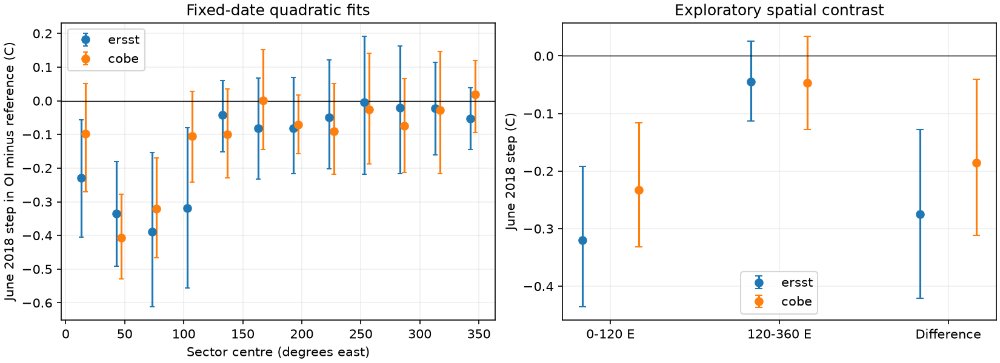
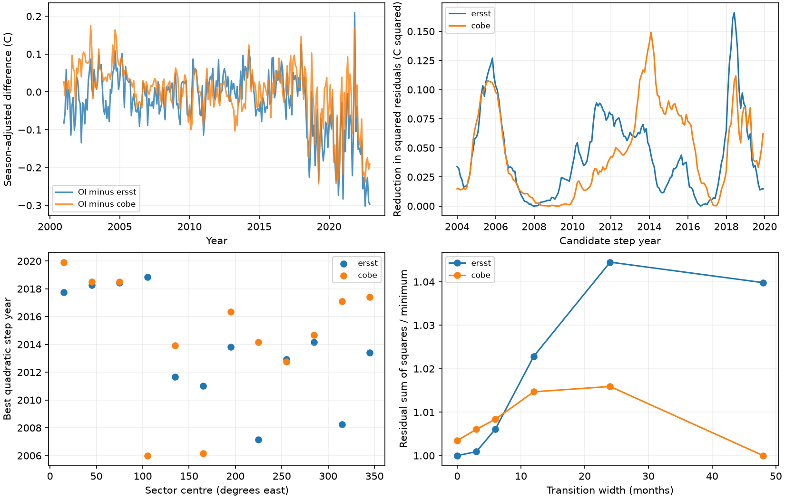

# A fixed June 2018 OI SST v2 step fit is larger at 0-120 E than elsewhere at 40-60 S

## Main result

The June 2018 cold step in NOAA OI SST v2 is not well described as one common Southern Ocean change. In 2001-2022 fits at 40-60 S, its size depends on longitude, the reference product and the model for slow drift. An exploratory spatial test places most of the fitted cold step in 0-120 E. This region has 31.1 percent of the tested area but carries 68.9 to 76.3 percent of the fixed-date quadratic step against two references. The test gives a useful region for a source audit or model forcing experiment. It does not identify a sensor error or establish a new correction field.

In the main fixed mask, a quadratic fit gives a June 2018 step of -0.320 C against ERSSTv5 at 0-120 E, compared with -0.045 C at 120-360 E. Against COBE-SST2 the values are -0.233 and -0.047 C. The spatial step contrasts are -0.275 C (conditional 95 percent interval -0.421 to -0.128) and -0.185 C (-0.312 to -0.041). The region was chosen after the sector scans. These intervals do not account for this spatial selection.



## Why this test was needed

SCI study 9e1a3e72 found a 2018 Southern Ocean OI SST v2 feature. Study 744ca398 showed that this feature reaches the released AMIP monthly SST target. Those results leave an important question: do the data support a synchronized discontinuity across the Southern Ocean, or does a fixed date force a step model onto different regional histories?

We searched the campaign for SST, variance corrections, the Southern Ocean and synchronized discontinuities. We read the source-pattern study, the AMIP transfer audit and the 16-version DOISST correction study e2e438dd. The new work tests date selection, slow drift, longitude sectors and transition width. It uses raw source files with new code, not earlier monthly extracts. It overlaps the earlier observations and is not an independent measurement campaign.

Lund et al. (2023, doi:10.1175/JCLI-D-22-0954.1) explain that trend and serial dependence can alter climate breakpoint conclusions. Menne and Williams (2009, doi:10.1175/2008JCLI2263.1) use pairwise comparisons to help locate artificial shifts. We use relative series, seasonal controls, curved drift controls and a date-search bootstrap. Our source comparisons cannot separate common reference errors from a target error. This is a new application and a spatial diagnosis, not a new general breakpoint estimator.

## Data and tested scope

Three existing shared files were used: NOAA OI SST v2 monthly, ERSSTv5 monthly and JMA COBE-SST2 monthly, all served by NOAA PSL. The data cover January 2001 to December 2022. We read centres from 59.5 S to 40.5 S on the OI one-degree grid. Reference values were assigned from the nearest cell centre with cyclic longitude distance. We did not spatially interpolate or treat cells as independent observations.

The main fixed mask has 6,285 cells. Every product must have finite SST greater than -1 C in every tested month. The warmer mask requires more than 1 C and has 5,165 cells. Counts and weights by longitude sector are in `files/counts.csv`. These masks differ from the prior AMIP audit, which also required agreement with two AMIP releases over a longer period. No AMIP file is used here. Latitude and longitude weights remain fixed in time. Regional means use cosine latitude weights.

Exact shared dataset directories:

- `./datasets/psl-noaa-oisst-v2-1deg-sst-mnmean-20261110/sst.mnmean.nc`
- `./datasets/ersst-v5-psl-sst-mnmean-20261108-olen/sst.mnmean.nc`
- `./datasets/psl-cobe-sst2-sst-mon-mean-20261110/sst.mon.mean.nc`

All three full-file SHA-256 hashes were checked against the shared store records. `files/provenance.json` records resolved paths, exact URLs, byte counts, hashes and original headers. No new download was needed. Product source errors can be shared because all three products use in situ observations.

## Method

The initial design is in `files/PLAN.md`. We fit difference series with an intercept, 11 calendar-month indicators, a polynomial time trend and one step. Degrees one, two and three test linear, quadratic and cubic drift. The date search spans January 2004 to December 2019. Thus at least 36 months remain on each side. We choose the step that gives the greatest reduction in residual sum of squares. This is a single-step model; it does not test the full history of source changes.

A circular residual block bootstrap under the no-step model calibrates the maximum statistic over all 192 dates. It uses 1,999 draws. Main full-mask fits use block lengths 12, 24 and 36 months. Other fits use 24 months. These search p values account for the date search within a fit. They do not account for the choice of product, region, period or model degree. Intervals for step size condition on the fitted date.

We then estimate a date using alternate 30-degree longitude sectors against one reference, and fit its size in the other sectors against the other reference. We reverse the direction. This changes space and reference together, but shared observations and spatial climate dependence prevent a claim of independent validation. We also compare the two references directly as a control.

Under quadratic drift, we compare an abrupt step with centred linear transitions of 3, 6, 12, 24 and 48 months. All transitions search the same centre dates. The residual sums of squares are descriptive fit measures. They are not confidence intervals for the transition width.

After the sector scans, we added the explicit exploratory 0-120 E versus 120-360 E check at fixed June 2018. Step-size intervals use 4,999 circular 24-month residual block draws. They condition on the date, region split, model and reference. See `files/METHODS.md` for equations and exact bootstrap details.

## Results

### The pooled date depends on the reference and drift model

The table uses the main mask and 24-month blocks. Step-size intervals are conditional on the selected date. Search p values test all candidate dates within each model.

| Difference | Drift degree | Best date | Step, C | Search p |
|---|---:|---|---:|---:|
| OI minus ERSST | 1 | June 2018 | -0.152 | 0.0055 |
| OI minus ERSST | 2 | June 2018 | -0.131 | 0.0170 |
| OI minus ERSST | 3 | June 2018 | -0.114 | 0.1085 |
| OI minus COBE | 1 | July 2018 | -0.072 | 0.1675 |
| OI minus COBE | 2 | February 2014 | +0.100 | 0.0595 |
| OI minus COBE | 3 | February 2014 | +0.086 | 0.3225 |
| ERSST minus COBE | 1 | December 2016 | +0.095 | 0.0195 |
| ERSST minus COBE | 2 | September 2014 | +0.049 | 0.2775 |
| ERSST minus COBE | 3 | March 2014 | +0.064 | 0.1380 |

The ERSST linear and quadratic June dates persist across the three block lengths. Their search p ranges are 0.0015-0.0115 and 0.0080-0.0365. The cubic range is 0.0685-0.1390. For COBE, the linear July 2018 date has p=0.1055-0.2030. Thus a negative fixed-date interval against COBE does not imply strong date-search evidence. The reference control also contains a difference change. It shows why neither reference can be assumed stable without a test. It does not locate an error in either one.

With the warmer mask, ERSST still selects June 2018 under quadratic drift, but p rises to 0.0765. COBE selects February 2014. These results do not establish one reference-independent date over the full zonal band. They also do not disprove a real localized 2018 artifact.

### The spatial and reference split is asymmetric

On the main mask, a quadratic ERSST fit on even sectors selects June 2018. At that date, the odd-sector COBE test gives -0.108 C (-0.181 to -0.036). In reverse, odd-sector COBE selects April 2014, and the even-sector ERSST test gives +0.038 C (-0.025 to +0.094). With the warmer mask, neither direction gives a negative interval that excludes zero. Complete results are in `files/crossfit.csv`.

Four of twelve sector scans against ERSST choose dates from October 2017 to November 2018. They are all in 0-120 E. Against COBE, only two sectors select 2018, both in 30-90 E. Other best dates span much of the search window. These are descriptive best dates; a weak series can have an unstable best date. Their spread is not proof that no common smaller shift exists.

### The exploratory spatial contrast survives curved drift

For the main mask, the fixed-date spatial contrast is negative against both references for all three drift degrees. In the warmer mask, both quadratic and cubic contrasts remain negative with conditional intervals below zero. The warmer linear contrast against ERSST includes zero (-0.113 C; -0.228 to +0.002). We report this exception. Individual sector intervals and all model choices are in `files/spatial_fixed.csv`.

Under quadratic drift, the 0-120 E region carries 76.3 percent of the full-band fixed-date step against ERSST and 68.9 percent against COBE, despite having only 31.1 percent of the weighted area. With the warmer mask, its area share is 26.4 percent and the step shares are 68.1 and 63.2 percent. These are linear-estimator decompositions, not causal shares. The rest of the band has unresolved quadratic step intervals against both references. It can still carry a smaller true step.

### The data do not sharply resolve transition speed

Against ERSST on the main mask, the optimized quadratic step has residual sum of squares 0.9540 C squared; three- and six-month transitions give 0.9549 and 0.9599. Even the best 48-month transition gives 0.9920. Against COBE, the best 48-month transition around late 2014 gives a slightly smaller sum than the best abrupt 2014 step (0.9111 versus 0.9143). These small differences do not establish an instantaneous input switch. No transition-width significance test is claimed.



## Interpretation and limits

The new contribution is a spatial constraint and a failure of uniform date validation. The prior fixed-date Southern Ocean feature is real as a product difference. A common June 2018 change across the whole band does not follow from those fits. Under curved drift, most of the June step comes from 0-120 E. This region is a better target for input-source and model-forcing sensitivity tests than one uniform zonal offset.

The region split was selected after the results were seen. Its intervals are exploratory and pointwise. The analysis cannot tell whether the spatial feature comes from a satellite, bias adjustment, sparse in situ sampling, reference drift or different reconstruction of actual ocean variability. A search of public source documentation did not establish a specific OI v2 input change at the fitted date. Documented NOAA-19 concerns in daily SST products cannot by themselves explain this separate weekly-source monthly product. No sensor cause is assigned.

The bootstrap assumes a suitable stationary residual process after detrending. It has only 22 years and can misrepresent longer dependence or time-varying variance. Polynomial trends are controls, not physical models. Multiple steps or other smooth curves could change the estimates. The design uses a period and band informed by prior campaign results. The exact model grid was set before numeric output; the longitude contrast was added after it. No global discovery probability is claimed. No feedback, heatwave, sea-ice or model radiation result is computed here. These results do not validate a climate correction product.

## Reproduction and inspection

Use Python 3.12 with numpy, pandas, netCDF4 and matplotlib. Exact versions are in `files/environment.json`. The scripts use one process and set numerical thread pools to one. They remain within the two-CPU job limit.

On the campaign host, use the shared root. Write outputs outside the signed draft:

```
python work/result/files/analyze.py --datasets datasets --out work/reproduce
python work/result/files/spatial_check.py work/reproduce
python work/result/files/check_math.py
```

After extraction of the verified bundle elsewhere:

```
python files/retrieve.py /absolute/path/to/external_data
python files/analyze.py --datasets /absolute/path/to/external_data --out /absolute/path/to/scratch
python files/spatial_check.py /absolute/path/to/scratch
python files/check_math.py
```

Source URLs are mutable snapshots. Retrieval stops on a hash mismatch; obtain an archived copy with the recorded hash in that case. No claim of permanent source availability is made. Keep raw and monthly derived records external. The package includes all aggregate fit tables, the full date-search gain profiles, sample counts, figures, source metadata, code and numerical checks. No private worktree file is needed after retrieval of the exact sources. The source files are about 777 MB in total. The numerical checks compare every scan gain with direct regression and test recovery of a known step under three trend degrees.

Data provided by NOAA PSL, Boulder, Colorado, USA, from https://psl.noaa.gov/. JMA produced COBE-SST2. See `files/NOTICE_external_data.md` for external rights and credit. All bundled code is new. No external source data or record-level extract is relicensed under the SCI baseline.

## Provenance and references

Campaign 11_07_2026. Job sci-1107-dell-earth-and-ocean-sciences-490c97c30cdb. Topic earth-and-ocean-sciences. Machine dell. Account codex-olen. Model gpt-6.1-sol with high reasoning effort through T3 Code. Analysis date 2026-11-11. All work was done in the assigned worktree. No agents were launched. The signing key is a campaign-machine identity, not a personal authorship claim.

- SCI 9e1a3e72650f07a215accf776c2f88bdb5c9461d78249bc5a59f407e71dac573: SST source patterns and OI v2 step.
- SCI 744ca39845d8ad5a735ec3185724cb75f02f7ced5aacaf95d643fc15df1e68bc: AMIP source-transfer audit.
- SCI e2e438dd3d5117f2238bb0b082b06daea99406355e30019bf8c3e33714fac3b3: uncertainty across DOISST correction choices.
- Reynolds et al. (2002). An improved in situ and satellite SST analysis for climate. doi:10.1175/1520-0442(2002)015<1609:AIISAS>2.0.CO;2.
- Huang et al. (2017). ERSSTv5. doi:10.1175/JCLI-D-16-0836.1.
- Hirahara et al. (2014). Centennial-scale sea surface temperature analysis and its uncertainty. doi:10.1175/JCLI-D-12-00837.1.
- Lund et al. (2023). Good practices and common pitfalls in climate time series changepoint techniques: a review. doi:10.1175/JCLI-D-22-0954.1.
- Menne and Williams (2009). Homogenization of temperature series via pairwise comparisons. doi:10.1175/2008JCLI2263.1.
