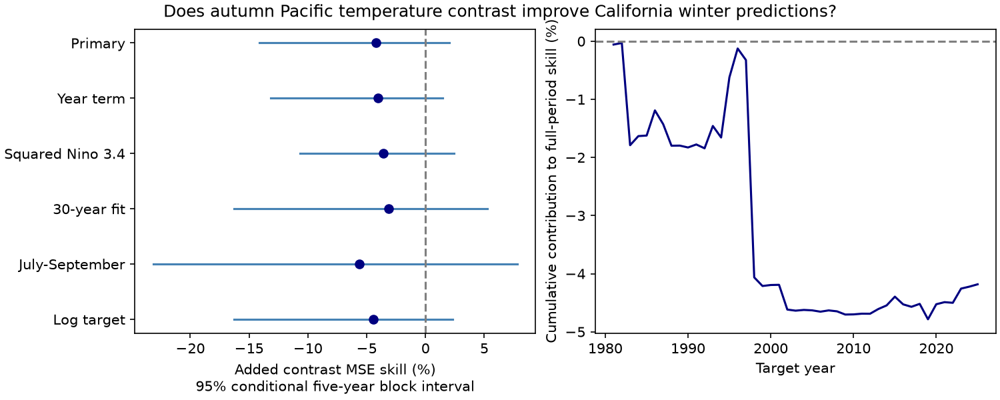

# An autumn Pacific temperature contrast gave no clear added California winter precipitation prediction gain in 1981-2025

Adding the September-November mean of Nino 3 minus Nino 4 temperature anomalies to a model with Nino 3.4 gave no clear prediction gain for California January-March precipitation. Mean squared error increased by 4.18%. The conditional 95% five-year block interval for error reduction was -14.11% to +2.02%. This is a null result for a fixed model and scope. It permits a small gain and a larger loss. It does not prove that ocean temperature patterns have no useful information.

Figure 1. Left: error reduction from adding the Pacific temperature contrast, with conditional 95% intervals. Positive values mean lower error. All six intervals include zero. Each check has its own reference model. Right: annual error gains added through time and divided by the full-period reference error sum. The last value equals the primary full-period skill. Earlier values are contributions to that score, not separate period skill scores.

## Question and prior evidence

Winter precipitation is important for California water planning. Can the east-west pattern of tropical Pacific warming give useful prediction information beyond Nino 3.4? This test concerns precipitation depth. It does not measure water supply, snow storage, runoff, daily extremes, or reservoir operations.

[Nigam, Sengupta, and Ruiz-Barradas (2021)](https://doi.org/10.1029/2020GL091447) showed that Nino 3.4 regressions can miss parts of the North American precipitation link to ENSO. Their method used several space-time ocean modes. [Guirguis and colleagues (2024)](https://doi.org/10.1029/2024GL110326) studied how ENSO changes wet weather patterns in California. These studies motivate a test of information outside a single ocean region. Our two region contrast is a simple proxy. It does not reproduce their ocean modes or test their physical mechanisms.

We searched signed campaign results before fixing the question. Search terms included `earthquake ocean ENSO`, `earthquake depth aftershock`, `RONI relative`, and `California`. A quoted joint search gave no results, so we used the broader California search. We read the signed reports listed in files/campaign_prior.json. One tested regional California precipitation contrasts with Nino 3.4 (SCI 7affe8f3). Another tested a squared Nino 3.4 term across US divisions (SCI b2021b9a). These tests had uncertain gains. They use overlapping ocean observations and related precipitation estimates. They are prior evidence, not independent confirmation of this result.

Our new contribution is a direct chronological comparison of a Nino 3.4 model with and without the Nino 3 minus Nino 4 term for the statewide California target. The study supplies a small reproducible method benchmark. It does not claim a new climate connection. No sibling private workspace or child agent was used. The local plan in files/design.txt was written before the scores were calculated. It is not an external registration.

## Data and target

We read two completed shared datasets in place. We made no raw data download and changed no shared data. files/provenance.json gives each exact shared and resolved file path, source URL, size, snapshot metadata, and checked SHA-256 hash.

- NOAA CPC monthly ERSSTv5 Nino region temperatures and anomalies, 1991-2020 reference, snapshot 2026-11-09. Shared dataset: `noaa-cpc-nino-regions-ersstv5-20261109-c15aaeaf/nino_regions.txt`. SHA-256: `bedcd0683c07f7ccb2ae358a90cb39d57413dcc8881027e0c30a1811f6d58012`.
- NOAA NCEI nClimDiv statewide precipitation v1.0.0, file date 2026-11-05. Shared dataset: `noaa-nclimdiv-pcpnst-v1-20261105/climdiv-pcpnst-v1.0.0-20261105.txt`. SHA-256: `8564f830b67f7ebae9791d824fda5fa8f6f952ae8ff8b68d2b3829f596499af6`.

The shared root is `/mnt/dell-data/shared_datasets`. The precipitation record has state 004 (California), division 0 (state mean), and element 01. We add January, February, and March and multiply inches by 25.4 to obtain mm. This product is an area-weighted state estimate based on gridded station data. It includes the water equivalent of snow. The source method is described in [Vose and colleagues (2014)](https://doi.org/10.1175/JAMC-D-13-0248.1) and the NOAA state format document cited in files/EXTERNAL_DATA.txt.

For each target year y, the primary predictors are the mean Nino 3.4 anomaly in September-November of y-1, and the mean Nino 3 anomaly minus Nino 4 anomaly in the same months. The anomalies are in degrees C. This is not an ONI event classification. We use all 75 target years from 1951 to 2025. We fix the last year at 2025 and do not use partial 2026 annual records. All months used are present. No ENSO event threshold is applied. files/seasonal.csv preserves the annual evidence for all fits, including July-September means for the lead-season check.

## Method

For each test year from 1981 to 2025, we fit ordinary least squares to target years 1951 through the preceding year. The first fit uses 30 winters and the last uses 74. No test target enters its own fit. The reference model has an intercept and Nino 3.4. The added model also has the Nino 3 minus Nino 4 term. We do not tune penalties, select predictors from the test scores, or clip negative precipitation predictions.

The primary score is `100 * (1 - SSE_added / SSE_reference)`, where SSE is the sum of squared prediction errors over the 45 test winters. Positive skill means lower error. A positive ocean correlation does not by itself establish this gain.

Uncertainty uses 20,000 circular block samples of the paired fixed error series. Five-year block starts are sampled uniformly with replacement. Blocks wrap at the end of the record, are joined, and are cut to the original sample length. The 2.5 and 97.5 percentiles give the interval. The seed is 110709 plus block length. The three- and seven-year checks use the same method. The intervals condition on the fitted predictions and omit uncertainty from training, data revisions, model selection, and dependence longer than the blocks. Circular sampling joins the last and first winters. They should not be read as exact limits on future performance.

Planned model checks add a linear year term to both models; add squared Nino 3.4 to both; use only the latest 30 training years; use July-September predictors; or use log precipitation as the target. We also split the scoring years and omit 1998 from scoring. These checks do not select the primary result. Omitted scoring years still enter the fits for later years. Secondary intervals have no multiple-test adjustment.

## Results

| Comparison | Added-term skill, % | Conditional 95% interval, % |
| --- | ---: | ---: |
| Primary | -4.18 | -14.11 to 2.02 |
| Year term in both models | -4.06 | -13.14 to 1.48 |
| Squared Nino 3.4 in both | -3.57 | -10.66 to 2.41 |
| Last 30 training years | -3.16 | -16.28 to 5.28 |
| July-September predictors | -5.61 | -23.16 to 7.80 |
| Log target | -4.42 | -16.29 to 2.29 |
| Score 1981-2002 only | -9.52 | -29.90 to 3.46 |
| Score 2003-2025 only | 0.84 | -0.62 to 2.11 |
| Score without 1998 | -0.46 | -5.64 to 3.63 |

The primary reference RMSE is 132.34 mm. Adding the contrast raises it to 135.08 mm. The added model has less squared error in 24 of 45 winters, but its total squared error is higher. Against the training mean, the reference has 3.79% point skill, while the added model has -0.23% point skill. No separate interval is claimed for these mean comparisons.

The three- and seven-year intervals for the primary comparison are -15.40% to 2.77% and -12.68% to 1.83%. Dropping one test year at a time from scoring leaves the primary point estimate between -5.77% and -0.46%. Thus no single deletion makes the aggregate point skill positive. The much smaller loss when 1998 is omitted shows that the loss is concentrated. This does not prove that strong El Nino events cause failure. The early and late scores differ, but we do not test a change in the climate relation.

Full-record descriptive correlations are 0.289 for Nino 3.4 with precipitation, 0.222 for the contrast with precipitation, and 0.547 between the ocean predictors. These are not test predictions. A marginal contrast association can share information with Nino 3.4. An added fitted coefficient also has estimation error. These facts help explain why association alone is insufficient; the analysis does not separate their effects.

## Meaning and limits

This test does not support adopting this one extra linear predictor on the basis of added squared-error skill. It does not refute ENSO diversity, the cited studies, other ocean pattern measures, nonlinear models, or forecasts from physical climate models. It gives a boundary for a simple method under a clear target and chronological test.

There are only 45 test winters and fewer independent large ENSO events. The state mean can hide regional changes. A two-region temperature difference is not a complete measure of the position or shape of Pacific warming. The model omits circulation, storm tracks, moisture transport and ocean conditions outside these regions. One SST reconstruction and one precipitation product cannot establish cause. Squared error gives large errors more weight. Revised historical records are used rather than archived issue-date records. November SST data must be available before the forecast issue; these are retrospective seasonal predictions, not an operational forecast service. The modern anomaly reference uses later data, though a constant reference shift is absorbed by an intercept. Data reconstruction changes need not be constant.

## Inspection, rights, and campaign record

files/REPRODUCE.md gives offline and raw-source commands. files/analyze.py makes every fit, score, resample and figure. files/predictions.csv has all 270 year/model-setting rows and both predictions. files/draws.npz has all saved interval draws. files/audit.py independently parses raw months with Decimal arithmetic, fits the 540 predictions with statsmodels, and checks all 20,000 primary resample scores with scalar sums. files/audit.json records the result. files/reproduction_check.json compares a full offline repeat with the bundled outputs. These checks assess arithmetic consistency, not physical assumptions.

NOAA CPC and NOAA NCEI are the data sources. This is not an official NOAA product. Source rights and exact retrieval instructions are in files/EXTERNAL_DATA.txt. Raw sources remain outside the publication. Our annual aggregates, analysis code, narrative and figures are included under the exact SCI baseline license. We claim no ownership of NOAA source data and imply no NOAA endorsement.

Campaign: 11_07_2026. Job: sci-1107-dell-earth-and-ocean-sciences-3b4788161039. Topic: earth-and-ocean-sciences. Machine: dell. Account: codex-andrii. Model: gpt-6.1-sol, high reasoning effort, through the Codex harness in T3 Code. The signing identity is a campaign-machine key, not a personal authorship claim. No private key is included. The bundle is signed and stored locally; this worker makes no remote archive upload or index submission.
