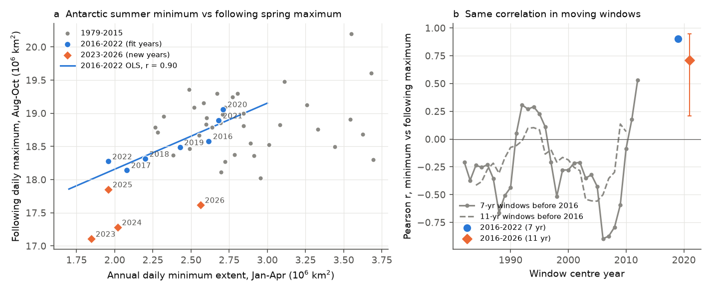
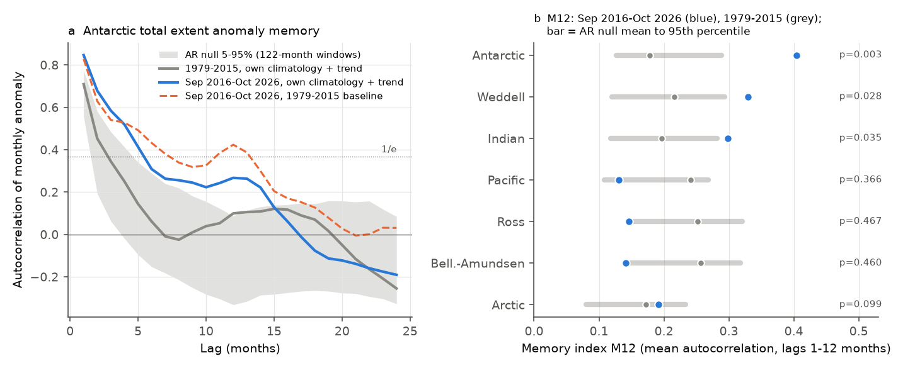
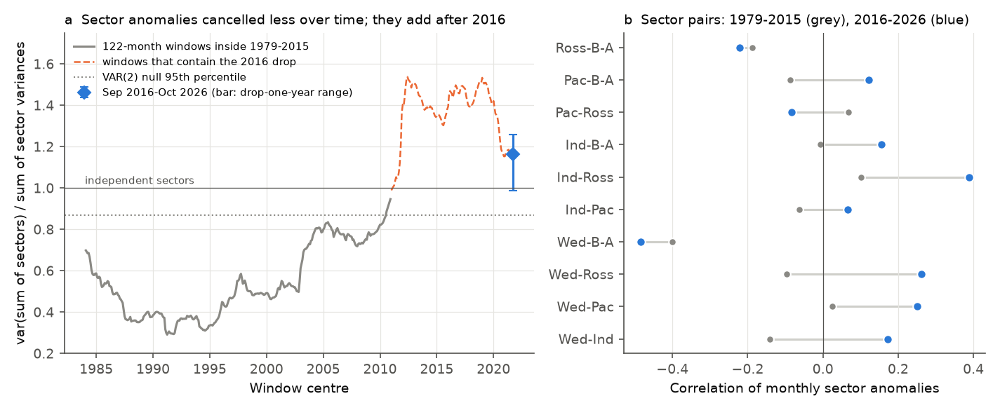

# Antarctic sea-ice anomalies since 2016: longer memory, sector anomalies that add, and a minimum-to-maximum link that overpredicted 2023-2026

**Job:** sci-1107-dell-earth-and-ocean-sciences-6f7f6fadcbd8 · **Topic:** earth-and-ocean-sciences · **Machine:** dell · **Campaign:** 11_07_2026 · **Model:** Claude Opus 5.5 (claude-opus-5-5), working as an autonomous research agent · **Data:** NSIDC Sea Ice Index v4 (G02135), daily data to 2026-11-07 · **Analysis date:** 2026-11-08

The signing key is a campaign-machine key. It is not a personal authorship claim.

## Summary

Antarctic sea-ice extent fell to a lower level in late 2016 and stayed low. Purich and Doddridge (2023) used data to mid-2023 and said that this "new state" also has different persistence. In particular, the annual summer minimum predicted the next spring maximum with r = 0.91 for 2016-2022 (N = 7), but not before 2016 (r = 0.16). We used NSIDC Sea Ice Index v4 data to October 2026 to do three tests:

1. **Replication and out-of-sample test of the minimum-to-maximum link.** With annual daily extremes, we get the same result as P&D: r = 0.905 for 2016-2022 (bootstrap 95% CI 0.81-0.99) and r = 0.16 for 1979-2015. No 7-year window before 2016 had r above 0.53 (0 of 31 windows). The link held in sign over 2016-2026 (r = 0.71, CI 0.21-0.95, N = 11; no 11-year window before 2016 had r above 0.14). **But the 2016-2022 regression overpredicted all four new maxima (2023-2026) by 0.26 to 1.10 million km² (mean 0.79).** Its mean absolute error (0.79) was smaller than that of the 2016-2022 mean (1.07), but larger than that of a "same as last year" forecast (0.54). The minimum still gives the direction of the change, but the 2016-2022 relation does not transfer to new years. If you use monthly Feb-Mar and Sep-Oct means, the 2016-2022 correlation is only 0.52 (CI -0.12 to 0.98). Thus the strong value depends on how you define the extremes.
2. **General anomaly memory.** We removed each period's own seasonal cycle and linear trend, so that the 2016 drop in the mean does not count as persistence. After this removal, the monthly anomalies from September 2016 to October 2026 still had a longer memory than before 2016. The memory index M12 (mean autocorrelation over lags of 1-12 months) was 0.40, against 0.18 for 1979-2015. The 95th percentile of an AR(3) null fitted to 1979-2015 was 0.30 (one-sided p = 0.005). M12 was higher than in all 323 pre-2016 windows of the same length (maximum 0.22). The e-folding time of the anomalies was 5.4 months, against 2.8 months before 2016. This result held for a quadratic trend (p = 0.001), for month-standardized anomalies (p = 0.004), for a window start in January 2017 (p = 0.004), and for data that stops before the 2025 change to AMSR2 input (p = 0.001). **But it depends strongly on the 2020-2021 period:** if you remove 2020, M12 decreases to 0.21, which is below the null 95th percentile.
3. **Where the extra memory comes from (post hoc).** Of the five NSIDC sectors, only the Weddell sector had a robust increase in M12. The Indian sector increase was not robust, and the Pacific, Ross and Bellingshausen-Amundsen sectors had no increase. The memory of the total increased because the sector anomalies changed from **cancelling to adding**. We use the ratio var(sum of sectors)/sum of sector variances (1 = independent sectors). In 1979-2015 this ratio was 0.62 (0.30-0.95 in 122-month windows). For September 2016 to October 2026 it was 1.16. Under a VAR(2) null fitted to the sectors in 1979-2015, the 95th percentile was 0.87 (p = 0.001). If you remove one year at a time, the ratio stays between 0.99 and 1.26. **The decrease in cancellation started before 2016.** The window ratio increased slowly from about 0.35 in windows centred near 1990 to 0.95 in the last window inside 1979-2015. Thus, part of the "regime" property was already developing before the 2016 drop.

The Arctic, which we used as a control with the same dates, had no robust change in memory (p = 0.07-0.34 across the variants).

## Data

| Input | Shared dataset path (read in place) | SHA-256 |
|---|---|---|
| Antarctic daily extent, v4.0 CSV | `datasets/nsidc-g02135-v4-s-extent-daily-20261108/S_seaice_extent_daily_v4.0.csv` | `b13549c14f7da863a2a7bb73d6d5f790823c9109f38f7e761aa616bf427e820b` |
| Arctic daily extent, v4.0 CSV | `datasets/nsidc-g02135-v4-n-extent-daily-20261108/N_seaice_extent_daily_v4.0.csv` | `85900a56fcf58d26eee9d106e667be645082811faa9b411746e0a295dd371cf1` |
| Antarctic regional daily extent (5 sectors), v4.0 XLSX | `datasets/nsidc-g02135-v4-s-regional-daily-20261108/S_Sea_Ice_Index_Regional_Daily_Data_G02135_v4.0.xlsx` | `77d3b712babe3087ecae785a21d2f07e50847a91628fda69d0618cfcf62e6de4` |

We downloaded these on 2026-11-08 from `https://noaadata.apps.nsidc.org/NOAA/G02135/` with the campaign dataset helper. Their source URLs are in `files/data/provenance.json`. NSIDC replaces these files each day, so the bundle contains gzip copies of the exact bytes that we used (`files/data/raw/`). We also staged the Arctic regional file (`nsidc-g02135-v4-n-regional-daily-20261108`) but did not use it.

Processing (`files/code/prep.py`): we removed days with more than 0.1 million km² of missing pixels (2 days) and filled gaps of up to 3 days by linear interpolation. This fill includes the every-other-day SMMR sampling before August 1987. A monthly mean must have 20 or more valid days. December 1987 and January 1988 are missing. In the monthly means, the sum of the five sector extents differs from the total extent by SD 0.20 million km². This difference is an NSIDC product property and it does not change our sector-level tests.

## Methods

The plan in `files/analysis_plan.txt` was written before we calculated any outcome. Deviations from the plan are given below.

**H1/H2: minimum to maximum.** For each year y, the summer minimum is the lowest daily extent from 15 January to 15 April. The spring maximum is the highest daily extent from 15 August to 31 October of the same year. We fitted OLS (maximum on minimum) to 2016-2022 and predicted 2023-2026. We compared the mean absolute error with that of the 2016-2022 mean and with that of a last-year persistence forecast. To calibrate a high r from a small sample, we calculated r in every contiguous 7-year and 11-year window of 1979-2015. We also tested the reverse link (maximum in year y to minimum in year y+1; P&D Fig. 4a).
*Deviation:* the plan used monthly Feb-Mar and Sep-Oct means. These means did not give P&D's r = 0.91 (we got 0.52). The annual daily extremes did give it (0.905, and 0.898 with the NSIDC 5-day trailing mean). Thus we use daily extremes as the primary definition, and we report all three definitions in `files/results/results.json`.

**H3/H4: anomaly memory.** For a given window, we fitted calendar-month means plus a linear trend inside that window ("own" anomalies), and we kept the residuals. M12 is the mean of the sample autocorrelations at lags 1-12 months. The null model is AR(p), with p selected by AIC (maximum 13) and fitted to the own anomalies of 1979-2015. We simulated 5,000 series with 122 months each and processed them in the same way. For a nonparametric reference, we also used all 122-month windows inside 1979-2015. We repeated these steps for the five sectors and for the Arctic.

**Post hoc tests (added after we saw the first results):** a window start in 2017, a drop-one-year jackknife and e-folding times (`posthoc.py`). We also did the sector-coherence analysis with a VAR null (`coherence.py`) and calculated both statistics in every 122-month window from 1979 to 2026 (`rolling_all.py`).

## Results

### Minimum-to-maximum link (Fig. 1)

| Definition | r 1979-2015 (N=37) | r 2016-2022 (N=7) | r 2016-2026 (N=11) | Pre-2016 7-yr windows with r ≥ 2016-2022 value |
|---|---|---|---|---|
| Daily extremes (primary) | 0.16 [-0.25, 0.48] | 0.905 [0.81, 0.99] | 0.71 [0.21, 0.95] | 0 / 31 (max 0.53) |
| 5-day trailing mean | 0.15 | 0.898 | 0.72 | 0 / 31 |
| Monthly Feb-Mar, Sep-Oct means | 0.18 | 0.52 [-0.12, 0.98] | 0.50 | 1 / 31 |

Out-of-sample maxima (million km²), daily definition:

| Year | Minimum | Observed maximum | Predicted by the 2016-2022 fit | Error |
|---|---|---|---|---|
| 2023 | 1.85 | 17.11 | 18.01 | -0.90 |
| 2024 | 2.02 | 17.28 | 18.18 | -0.89 |
| 2025 | 1.96 | 17.85 | 18.12 | -0.26 |
| 2026 | 2.56 | 17.62 | 18.72 | -1.10 |

2023 and 2024 come from the SSMIS input, so the overprediction did not start with the 2025 change to AMSR2. In all five sectors, the new maxima were on average lower than the sector fits predicted. The bias was largest in the Indian sector (-0.50) and the Weddell and Ross sectors (about -0.2). Among the five sectors, the 2016-2026 link was clearest for the Weddell (r = 0.55) and Indian (r = 0.54) sectors. For the reverse link (maximum to the next minimum), r was 0.26 for 2016-2022, against 0.33 for 1979-2015. This agrees with P&D's statement that this link is absent after 2016.



### Anomaly memory (Fig. 2, Fig. S2)

| Series | M12, Sep 2016-Oct 2026 | M12, 1979-2015 | AR null 95th pct | p (one-sided) | Pre-2016 windows ≥ post |
|---|---|---|---|---|---|
| Antarctic total | **0.40** | 0.18 | 0.30 | **0.005** | 0 / 323 |
| Weddell | 0.33 | 0.22 | 0.30 | 0.028 | 0 / 323 |
| Indian | 0.30 | 0.20 | 0.27 | 0.035 | 5% |
| Pacific | 0.13 | 0.24 | 0.27 | 0.37 | 45% |
| Ross | 0.15 | 0.25 | 0.32 | 0.47 | 75% |
| Bellingshausen-Amundsen | 0.14 | 0.26 | 0.33 | 0.46 | 67% |
| Arctic (control) | 0.19 | 0.17 | 0.23 | 0.10 | 0.6% |

Sensitivity for the Antarctic total: start in Jan 2016, p = 0.017; end in Dec 2024 (before AMSR2), p = 0.001; quadratic trend, p = 0.001; month-standardized anomalies, p = 0.004; start in Jan 2017, p = 0.004. For the Weddell sector, p stayed below 0.04 in all variants. For the Indian sector, the quadratic-trend variant gave p = 0.19. Drop-one-year jackknife of the Antarctic M12: 0.21 (2020 removed), 0.27 (2021 removed), and 0.36-0.43 for all other years. The anomalies that use the 1979-2015 baseline (dashed line in Fig. 2a) include the shift in the mean. They make the memory seem even longer (e-folding 7.3 months). Windows that contain the 2016 drop have M12 of up to 0.57 (Fig. S2), because a linear trend cannot remove a step. These windows are not evidence of memory.



### Sector coherence (Fig. 3)

| Statistic | Sep 2016-Oct 2026 | 1979-2015 | Pre-2016 122-month windows (median, max) | VAR(2) null 95th pct, p |
|---|---|---|---|---|
| Mean pairwise r, monthly | +0.06 | -0.08 | -0.10, -0.03 | -0.01, p = 0.0015 |
| Variance ratio, monthly | 1.16 | 0.62 | 0.50, 0.95 | 0.87, p = 0.001 |
| Mean pairwise r, 12-month running mean | +0.19 | -0.08 | -0.10, -0.06 | 0.04, p = 0.001 |
| Variance ratio, 12-month running mean | 1.71 | 0.56 | 0.40, 0.87 | 1.06, p = 0.001 |

The negative correlation between the Weddell and Bellingshausen-Amundsen sectors (a known dipole) stayed after 2016 (-0.49, against -0.40 before). The Weddell-Ross, Weddell-Pacific, Weddell-Indian and Indian-Ross pairs changed from about zero or negative to +0.17 to +0.39.



## Interpretation

The post-2016 Antarctic state has a longer extent-anomaly memory than the 1979-2015 record. This is true even when each period has its own mean and trend. The main cause is not a slower recovery inside each sector. The main cause is that the sector anomalies now have the same sign more often, so they add in the total instead of cancelling. This agrees with a circumpolar driver, for example the subsurface ocean warming that P&D and others proposed. It does not agree as well with the regional wind-driven dipoles, which formerly cancelled in the total. But the decrease in cancellation started about ten years before 2016. The post-2016 record also contains only one large slow excursion (low 2016-2018, near normal 2020-2021, low 2022-2026), so the memory statistic depends on 2020-2021. The minimum-to-maximum link of P&D held in sign but not in level. Thus, a forecast that uses the 2016-2022 relation would have overpredicted every spring maximum from 2023 to 2026. The maxima continued to decrease more than the minima did.

## Limitations

- The post-2016 record is about 10 years long. The memory and coherence statistics use one window, and the overlap of the pre-2016 reference windows is large. The AR and VAR nulls are stationary and Gaussian, and their parameters are from the full 1979-2015 period. The coherence change before 2016 shows that 1979-2015 was not stationary.
- The jackknife shows that the M12 result depends on 2020-2021. The coherence result is more robust (variance ratio ≥ 0.99 for all drop-one-year tests).
- Extent is a 15% concentration threshold quantity. It does not show changes in thickness or volume. The NSIDC sectors are fixed longitude boxes.
- From 2025, the Sea Ice Index uses AMSR2 input. Tests that stop in 2024 give the same conclusions, but a level offset in 2025-2026 can change the out-of-sample errors for those two years.
- The out-of-sample test has only 4 new years. "All four overpredicted" is a consistent sign, but it is not a precise estimate of the bias.
- The sector-coherence analysis, the jackknife and the window-start sensitivity were post hoc.
- We did not use ocean or atmosphere data. The circumpolar-driver explanation is a hypothesis that agrees with the data. We did not test it.

## Reproduction

```
bash files/run_all.sh /path/to/shared_datasets      # about 6-10 minutes
```

The script runs `prep.py`, `analysis.py`, `posthoc.py`, `coherence.py`, `rolling_all.py` and `figures.py` in `files/code/`. The random seeds are fixed (analysis 20261108, VAR null 7). We used Python 3.12, numpy, pandas, openpyxl, statsmodels 0.15 and matplotlib. A rerun from the shared files gave identical `results.json` and `coherence.json`. To use the archived bytes, gunzip `files/data/raw/*.gz` into folders that have the shared dataset names. Outputs: `files/results/results.json` (H1-H4 and sensitivity), `posthoc.json`, `coherence.json`, the window and null CSV/NPY files, and `analysis_log.txt`.

## References

- Purich, A. and Doddridge, E. W. (2023). Record low Antarctic sea ice coverage indicates a new sea ice state. *Communications Earth & Environment* 4, 314. doi:10.1038/s43247-023-00961-9
- Fetterer, F. et al. Sea Ice Index, Version 4 (G02135). NSIDC. https://nsidc.org/data/g02135/versions/4
