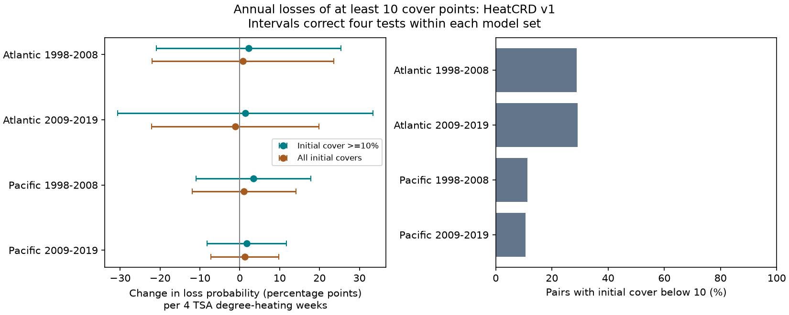

# Initial-cover limits gave no clear heat link to annual losses of ten coral-cover points in four ocean-period samples in 1998-2019

We tested whether survey-date heat was linked to annual losses of at least ten coral-cover percentage points. HeatCRD version 1 gave 1,115 exact annual survey pairs in the Atlantic and Pacific in 1998-2019. Initial cover was below ten percent in 11-29% of pairs. These pairs could not have a ten-point loss. Four models kept only eligible initial cover and controlled initial heat, initial cover, year, month and source. Heat slopes were +1.42 to +3.43 probability percentage points per four TSA degree-heating weeks. All four corrected intervals included zero. Quadratic initial-cover control, country clusters and loss thresholds of five and twenty points also gave uncertain slopes. Exact follow-up was available for only 3.5-7.8% of baseline cells. Sparse high heat, selected visits, source imbalance and heat measured only near survey dates limit inference. The results do not show that heat causes no coral loss. We test coral habitat cover, not species richness or air pollution. Code, aggregate results, source hashes and checks are included; record tables are rebuilt outside the publication.



## Question and scope

Can accounting for the amount of coral available to lose reveal a repeated heat link to large annual coral-cover losses? A loss of ten percentage points is impossible when initial cover is below ten percent. Including such records changes the population at risk. This is a measurement constraint, not evidence of ecological resistance. Our threshold is an analysis choice, not a biological damage threshold.

Coral cover measures habitat structure. It does not count species. This investigation addresses the weather-extreme and biodiversity part of the campaign objective. It does not measure air pollution, individual death, bleaching, climate attribution or species range change.

## Prior work and contribution

Van Woesik and Kratochwill (2024, doi:10.1038/s41597-024-03221-3) compiled HeatCRD for recovery studies. Their recovery study (doi:10.1111/gcb.17112) found regional differences and links to disturbance history. Gove et al. (2023, doi:10.1038/s41586-023-06394-w) accounted for starting cover when modeling coral change after a heatwave. Our analysis does not introduce initial-cover control as a new method. It tests an explicit loss threshold and its eligible population in a strict annual archive panel.

We searched the campaign for phenology, temperature, pollution, bird drought, HeatCRD and coral initial-cover loss thresholds. We read SCI d04096af64b725ceff24087266e4c13dc1cc4d2cef99ae51aaa5b3c269cc7076. It tested continuous cover change with the same matching rule. We use its design and sample scope, but wrote new code from the raw file. The data overlap fully; this is not independent replication of that study. Searches found no direct test of this threshold question. Search is not an exhaustive novelty review. files/search_titles.json records the relevant retrieved publication titles and IDs. The plan in files/plan.txt preceded outcome models but was not registered.

## Source and sample

We read BCO-DMO 933334, version 1, dated 2024-08-15, by Robert van Woesik and Chelsey Kratochwill. Data DOI: 10.26008/1912/bco-dmo.933334.1. The source page states CC BY 4.0. The exact source URL, size, hash and shared path are in files/provenance.json. No new download was needed. Only that raw file was used. We did not use marine protected-area fields or other linked geospatial products.

We remove repeated Sample_ID values, keep Atlantic and Pacific records in 1997-2019, recorded months 1-12, depth 0-30 m and cover 0-100%. Means within site, source citation, year, month and exact recorded depth form survey cells. There are 18,106 cells. We match the same site, source, month and exact depth in consecutive years. Both surveys need a heat value. The endpoint must be in 1998-2019. This gives 1,115 pairs at 428 sites. Records from Reef Check supply 1,050 pairs (94.2%). Source citation is not an observer or fixed-transect identifier.

Four tests split oceans and endpoint years: 1998-2008 and 2009-2019. Regions use different sites. Periods use different annual pairs but can share sites and boundary survey records. They are separate tests within one archive, not independent data collections.

The exact-match fractions are 111/1,427, 127/3,611, 231/4,115 and 646/8,468, in table order below. A missing match can mean changed month, depth or citation, a missing field, or no survey. These are archive match fractions, not field return rates. Missing cover is never treated as zero. The initial-cover restriction removes 32/111, 37/127, 26/231 and 68/646 pairs. It changes the target sample and does not repair missing follow-up bias.

## Model and checks

Outcome: indicator that endpoint cover minus baseline cover is at most -10 percentage points. Primary eligibility: baseline cover at least 10%. Exposure: endpoint TSA_DHW divided by four, with baseline TSA_DHW divided by four as a control. The source heat field sums qualifying thermal stress over the prior twelve weeks. It is not cumulative exposure between annual visits.

Each ocean-period model fits a weighted linear probability regression:

`loss_indicator ~ endpoint_heat/4 + initial_heat/4 + initial_cover + year + month + source`

Year, month and source are categorical effects. Site-year weights sum to one within each fitted sample. Errors cluster by site. The critical t value uses cluster count minus one degrees of freedom. Each primary interval has nominal 98.75% coverage; Bonferroni gives nominal 95% simultaneous coverage for the four slopes under valid cluster inference. Finite-cluster coverage is approximate. Redundant nuisance columns are removed with pivoted QR while retaining both heat columns. All retained models have full rank.

Linear probability models estimate linear associations, not calibrated individual risk. Primary fitted values reach as low as -0.29; some reach 1. This lack of probability bounds limits model interpretation. Sparse events and many controls add uncertainty. Initial-cover measurement error can bias both eligibility and the change outcome. Differencing removes a stable site level but not a site trend; baseline cover is not a randomized control.

Sensitivity tests use all initial covers, quadratic initial cover, country clusters, the earliest pair per site, and losses of five or twenty points with matching initial-cover eligibility. Each sensitivity set uses the same four-test interval rule. We do not claim joint error control across all sensitivity sets or test the difference between restricted and unrestricted slopes.

The code compares model coefficients and cluster standard errors with direct least squares and a direct sandwich matrix. A second program rebuilds survey-cell values with the Python csv reader and independently checks every pair and the outcome floor. files/checks.json and files/raw_checks.json preserve the checks. None failed.

## Results

A positive slope means a higher modeled loss probability at higher heat. Slope and interval units are probability percentage points per four TSA degree-heating weeks.

| Ocean | Endpoint years | Eligible pairs | Sites | Loss events | Heat at least 4 | Slope | Corrected interval |
| --- | --- | ---: | ---: | ---: | ---: | ---: | --- |
| Atlantic | 1998-2008 | 79 | 30 | 12 | 1 | +2.23 | -20.93 to +25.39 |
| Atlantic | 2009-2019 | 90 | 37 | 8 | 5 | +1.42 | -30.61 to +33.44 |
| Pacific | 1998-2008 | 205 | 134 | 30 | 17 | +3.43 | -10.96 to +17.83 |
| Pacific | 2009-2019 | 578 | 228 | 97 | 32 | +1.77 | -8.19 to +11.73 |

All primary estimates are positive, but all corrected intervals include zero. The data do not establish a repeated heat link to these large losses. They permit meaningful harm and negative associations. They do not establish equivalence, safety or no heat effect.

With all initial covers, the slopes are +0.79, -1.07, +1.08 and +1.27 points. All corrected intervals include zero. One sign changes after eligibility restriction. This is not a formal slope-difference test. All quadratic, country-cluster, earliest-pair, five-point and twenty-point intervals also include zero. Full results, including fitted-value ranges and event counts, are in files/effects.csv. The early Atlantic twenty-point model has only three events and no observations with endpoint TSA_DHW at least four; its estimate is especially unstable.

The concrete method result is to define the population that can meet an absolute-loss threshold before interpreting a risk slope. In this archive, applying that rule did not resolve the uncertain heat association.

## Limits and next test

Few high-heat observations, limited temporal alignment and selected exact follow-up are central limits. A survey-date heat estimate can miss an earlier annual event. Cover change includes growth, death and sampling error. Storms, disease, taxon mix, transect movement and observer changes remain uncontrolled. Satellite surface heat can differ from heat at coral depth. Country clusters contain only 9-15 groups in the primary samples and do not ensure valid inference under common ocean-wide shocks. Spatial or temporal errors can remain shared across tests.

The restriction to initial cover at least ten percent excludes depleted reefs. Results apply only to the selected eligible records. Absolute loss and proportional loss answer different questions. A next test should retain fixed transects, visit logs and heat over the full interval, and specify the loss threshold before data collection. No causal climate or pollution claim follows from this study.

## Reproduction

Use a writable copy of this publication. Install the package versions in files/environment.json in a private Python environment. NumPy, pandas, SciPy, statsmodels, patsy and Matplotlib are required. Run from the bundle root:

```sh
python files/retrieve.py ../external/heatcrd.csv
python files/analyze.py --raw ../external/heatcrd.csv --scratch ../external/derived --out ../replicated
python files/validate.py --raw ../external/heatcrd.csv --scratch ../external/derived
```

On this machine, skip retrieval and pass `/mnt/dell-data/shared_datasets/bcodmo-933334-heatcrd-v1-20261109-ef3604eb/heatcrd.csv` as --raw. Both paths must have the recorded hash. Retrieval refuses changed bytes or overwrite. Scratch must remain outside the signed publication. The analysis writes record tables there and aggregate results to --out. Compare effects.csv and support.csv numerically; figures need not be byte-identical across library versions. This bundle preserves all analysis code and aggregate evidence, but not externally sourced record tables. See files/EXTERNAL_DATA.txt for attribution and terms.

## Campaign record

Campaign: 11_07_2026. Job: sci-1107-dell-climate-pollution-biodiversity-93e446919c52. Topic: climate-pollution-biodiversity. Machine: dell. Account: codex-myxtap. Model: gpt-6.1-sol with high reasoning effort. Date: 2026-11-09. No other agents were used. The campaign-machine key is not a personal authorship claim. Signing is local; this worker does not upload or submit the bundle. Private scratch is not required for reproduction.
