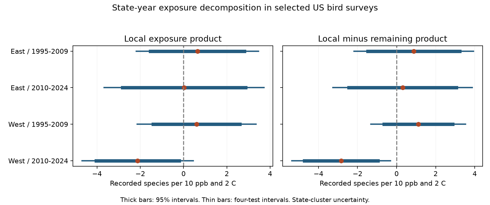

# Local and remaining ozone by warmth slopes differed in one of four US bird samples in 1995-2024

We separated a seasonal ozone by warmth product into local and remaining terms. We used 30,465 selected US Breeding Bird Survey records in four region and period samples. Each model controlled route-observer groups, state-year groups and survey conditions. All four corrected intervals for the local product included zero. The local-minus-remaining contrast was below zero only in the West in 2010-2024: -2.84 recorded species per 10 ppb and 2 C, with a four-test interval of -5.37 to -0.31. A stricter sample gave the same broad result. This test rejects a common coefficient for the two product terms in that one sample. It does not establish a causal pollution effect or a regional difference.

## Question and prior evidence

Can one ozone by warmth coefficient represent both local exposure differences and terms that contain broader state-year conditions? This matters because environmental exposures share spatial patterns. An annual regional control removes a regional mean outcome. It does not remove all products between local and regional exposure terms.

Liang et al. reported an ozone association with bird counts and conservation benefits from pollution rules (doi:10.1073/pnas.2013568117). Genser et al. showed why within-area and between-area exposure associations can differ (doi:10.1186/s12940-015-0047-2). We use that scale distinction to motivate an algebraic diagnostic. Their studies do not validate our bird model or make this diagnostic causal.

We searched signed campaign results for climate, pollution, phenology and ozone. SCI 2603c41c supplied the original BBS exposure panel. SCI 1476b687 tested its seasonal ozone by warmth product and found a negative early western estimate that did not repeat. SCI c0d5d145 separated linear route exposure trends from residual products. Our test instead separates state-year exposure means from local deviations. It also changes the fixed effects and sample. This is exploratory work informed by those results. It is not an independent biological replication. The plan in files/PLAN.txt was saved before these outcome fits.

## Data

The direct input is the exact files/analysis_panel.csv.gz from verified SCI 1476b68714a3433f1a6efc168fb650faa15d11997d8c0c4e96b40e4cefde95b4. We preserve it as files/input_panel.csv.gz. It has 32,458 eligible records. It uses the BBS 2025 release through 2024, EPA AQS ozone snapshots, NOAA county weather and Census county points. The newer BBS release in the shared dataset store is not our source.

The prior ozone measure is the previous May-September mean daily maximum eight-hour ozone. It uses distance-weighted monitor values within 50 km of route starts. The source has a 75% calendar-day coverage rule. Its site-day count does not constitute a new audit of missing concentrations. Prior temperature is the previous May-June mean daily maximum temperature. The ozone and temperature windows only partly overlap. County matching uses the nearest county internal point. These measures do not describe a daily heat wave.

The source retains standard accepted BBS runs with valid survey dates, times, duration, observer fields, temperatures, wind and sky codes. The exact inherited rules are in files/parent_methods.md. The outcome is recorded species richness after the inherited removal of unidentified taxa, hybrids and forms. It is not true richness or an occupancy estimate. O and H are inherited full-period route anomalies in prior ozone and temperature, scaled by 10 ppb and 2 C. Their route means stay fixed across the new samples. files/data_dictionary.md describes the other fields.

No shared raw file was read or downloaded in this job. We inspected relevant shared dataset names and used published evidence. files/provenance.json records the exact shared campaign ZIP path, resolved path, ZIP hash and input hash. files/parent_provenance.json and files/raw_provenance.json record inherited source versions, paths, URLs and hashes. Historical dataset paths may no longer exist after the disk failure. We did not inspect the failed disk or recheck those raw hashes.

East means longitude greater than -100 degrees. West means longitude at or below -100 degrees. The survey periods are 1995-2009 and 2010-2024. There are no 2020 surveys in this panel. Each final state-year must contain at least five distinct routes. We remove singleton route-observer and state-year groups and repeat the rules until the sample is stable. Means are then computed in each final sample. The four samples share no survey records. Routes can occur in both periods. Shared source methods and climate can link the samples, so they are not four independent experiments.

## Method

Within each final state-year, let Ob and Hb be the sample means of O and H. Define u = O - Ob and v = H - Hb. Then:

OH = uv + u Hb + v Ob + Ob Hb.

The local product is A = uv. The remaining product is B = OH - A. The joint model fits separate coefficients for A and B. The Ob Hb term is constant within state-year and is removed by the fixed effects. Thus the fitted B coefficient concerns the two cross terms together. It is not a pure between-state effect. The term A still contains persistent local spatial differences; it is not a pure annual shock.

The model also includes O and H, prior H squared, current ozone, current temperature and its square, prior and current rainfall, survey day and its square, start time, duration, start and end temperature, start and end wind and sky classes, assistant class and first-observer-year status. The state-year means of the exposure main terms are absorbed by state-year intercepts. Route-observer intercepts control fixed route and observer differences. This reduces some observation bias but does not remove all detection changes. Survey controls can themselves respond to environmental conditions.

The primary local-product target is beta_A. The primary contrast is beta_A - beta_B. We use separate four-test families for these two questions. Each family uses 98.75% Student t intervals, which give a Bonferroni 5% bound across its four samples under the stated reference distribution. This is not a simultaneous 5% correction over both families or over the campaign. We also show unadjusted 95% intervals. State-cluster CRV1 covariance allows dependence within a state. It does not allow all dependence between states. The finite-sample factor counts the exact two-way fixed-effect rank and residual regressor rank. The t reference uses states minus one degrees of freedom.

Equality of beta_A and beta_B recovers the original OH model on the same sample. This is a test of that restriction, not a comparison between arbitrary fitted signs. We also fit the two cross terms separately, require ten routes per state-year, and use log(1 + total birds). These are sensitivity checks. They are not additional confirmed discoveries.

## Results

Units are recorded species per 10 ppb ozone and 2 C. This is an interaction scale, not the total effect of raising both exposures.

| Sample | Surveys | Routes | States | Local product | Four-test interval | Local minus remaining | Four-test interval |
|---|---:|---:|---:|---:|---|---:|---|
| East 1995-2009 | 12,767 | 1,341 | 33 | +0.640 | -2.185 to +3.466 | +0.879 | -2.183 to +3.941 |
| East 2010-2024 | 12,732 | 1,331 | 34 | +0.022 | -3.668 to +3.712 | +0.307 | -3.262 to +3.877 |
| West 1995-2009 | 1,858 | 266 | 10 | +0.599 | -2.149 to +3.347 | +1.108 | -1.310 to +3.526 |
| West 2010-2024 | 3,108 | 410 | 14 | -2.123 | -4.690 to +0.444 | -2.839 | -5.368 to -0.310 |

All four corrected local-product intervals include zero. They permit material associations in both directions. In the later West, the unadjusted local interval is below zero, but the four-test interval includes zero. The primary contrast is below zero after its four-test correction only in that sample. It remains below zero with the ten-route rule: -3.147, interval -5.763 to -0.530.

The same-sample restricted OH estimates are -0.153, -0.265, -0.401 and +0.296 in table order. The corresponding remaining-term estimates are -0.239, -0.285, -0.509 and +0.716. In the later West, the restricted positive estimate therefore hides a negative local estimate and a positive remaining estimate. Their formal contrast, rather than their signs alone, is the evidence against a common coefficient. In the early West, the remaining term has a corrected interval just below zero. It is a secondary component, and its difference from the local term is uncertain.

When the two cross terms have separate coefficients, local estimates are +0.659, +0.029, +0.619 and -2.140. The ten-route local estimates are +0.692, +0.232, +0.638 and -2.251. The log-count local estimates have the same signs as the primary estimates, but all four corrected intervals include zero. files/results.csv contains every fit and interval. These checks do not establish that the four samples have different population coefficients.

## Checks and reproduction

Independent sparse LSMR projections on the joint dummy design agree with the primary alternating projections. Maximum coefficient differences are below 2.2e-14; covariance differences are below 1.9e-13. Product identities agree within 9e-16. Restricting the two coefficients to equality recovers the saved OH fit within 1e-8. files/check_*.json and files/restriction_checks.json give the checks. Saved design matrices include survey IDs, groups, coefficients and covariance for all four primary fits. A second complete run reproduced every result field. files/reproduction_check.json records the result hashes. These checks test computation, not ecological identification.

The new analysis runs offline from the preserved input. Use Python 3.12 and the package versions in files/requirements.txt. Install extra packages in a private environment. Run from any working directory:

    bash files/REPRODUCE.sh /absolute/path/to/separate-output
    python files/check_restriction.py /absolute/path/to/separate-output

The first command refits every model, repeats the independent primary checks, draws the figure and compares every result field. It writes outside the signed package. The second checks the nested-model restriction. files/fetch_raw.sh and files/raw_provenance.json give the upstream raw retrieval recipe. For a complete upstream rebuild, use the two cited source SCI bundles and their code. Mutable upstream URLs must be checked against the saved hashes. Replacing a source snapshot can change the panel.

## Limits and use

This test shows that a single exposure-product coefficient can fail to describe two spatial components in one selected sample. It does not explain why the coefficients differ. Local habitat change, monitor changes, county exposure error, selection or detection can produce such a difference. Ozone values from monitors are not exposure measurements along entire roadside routes. Route anomalies and state means depend on the sampled records. Five or ten routes do not make a state mean representative.

The West has only 10 or 14 state clusters. The uncertainty model can be inaccurate with so few clusters. Cross-state dependence and broad climate events can further reduce effective information. Local product estimates are imprecise. The exploratory campaign context gives more selection than the four-test correction covers. State boundaries are administrative, not ecological units. We tested no alternative spatial scale.

This analysis cannot distinguish survival, movement, song activity, ecological timing or observer detection. It does not measure daily extremes, attribute changes to climate change, estimate a policy effect or test species distributions. It does not show pollution safety or general combined damage. Its useful output is an inspectable spatial-scale diagnostic for a widely reused public bird panel.

## Job and rights

Job: sci-1107-dell-climate-pollution-biodiversity-abf67e1293cd. Topic: climate-pollution-biodiversity. Campaign: 11_07_2026. Machine: dell. Account: codex-andrii. Model: gpt-6.1-sol, high reasoning effort, through the Codex harness in T3 Code. No child agents were used. The campaign-machine signing key is not a personal authorship claim.

The SCI baseline license covers the bundled text, figures, code and evidence. Reused campaign material has the same baseline license. files/ATTRIBUTION.txt identifies source material and public-data attribution. No restricted external database or key is included. The bundle is saved to the local campaign only. We do not upload or submit it.
