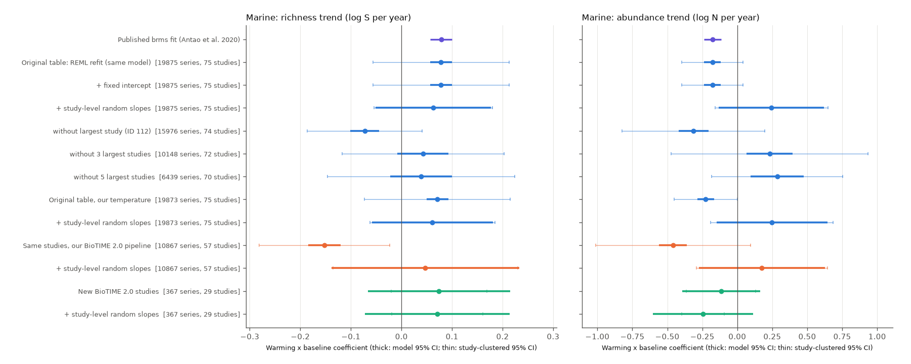
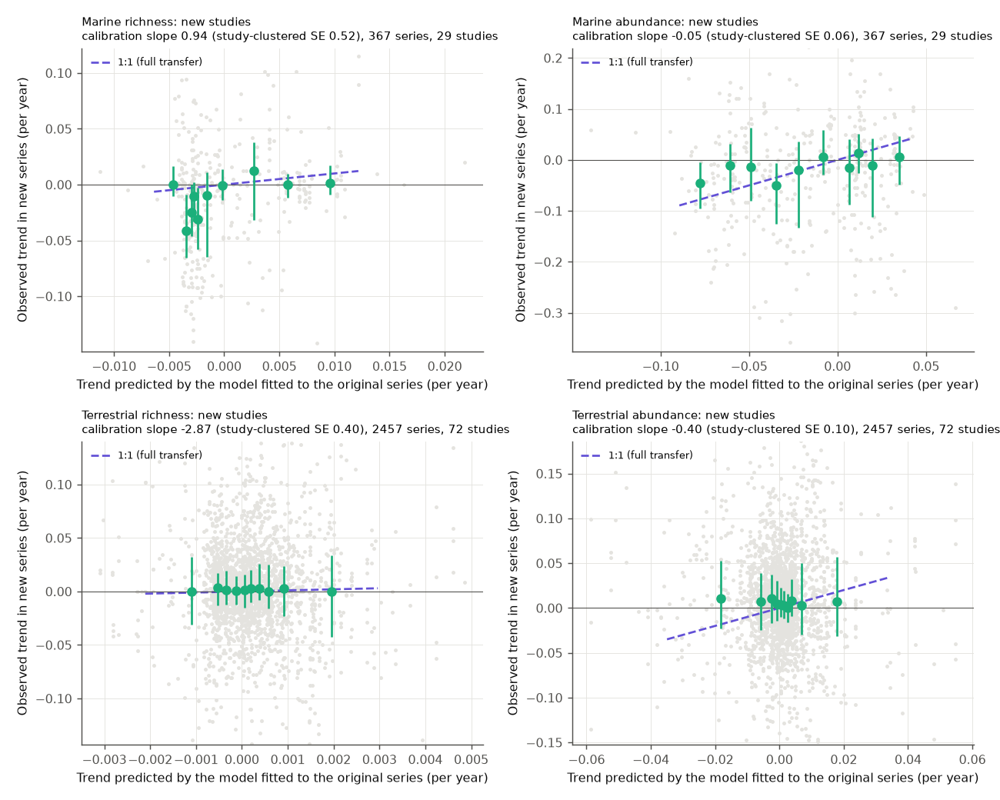
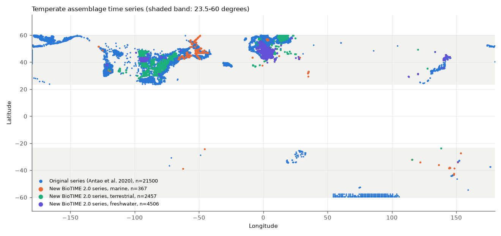

# Marine warming-by-baseline links to assemblage trends were not clear when the link could vary among studies (BioTIME, 2020 data and 29 new BioTIME 2.0 studies)

## Summary

Antao et al. (2020, Nature Ecology & Evolution 4:927) used 21,500 temperate BioTIME assemblage time series and reported two marine results. First, warming was linked to richness increases that were larger at warm baseline temperatures. Second, warming was linked to abundance decreases at warm baselines. On land they found no systematic link. We tested whether the two marine results are robust and whether they repeat in data that the original study did not use.

We did three tests.

1. **Re-analysis of the original series table.** We used the authors' published table of series trends. A frequentist REML version of their meta-regression gave the published estimates: richness warming x baseline 0.078 (published 0.079) and abundance -0.177 (published -0.177). An added fixed intercept changed nothing. The published model lets the warming effect vary only among 6 taxon groups. When we also let the warming and warming x baseline effects vary among the 75 marine studies, the richness term was 0.063 (95% CI -0.052 to 0.177). The abundance term changed sign to +0.244 (95% CI -0.13 to 0.62). Study-clustered standard errors of the original model were 6.3 times (richness) and 3.6 times (abundance) larger than its model standard errors. When we removed the largest study, the richness term changed sign to -0.073. This study is a commercial pelagic longline observer programme (BioTIME study 112, 19.6% of marine series, at warm baselines). When we removed 3 or 5 large studies, the abundance term changed sign to +0.23 and +0.29.
2. **Rebuilt series from BioTIME 2.0 for the same studies.** We gridded, coverage-filtered and rarefied the raw BioTIME 2.0 records again. The rebuilt trends agree with the original trends (r = 0.73 for series with the same years; r = 0.81 for marine study means). Study 112 and 28 other original studies are not in BioTIME 2.0. With the original model, the richness term was -0.153. With study-level random slopes it was +0.047 (95% CI -0.14 to 0.23).
3. **Out-of-sample test with studies first added in BioTIME 2.0.** We used 367 marine series from 29 new studies. The richness term was +0.074 (SE 0.072) and the abundance term was -0.116 (SE 0.142). These signs and sizes are near the published values, and the signs stayed the same in all 29 leave-one-study-out fits. But both intervals include zero. The model that we fitted to the original series predicted the new marine richness trends with a calibration slope of 0.94 (study-clustered SE 0.52). It did not predict the new marine abundance trends (calibration slope -0.05, SE 0.06). On land (2,457 new series, 72 studies) and in freshwater (4,506 series, 88 studies; not in the original study), the warming x baseline terms were small and not clear when effects could vary among studies.

**Conclusion.** The two marine results of Antao et al. (2020) are not robust. The model treats the series in each study as independent evidence about the warming effect, and a few large surveys supply most of the evidence. When the effect can vary among studies, neither term is clearly different from zero, and the abundance term can change sign. The new BioTIME 2.0 marine studies point in the published direction, but they are too few (29 studies) to confirm or reject the result. We do not show that warming has no effect. We show that these data do not give clear evidence for the reported interaction. The terrestrial null result of the original study repeated.

*Figure 1. Marine warming x baseline coefficients for richness (left) and abundance (right) trends. Purple: published brms estimate. Blue: the original series table. Orange: the same studies, rebuilt from BioTIME 2.0. Green: new BioTIME 2.0 studies. Thick bars: model 95% CI. Thin bars: study-clustered 95% CI.*

## Question and prior work

- Antao, L.H. et al. (2020) Temperature-related biodiversity change across temperate marine and terrestrial systems. Nat. Ecol. Evol. 4, 927-933. doi:10.1038/s41559-020-1185-7. Code and series table: https://github.com/lauraantao/Temp_Biodiv_Change (MIT).
- Blowes, S.A. et al. (2019) The geography of biodiversity change in marine and terrestrial assemblages. Science 366, 339-345 (gridding, coverage and rarefaction method).
- Dornelas, M. et al. (2025) BioTIME 2.0: expanding and improving a database of biodiversity time series. Global Ecology and Biogeography. Data: doi:10.5281/zenodo.15222193.

The campaign archive had no earlier publication on BioTIME or on Antao et al. (2020). Earlier campaign work on trawl-survey community temperature indices and range shifts (sci:sha256:566c05207cc6c7b1802d659122fab3152e1fcd1a7c488a5d1a08362a17f030ba and sci:sha256:58093808ecb2a86ee2ee789bec9ac0ee81c53408d54e43471041d519715ee6f4) uses different data and questions.

Question: is the reported marine coupling of assemblage richness and abundance trends to warming, conditional on baseline temperature, robust to among-study variation and to new data?

## Data

| Input | Version | Use |
| --- | --- | --- |
| BioTIME 2.0 query, metadata and references | Zenodo record 15222193, v4, files dated 15 April 2025 | raw records for rebuilt and new series; study licences |
| Antao et al. series table `lm_slopes_meta_temperature3.Rdata` and `ALLcoeffs_baselines.Rdata` | GitHub master, retrieved 2026-11-09 | original trends, original temperature change and baseline; published coefficients |
| Berkeley Earth Complete_TAVG_LatLong1.nc | file history 09-Jan-2025, data to Dec 2024 | land and freshwater temperature trends and baselines |
| HadISST1.1 monthly SST | Met Office, data to Sep 2026 | marine temperature trends and baselines |

`files/provenance/input_hashes.tsv` gives URLs, byte counts and SHA-256 hashes. On the campaign machine, the shared copies are in `datasets/biotime-v2-zenodo15222193-*`, `datasets/berkeley-earth-complete-tavg-latlong1-20261109` and `datasets/hadisst1-sst-nc-20261108-olen`.

## Methods

**Series construction** (`build_series.py`; follows Blowes et al. 2019). We put the samples of each study into equal-area cells of 96 km^2 (Lambert cylindrical equal-area squares; the original used ISEA3H resolution-12 hexagons of the same area). One series is one study in one cell. For count data, we removed cell-years with Chao & Jost sample coverage below 0.85. We kept cells with 5 or more sampled years and a centroid between 23.5 and 60 degrees absolute latitude. In each year we drew the minimum yearly number of samples 199 times without replacement, and used the median species richness S and total abundance N. The trends are OLS slopes of log S and log N on year, with their standard errors. For abundance-type studies, N is the summed abundance; for biomass-only studies, it is the summed biomass. Rows with no positive value count as 1.

**Study sets.** "Original" means the 156 studies (21,500 series) in the Antao table. 127 of these studies are in BioTIME 2.0. "New" means BioTIME 2.0 studies added in March 2024 (DATE_STUDY_ADDED = "Mar-24") that are not in the Antao table and have a span of 5 or more years: 284 studies, of which 29 marine, 72 terrestrial and 88 freshwater studies gave usable temperate series. BioTIME 2.0 added few years to the original studies: only 6 studies have 5 or more years after the original end year. Thus we did not do a separate time-extension test.

**Temperature.** The temperature change T is the OLS slope (deg C per year) of monthly anomalies over the first to last year of each series. For marine series we used HadISST1.1. These trends agree with the original HadSST3-based values (r = 0.97, n = 19,873). Berkeley Earth over coastal cells agreed less (r = 0.54), because it uses land air temperature in coastal grid cells, so we used it only as a sensitivity test. For land and freshwater series we used Berkeley Earth (r = 0.82 with the original CRUTEM-based values). The baseline B is the cell 1961-1990 (HadISST) or 1951-1980 (Berkeley Earth) annual mean. We mapped it linearly onto the original WorldClim/Bio-ORACLE baseline scale with the original series (`baseline_calibration.json`), and then standardised it with the original realm mean and SD. Freshwater series use the terrestrial mapping. Berkeley Earth ends in 2024, so series that end in 2025 use temperature to 2024.

**Models** (`lmm.py`, `analysis.py`). The original model is the brms model `slope | se(std.error, sigma = TRUE) ~ 0 + T*B + (0+T | taxa) + (1 | taxa/study)`. We fit it by REML with the known sampling variances (model A), with a fixed intercept (model B), and with independent study-level random slopes for T and T x B (model D). For every fit we also give a study-clustered sandwich SE. For the T main effect, this SE is not reliable, because T also has a taxon-level random slope that crosses studies. Series with constant S or N have SE = 0, which makes the likelihood degenerate when the residual variance is near 0. We set those SEs to the 1st percentile of the positive SEs. Without this floor, the fits without the largest study collapsed to a zero estimate.

**Transfer test** (`transfer.py`). We predicted each new series trend from the fixed effects that we fitted to the original table (model A, our temperatures), and from the published fixed effects. Then we regressed the observed trends on the predictions with a study random intercept. A calibration slope of 1 means full transfer; 0 means no transfer.

## Results

Warming x baseline (T x B) coefficients. Marine richness and abundance: Figure 1; all realms: `files/results/key_TxB.csv`; all terms: `fits.csv`.

| Data | Model | Marine richness T x B (SE) | Marine abundance T x B (SE) |
| --- | --- | --- | --- |
| Published brms (Antao et al. 2020) | original | 0.079 (0.011) | -0.177 (0.031) |
| Original table, original temperature | A (REML) | 0.078 (0.011; clustered 0.069) | -0.177 (0.031; clustered 0.112) |
| same | B (+ intercept) | 0.078 (0.011) | -0.177 (0.031) |
| same | D (+ study random slopes) | 0.063 (0.058) | +0.244 (0.192) |
| same, largest study removed | A | -0.073 (0.015; clustered 0.058) | -0.313 (0.054; clustered 0.260) |
| same, 3 largest studies removed | A | +0.043 (0.026) | +0.231 (0.084) |
| same, 5 largest studies removed | A | +0.039 (0.031) | +0.285 (0.096) |
| Original table, our temperature (HadISST) | A | 0.071 (0.011) | -0.226 (0.031) |
| same | D | 0.061 (0.061) | +0.248 (0.203) |
| Original table, Berkeley Earth coastal temperature | A | -0.027 (0.008) | -0.255 (0.022) |
| Same studies rebuilt from BioTIME 2.0 (10,867 series, 57 studies) | A | -0.153 (0.016; clustered 0.066) | -0.460 (0.051) |
| same | D | +0.047 (0.095) | +0.175 (0.230) |
| New BioTIME 2.0 studies (367 series, 29 studies) | A | +0.074 (0.072) | -0.116 (0.142) |
| same | D | +0.071 (0.073) | -0.246 (0.183) |

Leave-one-study-out on the new marine studies (`loso_new_marine.csv`): richness T x B from +0.038 to +0.105, abundance T x B from -0.285 to -0.043. All 29 fits have the same sign as the full fit.

Transfer to new studies (`transfer.csv`; Figure 2): marine richness calibration slope 0.94 (study-clustered SE 0.52; prediction-observation r = 0.21). Marine abundance: -0.05 (SE 0.06; r = 0.06). Published coefficients gave 0.76 (0.45) and -0.07 (0.08). For terrestrial series the predictions have almost no spread (SD 0.001-0.01 per year, against an observed SD of 0.05). Thus the terrestrial calibration slopes (-2.9 and -0.4) do not give useful information. This agrees with the original conclusion that there is no terrestrial coupling.

Land and freshwater (`fig_terrestrial_interaction.png`, `key_TxB.csv`). Terrestrial richness T x B was between -0.033 and +0.019 in all samples and models, and all intervals include zero. New terrestrial abundance: -0.024 (model A, SE 0.015) and -0.018 (D, SE 0.015). Freshwater (new only): richness +0.050 (A, SE 0.028) and +0.008 (D, SE 0.056); abundance +0.197 (A, SE 0.076) and +0.100 (D, SE 0.175).

*Figure 2. Observed trends in new BioTIME 2.0 series against the trends that the model fitted to the original series predicts. Green points: medians and interquartile ranges in deciles of the prediction. Dashed line: full transfer.*

*Figure 3. Locations of the original series (blue) and of the new BioTIME 2.0 series by realm.*

## Interpretation and observation bias

- **Concentration of evidence.** Five surveys supply 68% of the 19,875 original marine series: a pelagic longline observer programme (study 112, 3,899 series), two NW Atlantic trawl surveys (studies 180 and 213), a California seabird survey (169) and the North Sea IBTS (210). Each cell of a survey is a separate series, but the series in a survey share gear, effort changes, taxonomy and regional climate. When the warming effect can vary among studies (model D), the effective sample is close to the number of studies, and the marine terms are not clear. Study 112 records fishery-observer catch. Its "assemblage" changes depend on where and how the fleet fished, and these are not standardised survey data. Removing this study changed the richness sign.
- **Temperature product.** The marine richness term changed sign when coastal Berkeley Earth trends replaced SST trends. Thus the result also depends on how coastal temperature change is defined.
- **What remains.** The new marine studies give estimates with the published signs. Thus a real but smaller and study-dependent interaction is possible. More independent marine studies are necessary to test it.

## Limitations

- Our REML fit is a frequentist approximation of the brms model. It gave the same point estimates and model SEs as the published fit.
- Our rebuilt series use square cells, not hexagons. The cell-level trends thus differ from the original trends (r = 0.73 for series with the same years).
- The new marine sample is small (29 studies, 367 series) and mostly from the NW Atlantic and Europe.
- Baselines come from coarse 1-degree climatologies that we mapped onto the original scale. They are not the original WorldClim/Bio-ORACLE values.
- The study-clustered SE assumes independence between studies. For the T main effect it is not reliable (see Methods), so we do not interpret it.
- Freshwater was not part of the original study. We give freshwater results only as an extension.

## Reproduce

1. `bash files/code/fetch_inputs.sh SCRATCH` downloads all inputs into a local scratch folder (not into this publication). Compare the hashes with `files/provenance/input_hashes.tsv`. Berkeley Earth and HadISST are updated in place, so newer downloads can differ in the last months.
2. Install `pyreadr` (for example `pip install --target pylib pyreadr --no-deps`). The other requirements are Python 3.12 with numpy, scipy, pandas, pyarrow, xarray, netCDF4 and matplotlib.
3. In an empty work folder: `bash run_all.sh <path>/files/code SCRATCH 12`. With 12 processes on the campaign machine, the full run took less than one hour; most of the time is in reading the RDS file and in the study-level random-slope fits.
4. Outputs: `out/fits.csv`, `out/transfer.csv`, `out/loso_new_marine.csv`, `out/validation_summary.json` and `figs/*.png`. They correspond to the files in `files/results` and `files/figures`. Rarefaction uses fixed per-study seeds.

## Files

- `files/code/`: all analysis code (MIT, see LICENSE).
- `files/results/fits.csv`: all model coefficients. `key_TxB.csv`: T x B terms with intervals. `transfer.csv`, `loso_new_marine.csv`, `validation_summary.json`, `baseline_calibration.json`.
- `files/results/series_trends_open_licence_studies.csv`: our rebuilt richness and abundance trends for 13,806 series from the 202 studies whose BioTIME licence is CC0, public domain or CC BY. Series from studies with other licences (ODbL, ODC-By, OGL, non-commercial, share-alike or custom terms) are not included. The scripts regenerate them. This file has no temperature columns, because Berkeley Earth (CC BY-NC) and HadISST (academic use) terms do not allow redistribution under the baseline licence.
- `files/provenance/studies_used.csv`: every BioTIME study that we used, with number of series, licence text, licence class and source link. `input_hashes.tsv`: input URLs and hashes. `studies_antao.txt`, `studies_new.txt`: study lists.
- `files/EXTERNAL_DATA_NOTICE.md`: attribution and terms of the external data.

## Provenance of this work

Campaign 11_07_2026, job sci-1107-dell-climate-pollution-biodiversity-b6e2d2ee064e, topic climate-pollution-biodiversity, machine dell, model Claude Opus 5.5 (claude-opus-5-5), run on 2026-11-09. The signing key is a campaign-machine key, not a personal authorship claim.
